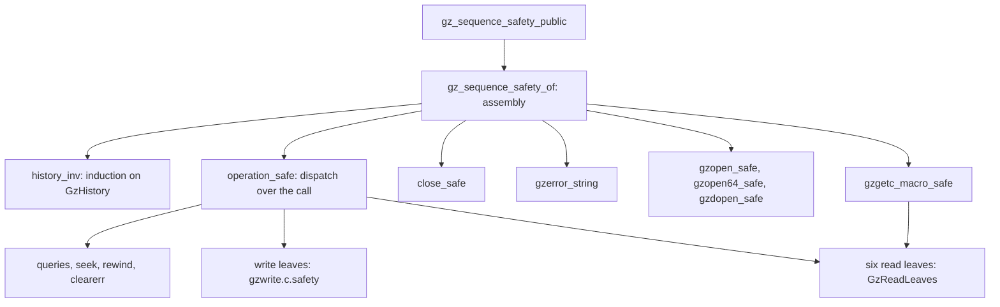
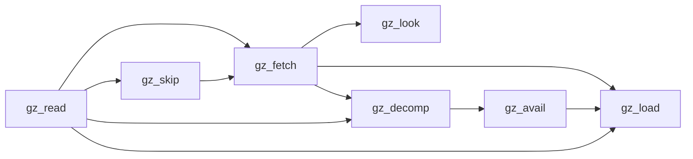

# Gzip files: the invariant, histories and the OS oracle

The gzip file interface (`gzopen`, `gzread`, `gzwrite`, `gzseek`, `gzclose` and the other `gz`
functions) is safe on every history of a handle, whatever the operating system returns. This
page gives the statement, separates what it assumes, and explains the shape of the proof.

Sources: `gzlib.c`, `gzread.c`, `gzwrite.c`, `gzclose.c`, `gzguts.h` and the `gzgetc` macro of
`zlib.h`. The [API pages](../spec/api/gz-file.md) give the caller-visible behaviour. Terms:
[glossary](../glossary.md).

## The result

| Goal | Theorem | Module |
| --- | --- | --- |
| `Goal.gz_sequence_safety` (`ZlibF/Spec/Public/GzSafety.lean`) | `gz_sequence_safety_public` | `ZlibF/Proof/public-gz-sequence-safety.lean` |
| `Goal.gz_refusal` (`ZlibF/Spec/Public/GzRefusal.lean`) | `gz_refusal` | `ZlibF/Proof/public-gz-refusal.lean` |
| `Goal.gz_sequence_nonvacuity` (`ZlibF/Spec/Public/GzSafety.lean`) | `gz_sequence_nonvacuity_public` | `ZlibF/Proof/public-gz-sequence-nonvacuity.lean` |

All three are safety results and are required. They are
[registered](../checking/README.md) in `tests/audit/theorems.txt` and
[accepted](../checking/README.md) on commit `bde170e9`.

The 31 documented gz functions are proved safe through the sequence goal. No gz function has a
one-function safety goal: the manifest `tests/audit/public-api.json` names
`Goal.gz_sequence_safety` as the safety goal of each of the 31, and `tests/audit/goals.txt`
lists no other safety goal for them ([progress, Scope](../progress.md#scope)). `gzvprintf`,
which `zlib.h` lists as undocumented, is also one of the calls the sequence goal covers
(`GzOperation`); `gzprintf` goes through it. The manifest names no safety goal for it. Each
function also has a functional contract `Goal.<function>`. These contracts are not required;
[the last section](#functional-results-that-stay) says which are proved.

The sequence goal covers a program such as this one. The comments name the clause of the goal
that covers each call.

```c
gzFile f = gzopen(path, "rb");      /* clause 6: the open returns; no leak when it fails */
n = gzread(f, buf, len);            /* clause 2; that it returns needs a finite source */
c = gzgetc(f);                      /* clause 3: the macro of zlib.h */
msg = gzerror(f, &err);             /* clauses 2 and 4: msg is a readable string */
gzclose(f);                         /* clause 5: everything is freed, also when close fails */
```

Between two calls the program may change its own memory, and anyone may change the file
system. The goal holds for all such histories.

## What the goal states

A *world* is a state of the file system, the descriptor table, `errno` and the oracle that
chooses the results of system calls ([below](#the-world-and-its-oracle)). A *history* of a
handle is a sequence of steps that starts at a successful open ([below](#histories)).
`Goal.gz_sequence_safety` has seven clauses.

1. **Invariant.** After every history the world is well formed (`FileSystem`) and the handle
   satisfies the representation invariant `GzInv`.
2. **One more call.** For every history, every next public call on the handle with permitted
   arguments, and every world, three parts hold.
   - (a) *No undefined behaviour and no memory error.* The run does not end in `Fault.ub`. This
     part has no further premise.
   - (b) *Termination.* The run does not end in `Fault.outOfFuel`, so with (a) the call
     returns. For the six reading calls `gzread`, `gzfread`, `gzgetc`, `gzgetc_`, `gzgets` and
     `gzungetc` this part needs the read-budget premise `ReadsFinite`. For every other call it
     holds in every world.
   - (c) *Effect of a call that returned.* The set of open descriptors is the same
     (`FdsKept`). The handle is in `GzInv` again, with the same mode and descriptor. The call
     wrote only the handle's blocks and the caller regions declared for that call. The live
     blocks changed only by blocks the handle owns: every new live block is owned by the handle,
     and every block that is gone was owned by it (`GzStepPost`). So nothing leaks.
3. **The `gzgetc()` macro.** A use of the macro has the same three parts, with its own
   termination split (see [the macro](#the-gzgetc-macro)).
4. **The string of `gzerror`.** The pointer `gzerror` returns is a NUL-terminated string that
   is readable in the heap after the call: a literal or the handle's message.
5. **Close.** Every close call returns. It refuses on the wrong mode and changes nothing, or it
   frees the record and every owned block and releases the descriptor, also when `close`
   reports `-1` (`GzReleased`).
6. **Open.** `gzopen` and `gzopen64` return. A failed open leaves no new block and no new open
   descriptor. A successful open gives a handle in `GzInv` that owns exactly the new blocks.
   Its descriptor number is not negative and was not open before the call, and no other
   descriptor number was opened or closed (`GzOpenSafe`). The clause does not state that the
   handle's descriptor is open after the call.
7. **`gzdopen`.** It returns and opens or closes no descriptor (`GzDopenSafe`).

Without `ReadsFinite`, part (a) still holds for a reading call. It is then partial
correctness: no undefined behaviour in any run of fewer than `2^64` trips of each loop. No
real execution reaches that count.

## What is assumed

Three different things stand behind the result: premises, a trusted model, and patches to the
source. Only the first is in the Lean statement.

### Premises in the statement

Each is explicit in `Goal.gz_sequence_safety` or in `GzHistory`, the histories it quantifies
over. The rows are in [deviations](../deviations.md#gzip-file-interface).

| Premise | Where | Meaning |
| --- | --- | --- |
| Caller heap and world at an open | `GzHistory.open`, `open64`, `dopen`; `GzOpenSafe`, `GzDopenSafe` | The heap is well formed (`Fresh`, `Uniq`, `LibraryGlobals`), every byte object has fewer than `2^63` bytes (`ByteObjectsFit`), the world is well formed (`FileSystem`), and `path` and `mode` are NUL-terminated strings (or `NULL`, in clauses 6 and 7). |
| Caller buffers | `GzArguments`, through `GzRange` | The buffers of `gzread`, `gzfread`, `gzwrite`, `gzfwrite`, `gzputs`, `gzgets` and `gzerror` are readable for the requested length, writable where the call stores into them, and lie apart from the blocks the handle owns. The argument of `gzputs` is a NUL-terminated string. A request of length 0, a request that the C refuses for its size, and a `NULL` `errnum` of `gzerror` carry no buffer premise. |
| Arguments of `gzprintf` and `gzvprintf` | `GzArguments` | The format is one the model's formatter represents for its arguments (`Formatted`; the [format language](../design/external-io.md#formatted-output)). The format and every `%s` argument lie apart from the handle's blocks. |
| Read budget | `ReadsFinite` | The handle's descriptor can still deliver fewer than `2^61` bytes. It is a premise of part (b) only, and only for the six reading calls. The premise also says that the descriptor number is not negative. Every handle the library returns has such a number: `GzOpenSafe` states it for `gzopen`, and `gzdopen` returns `NULL` for a negative descriptor. |
| Caller step between two calls | `GzHistory.caller`: `GzCallerFrame`, `ByteObjectsFit` | The caller changes only blocks that the handle does not own. The heap after the change is well formed (`Fresh`, `Uniq`, `LibraryGlobals`), and every byte object in it has fewer than `2^63` bytes. |
| World step between two calls | `GzHistory.world`: `GzWorldStep` | The new world is well formed (`FileSystem`). Nothing else is asked. |

### Trusted, not in the statement: the world model

The world and its oracle are a model of Linux written in Lean
([external I/O](../design/external-io.md)). The kernel checks the proof against that model. It
does not check the model against Linux ([trusted base](../trusted-base.md)). Two facts of the
model carry weight in the proof:

- a `write` of a nonempty buffer never returns 0;
- `close` releases the descriptor also when it fails.

### The source is the patched source

The statements are about the C with patches 0002 to 0005 applied. Without them the unpatched C
has undefined behaviour on some histories: see
[source reports and patches](#source-reports-and-patches).

### Why the read budget

A finite budget is a real requirement, not an artefact of the model. An endless source makes
one `gzread` call run forever in C: an endless `FNAME` field, or endless empty gzip members.
`zlib.h` does not promise that a read returns on such a source.

The figure `2^61` is the model's limit. A loop of the model has `2^64` trips of fuel. The
reading loops are bounded by measures built from the input left, the read budget and the
bytes still to deliver. A budget below `2^61` keeps those measures below `2^64`.

The premise goes by call name (`NeedsReadBound`). So it is also asked where the C returns at
once: a reading call on a writer, or a request of length 0. `gzdirect` has no reading loop
and needs no budget. `gzseek` defers its skip and needs none either.

## Source reports and patches

The invariant has its form because of six reports against the unpatched C. The labels R-1 to
R-4, F-1 and W7 are the names these reports have in `patches/README.md`, in
[findings](../findings.md) and in the Lean comments. `patches/README.md` is the authoritative
list of patches.

- R-1 and R-2 are reproduced under sanitizers. Their fixes are submitted upstream and applied
  as patches 0002 and 0003.
- F-1 and W7 are reproduced under sanitizers. R-3 and R-4 are undefined by the letter of C,
  and no sanitizer reports them. The fixes for these four are the local patches 0004 and 0005,
  approved by the owner and not submitted upstream.

| Case | Behaviour of the unpatched C | Fix and evidence |
| --- | --- | --- |
| R-1: negative seek position | After an initial `gzungetc`, `GZ_OFF_MAX - pos` or a later position difference overflowed signed 64-bit arithmetic. | Reproduced: [gzseek-pushback-overflow](../findings/gzseek-pushback-overflow/README.md). Upstream [PR 1361](https://github.com/madler/zlib/pull/1361), applied as patch 0002. The pull request is open. |
| R-2: partial read then error | In the `COPY` case of `gz_fetch`, `gz_load` could leave a nonzero `x.have` on error before `x.next = out` ran; `gz_read` then copied from a stale pointer. | Reproduced: [gzread-transparent-stale-next](../findings/gzread-transparent-stale-next/README.md). Upstream [PR 1363](https://github.com/madler/zlib/pull/1363), applied as patch 0003. The pull request is open. |
| R-3: unwritten pointer | `gz_reset` leaves `x.next` unwritten; `gzseek64` and `gz_skip_have` added zero to it. | [Finding](../findings/gz-reset-next-uninitialised/README.md), shown with a probe. Local patch 0005 advances `x.next` only by a nonzero count. A `NULL` initialisation would not do: `NULL + 0` is undefined in C. |
| R-4: caller-buffer lifetime | A direct read sets `x.next` into the caller's buffer and keeps it with `x.have = 0`. After the caller freed the buffer, `gzseek64` and `gz_skip_have` added zero to it. | [Finding](../findings/gz-next-dangling-after-direct-read/README.md), shown with a probe. Local patch 0005. `gzseek64_dangling_next_ok` shows that the patched seek does not use the pointer. |
| F-1: read position overflow | A transparent seek on a device whose `lseek` succeeds without moving set `x.pos` to `GZ_OFF_MAX`; the next read overflowed it. | Reproduced: [gzread-pos-overflow](../findings/gzread-pos-overflow/README.md). Local patch 0004 keeps `x.pos + x.have ≤ GZ_OFF_MAX` on return from every call. |
| W7: write position overflow | A forward seek of a transparent writer to near `GZ_OFF_MAX`, then a write, overflowed `x.pos`. | Reproduced: [gzwrite-pos-overflow](../findings/gzwrite-pos-overflow/README.md). Local patch 0004 refuses a write that would pass `GZ_OFF_MAX`. |

An unconfirmed experiment on `gzsetparams` is kept in the
[earlier proof notes](../history/proof-earlier-notes.md#gzsetparams-experiment).

## Histories

`GzHistory h fs i` says that heap `h` and world `fs` are reached by some actual history of
handle `i`. It has seven constructors; the table puts the three opens in one row.

| Constructor | Step |
| --- | --- |
| `open`, `open64`, `dopen` | A successful `gzopen`, `gzopen64` or `gzdopen` from a caller heap and a world that satisfy the first row of the [premise table](#premises-in-the-statement), with string arguments that are not `NULL`. |
| `step` | A public call on the handle (`GzOperation`) with permitted arguments (`GzArguments`) that returned. |
| `getcMacro` | A use of the `gzgetc()` macro that returned. |
| `caller` | The caller changes its own memory: any block the handle does not own. It may free its buffers, including the last `gzread` buffer. The heap after the change is well formed (`GzCallerFrame`: `Fresh`, `Uniq`, `LibraryGlobals`) and its byte objects fit (`ByteObjectsFit`). The world is unchanged. |
| `world` | Another party changes the world (`GzWorldStep`): to any well-formed file-system state. The heap is unchanged. |

The `world` step is deliberately wide. Another handle or the application may close the
handle's descriptor, or open another file under its number. The next read or write then gets
an error or reaches the other file, as in C. The step may also replace the oracle.

`GzHistory` has no budget premise, so clause 1 holds on every history. The functional gz goals
are stated over a different predicate, `GzReachable`; the safety goal does not use it.

## The world and its oracle

The world is a record `Fs` beside the heap (`ZlibF/Zlib/gzfs.lean`). A gz computation takes a
world and a heap and returns a value and both, or a fault. The world holds files, the
descriptor table, `errno`, and an oracle that chooses the result of every `read`, `write`,
`lseek`, `close`, `open` and caller-format `vsnprintf` within the contract of that call.
[External I/O](../design/external-io.md#the-os-oracle) has the table of what the oracle may
choose.

The oracle is wider than any real system: for example, a read may succeed whatever the
descriptor's state. Every clause quantifies over all worlds, so no proof step can depend on the
file being a regular file.

The external calls fall into two groups.

- **The five system calls leave the heap alone.** The model functions `fsRead`, `fsWrite`,
  `fsLseek`, `fsClose` and `fsOpen` take a world and return a result and a new world. For every
  oracle value each is `pure` of a result that depends on the world only: it never faults and
  never changes the heap (`fsRead_pure`, `fsWrite_pure`, `fsLseek_pure`, `fsClose_pure`,
  `fsOpen_pure`, in `ZlibF/Proof/gzfs.oracle.lean`). `fsRead` returns the bytes it read as a
  value. The translation of `gz_load` then stores them at `buf` (`storeBytes`); that store is
  an ordinary checked heap store, and it is a step of the translated C, not of the system call.
- **Two library calls change the heap.** `vsnprintf` stores into its destination: the formatted
  bytes and a NUL, or, when the oracle makes the call fail, bytes of the oracle's choice and a
  NUL, in both cases inside the `size` bytes it was given. It faults when the format is not a
  string or is one the model's formatter does not represent, or when the destination is not
  writable for those bytes. `vsnprintf_in` (`ZlibF/Proof/gzwrite.c.printf-run.lean`) shows that
  the call in `gzvprintf`, whose destination is in the handle's `in` buffer, returns for every
  oracle value, keeps `GzInv` and writes only blocks the handle owns. `zstrerror`, the model
  of `strerror(errno)`, allocates nothing and returns a borrowed string that is not a heap
  block. It changes one heap field, `libcErrorBorrow`, which records which error text is on
  loan; no block, liveness flag or allocator field changes (`zstrerror_run`,
  `zstrerror_no_malloc`, in `ZlibF/Proof/gzfs.borrowed-error.lean`).

The contract of `read` and its budget accounting (`BudgetAcc`) are in
`ZlibF/Proof/gzfs.read-contract.lean`. The contract of `write` for every oracle value is in
`ZlibF/Proof/gzwrite.c.comp.lean`.

## Proof structure



Safety of one call has one shape, `GzCallSafe i call`: for every heap, world and record in
`GzInv` and every permitted argument, the three parts of clause 2 hold. A *leaf* is a lemma
that proves `GzCallSafe` for one public function.

The assembly (`ZlibF/Proof/gz.sequence-safety.lean`) has two steps.

- `history_inv` goes by induction on `GzHistory`. The open constructors use the open
  lemmas. A `step` uses part (c) of the call's leaf. A `caller` step uses
  `GzInv.caller`: the invariant reads the handle's blocks, which the step keeps, and the
  well-formedness and byte-object size of the whole heap, which the step supplies for the new
  heap. A `world` step changes no heap, and the invariant does not mention the world.
- `operation_safe` dispatches a call to its leaf. `close_safe` does the same for the three
  close calls.

The leaves of the read side are bundled in `GzReadLeaves`: `gzread_step`, `gzfread_step`,
`gzgetc_step`, `gzungetc_step`, `gzgets_step` and `gzdirect_step`. `gzgetc_` is `gzgetc` by
definition, so it has no leaf of its own. (`gzdirect` is on the read side but is not one of the
six calls that need the read budget.) `gz_sequence_safety_of` takes the bundle as its only argument, and
`gz_sequence_safety_public` supplies it. Every leaf is a theorem with no premise.

## The invariant `GzInv`

`GzInv h i s` (`ZlibF/Proof/gz.inv-model.lean`) is the representation invariant of an open
handle `i` with record `s`. It has a common part and a part per mode. Other modules use its
interface lemmas (`GzInv.common`, `GzInv.reader`, `GzInv.writer`, `GzInv.state_eq`,
`GzInv.pos_lower`) and do not unfold the definition.

The fields it speaks about are those of `gz_state` in `gzguts.h`:

| Field | Meaning in the C |
| --- | --- |
| `x.have`, `x.next`, `x.pos` | The public prefix `gzFile_s`: bytes of output buffered at `x.next`, and the position in the uncompressed data. The `gzgetc` macro reads and writes them directly |
| `mode`, `fd`, `path` | Read or write; the descriptor; the name for error messages |
| `size`, `want` | The buffer size, 0 while the buffers do not exist; the requested size |
| `in`, `out` | The input and output buffers |
| `strm` | The embedded `z_stream`; below, "the codec" is the inflate or deflate state behind it |
| `how` | Reader: `LOOK` (look for a gzip header), `COPY` (copy the input unchanged, "transparent"), `GZIP` (inflate a gzip member) |
| `direct` | 0 when processing gzip, 1 when transparent. A reader opened for gzip only (mode letter `G`) holds -1 until `gz_look` selects gzip decoding |
| `junk` | Reader: -1 at the start, 1 for a junk candidate, 0 inside gzip data |
| `eof`, `past`, `again` | The input ended; a read was asked past the end; the last I/O was refused with `EAGAIN` |
| `skip` | The distance of a pending seek |
| `err`, `msg` | The error code and message |

On the LP64 build, offsets are signed 64-bit with `GZ_OFF_MAX = 2^63 - 1`, and one I/O request
is at most `2^30` bytes.

The three lists below are a summary in plain words. Clause names are in parentheses where
the page uses them later.

**Common part (`GzCommon`).**

- The record is in the heap and the mode is read or write.
- The heap is well formed (`Fresh`, `Uniq`, `LibraryGlobals`) and every byte object has fewer
  than `2^63` bytes (`ByteObjectsFit`). The embedded codec needs both at each of its calls.
- `path` is an owned NUL-terminated string. `msg` is `NULL` or an owned string, and is `NULL`
  after `Z_MEM_ERROR`.
- `8 ≤ want < 2^31`, and `size` is 0 or `want`. `size = 0` means that the buffers and the
  codec do not exist yet.
- The owned blocks are live, distinct, different from the record, and not owned by the
  embedded codec. The codec does not own the record block.
- Positions: `0 ≤ skip`, `x.pos + skip ≤ GZ_OFF_MAX`, and `0 ≤ x.pos + x.have`.
- `x.next`: with buffered output (`x.have ≠ 0`) it points into an owned block other than the
  record and the message, with `x.have` bytes after it (`next`). With `x.have = 0` the
  invariant says nothing about where it points. A `NULL` `x.next` has `x.have = 0`.

**Reader part (`GzReadInv`).**

- `how` is `LOOK`, `COPY` or `GZIP`, with the permitted values of `direct`, `junk` and the
  flags `eof`, `past`, `again`.
- Without buffers (`size = 0`) there is no codec (`strm.state = NULL`), no buffered output and
  no pending input; `how` is `LOOK` and `again` is 0.
- With buffers (`size ≠ 0`), `in` is a writable block of exactly `size` bytes and `out` one of
  exactly `2·size`.
- Pending input (`avail_in ≠ 0`) lies in `in`: `next_in = in + a` with `a + avail_in ≤ size`.
  Buffered output lies in `out`: `x.next = out + c` with `c + x.have ≤ 2·size`.
- With buffers, the embedded stream is in the inflate history (`StreamReachable .inflate`),
  with no header record.
- `x.pos + x.have ≤ GZ_OFF_MAX` (`posHave`).
- Buffered output means no pending skip (`haveSkip`).
- A reader that stalled at the end of its input has no pending input (`againEof`).
- `err` is never `Z_STREAM_END`. `COPY` has no pending input. With buffers, the stream's
  message is `NULL` or a literal.

**Writer part (`GzWriteInv`).**

- `x.have = 0`. The `gzgetc` macro reads `x.have` on any handle.
- `direct` is 0 (a compressing writer) or 1 (a transparent writer), and `reset` is 0 or 1.
- Without buffers there is no codec (`strm.state = NULL`).
- With buffers, `in` is a writable block of exactly `2·size` bytes. A compressing writer has
  `out` with exactly `size` bytes. A transparent writer has no codec, and the invariant does
  not count `out` among its owned blocks; it says nothing else of that field.
- `next_in` is `NULL` with `avail_in = 0`, or the buffers exist and the pending input lies in
  the first half of `in`: `next_in = in + a` with `a + avail_in ≤ size`.
- For a compressing writer with buffers, `next_out = out + b` and `x.next = out + c` with
  `c ≤ b ≤ size`, and `avail_out = size - b`. The embedded stream is in the deflate history,
  with no gzip header record.

The complete statement is the definition `GzInv` in `ZlibF/Proof/gz.inv-model.lean`, with its
parts `GzCommon`, `GzReadInv` and `GzWriteInv`; where this summary and the definition differ,
the definition holds.

Each clause exists because a call needs it. Three examples show the pattern.

- Without `posHave`, the buffered path of `gzgetc` overflows `x.pos`.
- Without `haveSkip`, `gzgetc` returns a buffered byte while a skip is pending and moves
  `x.pos` past `GZ_OFF_MAX - skip`.
- Without `againEof`, `gz_read` loops forever: `gz_avail` reads nothing at `eof`, and
  `gz_look` returns 0.

Two weaker forms hold inside a reading call. `GzInvUpToOutput` is `GzInv` of the record with
its buffered output cleared: a direct read leaves `x.next` in the caller's buffer.
`GzInvUpToSkip` is `GzInv` without `haveSkip`: `gz_look` and `gz_fetch` may buffer output
while a skip is pending, and the caller consumes it before it returns.

### Pointer fields of a fresh record

`gz_open` does not write `strm.state`, `strm.next_in` or `x.next`. In the model a fresh
pointer is `NULL`. In C it is indeterminate, and reading it is undefined
([safety, section 3](../spec/safety.md#uninitialised-memory)).

- `strm.state` and `strm.next_in`: the invariant states `strm.state = NULL` while `size = 0`.
  The proof shows safety for the translation. It does not show that C code which read an
  indeterminate pointer would be caught: that is the model gap of
  [trusted base](../trusted-base.md), section 2. **To confirm** by source review: the C never
  reads `strm.state` or `strm.next_in` before `gz_look` or `gz_init` writes them.
- `x.next`: the invariant claims nothing about it while `x.have = 0`, and with patch 0005
  every read or advance of `x.next` happens with `x.have ≠ 0`.

## Read side



`gz_load` accumulates bytes until the request is filled or a read stops it. A positive read
advances `have`; zero sets `eof`; a blocking refusal sets `again`; another failure sets an
error. A failure can follow successful partial reads.

`gz_look` sets up the buffers and the codec on its first call, then decides how to read. It
recognises gzip only with at least four available bytes: magic `31, 139`, method 8 and a
flags byte below 32. Otherwise the input is transparent when the mode allows it.

`gz_decomp` runs `inflate` on the embedded stream until the output is full, the member ends,
the input ends or an error occurs. The member-end path returns to detection, for
concatenated members.

`gz_read` has three data paths: consume buffered output, read transparent data directly into
the caller's buffer, or inflate directly into a large enough caller buffer.

The read helpers compose in `ZlibF/Proof/gz.read-assembly.lean`:

| Lemma | Statement |
| --- | --- |
| `gz_look_safe` | `gz_look` is safe (`gz.read-look.lean`). |
| `gz_decomp_safe_of` | `gz_decomp` is safe, given that an `inflate` call from mode `BAD` or `MEM` moves neither buffer (`gz.read-decomp.lean`). That fact is `inflateStuckNoOutput_holds` (`inflate.c.stuck-no-output.lean`). |
| `gz_fetch_safe_of` | `gz_fetch` is safe, given the two above (`gz.read-fetch.lean`). |
| `gzSkipRead_holds` | `gz_skip` is safe, given `gz_fetch` (`gzread.c.skip-fetch.lean`). |
| `gz_read_safe_of` | `gz_read` is safe, given the three above (`gz.read-read.lean`). |
| `gzread_step`, `gzfread_step` | The public calls, from `gz_read`. |

Each embedded `inflate` call uses the stream results of [stream decoding](inflate.md): the
embedded stream is reachable, so the full contract of one call applies.

### Termination of the read loops

Every reading loop has a measure, a natural number computed from the world and the handle.
With `ReadsFinite` the measure starts below `2^64` and falls on every trip that continues. The
table gives the shape of each measure; the exact definitions are `fetchMeasure`
(`gz.read-fetch.lean`), `fetchRank` (`gz.read-fetch-specs.lean`) and `readMeasure`
(`gz.read-read.lean`).

Write `inputLeft` for the read budget of the descriptor plus `avail_in`. `gz_avail` raises
`avail_in` by the bytes it reads, and the budget falls by the same bytes (`gz_avail_budget`,
`gz.read-budget.lean`). So `inputLeft` never rises.

| Loop | Measure | Why it falls |
| --- | --- | --- |
| `gz_decomp` | `inputLeft + avail_out` | It falls on each trip that continues. |
| `gz_fetch` | `4 · inputLeft + c`, with `c` = 2 for `LOOK`, 1 for `GZIP` at the head of a member, 0 for `COPY`, 3 otherwise | It falls on each trip that continues. An empty gzip member costs input, so endless empty members are excluded by the budget. |
| `gz_read` | `readMeasure`: with `L = min(len, GZ_OFF_MAX - pos)`, it is `L / 8 + Q + 2·E + 3·R + fetchRank`. `Q` is 1 with no buffered output; 2 with fewer than 16 buffered bytes, `err = Z_OK` and `x.pos + x.have < GZ_OFF_MAX`; 0 otherwise. `E` is 0 at the end of the input and 1 before it. `R` is 1 while `pos` is below `GZ_OFF_MAX`. `fetchRank` is `4 · inputLeft`, plus the read budget, plus 2 while a gzip member is under way past its head, plus 2 until `how` is `COPY` | It falls on each trip that continues. Neither `gz_decomp` nor `gz_fetch` raises `fetchRank`. |
| `gzgets` | Its loop variable `left` | It falls on each trip that continues. |
| `gz_skip` | `skipMeasureF` | `gzSkipTerminates_holds` (`gzread.c.skip-terminates.lean`), from `GzInvUpToSkip`. |

### Reader wrappers

The wrappers keep the check order of the C. `gzread` checks that its unsigned request fits
`int`. `gzfread` checks the `size_t` product before it divides. `gzgets` reserves room for
the NUL, bounds its `memchr` by `min(have, left)`, and writes the final NUL at `buf[len - 1]`
at most. `gzungetc` runs `gz_look` and `gz_skip` first, then pushes back inside `out`; it can
set `x.pos = -1` at the start of a file, which is why the invariant bounds `x.pos + x.have`
and not `x.pos`.

## The `gzgetc` macro

`zlib.h` defines `gzgetc` as a macro:

```c
#define gzgetc(g) \
          ((g)->have ? ((g)->have--, (g)->pos++, *((g)->next)++) : (gzgetc)(g))
```

It is the default way an application calls `gzgetc`, so the history has a constructor for it
(`GzHistory.getcMacro`) and the goal has a clause for it. The translation is
`Zlib.ZlibH.gzgetc`; the proof is `gzgetc_macro_safe` (`ZlibF/Proof/zlib.h.gzgetc-macro.lean`).

The macro has two branches.

- **Buffered output (`x.have ≠ 0`).** The macro changes `x.have`, `x.pos` and `x.next` inline,
  with no library call. Unlike the function, it does not clear `err` and `msg` when `again`
  is set. This branch returns with no premise on the world. `GzCommon.next` puts `x.next`
  inside an owned buffer with `x.have` bytes after it, `posHave` keeps `x.pos + 1`
  representable, and `haveSkip` gives `skip = 0`. A writer has `x.have = 0`, so the inline
  branch runs only on a reader.
- **No buffered output (`x.have = 0`).** The macro calls the function `gzgetc`. This branch
  is the read leaf `gzgetc_step`, and it returns under `ReadsFinite`.

In both branches the effect is that of the function, which writes no caller region.

On a `NULL` handle the macro reads `(g)->have` first, which is undefined behaviour in C.
`Goal.gz_refusal` states the `NULL` case for the function `(gzgetc)(file)` only.

## Write side

`gz_init` allocates the double input buffer and, for compressed output, the output buffer
and the codec. `gz_comp` writes the input directly for transparent output, or alternates
`deflate` calls and output writes. `gz_write` copies small input into `in`, or points
`next_in` at the caller's large buffer and resets it afterwards. `gz_zero` resolves a pending
forward seek by writing zeros. `gz_vacate` compresses pending data and moves the rest to the
front.

The write leaves are in `ZlibF/Proof/gzwrite.c.safety.lean`: `gzwrite_step`, `gzfwrite_step`,
`gzputc_step`, `gzputs_step`, `gzprintf_step`, `gzvprintf_step`, `gzflush_step`,
`gzsetparams_step` and `gzclose_w_step`. They use the facts of `gz_error`, which follow from
the invariant (`ZlibF/Proof/gzlib.c.error-inv-premises.lean`).

The loops of `gz_comp` terminate in every world, with no budget
(`ZlibF/Proof/gzwrite.c.comp.lean`). The write-out loop is measured by the bytes still to
write, and the transparent loop by the pending input. Both fall because a `write` of a
nonempty buffer returns `-1` or a count between 1 and the length. That is the trusted fact
about `write` [above](#trusted-not-in-the-statement-the-world-model). A `write` that returned 0
forever would make `gz_comp` spin in the C; [progress](../progress.md), section "Observations",
records that reading of the code. The deflate loop has its own measure, which falls whenever
the loop continues.

`gzvprintf` writes a sentinel at `next[size - 1]` and formats with capacity `size`. A length
outside `1..size-1`, or a lost sentinel, makes `gzvprintf` refuse the result.

`gzsetparams` flushes pending data, calls `deflateParams`, then stores the requested level
and strategy. It ignores the callee's result. The safety proof does not need that result.

## Positions, seeking and error ownership

`gztell64` reports the logical position plus a pending skip, unless `past` suppresses it.
`gzoffset64` queries the descriptor position and subtracts buffered compressed input in read
mode. These are different positions.

`gzseek64_step` and `gzseek_step` (`ZlibF/Proof/gz.inv-seek.lean`) hold for every world. The
paths are:

- a refusal (a serious error, a bad `whence`, a target outside the range of patch 0002):
  `-1`, nothing changes;
- a writer: `skip` becomes the distance; for a target behind `x.pos` the call returns `-1`;
- a reader in transparent mode: one `lseek`. The displacement `pos - x.pos - have` does not
  overflow, by `posHave`;
- a reader going back: `gzrewind`, then the whole distance becomes `skip`;
- a reader going forward, also from a negative `x.pos` after `gzungetc`: buffered bytes are
  consumed and the rest becomes `skip`.

`haveSkip` holds after each path. `lseek` may return anything the oracle chooses. It changes
only the call counter, `errno` and, for a regular file, the position of the one descriptor.
So the world stays well formed and the open descriptors are kept.

`gz_error` frees the old owned message first. A memory error allocates no new message; any
other message owns the allocation `path + ": " + text`. `gzerror` returns the memory-error
literal, the current message or the empty literal, and may store the code into the caller's
four-byte cell. `gzerror_step` and `gzerror_string` (`ZlibF/Proof/gz.inv-frame.lean`) show
that the store keeps the invariant and that the returned pointer is a string in the heap
after the call. The string is freed by the next call that reaches `gz_error`; the caller
premise on `gzprintf` arguments excludes passing it back to the same handle.

## Open and close

`gzopen_safe`, `gzopen64_safe` and `gzdopen_safe` show that a fresh handle is in `GzInv`
(`ZlibF/Proof/gz.inv-open.lean`, `gz.inv-open-fresh.lean`). An open gives `size = 0`, so
every clause about buffers or buffered output holds vacuously.

`gzclose` reads the mode and runs `gzclose_r` or `gzclose_w`
(`ZlibF/Proof/gz.inv-close.lean`). A handle in `GzInv` is a reader or a writer, so `gzclose`
never refuses. `gzclose_r` ends the codec when it exists, frees the buffers, the message, the
path and the record, and closes the descriptor. `gzclose_w` also resolves pending zeros and
finishes the output first. Cleanup happens also when those operations fail. A successful
`gzdopen` takes over the descriptor; a failed one leaves it with the caller.

## The `NULL` handle

`Goal.gz_sequence_safety` runs only on a real handle. `Goal.gz_refusal` states the `NULL`
case for 29 functions: for every heap, every world and every other argument, the call
returns its documented value and changes neither the heap nor the world. It has no
precondition. Each clause holds by evaluation, because each function tests `file == NULL`
first.

## Non-vacuity

`Goal.gz_sequence_nonvacuity` shows that the premises of the sequence goal can be met. It
gives two concrete histories, each from a caller heap and a world that satisfy every premise
of the opening constructor, with no allocation failure.

1. `gzopen` gives a reading handle in `GzInv` whose descriptor has a finite read budget. A
   one-byte `gzread` into a caller buffer satisfies `GzArguments`.
2. `gzdopen` on an open descriptor gives a writing handle in `GzInv` that keeps the
   descriptor. A one-byte `gzwrite` from a caller buffer satisfies `GzArguments`.

So clause 2, and its part (b) for a reading call, apply to a real call with a nonzero length.

## Functional results that stay

`tests/audit/goals.txt` lists one functional contract `Goal.<function>` for each of the 31
documented gz functions and for `gzvprintf`: 32 goals. None is required for the safety
results. `tests/audit/proved-goals.txt` lists eight of them as proved; their theorems are
registered.

- `Goal.gzbuffer`, `Goal.gzeof`, `Goal.gzerror`, `Goal.gzclearerr`, `Goal.gzdopen`: full
  contracts of single functions.
- `Goal.gzoffset64`, `Goal.gzoffset` and `Goal.gzrewind`: stated for the regular-file world
  (premise `RegularOs fs`).

Not proved, and not needed by the safety results:

- the other 24 functional contracts: `Goal.gzopen`, `Goal.gzopen64`, `Goal.gzclose`,
  `Goal.gzclose_r`, `Goal.gzclose_w`, `Goal.gzread`, `Goal.gzfread`, `Goal.gzgetc`,
  `Goal.gzgetc_`, `Goal.gzungetc`, `Goal.gzgets`, `Goal.gzdirect`, `Goal.gzwrite`,
  `Goal.gzfwrite`, `Goal.gzputc`, `Goal.gzputs`, `Goal.gzprintf`, `Goal.gzvprintf`,
  `Goal.gzflush`, `Goal.gzsetparams`, `Goal.gzseek`, `Goal.gzseek64`, `Goal.gztell` and
  `Goal.gztell64`;
- `Goal.gz_sequence`, the functional sequence goal;
- `Goal.gz_initialisation_domain`, the functional contract of `gzopen`.
