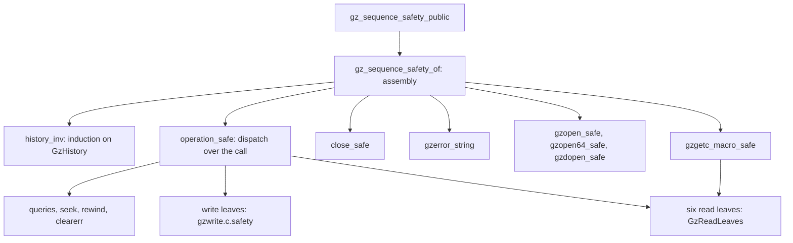
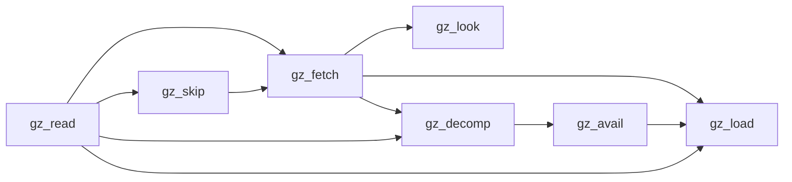

# Gzip files: the invariant, histories and the OS oracle

Sources: `gzlib.c`, `gzread.c`, `gzwrite.c`, `gzclose.c`, `gzguts.h` and the `gzgetc` macro of
`zlib.h`. The [API pages](../spec/api/gz-file.md) give the caller-visible behaviour. The
[external-I/O model](../design/external-io.md) defines the file system, `errno` and
`vsnprintf` that the translation calls.

The gzip file interface is safe on every history of a handle, in every file-system world.
This page explains that result: the statement, its premises and the shape of the proof.

## What is proved

| Goal | Theorem | Module |
| --- | --- | --- |
| `Goal.gz_sequence_safety` (`ZlibF/Spec/Public/GzSafety.lean`) | `gz_sequence_safety_public` | `ZlibF/Proof/public-gz-sequence-safety.lean` |
| `Goal.gz_refusal` (`ZlibF/Spec/Public/GzRefusal.lean`) | `gz_refusal` | `ZlibF/Proof/public-gz-refusal.lean` |
| `Goal.gz_sequence_nonvacuity` (`ZlibF/Spec/Public/GzSafety.lean`) | `gz_sequence_nonvacuity_public` | `ZlibF/Proof/public-gz-sequence-nonvacuity.lean` |

All three are safety results and are required. They are registered in
`tests/audit/theorems.txt` and accepted on commit `bde170e9`
([progress, Scope](../progress.md#scope)).

`Goal.gz_sequence_safety` has seven clauses.

1. Every history keeps the world well formed (`FileSystem`) and the handle in the
   representation invariant `GzInv`.
2. For every next public call on the handle, in every world:
   - the run never ends in a fault other than running out of loop fuel. There is no undefined
     behaviour and no memory error. This half has no premise;
   - the call returns. For `gzread`, `gzfread`, `gzgetc`, `gzgetc_`, `gzgets` and `gzungetc`
     this half needs the read-budget premise `ReadsFinite`. Every other call returns in every
     world;
   - a call that returns keeps the set of open descriptors (`FdsKept`), keeps `GzInv`, the
     mode and the descriptor, writes only the handle's blocks and the declared caller regions,
     and changes the live blocks exactly by the handle's ledger (`GzStepPost`). There is no
     leak.
3. A call of the `gzgetc()` macro has the same three parts, with its own termination split
   (see [the macro](#the-gzgetc-macro)).
4. The pointer `gzerror` returns is a NUL-terminated string that is readable in the heap
   after the call: a literal or the handle's message.
5. Every close call returns. It refuses on the wrong mode and changes nothing, or it frees
   the record and every owned block and releases the descriptor, also when `close` reports
   `-1` (`GzReleased`).
6. `gzopen` and `gzopen64` return. A failed open leaves no new block and no new open
   descriptor. A successful open gives a handle in `GzInv` that owns exactly the new blocks,
   and its descriptor is the only newly opened one (`GzOpenSafe`).
7. `gzdopen` returns and opens or closes no descriptor (`GzDopenSafe`).

The first half of clause 2 is partial correctness up to `2^64` iterations of each loop. No
real execution reaches that count.

## What is assumed

Every premise is explicit in the statement. The rows are in
[deviations](../deviations.md), section "Gzip file interface".

| Premise | Where | Meaning |
| --- | --- | --- |
| Caller heap at an open | `GzHistory.open`, `open64`, `dopen` | The heap is well formed (`Fresh`, `Uniq`, `LibraryGlobals`), every byte object has fewer than `2^63` bytes (`ByteObjectsFit`), and `path` and `mode` are NUL-terminated strings. |
| Caller buffers | `GzArguments`, through `GzRange` | The buffers of `gzread`, `gzfread`, `gzwrite`, `gzfwrite`, `gzputs`, `gzgets` and `gzerror` are readable or writable for the requested length and lie apart from the blocks the handle owns. |
| `gzprintf` arguments | `GzArguments` | The format is a represented format string for its arguments (`Formatted`). The format and every `%s` argument lie apart from the handle's blocks. |
| Read budget | `ReadsFinite` | The descriptor number is not negative (`0 ≤ fd`, in `HasBudget`) and can still deliver fewer than `2^61` bytes. It is a premise of termination only, and only for the six reading calls. A handle that `gzdopen` made from a negative descriptor other than -1 has no budget, so termination of its reading calls is not claimed. |
| OS facts | the oracle, trusted | A `write` of a nonempty buffer never returns 0. `close` releases the descriptor also when it fails. |
| Patched source | `patches/` | The statements are for the C with patches 0002 to 0005 applied. See [source reports](#source-reports-and-patches). |

The world model is part of the [trusted base](../trusted-base.md). The kernel checks the
proof against that model. It does not check the model against Linux.

### Why the read budget

A finite budget is a real requirement, not a model artefact. An endless source makes one
`gzread` call run forever in C: an endless `FNAME` field, or endless empty gzip members.
`zlib.h` does not promise that a read returns on such a source.

The figure `2^61` is the model's limit. A loop of the model has `2^64` trips of fuel. The
reading loops are bounded by measures built from the input left, the read budget and the
bytes still to deliver. A budget below `2^61` keeps those measures below `2^64`.

The premise goes by call name (`NeedsReadBound`). So it is also asked where the C returns at
once: a reading call on a writer, or a request of length 0. `gzdirect` has no reading loop
and needs no budget. `gzseek` defers its skip and needs none either.

## Histories

`GzHistory h fs i` says that heap `h` and world `fs` are reached by some actual history of
handle `i`. It has seven constructors.

| Constructor | Step |
| --- | --- |
| `open`, `open64`, `dopen` | A successful `gzopen`, `gzopen64` or `gzdopen` from a well-formed caller heap. |
| `step` | A public call on the handle (`GzOperation`) with permitted arguments (`GzArguments`) that returned. |
| `getcMacro` | A call of the `gzgetc()` macro that returned. |
| `caller` | The caller changes its own memory (`GzCallerFrame`): anything the handle does not own. It may free its buffers, including the last `gzread` buffer. |
| `world` | Another party changes the world (`GzWorldStep`): any well-formed file-system state. |

The `world` step is deliberately wide. Another handle or the application may close the
handle's descriptor, or open another file under its number. The next read or write then gets
an error or reaches the other file, as in C. The step may also replace the oracle.

`GzHistory` has no budget premise. The invariant clause of the goal holds on every history.
The histories replace the earlier predicate `GzReachable`, which belongs to the functional
contract of the regular-file world.

## The OS oracle

The world is a record `Fs` beside the heap (`ZlibF/Zlib/gzfs.lean`). A gz computation takes a
world and a heap and returns a value and both, or a fault. The world holds files, the
descriptor table, `errno`, and two oracles that choose the result of each external call.

| Call | Choices of the oracle |
| --- | --- |
| `read` (M1) | The regular-file read; `-1` with an `errno`; or any bytes, cut to the request and to the descriptor's budget. |
| `write` (M2) | The regular-file write; `-1` with an `errno`; or a count clamped to `[1, len]` for a nonempty buffer. |
| `lseek` (M3) | The regular-file `lseek`; `-1` with an `errno`; or any value up to `2^63 - 1`, without moving the descriptor. |
| `close` (M4) | May report `-1` with an `errno`. The descriptor is released anyway. |
| `open` (M5) | May fail with an `errno` before anything is created, or return another free descriptor number. |
| success `errno` | A successful call may leave any `errno`. |
| `vsnprintf` | A caller-format call may fail and leave arbitrary bytes before its NUL. |
| read budget (M7) | The bytes a descriptor may still deliver, or no bound. |

The oracle is wider than any real system. A `bytes` read succeeds whatever the descriptor's
state. Every goal quantifies over all worlds, so a proof cannot depend on a regular file.

Each external call is `pure` of a result that depends on the world only
(`ZlibF/Proof/gzfs.oracle.lean`). It never faults and never changes the heap. The contract of
`read` and its budget accounting (`BudgetAcc`) are in `ZlibF/Proof/gzfs.read-contract.lean`.
The contract of `write` for every oracle value is in `ZlibF/Proof/gzwrite.c.comp.lean`.

## The invariant `GzInv`

`GzInv h i s` (`ZlibF/Proof/gz.inv-model.lean`) is the representation invariant of an open
handle `i` with record `s`. It has a common part and a part per mode. Other modules use its
interface lemmas (`GzInv.common`, `GzInv.reader`, `GzInv.writer`, `GzInv.state_eq`,
`GzInv.pos_lower`) and do not unfold the definition.

On the LP64 build, offsets are signed 64-bit with `GZ_OFF_MAX = 2^63 - 1`, and one I/O request
is at most `2^30` bytes. The public `gzFile_s` prefix and the library's `x.have`, `x.next` and
`x.pos` are the same storage. That is how the `gzgetc` macro reaches them.

**Common part (`GzCommon`).**

- The record is in the heap and the mode is read or write.
- `path` is an owned NUL-terminated string. `msg` is `NULL` or an owned string, and is `NULL`
  after `Z_MEM_ERROR`.
- `8 ≤ want < 2^31`, and `size` is 0 or `want`. `size = 0` means that the buffers and the
  codec do not exist yet.
- The owned blocks are live, distinct, different from the record, and not owned by the
  embedded codec. The codec does not own the record block.
- Positions: `0 ≤ skip`, `x.pos + skip ≤ GZ_OFF_MAX`, and `0 ≤ x.pos + x.have`.
- `x.next`: with buffered output (`x.have ≠ 0`) it points into an owned buffer other than
  the message, with `x.have` bytes after it. With `x.have = 0` the invariant says nothing
  about it.

**Reader part (`GzReadInv`).**

- `how` is `LOOK`, `COPY` or `GZIP`, with the permitted values of `direct`, `junk` and the
  flags `eof`, `past`, `again`.
- Without buffers there is no codec, no buffered output and no pending input.
- With buffers, `in` has exactly `size` bytes and `out` exactly `2·size`. The pending input
  lies in `in`. The buffered output lies in `out`.
- The embedded stream is in the inflate history (`StreamReachable .inflate`), with no header
  record.
- `x.pos + x.have ≤ GZ_OFF_MAX` (`posHave`).
- Buffered output means no pending skip (`haveSkip`).
- A reader that stalled at the end of its input has no pending input (`againEof`).
- `err` is never `Z_STREAM_END`. `COPY` has no pending input. The stream's message is `NULL`
  or a literal.

**Writer part (`GzWriteInv`).**

- `x.have = 0`. The `gzgetc` macro reads `x.have` on any handle.
- With buffers, `in` has exactly `2·size` bytes. A compressing writer has `out` with `size`
  bytes. A transparent writer has no `out` and no codec.
- `next_in` is `NULL` with no pending input, or points into `in` with the pending input
  inside.
- For a compressing writer, `out ≤ x.next ≤ next_out ≤ out + size` in one block, and the
  embedded stream is in the deflate history, with no gzip header record.

Each clause exists because a call needs it. Three examples show the pattern.

- Without `posHave`, the buffered path of `gzgetc` overflows `x.pos`.
- Without `haveSkip`, `gzgetc` returns a buffered byte while a skip is pending and moves
  `x.pos` past `GZ_OFF_MAX - skip`.
- Without `againEof`, `gz_read` loops forever: `gz_avail` reads nothing at `eof`, and
  `gz_look` returns 0.

Two weaker forms hold inside a reading call. `GzInvUpToOutput` is `GzInv` of the record with
its buffered output cleared: a direct read leaves `x.next` in the caller's buffer.
`GzInvUpToSkip` is `GzInv` without `haveSkip`: `gz_look` and `gz_fetch` may buffer output
while a skip is pending, and the caller consumes it before it returns.

### Pointer fields of a fresh record

`gz_open` does not write `strm.state`, `strm.next_in` or `x.next`. In the model a fresh
pointer is `NULL`, which is weaker than C, where it is indeterminate
([safety, section 3](../spec/safety.md#uninitialised-memory)). The invariant states
`strm.state = NULL` while `size = 0`. **To confirm**: the C never reads `strm.state` or
`strm.next_in` before `gz_look` or `gz_init` writes them. For `x.next` the invariant claims
nothing while `x.have = 0`, and with patch 0005 every read or advance of `x.next` happens
with `x.have ≠ 0`.

## Proof structure

Safety of one call has one shape, `GzCallSafe i call`: for every heap, world and record in
`GzInv` and every permitted argument, the three parts of clause 2 hold. A leaf lemma proves
`GzCallSafe` for one function.

The assembly (`ZlibF/Proof/gz.sequence-safety.lean`) has two steps.

- `history_inv` goes by induction on `GzHistory`. The open constructors use the open
  lemmas. A `step` uses the third part of the call's leaf. A `caller` step uses
  `GzInv.caller`: the invariant reads only the handle's blocks. A `world` step changes no
  heap, and the invariant does not mention the world.
- `operation_safe` dispatches a call to its leaf. `close_safe` does the same for the three
  close calls.

The six read leaves are bundled in `GzReadLeaves`: `gzread_step`, `gzfread_step`,
`gzgetc_step`, `gzungetc_step`, `gzgets_step` and `gzdirect_step`. `gzgetc_` is `gzgetc` by
definition. `gz_sequence_safety_of` takes the bundle as its only argument, and
`gz_sequence_safety_public` supplies it. Every leaf is a theorem with no premise.

## Read side

`gz_load` accumulates bytes until the request is filled or a read stops it. A positive read
advances `have`; zero sets `eof`; a blocking refusal sets `again`; another failure sets an
error. A failure can follow successful partial reads.

`gz_look` sets up the buffers and the codec on its first call, then decides how to read. It
recognises gzip only with at least four available bytes: magic `31, 139`, method 8 and a
flags byte below 32. Otherwise the input is transparent when the mode allows it.

`gz_decomp` runs `inflate` on the embedded stream until the output is full, the member ends,
the input ends or an error occurs. The member-end path returns to detection, for
concatenated members.

`gz_read` has three data paths: consume buffered output, read transparent data directly into
the caller's buffer, or inflate directly into a large enough caller buffer.

The read helpers compose in `ZlibF/Proof/gz.read-assembly.lean`:

| Lemma | Statement |
| --- | --- |
| `gz_look_safe` | `gz_look` is safe (`gz.read-look.lean`). |
| `gz_decomp_safe_of` | `gz_decomp` is safe, given that an `inflate` call from mode `BAD` or `MEM` moves neither buffer (`gz.read-decomp.lean`). That fact is `inflateStuckNoOutput_holds` (`inflate.c.stuck-no-output.lean`). |
| `gz_fetch_safe_of` | `gz_fetch` is safe, given the two above (`gz.read-fetch.lean`). |
| `gzSkipRead_holds` | `gz_skip` is safe, given `gz_fetch` (`gzread.c.skip-fetch.lean`). |
| `gz_read_safe_of` | `gz_read` is safe, given the three above (`gz.read-read.lean`). |
| `gzread_step`, `gzfread_step` | The public calls, from `gz_read`. |

Each embedded `inflate` call uses the stream results of [stream decoding](inflate.md): the
embedded stream is reachable, so the full contract of one call applies.

### Termination of the read loops

Every reading loop has a measure over the world. With `ReadsFinite` the measure starts below
`2^64` and falls on every trip that continues.

- `inputLeft` is the read budget of the descriptor plus `avail_in`. `gz_avail` raises
  `avail_in` by the bytes it reads, and the budget falls by the same bytes
  (`gz_avail_budget`, `gz.read-budget.lean`). So `inputLeft` never rises.
- `gz_decomp` uses `inputLeft + avail_out`.
- `gz_fetch` uses `4 · inputLeft + c`, where `c` depends on `how`. An empty gzip member costs
  input, so endless empty members are excluded by the budget.
- `fetchRank` is `4 · inputLeft`, plus the budget, plus 2 while a gzip member is under way
  past its head, plus 2 until the transparent copy mode. Neither `gz_decomp` nor `gz_fetch`
  raises it.
- `gz_read` uses `readMeasure`: with `L = min(len, GZ_OFF_MAX - pos)`, it is
  `L / 8 + Q + 2·E + 3·R + fetchRank`. `Q` ranks the buffered output, `E` the end of the
  input and `R` the room left before `GZ_OFF_MAX`.
- `gzgets` uses its loop variable `left`. `gz_skip` terminates from `GzInvUpToSkip`
  (`gzSkipTerminates_holds`, `gzread.c.skip-terminates.lean`).

### Reader wrappers

The wrappers keep the check order of the C. `gzread` checks that its unsigned request fits
`int`. `gzfread` checks the `size_t` product before it divides. `gzgets` reserves room for
the NUL, bounds its `memchr` by `min(have, left)`, and writes the final NUL at `buf[len - 1]`
at most. `gzungetc` runs `gz_look` and `gz_skip` first, then pushes back inside `out`; it can
set `x.pos = -1` at the start of a file, which is why the invariant bounds `x.pos + x.have`
and not `x.pos`.

## The `gzgetc` macro

`zlib.h` defines `gzgetc` as a macro. It is the default way an application calls `gzgetc`,
so the history has a constructor for it (`GzHistory.getcMacro`) and the goal has a clause for
it. The translation is `Zlib.ZlibH.gzgetc`; the proof is `gzgetc_macro_safe`
(`ZlibF/Proof/zlib.h.gzgetc-macro.lean`).

The macro has two branches.

- **Buffered output (`x.have ≠ 0`).** The macro changes `x.have`, `x.pos` and `x.next` inline,
  with no library call. Unlike the function, it does not clear `err` and `msg` when `again`
  is set. This branch returns with no premise on the world. `GzCommon.next` puts `x.next`
  inside an owned buffer with `x.have` bytes after it, `posHave` keeps `x.pos + 1`
  representable, and `haveSkip` gives `skip = 0`. A writer has `x.have = 0`, so the inline
  branch runs only on a reader.
- **No buffered output (`x.have = 0`).** The macro calls the function `gzgetc`. This branch
  is the read leaf `gzgetc_step`, and it returns under `ReadsFinite`.

In both branches the post is that of the function, which writes no caller region.

On a `NULL` handle the macro reads `(g)->have` first, which is undefined behaviour in C.
`Goal.gz_refusal` states the `NULL` case for the function `(gzgetc)(file)` only.

## Write side

`gz_init` allocates the double input buffer and, for compressed output, the output buffer
and the codec. `gz_comp` writes the input directly for transparent output, or alternates
`deflate` calls and output writes. `gz_write` copies small input into `in`, or points
`next_in` at the caller's large buffer and resets it afterwards. `gz_zero` resolves a pending
forward seek by writing zeros. `gz_vacate` compresses pending data and moves the rest to the
front.

The write leaves are in `ZlibF/Proof/gzwrite.c.safety.lean`: `gzwrite_step`, `gzfwrite_step`,
`gzputc_step`, `gzputs_step`, `gzprintf_step`, `gzvprintf_step`, `gzflush_step`,
`gzsetparams_step` and `gzclose_w_step`. They use the facts of `gz_error`, which follow from
the invariant (`ZlibF/Proof/gzlib.c.error-inv-premises.lean`).

The loops of `gz_comp` terminate in every world, with no budget
(`ZlibF/Proof/gzwrite.c.comp.lean`). The write-out loop is measured by the bytes still to
write, and the transparent loop by the pending input. Both fall because a `write` of a nonempty buffer returns `-1` or
a count between 1 and the length. That is the OS fact M2. A `write` that returns 0 forever
would make `gz_comp` spin in the C; [progress](../progress.md) records that observation. The
deflate loop has its own measure, which falls whenever the loop continues.

`gzvprintf` writes a sentinel at `next[size - 1]` and formats with capacity `size`. A length
outside `1..size-1`, or a lost sentinel, refuses the result. The format language that the
model represents is in the [external-I/O model](../design/external-io.md).

`gzsetparams` flushes pending data, calls `deflateParams`, then stores the requested level
and strategy. It ignores the callee's result. The safety proof does not need that result.

## Positions, seeking and error ownership

`gztell64` reports the logical position plus a pending skip, unless `past` suppresses it.
`gzoffset64` queries the descriptor position and subtracts buffered compressed input in read
mode. These are different positions.

`gzseek64_step` and `gzseek_step` (`ZlibF/Proof/gz.inv-seek.lean`) hold for every world. The
paths are:

- a refusal (a serious error, a bad `whence`, a target outside the range of patch 0002):
  `-1`, nothing changes;
- a writer: `skip` becomes the distance, or `-1` for a target behind `x.pos`;
- a reader in transparent mode: one `lseek`. The displacement `pos - x.pos - have` does not
  overflow, by `posHave`;
- a reader going back: `gzrewind`, then the whole distance becomes `skip`;
- a reader going forward, also from a negative `x.pos` after `gzungetc`: buffered bytes are
  consumed and the rest becomes `skip`.

`haveSkip` holds after each path. `lseek` may return anything the oracle chooses. It changes
only the call counter, `errno` and, for a regular file, the position of the one descriptor.
So the world stays well formed and the open descriptors are kept.

`gz_error` frees the old owned message first. A memory error allocates no new message; any
other message owns the allocation `path + ": " + text`. `gzerror` returns the memory-error
literal, the current message or the empty literal, and may store the code into the caller's
four-byte cell. `gzerror_step` and `gzerror_string` (`ZlibF/Proof/gz.inv-frame.lean`) show
that the store keeps the invariant and that the returned pointer is a string in the heap
after the call. The string is freed by the next call that reaches `gz_error`; the caller
premise on `gzprintf` arguments excludes passing it back to the same handle.

## Open and close

`gzopen_safe`, `gzopen64_safe` and `gzdopen_safe` show that a fresh handle is in `GzInv`
(`ZlibF/Proof/gz.inv-open.lean`, `gz.inv-open-fresh.lean`). An open gives `size = 0`, so
every clause about buffers or buffered output holds vacuously.

`gzclose` reads the mode and runs `gzclose_r` or `gzclose_w`
(`ZlibF/Proof/gz.inv-close.lean`). A handle in `GzInv` is a reader or a writer, so `gzclose`
never refuses. `gzclose_r` ends the codec when it exists, frees the buffers, the message, the
path and the record, and closes the descriptor. `gzclose_w` also resolves pending zeros and
finishes the output first. Cleanup happens also when those operations fail. A successful
`gzdopen` takes over the descriptor; a failed one leaves it with the caller.

## The `NULL` handle

`Goal.gz_sequence_safety` runs only on a real handle. `Goal.gz_refusal` states the `NULL`
case for 29 functions: for every heap, every world and every other argument, the call
returns its documented value and changes neither the heap nor the world. It has no
precondition. Each clause holds by evaluation, because each function tests `file == NULL`
first.

## Non-vacuity

`Goal.gz_sequence_nonvacuity` shows that the premises of the sequence goal can be met. It
gives two concrete histories, each from a caller heap and a world that satisfy every premise
of the opening constructor, with no allocation failure.

1. `gzopen` gives a reading handle in `GzInv` whose descriptor has a finite read budget. A
   one-byte `gzread` into a caller buffer satisfies `GzArguments`.
2. `gzdopen` on an open descriptor gives a writing handle in `GzInv` that keeps the
   descriptor. A one-byte `gzwrite` from a caller buffer satisfies `GzArguments`.

So the call clause, and its termination half for a reading call, apply to a real call with a
nonzero length.

## Source reports and patches

The invariant has its present form because of six reports against the unpatched C. R-1 and
R-2 are reproduced under sanitizers; their fixes are submitted upstream and applied as
patches 0002 and 0003. F-1 and W7 are reproduced under sanitizers. R-3 and R-4 are undefined
by the letter of C, and no sanitizer reports them. The fixes for these four are the local
patches 0004 and 0005, approved by the owner and not yet submitted upstream.
`patches/README.md` is the authoritative list.

| Case | Behaviour of the unpatched C | Fix and evidence |
| --- | --- | --- |
| R-1: negative seek position | After an initial `gzungetc`, `GZ_OFF_MAX - pos` or a later position difference overflowed signed 64-bit arithmetic. | Reproduced: [gzseek-pushback-overflow](../../tests/regression/gzseek-pushback-overflow/README.md). Upstream [PR 1361](https://github.com/madler/zlib/pull/1361), applied as patch 0002. The pull request is open. |
| R-2: partial read then error | In the `COPY` case of `gz_fetch`, `gz_load` could leave a nonzero `x.have` on error before `x.next = out` ran; `gz_read` then copied from a stale pointer. | Reproduced: [gzread-transparent-stale-next](../../tests/regression/gzread-transparent-stale-next/README.md). Upstream [PR 1363](https://github.com/madler/zlib/pull/1363), applied as patch 0003. The pull request is open. |
| R-3: unwritten pointer | `gz_reset` leaves `x.next` unwritten; `gzseek64` and `gz_skip_have` added zero to it. | [Finding](../findings/gz-reset-next-uninitialised/README.md), shown with a probe. Local patch 0005 advances `x.next` only by a nonzero count. A `NULL` initialisation would not do: `NULL + 0` is undefined in C. |
| R-4: caller-buffer lifetime | A direct read sets `x.next` into the caller's buffer and keeps it with `x.have = 0`. After the caller freed the buffer, `gzseek64` and `gz_skip_have` added zero to it. | [Finding](../findings/gz-next-dangling-after-direct-read/README.md), shown with a probe. Local patch 0005. `gzseek64_dangling_next_ok` shows that the patched seek does not use the pointer. |
| F-1: read position overflow | A transparent seek on a device whose `lseek` succeeds without moving set `x.pos` to `GZ_OFF_MAX`; the next read overflowed it. | Reproduced: [gzread-pos-overflow](../../tests/regression/gzread-pos-overflow/README.md). Local patch 0004 keeps `x.pos + x.have ≤ GZ_OFF_MAX` on return from every call. |
| W7: write position overflow | A forward seek of a transparent writer to near `GZ_OFF_MAX`, then a write, overflowed `x.pos`. | Reproduced: [gzwrite-pos-overflow](../../tests/regression/gzwrite-pos-overflow/README.md). Local patch 0004 refuses a write that would pass `GZ_OFF_MAX`. |

An earlier unconfirmed experiment on `gzsetparams` is kept in the
[earlier proof notes](../history/proof-earlier-notes.md#gzsetparams-experiment).

## Functional results that stay

These results are not required. They were proved earlier and stay registered.

- `Goal.gzbuffer`, `Goal.gzeof`, `Goal.gzerror`, `Goal.gzclearerr`, `Goal.gzdopen`: full
  contracts of single functions.
- `Goal.gzoffset64`, `Goal.gzoffset` and `Goal.gzrewind`: stated for the regular-file world
  (premise `RegularOs fs`).
- `Goal.gz_sequence` and `Goal.gz_initialisation_domain` are the functional sequence goal
  and the functional contract of `gzopen`. They are not planned and not proved.
