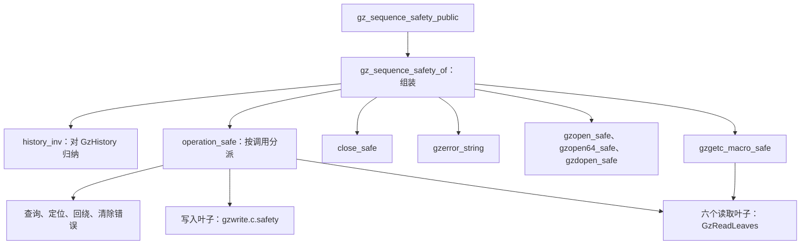
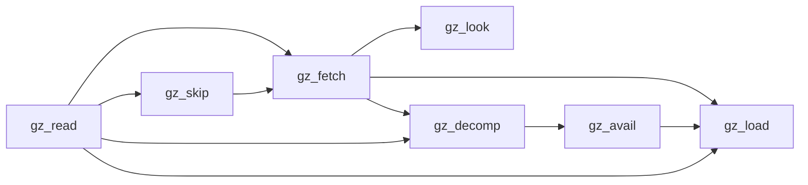

<!-- source-sha256: 8e160d176fdbd7907dcfc536130415f39dc41a398c9b24dc31b5103d38938486 -->
# Gzip 文件：不变量、历史与操作系统预言机

源文件为 `gzlib.c`、`gzread.c`、`gzwrite.c`、`gzclose.c`、`gzguts.h`，以及 `zlib.h` 中的 `gzgetc` 宏。[API 页面](../spec/api/gz-file.md)给出调用者可见的行为。[外部 I/O 模型](../design/external-io.md)定义翻译所调用的文件系统、`errno` 和 `vsnprintf`。

gzip 文件接口在句柄的每一个历史上、在每一个文件系统世界中都是安全的。本页解释这个结果：它的陈述、前提和证明的结构。

## 已证明什么

| 目标 | 定理 | 模块 |
| --- | --- | --- |
| `Goal.gz_sequence_safety`（`ZlibF/Spec/Public/GzSafety.lean`） | `gz_sequence_safety_public` | `ZlibF/Proof/public-gz-sequence-safety.lean` |
| `Goal.gz_refusal`（`ZlibF/Spec/Public/GzRefusal.lean`） | `gz_refusal` | `ZlibF/Proof/public-gz-refusal.lean` |
| `Goal.gz_sequence_nonvacuity`（`ZlibF/Spec/Public/GzSafety.lean`） | `gz_sequence_nonvacuity_public` | `ZlibF/Proof/public-gz-sequence-nonvacuity.lean` |

三者都是安全性结果，都是必需的。它们登记在 `tests/audit/theorems.txt` 中，并在提交 `bde170e9` 上被接受（[进度，范围](../progress.md#scope)）。

`Goal.gz_sequence_safety` 有七个子句。

1. 每个历史都保持世界良构（`FileSystem`），并保持句柄满足表示不变量 `GzInv`。
2. 对句柄上的下一次公开调用，在每一个世界中：
   - 运行除了耗尽循环燃料之外不会以任何故障结束。没有未定义行为，也没有内存错误。这一半没有任何前提；
   - 调用会返回。对 `gzread`、`gzfread`、`gzgetc`、`gzgetc_`、`gzgets` 和 `gzungetc`，这一半需要读取预算前提 `ReadsFinite`。其他调用在每一个世界中都返回；
   - 返回的调用保持已打开描述符的集合（`FdsKept`），保持 `GzInv`、模式和描述符，只写句柄拥有的块和声明的调用者区域，并且存活块的变化恰好等于句柄的账目（`GzStepPost`）。没有泄漏。
3. 调用 `gzgetc()` 宏同样有这三部分，但终止性的划分不同（见[宏](#the-gzgetc-macro)）。
4. `gzerror` 返回的指针是一个以 NUL 结尾的字符串，在调用之后的堆中可读：它是字面量或句柄的消息。
5. 每次关闭调用都返回。它要么因模式不符而拒绝且不改变任何东西，要么释放记录和所有拥有的块并释放描述符；`close` 报告 `-1` 时也是如此（`GzReleased`）。
6. `gzopen` 和 `gzopen64` 会返回。打开失败不留下新块，也不留下新打开的描述符。打开成功给出一个满足 `GzInv` 的句柄，它恰好拥有新分配的块，并且它的描述符是唯一新打开的描述符（`GzOpenSafe`）。
7. `gzdopen` 会返回，并且不打开也不关闭任何描述符（`GzDopenSafe`）。

子句 2 的前一半是部分正确性，界限是每个循环 `2^64` 次迭代。真实执行达不到这个次数。

## 假设了什么

每个前提都明确写在陈述中。对应的行在[偏差记录](../deviations.md)的“调用者缓冲区的分离”和“Gz 外部世界”两节。

| 前提 | 位置 | 含义 |
| --- | --- | --- |
| 打开时的调用者堆 | `GzHistory.open`、`open64`、`dopen` | 堆是良构的（`Fresh`、`Uniq`、`LibraryGlobals`），每个字节对象小于 `2^63` 字节（`ByteObjectsFit`），`path` 和 `mode` 是以 NUL 结尾的字符串。 |
| 调用者缓冲区 | `GzArguments`，经由 `GzRange` | `gzread`、`gzfread`、`gzwrite`、`gzfwrite`、`gzputs`、`gzgets` 和 `gzerror` 的缓冲区在所请求的长度内可读或可写，并且与句柄拥有的块分离。 |
| `gzprintf` 的参数 | `GzArguments` | 格式串对其参数而言是模型能表示的格式串（`Formatted`）。格式串和每个 `%s` 参数都与句柄的块分离。 |
| 读取预算 | `ReadsFinite` | 描述符还能交付的字节数少于 `2^61`。它只是终止性的前提，并且只针对六个读取调用。 |
| 操作系统事实 | 预言机，属于可信部分 | 对非空缓冲区的 `write` 从不返回 0。`close` 即使失败也释放描述符。 |
| 打过补丁的源代码 | `patches/` | 陈述针对应用了补丁 0002 至 0005 的 C 代码。见[源代码报告与补丁](#source-reports-and-patches)。 |

世界模型属于[可信基础](../trusted-base.md)。内核依据该模型检查证明，但不检查模型是否与 Linux 一致。

### 为什么需要读取预算

有限预算是一个真实的要求，不是模型造成的假象。无穷的输入源会让一次 `gzread` 调用在 C 中永远运行：例如无穷长的 `FNAME` 字段，或无穷多个空 gzip 成员。`zlib.h` 并不保证在这种输入源上读取会返回。

`2^61` 这个数字是模型的限制。模型的一个循环有 `2^64` 次迭代的燃料。读取循环的界由若干度量给出，这些度量由剩余输入、读取预算和尚待交付的字节数构成。预算低于 `2^61` 时，这些度量保持在 `2^64` 以下。

该前提按调用名称判定（`NeedsReadBound`）。因此在 C 立即返回的情形下它也被要求：在写入句柄上调用读取函数，或请求长度为 0。`gzdirect` 没有读取循环，不需要预算。`gzseek` 把跳过推迟执行，也不需要预算。

## 历史

`GzHistory h fs i` 表示堆 `h` 和世界 `fs` 可由句柄 `i` 的某个实际历史到达。它有七个构造子。

| 构造子 | 步骤 |
| --- | --- |
| `open`、`open64`、`dopen` | 从良构的调用者堆出发，一次成功的 `gzopen`、`gzopen64` 或 `gzdopen`。 |
| `step` | 句柄上一次已返回的公开调用（`GzOperation`），参数符合 `GzArguments`。 |
| `getcMacro` | 一次已返回的 `gzgetc()` 宏调用。 |
| `caller` | 调用者修改自己的内存（`GzCallerFrame`），即句柄不拥有的任何东西。调用者可以释放自己的缓冲区，包括上一次 `gzread` 用的缓冲区。 |
| `world` | 其他参与者改变世界（`GzWorldStep`）：任何良构的文件系统状态。 |

`world` 步骤有意放得很宽。另一个句柄或应用程序可以关闭本句柄的描述符，或在同一编号下打开另一个文件。下一次读或写就会像在 C 中一样得到错误，或者读写到另一个文件。这一步也可以替换预言机。

`GzHistory` 没有预算前提。目标中的不变量子句对每个历史都成立。这些历史取代了早先的谓词 `GzReachable`，后者属于普通文件世界的功能性契约。

## 操作系统预言机

世界是堆旁边的一条记录 `Fs`（`ZlibF/Zlib/gzfs.lean`）。一次 gz 计算接收世界和堆，返回一个值和新的世界与堆，或者返回故障。世界中有文件、描述符表、`errno`，以及两个为每次外部调用选择结果的预言机。

| 调用 | 预言机可作的选择 |
| --- | --- |
| `read`（M1） | 普通文件的读取；`-1` 并设置某个 `errno`；或任意字节，按请求长度和描述符预算截断。 |
| `write`（M2） | 普通文件的写入；`-1` 并设置某个 `errno`；或一个计数，对非空缓冲区限制在 `[1, len]` 内。 |
| `lseek`（M3） | 普通文件的 `lseek`；`-1` 并设置某个 `errno`；或不超过 `2^63 - 1` 的任意值，且不移动描述符。 |
| `close`（M4） | 可以报告 `-1` 并设置某个 `errno`。描述符照样被释放。 |
| `open`（M5） | 可以在创建任何东西之前以某个 `errno` 失败，或返回另一个空闲的描述符编号。 |
| 成功后的 `errno` | 成功的调用可以留下任意 `errno`。 |
| `vsnprintf` | 使用调用者格式串的调用可以失败，并在 NUL 之前留下任意字节。 |
| 读取预算（M7） | 一个描述符还能交付的字节数，或者没有上界。 |

预言机比任何真实系统都宽。例如 `bytes` 读取无论描述符处于什么状态都会成功。每个目标都对所有世界量化，因此证明不能依赖普通文件的行为。

每个外部调用都是 `pure`，其结果只依赖于世界（`ZlibF/Proof/gzfs.oracle.lean`）。它从不产生故障，也从不改变堆。`read` 的契约及其预算记账（`BudgetAcc`）在 `ZlibF/Proof/gzfs.read-contract.lean` 中。`write` 对每个预言机取值的契约在 `ZlibF/Proof/gzwrite.c.comp.lean` 中。

## 不变量 `GzInv`

`GzInv h i s`（`ZlibF/Proof/gz.inv-model.lean`）是记录为 `s` 的已打开句柄 `i` 的表示不变量。它有一个公共部分和按模式区分的部分。其他模块使用它的接口引理（`GzInv.common`、`GzInv.reader`、`GzInv.writer`、`GzInv.state_eq`、`GzInv.pos_lower`），不展开定义。

在 LP64 构建上，偏移是有符号 64 位，`GZ_OFF_MAX = 2^63 - 1`，单次 I/O 请求最多 `2^30` 字节。公开的 `gzFile_s` 前缀与库内部的 `x.have`、`x.next`、`x.pos` 是同一块存储，`gzgetc` 宏就是这样访问它们的。

**公共部分（`GzCommon`）。**

- 记录在堆中，模式是读或写。
- `path` 是句柄拥有的以 NUL 结尾的字符串。`msg` 是 `NULL` 或句柄拥有的字符串；发生 `Z_MEM_ERROR` 之后它是 `NULL`。
- `8 ≤ want < 2^31`，并且 `size` 为 0 或等于 `want`。`size = 0` 表示缓冲区和编解码器尚不存在。
- 拥有的块都存活、互不相同、不同于记录本身，并且不属于内嵌的编解码器。编解码器不拥有记录所在的块。
- 位置：`0 ≤ skip`，`x.pos + skip ≤ GZ_OFF_MAX`，并且 `0 ≤ x.pos + x.have`。
- `x.next`：有缓冲输出时（`x.have ≠ 0`），它指向消息之外的某个拥有的缓冲区，其后有 `x.have` 个字节。`x.have = 0` 时，不变量对它不作任何断言。

**读取部分（`GzReadInv`）。**

- `how` 是 `LOOK`、`COPY` 或 `GZIP`，`direct`、`junk` 以及标志 `eof`、`past`、`again` 取允许的值。
- 没有缓冲区时，没有编解码器，没有缓冲输出，也没有待处理输入。
- 有缓冲区时，`in` 恰好有 `size` 字节，`out` 恰好有 `2·size` 字节。待处理输入位于 `in` 中，缓冲输出位于 `out` 中。
- 内嵌的流处于 inflate 历史中（`StreamReachable .inflate`），没有头记录。
- `x.pos + x.have ≤ GZ_OFF_MAX`（`posHave`）。
- 有缓冲输出就没有待执行的跳过（`haveSkip`）。
- 在输入末尾停滞的读取句柄没有待处理输入（`againEof`）。
- `err` 从不为 `Z_STREAM_END`。`COPY` 模式下没有待处理输入。流的消息是 `NULL` 或字面量。

**写入部分（`GzWriteInv`）。**

- `x.have = 0`。`gzgetc` 宏在任何句柄上都会读 `x.have`。
- 有缓冲区时，`in` 恰好有 `2·size` 字节。压缩写入的句柄有 `size` 字节的 `out`。透明写入的句柄没有 `out`，也没有编解码器。
- `next_in` 在没有待处理输入时是 `NULL`，否则指向 `in` 内部，待处理输入全部在其中。
- 对压缩写入的句柄，`out ≤ x.next ≤ next_out ≤ out + size`，都在同一个块内；内嵌的流处于 deflate 历史中，没有 gzip 头记录。

每个子句的存在都是因为某个调用需要它。三个例子说明这种模式。

- 没有 `posHave`，`gzgetc` 的缓冲路径会使 `x.pos` 溢出。
- 没有 `haveSkip`，`gzgetc` 会在跳过尚未执行时返回一个缓冲字节，并把 `x.pos` 移过 `GZ_OFF_MAX - skip`。
- 没有 `againEof`，`gz_read` 会永远循环：`gz_avail` 在 `eof` 时什么也读不到，而 `gz_look` 返回 0。

在一次读取调用的内部，成立的是两种较弱的形式。`GzInvUpToOutput` 是清除了缓冲输出的记录所满足的 `GzInv`：直接读取会把 `x.next` 留在调用者的缓冲区中。`GzInvUpToSkip` 是去掉 `haveSkip` 的 `GzInv`：`gz_look` 和 `gz_fetch` 可能在跳过尚未执行时缓冲输出，调用者在返回之前把它消费掉。

### 新记录的指针字段

`gz_open` 不写 `strm.state`、`strm.next_in` 和 `x.next`。在模型中，新鲜指针是 `NULL`，这比 C 弱；在 C 中它是不确定值（[安全规范，第 3 节](../spec/safety.md#uninitialised-memory)）。不变量规定 `size = 0` 时 `strm.state = NULL`。**尚未完成的确认：** C 在 `gz_look` 或 `gz_init` 写入 `strm.state` 和 `strm.next_in` 之前从不读取它们。对 `x.next`，不变量在 `x.have = 0` 时不作任何断言；有了补丁 0005，对 `x.next` 的每次读取或推进都发生在 `x.have ≠ 0` 时。

## 证明结构

一次调用的安全性只有一种形状，即 `GzCallSafe i call`：对每个堆、每个世界、每个满足 `GzInv` 的记录以及每组允许的参数，子句 2 的三部分都成立。一条叶子引理为一个函数证明 `GzCallSafe`。

组装（`ZlibF/Proof/gz.sequence-safety.lean`）分两步。

- `history_inv` 对 `GzHistory` 归纳。打开构造子使用打开引理。`step` 使用该调用叶子引理的第三部分。`caller` 步骤使用 `GzInv.caller`：不变量只读句柄拥有的块。`world` 步骤不改变堆，而不变量不涉及世界。
- `operation_safe` 把一次调用分派到它的叶子引理。`close_safe` 对三个关闭调用做同样的事。

六个读取叶子打包在 `GzReadLeaves` 中：`gzread_step`、`gzfread_step`、`gzgetc_step`、`gzungetc_step`、`gzgets_step` 和 `gzdirect_step`。`gzgetc_` 按定义就是 `gzgetc`。`gz_sequence_safety_of` 只以这个包为参数，`gz_sequence_safety_public` 提供它。每个叶子都是没有前提的定理。

## 读取侧

`gz_load` 累积字节，直到请求被填满或某次读取使它停下。读到正数个字节时推进 `have`；读到零时设置 `eof`；因阻塞而被拒绝时设置 `again`；其他失败则设置错误。失败可以发生在若干次成功的部分读取之后。

`gz_look` 在第一次调用时建立缓冲区和编解码器，然后决定如何读取。只有至少四个可用字节时它才识别 gzip：魔数 `31, 139`、方法 8，以及小于 32 的标志字节。否则，在模式允许时把输入当作透明数据。

`gz_decomp` 在内嵌的流上运行 `inflate`，直到输出已满、成员结束、输入结束或发生错误。成员结束的路径回到格式检测，以处理拼接的成员。

`gz_read` 有三条数据路径：消费缓冲输出；把透明数据直接读入调用者的缓冲区；或者直接解压到足够大的调用者缓冲区。

读取辅助函数在 `ZlibF/Proof/gz.read-assembly.lean` 中组合：

| 引理 | 陈述 |
| --- | --- |
| `gz_look_safe` | `gz_look` 是安全的（`gz.read-look.lean`）。 |
| `gz_decomp_safe_of` | 给定“从 `BAD` 或 `MEM` 模式开始的 `inflate` 调用不移动任何缓冲区”，`gz_decomp` 是安全的（`gz.read-decomp.lean`）。该事实是 `inflateStuckNoOutput_holds`（`inflate.c.stuck-no-output.lean`）。 |
| `gz_fetch_safe_of` | 给定上面两条，`gz_fetch` 是安全的（`gz.read-fetch.lean`）。 |
| `gzSkipRead_holds` | 给定 `gz_fetch`，`gz_skip` 是安全的（`gzread.c.skip-fetch.lean`）。 |
| `gz_read_safe_of` | 给定上面三条，`gz_read` 是安全的（`gz.read-read.lean`）。 |
| `gzread_step`、`gzfread_step` | 由 `gz_read` 得到两个公开调用。 |

每次内嵌的 `inflate` 调用都使用[流解码](inflate.md)的流结果：内嵌的流是可达的，因此单次调用的完整契约适用。

### 读取循环的终止

每个读取循环都有一个定义在世界上的度量。在 `ReadsFinite` 下，度量的初值低于 `2^64`，并且每次继续的迭代都使它下降。

- `inputLeft` 是描述符的读取预算加上 `avail_in`。`gz_avail` 读入多少字节，`avail_in` 就增加多少，预算就减少多少（`gz_avail_budget`，`gz.read-budget.lean`）。因此 `inputLeft` 从不上升。
- `gz_decomp` 使用 `inputLeft + avail_out`。
- `gz_fetch` 使用 `4 · inputLeft + c`，其中 `c` 取决于 `how`。空的 gzip 成员要消耗输入，所以预算排除了无穷多个空成员。
- `fetchRank` 等于 `4 · inputLeft` 加上预算；一个 gzip 成员已越过头部且尚未结束时再加 2；进入透明复制模式之前再加 2。`gz_decomp` 和 `gz_fetch` 都不会使它上升。
- `gz_read` 使用 `readMeasure`：令 `L = min(len, GZ_OFF_MAX - pos)`，它等于 `L / 8 + Q + 2·E + 3·R + fetchRank`。`Q` 衡量缓冲输出，`E` 衡量输入是否结束，`R` 衡量到 `GZ_OFF_MAX` 之前剩余的空间。
- `gzgets` 使用它的循环变量 `left`。`gz_skip` 从 `GzInvUpToSkip` 出发终止（`gzSkipTerminates_holds`，`gzread.c.skip-terminates.lean`）。

### 读取包装函数

包装函数保持 C 的检查顺序。`gzread` 检查无符号请求能否放入 `int`。`gzfread` 在做除法之前检查 `size_t` 乘积。`gzgets` 为 NUL 留出空间，用 `min(have, left)` 限定 `memchr` 的范围，最后的 NUL 最远写到 `buf[len - 1]`。`gzungetc` 先运行 `gz_look` 和 `gz_skip`，然后在 `out` 内部回推字节；它可以在文件开头使 `x.pos = -1`，这就是不变量约束 `x.pos + x.have` 而不是 `x.pos` 的原因。

## `gzgetc` 宏

`zlib.h` 把 `gzgetc` 定义为宏。这是应用程序调用 `gzgetc` 的默认方式，所以历史中有一个专门的构造子（`GzHistory.getcMacro`），目标中有一个专门的子句。翻译是 `Zlib.ZlibH.gzgetc`；证明是 `gzgetc_macro_safe`（`ZlibF/Proof/zlib.h.gzgetc-macro.lean`）。

宏有两个分支。

- **有缓冲输出（`x.have ≠ 0`）。** 宏就地修改 `x.have`、`x.pos` 和 `x.next`，不调用库函数。与函数不同，`again` 置位时它不清除 `err` 和 `msg`。这个分支不需要对世界作任何假设就会返回。`GzCommon.next` 保证 `x.next` 位于某个拥有的缓冲区内，其后有 `x.have` 个字节；`posHave` 保证 `x.pos + 1` 可表示；`haveSkip` 给出 `skip = 0`。写入句柄有 `x.have = 0`，所以内联分支只在读取句柄上运行。
- **没有缓冲输出（`x.have = 0`）。** 宏调用函数 `gzgetc`。这个分支就是读取叶子 `gzgetc_step`，它在 `ReadsFinite` 下返回。

两个分支的后置条件都与函数相同，函数不写任何调用者区域。

在 `NULL` 句柄上，宏首先读 `(g)->have`，这在 C 中是未定义行为。`Goal.gz_refusal` 只对函数 `(gzgetc)(file)` 陈述 `NULL` 的情形。

## 写入侧

`gz_init` 分配双倍大小的输入缓冲区；对压缩输出，还分配输出缓冲区和编解码器。`gz_comp` 对透明输出直接写出输入，否则交替调用 `deflate` 和写出输出。`gz_write` 把较小的输入复制到 `in` 中，或者让 `next_in` 指向调用者的大缓冲区，事后再复位。`gz_zero` 通过写零来兑现待执行的向前定位。`gz_vacate` 压缩待处理数据，并把余下部分移到缓冲区开头。

写入叶子在 `ZlibF/Proof/gzwrite.c.safety.lean` 中：`gzwrite_step`、`gzfwrite_step`、`gzputc_step`、`gzputs_step`、`gzprintf_step`、`gzvprintf_step`、`gzflush_step`、`gzsetparams_step` 和 `gzclose_w_step`。它们使用 `gz_error` 的事实，这些事实由不变量推出（`ZlibF/Proof/gzlib.c.error-inv-premises.lean`）。

`gz_comp` 的循环在每一个世界中都终止，不需要预算（`ZlibF/Proof/gzwrite.c.comp.lean`）。写出循环的度量是尚待写出的字节数，透明循环的度量是待处理输入。两者都会下降，因为对非空缓冲区的 `write` 要么返回 `-1`，要么返回 1 到长度之间的计数。这就是操作系统事实 M2。如果 `write` 永远返回 0，`gz_comp` 在 C 中会空转；[进度](../progress.md)记录了这一观察。deflate 循环有自己的度量，循环每继续一次它就下降。

`gzvprintf` 在 `next[size - 1]` 写入哨兵，并以容量 `size` 进行格式化。长度不在 `1..size-1` 内，或哨兵丢失，结果就被拒绝。模型能表示的格式语言见[外部 I/O 模型](../design/external-io.md)。

`gzsetparams` 刷新待处理数据，调用 `deflateParams`，然后保存所请求的级别和策略。它忽略被调用函数的返回值。安全性证明不需要这个返回值。

## 位置、定位与错误所有权

`gztell64` 报告逻辑位置加上待执行的跳过量，除非 `past` 抑制了后者。`gzoffset64` 查询描述符位置，并在读模式下减去已缓冲的压缩输入。这是两个不同的位置。

`gzseek64_step` 和 `gzseek_step`（`ZlibF/Proof/gz.inv-seek.lean`）对每一个世界都成立。各条路径是：

- 拒绝（严重错误、错误的 `whence`、目标超出补丁 0002 的范围）：返回 `-1`，什么也不改变；
- 写入句柄：`skip` 变为距离；目标在 `x.pos` 之前时返回 `-1`；
- 透明模式下的读取句柄：一次 `lseek`。位移 `pos - x.pos - have` 不会溢出，依据是 `posHave`；
- 向后移动的读取句柄：先 `gzrewind`，然后整段距离变为 `skip`；
- 向前移动的读取句柄，包括 `gzungetc` 之后 `x.pos` 为负的情形：先消费缓冲字节，余下的变为 `skip`。

每条路径之后 `haveSkip` 都成立。`lseek` 可以返回预言机选择的任何值。它只改变调用计数器、`errno`，以及普通文件情形下那一个描述符的位置。因此世界保持良构，已打开的描述符集合不变。

`gz_error` 先释放旧的自有消息。内存错误不分配新消息；其他消息拥有 `path + ": " + text` 这次分配。`gzerror` 返回内存错误字面量、当前消息或空字面量，并且可以把错误码写入调用者的四字节单元。`gzerror_step` 和 `gzerror_string`（`ZlibF/Proof/gz.inv-frame.lean`）表明这次写入保持不变量，并且返回的指针在调用之后的堆中是一个字符串。下一次到达 `gz_error` 的调用会释放这个字符串；对 `gzprintf` 参数的调用者前提排除了把它传回同一个句柄的用法。

## 打开与关闭

`gzopen_safe`、`gzopen64_safe` 和 `gzdopen_safe` 表明新句柄满足 `GzInv`（`ZlibF/Proof/gz.inv-open.lean`、`gz.inv-open-fresh.lean`）。打开之后 `size = 0`，所以关于缓冲区或缓冲输出的每个子句都空泛地成立。

`gzclose` 读取模式，然后运行 `gzclose_r` 或 `gzclose_w`（`ZlibF/Proof/gz.inv-close.lean`）。满足 `GzInv` 的句柄要么是读取句柄，要么是写入句柄，所以 `gzclose` 从不拒绝。`gzclose_r` 在编解码器存在时结束它，释放缓冲区、消息、路径和记录，并关闭描述符。`gzclose_w` 还要先兑现待写的零并完成输出。这些操作失败时清理照样进行。成功的 `gzdopen` 接管描述符；失败的 `gzdopen` 把描述符留给调用者。

## `NULL` 句柄

`Goal.gz_sequence_safety` 只在真实句柄上运行。`Goal.gz_refusal` 对 29 个函数陈述 `NULL` 的情形：对每个堆、每个世界和其他每个参数，调用返回文档规定的值，并且既不改变堆也不改变世界。它没有前置条件。每个子句都通过求值成立，因为每个函数首先测试 `file == NULL`。

## 非空泛性

`Goal.gz_sequence_nonvacuity` 表明序列目标的前提可以被满足。它给出两个具体历史，各自从满足打开构造子全部前提的调用者堆和世界出发，没有分配失败。

1. `gzopen` 给出一个满足 `GzInv` 的读取句柄，其描述符有有限的读取预算。向调用者缓冲区读一个字节的 `gzread` 满足 `GzArguments`。
2. 在已打开的描述符上调用 `gzdopen`，给出一个满足 `GzInv` 且保留该描述符的写入句柄。从调用者缓冲区写一个字节的 `gzwrite` 满足 `GzArguments`。

因此，调用子句以及读取调用的终止那一半，都适用于一次长度非零的真实调用。

## 源代码报告与补丁

不变量之所以是现在的形式，是因为针对未打补丁的 C 有六份报告。R-1 和 R-2 在运行时检测器下复现；它们的修复已提交上游，并作为补丁 0002 和 0003 应用。F-1 和 W7 在运行时检测器下复现。R-3 和 R-4 按 C 的字面规定是未定义行为，没有检测器报告它们。这四项的修复是本地补丁 0004 和 0005，已获所有者批准，尚未提交上游。`patches/README.md` 是权威的补丁列表。

| 情形 | 未打补丁的 C 的行为 | 修复与证据 |
| --- | --- | --- |
| R-1：负的定位位置 | 起始处 `gzungetc` 之后，`GZ_OFF_MAX - pos` 或之后的位置差使有符号 64 位算术溢出。 | 已复现：[gzseek-pushback-overflow](../../tests/regression/gzseek-pushback-overflow/README.md)。上游 [PR 1361](https://github.com/madler/zlib/pull/1361)，作为补丁 0002 应用。该拉取请求尚未合并。 |
| R-2：部分读取后出错 | 在 `gz_fetch` 的 `COPY` 情形中，`gz_load` 可能在 `x.next = out` 执行之前出错并留下非零的 `x.have`；之后 `gz_read` 从过期的指针复制。 | 已复现：[gzread-transparent-stale-next](../../tests/regression/gzread-transparent-stale-next/README.md)。上游 [PR 1363](https://github.com/madler/zlib/pull/1363)，作为补丁 0003 应用。该拉取请求尚未合并。 |
| R-3：未写入的指针 | `gz_reset` 不写 `x.next`；`gzseek64` 和 `gz_skip_have` 给它加零。 | [发现](../findings/gz-reset-next-uninitialised/README.md)，用探针展示。本地补丁 0005 只在计数非零时推进 `x.next`。初始化为 `NULL` 不行：`NULL + 0` 在 C 中是未定义的。 |
| R-4：调用者缓冲区的生命周期 | 直接读取把 `x.next` 指向调用者的缓冲区，并在 `x.have = 0` 时保留它。调用者释放缓冲区之后，`gzseek64` 和 `gz_skip_have` 给它加零。 | [发现](../findings/gz-next-dangling-after-direct-read/README.md)，用探针展示。本地补丁 0005。`gzseek64_dangling_next_ok` 表明打过补丁的定位不使用该指针。 |
| F-1：读取位置溢出 | 在 `lseek` 成功但不移动的设备上做透明定位，会把 `x.pos` 设为 `GZ_OFF_MAX`；下一次读取使它溢出。 | 已复现：[gzread-pos-overflow](../../tests/regression/gzread-pos-overflow/README.md)。本地补丁 0004 保证每次调用返回时 `x.pos + x.have ≤ GZ_OFF_MAX`。 |
| W7：写入位置溢出 | 透明写入句柄向前定位到 `GZ_OFF_MAX` 附近再写入，会使 `x.pos` 溢出。 | 已复现：[gzwrite-pos-overflow](../../tests/regression/gzwrite-pos-overflow/README.md)。本地补丁 0004 拒绝会越过 `GZ_OFF_MAX` 的写入。 |

早先一个关于 `gzsetparams` 的未确认实验保存在[早期证明笔记](../history/proof-earlier-notes.md#gzsetparams-experiment)中。

## 保留的功能性结果

这些结果不是必需的。它们是早先证明的，继续保持登记。

- `Goal.gzbuffer`、`Goal.gzeof`、`Goal.gzerror`、`Goal.gzclearerr`、`Goal.gzdopen`：单个函数的完整契约。
- `Goal.gzoffset64`、`Goal.gzoffset` 和 `Goal.gzrewind`：针对普通文件世界陈述（前提 `RegularOs fs`）。
- `Goal.gz_sequence` 和 `Goal.gz_initialisation_domain` 是功能性的序列目标和 `gzopen` 的功能性契约。它们不在计划内，也没有被证明。
