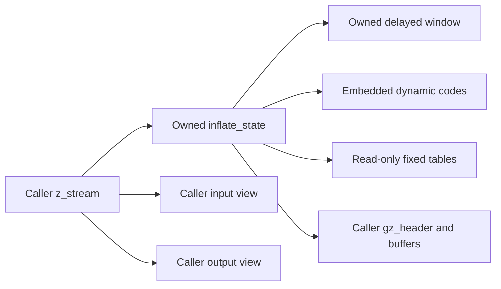

# Stream decoding: modes, history and call composition

Source: `zlib/inflate.c`; translation: `ZlibF/Zlib/inflate.c.lean`.
Public behavior is specified in [the API guide](../spec/api/README.md), the decoded
stream in [the format guide](../spec/format/README.md), and window updates by
`I-uw-*` in [internal contracts](../spec/internal-contracts.md).

`inflate` is safe on every input and every split of the buffers, also over its
call sequences. This page explains how the proof is composed. It uses
[decode tables](inftrees.md), [fast decoding](inffast.md),
[Adler-32](adler32.md), [CRC-32](crc32.md) and [allocation](zutil.md).

## What is proved

| Result | Kind | Theorem | Module |
| --- | --- | --- | --- |
| `Goal.inflate_sequence_safety` (`ZlibF/Spec/Safety/Sequences.lean`): the invariant on every reachable history, a safe next call with an exact allocation ledger, and an `inflateEnd` that frees everything the stream owns | Safety, required | `inflate_sequence_safety_public`, from `inflate_sequence_safety` | `ZlibF/Proof/public-inflate-sequence-safety.lean`, `inflate.c.sequence-safety.lean` |
| One safety goal per function: `inflate`, `inflateSetDictionary`, `inflateGetDictionary`, `inflateSync`, `inflateReset`, `inflateReset2`, `inflatePrime`, `inflateMark`, `inflateGetHeader`, `inflateEnd` (`ZlibF/Spec/Safety/Streams.lean`) | Safety, required | `inflate_safety` and the other `inflate*_safety` theorems | `ZlibF/Proof/public-stream-call-safety.lean` |
| `Goal.inflateInit__safety`, `Goal.inflateInit2__safety` | Safety, required | `inflateInit__safety`, `inflateInit2__safety` | `ZlibF/Proof/public-init-safety.lean` |
| `Goal.inflateCopy_safety` | Safety, required | `inflateCopy_safety` | `ZlibF/Proof/public-inflate-copy-safety.lean` |
| `Goal.inflate_refusal`: every function refuses a stream that is not initialised and leaves the heap as it was | Safety, required | `inflate_refusal` | `ZlibF/Proof/public-stream-refusal.lean` |
| `Goal.inflate_initialisation_domain`: the premises of the sequence goal can be met | Non-vacuity, required | `inflate_initialisation_domain_public` | `ZlibF/Proof/public-inflate-init.lean` |
| `Goal.inflate`: the full contract of one call, with progress, return codes, counters, frame and ownership | Functional, stays; the safety proofs of `uncompress*` and of the gzip reader use it | `inflate_public` | `ZlibF/Proof/public-inflate.lean` |
| The full contracts of the other functions, such as `Goal.inflateCopy`, `Goal.inflateReset`, `Goal.inflateSetDictionary` | Functional, stays | `inflate_copy_public`, `reset_public`, `inflateSetDictionary_public` and others | `ZlibF/Proof/public-inflate-*.lean` |

These theorems are registered in `tests/audit/theorems.txt` and accepted on
commit `bde170e9` ([progress, Scope](../progress.md#scope)).

The per-function safety theorems are corollaries of the sequence theorem. The
sequence theorem rests on one invariant, `InflateInv`
(`ZlibF/Proof/inflate.c.invariant.lean`). Initialization establishes it for every
accepted `windowBits`, and a caller rebuffer, every stream operation and
`inflateCopy` preserve it (`reachable_invariant_kind`,
`ZlibF/Proof/inflate.c.reachable.lean`).

Not required and not planned: that the output of `inflate` equals the format's
meaning of the input. The sections below say where an argument is functional
only.

A paragraph marked **to confirm** is a reading of the C source that no theorem
named here states in that form. The theorems are checked against the
translation, not against this prose.

## What is assumed

- Every byte object has fewer than `2^63` bytes (`ByteObjectsFit`).
- The stream uses the default allocator.
- The input and output ranges are separate and lie outside the storage the
  stream owns (`StreamBuffers`). Dictionary buffers are separate from the
  window.
- While `inflate` reads a gzip header into an attached `gz_header`, the
  record's `extra` buffer is separate from the unread input
  (`InflateHeaderProgress`).

Each premise is explicit in the statement and has a row in
[deviations](../deviations.md).

## Paths through the decoder

Available bytes, output room and held bits select the fast path. One call can
take the fast and the slow path in turn. The theorem covers small buffers,
partial input and dynamic Huffman blocks: table construction, dispatch and exit
carry the same invariant through the heaps the calls return. The
[input configurations](../spec/input-configurations.md#inflate-inputs) page
names the parameter ranges.

## Memory and ownership

The stream owns its allocated state and any allocated window. `lens[320]`,
`work[288]` and `codes[1444]` are embedded in the state. `lencode` and `distcode`
select static fixed tables or regions of `codes`; `next` tracks table
construction. `head` refers to caller-owned header storage. The invariant
records those alternatives, initialized ranges and authorized byte views.

Initialization establishes pointer fields before they are read. The runtime's
fresh-null convention cannot prove that temporal fact; see
[safety](../spec/safety.md#uninitialised-memory). Error modes also belong to the
invariant so that cleanup remains safe after a refusal or data error.

## Window invariant W and F4

Use **W** for the ring-buffer shape:

1. `wsize = 0` or `wsize = 2^wbits`.
2. `window` is null or points to an allocated `2^wbits`-byte block;
   `wsize > 0` implies non-null storage.
3. `whave ≤ wsize`; if `wsize > 0`, `wnext < wsize`; otherwise `wnext = 0`.
4. If `whave < wsize`, then `wnext = whave`.

Initialization gives the empty window. Reset variants must be checked
individually: resetting the counters, retaining existing storage and changing
window size are different operations. Only the size-changing path that frees
storage may remove its ownership claim.

Functional only: for correctness, W is enriched with the ring contents. The
valid `whave` bytes are the appropriate suffix of logical history in ring order.
Preset dictionary bytes contribute history without becoming output. Shape W
alone shows that a back-reference reads inside the window, not that it returns
the right byte.

### `updatewindow(strm, end, copy)`

`I-uw-pre` provides a readable source interval `[end-copy, end)` and the
non-overlap facts for each `memcpy`. The source may be recent output or a
permitted dictionary range. A public caller must supply those facts; it cannot
silently exclude an allowed view.

If allocation is needed and fails, the function returns 1 without acquiring a
window block. Prove its exact field/frame effects; do not infer a global
unchanged-heap claim from the failure code. If `wsize` is zero after successful
allocation, set it to `2^wbits` and initialize `wnext = whave = 0`.

For `copy ≥ wsize`, retain only `[end-wsize, end)`, write the whole window and
set `wnext = 0`, `whave = wsize`.

For `copy < wsize`, let `dist = min(wsize-wnext, copy)`. The first copy writes
`[wnext, wnext+dist)` from the source prefix. If bytes remain, then
`dist = wsize-wnext`; the second copy writes `[0, copy-dist)` and the ring is
full. Set `wnext = copy-dist`, `whave = wsize`.

If no bytes remain, advance `wnext` by dist and wrap at `wsize`. If the old ring
was partial, W.4 gives `whave = wnext`, so the same addition advances `whave` to
at most `wsize` and restores W.4 when it remains partial. If it was full, it
stays full. This proves the shape preservation argument. The content argument
tracks the newest suffix through these same cases. Include zero-copy calls and
exact pointer formation for their actual source views.

## The mode proof

Each real mode has one execution case over a common invariant. A grouped view
shows the dataflow; it does not replace the source's individual modes or exits.

| Source group | Required execution fact |
| --- | --- |
| Entry checks | Invalid stream/arguments return the specified error with exactly the permitted effects. A blanket unchanged-heap claim applies only where the contract says so. |
| `PULLBYTE` | `have == 0` leaves before the read; otherwise the read and cursor increment consume one valid byte. |
| `NEEDBITS`, `BITS`, `DROPBITS` | Bound each actual requested count and establish enough bits before subtraction. A byte is shifted only at a valid count; the default 64-bit `hold` retains the pulled bits. |
| `HEAD` through `HCRC` | Validate wrapper fields; write `extra`, `name`, `comment` only within caller-provided capacities. Bound `length` and progress counters before unsigned subtraction. |
| `DICTID`, `DICT` | Preserve dictionary-required state and checksum effects; a dictionary refusal does not invent decoded output. |
| `STORED`, `COPY` | `copy ≤ min(length, have, left)` bounds both views. Supply the API's justified non-overlap condition for `memcpy`. |
| `TABLE` | Default checks give `nlen ≤ 286`, `ndist ≤ 30`, hence `nlen+ndist ≤ 316 < 320`. |
| `LENLENS` | `have < ncode ≤ 19` bounds `order[have]`; zero-fill completes the 19-length input to the code-length table. |
| `CODELENS` | Code 16 requires a previous length; repeat-count checks prevent writing beyond `nlen+ndist`. |
| Table installation | Prove `inflate_table` execution, its entry meanings and total reservation `852+592 = 1444`; install the resulting table predicate. |
| `LEN` through `DISTEXT` | Root/subtable reads use initialized entries and consume exactly the supporting code and extra bits. Prove the fast-path entry premises when that branch is selected. |
| `MATCH`, `LIT` | Bound output writes and justify history/window sources, including overlap within sequential output. |
| `CHECK`, `LENGTH` | Compare the right wrapper checksum/length against actual produced bytes with their defined widths. |
| `inf_leave` | Write back exact cursors/counters/bits, update history when required and preserve the specified return behavior. |

For refill reasoning, if a requested `n ≤ 32`, pulling occurs only with
`bits < n`; the byte shift is then at most 31 and the count after a pull at most
39. Other masks and drops require their own source-specific bounds. It is not
correct to treat every `BITS` use as a fixed small constant: dynamic table
widths and linked entries obtain their bounds from the table predicate.

The outer loop needs a mode-aware measure. Some transitions consume no input
and produce no output. Bound those internal transitions between progress or
return points, and combine that bound with finite input/output and copy
measures. Per-mode termination alone does not establish the complete fuel bound.

## Causality and history across calls

This section is functional. It is not required. It records why two earlier
model statements were wrong, and what a correct functional statement needs.

Functional correctness must identify output independently of the implementation
state. A decoded symbol needs a supporting prefix of source bits. The decoder
may read beyond that prefix speculatively, and may return whole lookahead bytes
before leaving the fast path. Relate the emitted symbol to the supporting bits;
do not require its meaning to agree with all speculative lookahead.

The earlier whole-lookahead consistency condition is false. The corrected
supporting-bit-prefix relation addresses that distinction. Likewise, a fixed
data-error detection lag of eight bytes has a counterexample. Increasing the
constant without proof does not establish a causal error theorem. These are
specification and model lessons, not upstream memory bugs. The corrected
relation is registered as `inflate_deferred_distance` and
`inflate_deferred_distance_rejects_legacy_consistency`, with the regression
`tests/regression/inflate-deferred-distance`.

Across calls, preserve the accumulated bit prefix, output prefix, logical
history, wrapper/checksum state and any dictionary requirement. Quantify over
all permitted input splits, output-room splits and flush values. A later
failure may follow actual output: delayed window allocation can return
`Z_MEM_ERROR` after decompression has written bytes. Error contracts must retain
those effects rather than require empty output.

A preset dictionary contributes a known checksum requirement and may provide
history whose contents are not known until the caller supplies it. Distinguish
that unknown history from output bytes. Raw dictionary replacement, header
operations, priming and recovery require their exact API effects; an ordinary
data-epoch refinement does not cover every such sequence automatically.
Negative-value priming also requires the general bit-level bridge, beyond a
finite execution matrix or model witness.

## Lifecycle and auxiliary functions

| Functions | What the proof must compose |
| --- | --- |
| `inflateInit_`, `inflateInit2_` | Version/size and parameter refusals, state allocation, initialization writes, success invariant and exact failure cleanup. |
| `inflateReset`, `inflateResetKeep`, `inflateReset2` | Their distinct counter/history/header effects, permitted window-size changes and matching ownership transitions. |
| `inflateEnd` | Free window and state once, clear the stream state and restore the caller's prior live-block set. |
| `inflatePrime` | Negative-count reset and nonnegative bit insertion; shifts, low-bit interpretation and count-limit refusals. |
| `inflateSetDictionary`, `inflateGetDictionary` | Documented dictionary modes, checksum decision and ring copies in chronological order; history differs from produced output. |
| `inflateCopy` | Independent state/window allocations and failure cleanup; copy content, rebase dynamic `lencode`, `distcode`, `next`, preserve static pointers and prove future behavioral equivalence. |
| `inflateSync`, `syncsearch` | Bounded scanning, recovery state changes and the relation of discarded input to the restarted decoder epoch. |
| `inflateGetHeader` | Store permitted caller storage and preserve its lifetime/capacity requirements until header processing completes. |
| `inflateMark`, `inflateSyncPoint`, `inflateCodesUsed` | Exact numeric/query behavior in every admitted mode, including refusal cases. |
| `inflateValidate`, `inflateUndermine` | Exact state updates, supported/unsupported behavior and invariant preservation. |

The unpatched `inflateCopy` compares pointers to the static fixed table and to
the state's `codes` array with `>=` and `<=`. Those are different objects, so the
comparison is undefined. Patch 0001 replaces it with pointer equality
([finding](../findings/inflate-copy-fixed/README.md), `patches/README.md`). The
translation and `inflateCopy_safety` are for the patched source.

The sequence theorem uses the init result and each function's proved
preservation, frame and ownership effects. It does not connect the internal
history and table predicates to the independent format relation. That
connection is functional and not planned; the abstract model theorem
`inflate_decodes` is a statement about the model only.

## C correspondence checks

### Control flow and bit buffers

`inflate` keeps its C registers in `IL`. Each mode is a helper in
`ExceptT Ex (StateT IL M)`. A switch `break` returns to the dispatcher. `Ex.leave` jumps to
`inf_leave` with the registers as they stand; it does not roll back prior reads or writes.
`Ex.ret` is a direct C return. Fall-through calls the next mode body. The dispatcher reads
`state->mode` from the heap on each iteration.

The following details are observable and must survive helper boundaries:

- `TYPE` falls into `TYPEDO` without writing `mode`. If reading the block header runs out of
  input, the saved mode is still `TYPE`. This affects `data_type` and the next entry.
- `PULLBYTE` checks for input before changing anything. A failing `NEEDBITS` preserves all
  bytes pulled on earlier iterations. `DROPBITS` changes `hold` before subtracting from
  `bits`; `BYTEBITS` uses the old bit count in both expressions.
- `BITS(n)` casts `hold` to unsigned int before masking with `(1U << n) - 1`.
  `hold` itself is unsigned long. Neither the cast nor the shift width may be simplified.
- In `HEAD`, the header modulus expression adds an unsigned 32-bit shifted term to
  `hold >> 8` in 64-bit arithmetic. Primed high bits participate in that expression.
- `DICT` returns `Z_NEED_DICT` after `RESTORE` and the input-total update. It bypasses
  the normal epilogue. `MEM` and `SYNC` also return directly.
- `CHECK` updates output totals and the checksum, then resets the local output baseline.
  The epilogue uses that changed baseline, avoiding a second count of the same bytes.
- `inf_leave` restores registers before it updates the window. A window-allocation failure
  returns `Z_MEM_ERROR` before later totals and checksum updates. Output already written
  remains written; memory error does not imply empty output.

The usual normalized bit-buffer facts are `bits ≤ 39` and `hold < 2^bits`.
They are proof obligations, not assumptions valid for every arbitrary state record.
`inflatePrime` clears the buffer for a negative bit count, refuses counts above 16 or a
combined count above 32, and masks `value` using the signed-long expression before converting
it to unsigned long. Negative values must follow that conversion order.

`inflateMark` also needs its exact conversions: sign-extend `back`, convert to unsigned
long, shift by 16, convert back to signed long, then add the unsigned conditional term.
The default platform's out-of-range conversions are modular. The error result is `-65536`.

### Window, dictionaries, copying and buffer views

The retained history is chronological data, not just `whave` bytes of arbitrary storage.
For an allocated window, `8 ≤ wbits ≤ 15`, `whave ≤ wsize`, and `wnext < wsize` when
`wsize > 0`; a partly filled window has `wnext = whave`. A full ring's chronological order
starts at `wnext`. Match proofs must connect that order to prior output and dictionaries.

`updatewindow` allocates uninitialised bytes, then copies either the last full window or a
split suffix around the ring boundary. Only written history may be read. `inflateGetDictionary`
returns the tail from `window + wnext` followed by the prefix. `inflateSetDictionary` validates
the Adler identifier in `DICT` and passes the dictionary end to `updatewindow`; raw replacement
has different epoch semantics from one preset dictionary. `inflateResetKeep` retains history;
`inflateReset` restores the requested settings and clears history, freeing a changed-size window.

`inflateCopy` allocates through the source allocator, frees the new state if window allocation
fails, and clears `dest->state` on its source-check and allocation failures. On success it
copies both records, repairs the stream backlink, rebases internal table pointers and copies
only `whave` window bytes. `next` always refers into the state's `codes` array.
`lencode`/`distcode` either name that array or the shared fixed tables. The clause `origin` of
`InflateInv` (`CopyTableOrigin`) carries part of this: `lencode` points at `codes[0]`, or
`lencode` and `distcode` are the two fixed tables. The facts for `next` and for a dynamic
`distcode` (offsets into `codes`; `next` may be one past its end) come from `Good`, clause `inv.ptr`
(`CopyTableOrigin.dynamic_geometry`, `ZlibF/Proof/inflate.c.copy-origin.lean`). Source and
destination records must not overlap.

The pinned upstream source tests whether `lencode` lies within `codes` using `>=` and `<=`.
With fixed tables these are different objects. Patch 0001 replaces the test with pointer
equality, and the translation follows the patched source. The
[reproduction](../findings/inflate-copy-fixed/README.md) shows the sanitizer report on the
unpatched C.

Byte input, output, header and dictionary ranges must meet their actual access requirements.
The runtime now permits disjoint ranges in the same byte object for `memcpy`; the older
claim that distinct blocks were required is obsolete. Overlap still faults. Local fast-decoder
lemmas with distinct raw blocks do not cover every public buffer view; see
[deviations](../deviations.md).

### Initialization, recovery and pointer representation

`inflateInit2_` zeroes its allocated state before setting fields and calling reset.
Version checks inspect only the first version byte and the stream size, 112 in this build.
`inflateReset2` rejects negative values below `-15` before negation, so `INT_MIN` cannot reach
that operation. Custom allocators remain outside the represented default-allocator domain.

`inflateStateCheck` preserves short-circuit checks before dereferences. A deflate-state cast
faults in the object model; a numeric layout coincidence is not a proof of a valid inflate
state. Initialization families must stay paired: `inflateBackInit_` is not interchangeable
with `inflateInit2_`, and their end functions own different objects.

`inflateGetHeader` retains a caller pointer and writes `head->done` unconditionally.
It therefore needs a non-null record and live auxiliary buffers of their advertised capacities.
Its documented timing matters to `extra_len - length`. Preserve the assignment inside
`EXTRA`'s condition and the post-increments in `NAME` and `COMMENT`.

`syncsearch` returns the updated scalar `have`; `inflateSync` stores it at the source call
boundary. Recovery first searches buffered whole bytes, then caller input, and restores saved
totals and wrapper facts after reset. Local four-byte arrays for recovery and header CRC
have real temporary byte storage and are released on all returns.
`inflateGetDictionary` represents its optional scalar length out-parameter as a returned
value. This does not model arbitrary aliases of a caller scalar pointer; public-domain review
must account for that representation choice.

## Table and trailer statement boundaries

These are the statements of the local run lemmas for the table and trailer
modes. They are registered and serve the sequence theorem.

`inflate_TABLE_run` describes the count extraction and the “too many length or distance symbols”
exit. `inflate_LENLENS_run` uses `have <= ncode <= 19` and `Good3 lens have`. `TABLE` establishes
the count bound; earlier loop iterations establish the written-prefix condition. The associated
results `ll1_run`, `lz_run` and `llTail_run` expose the loop structure.

The code-length constructor call uses `inflate_table_safe` and `inflate_table_correct_ret`.
Those results establish execution safety and the return classification. The shape of the
table entries comes from `inflate_table_decoder_safe`; see [decode tables](inftrees.md).

`inflate_CHECK_run` uses `StaticsOK` for checksum tables and `PutAt` for the bytes written during
this call. The one-byte Adler behaviour has its own relation when the previous checksum is
not canonical ([Adler-32](adler32.md)). The public domain is not narrowed to a canonical seed.
