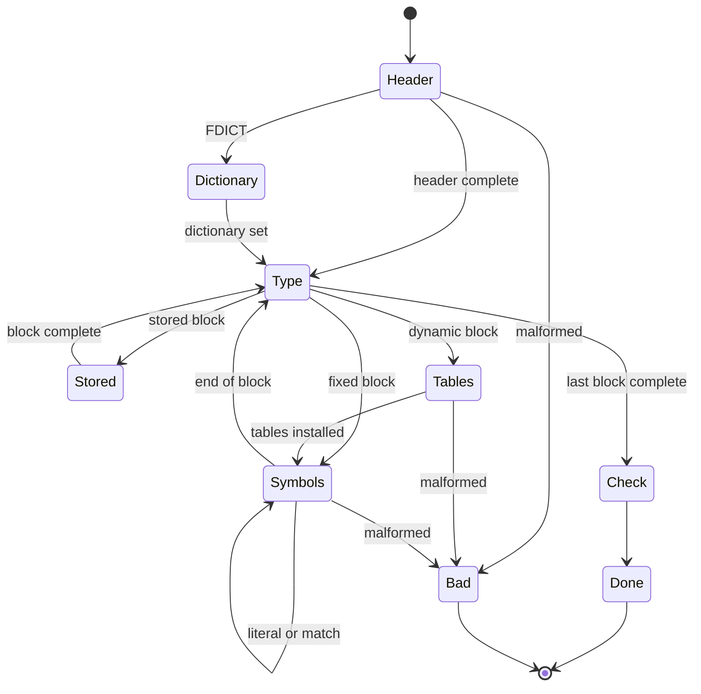
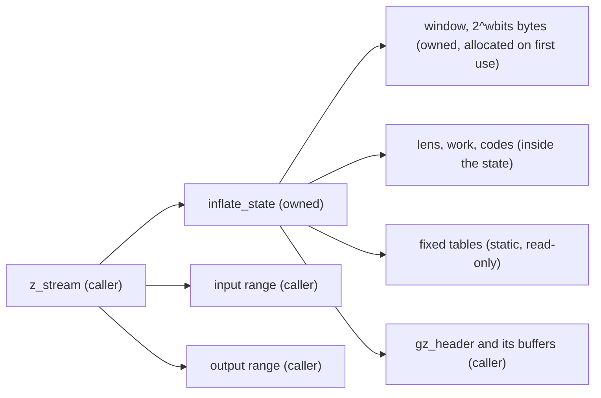

# Stream decoding: why `inflate` is safe

Source: `zlib/inflate.c`. Translation: `ZlibF/Zlib/inflate.c.lean`.

`inflate` and the other `inflate*` functions are safe on every input, for every split of the
input and output buffers, over every permitted sequence of calls. The proof keeps one invariant
of the decoder state. `inflateInit2_` establishes it, every call keeps it, and every memory
access of the C is inside what the invariant describes. This page explains the invariant, why
each step keeps it, and why the decoding loop ends.

It builds on [decode tables](inftrees.md) and [fast decoding](inffast.md). Notes on how the
translation follows the C are in [source notes for the decoder](inflate-source-notes.md). The
internal contract of `updatewindow` is `I-uw-*` in
[internal contracts](../spec/internal-contracts.md).

## Results

All theorems below are registered in `tests/audit/theorems.txt`. They are accepted on commit
`bde170e9`, with one exception: the two initialisation goals were widened after that commit, so
they are registered in the form shown here and accepted in their earlier, narrower form. The
levels are defined in [the proof map](README.md#status-levels).

| Goal | What it says | Theorem | Module under `ZlibF/Proof/` |
| --- | --- | --- | --- |
| `Goal.inflate_sequence_safety` | The sequence result; see below | `inflate_sequence_safety_public` | `public-inflate-sequence-safety.lean` |
| Ten goals `Goal.inflate_safety`, `Goal.inflateSetDictionary_safety`, `Goal.inflateGetDictionary_safety`, `Goal.inflateSync_safety`, `Goal.inflateReset_safety`, `Goal.inflateReset2_safety`, `Goal.inflatePrime_safety`, `Goal.inflateMark_safety`, `Goal.inflateGetHeader_safety`, `Goal.inflateEnd_safety` | One call of that function on a reachable stream is safe | `inflate_safety` and the nine others of the same form | `public-stream-call-safety.lean` |
| `Goal.inflateInit__safety`, `Goal.inflateInit2__safety` | Initialisation is safe for every argument `zlib.h` allows | `inflateInit__safety`, `inflateInit2__safety` | `public-init-safety.lean` |
| `Goal.inflateCopy_safety` | `inflateCopy` is safe | `inflateCopy_safety` | `public-inflate-copy-safety.lean` |
| `Goal.inflate_refusal` | See [Refusals](#refusals) | `inflate_refusal` | `public-stream-refusal.lean` |
| `Goal.inflate_initialisation_domain` | The premises of the sequence goal can be met (non-vacuity) | `inflate_initialisation_domain_public` | `public-inflate-init.lean` |

The goals are stated in `ZlibF/Spec/Safety/`: `Sequences.lean`, `Streams.lean`,
`Initialisation.lean`, `Copy.lean`, `Refusals.lean` and `Domains.lean`.

**The sequence result** has three parts (`StreamSequenceSafety`,
`ZlibF/Spec/Public/Sequences.lean`).

1. Every reachable stream satisfies the public invariant `StreamInvariant`.
2. On a reachable stream, one more permitted call returns without a fault. Afterwards the
   invariant holds again. The call changed only the stream record, the blocks the stream owns,
   an attached `gz_header` record and the caller ranges it was given (the *frame*). The set of
   live blocks changed exactly by the blocks the stream gained or released (the *allocation
   ledger*): nothing leaks.
3. `inflateEnd` on a reachable stream returns `Z_OK` and frees every block the stream owns.

A stream is *reachable* when it results from a successful `inflateInit2_` followed by any number
of permitted calls, successful `inflateCopy` calls, and caller edits of the four buffer fields.
The per-function theorems are part 2 for one function. They are corollaries of the sequence
theorem.

`inflate_sequence_safety_public` is derived from `inflate_sequence_safety`
(`inflate.c.sequence-safety.lean`), which is checked and not registered.

Functional results also exist for this file. They are not required for the safety results and
are listed in [Functional results](#functional-results).

## Refusals

A *refused* stream (`RefusedInflate`) is `NULL`, or a readable record that the state check
`inflateStateCheck` rejects. `Goal.inflate_refusal` covers seven functions: `inflate`,
`inflateEnd`, `inflateReset`, `inflateReset2`, `inflateGetDictionary`, `inflateSetDictionary`
and `inflateCopy`. On a refused stream each returns `Z_STREAM_ERROR` without a fault.

- `inflate` changes nothing outside its frame and allocates nothing.
- `inflateCopy` sets the destination's `state` field to `NULL`.
- The other five leave the heap as it was.

A record whose `state` field holds a garbage pointer is outside this result; the row
"Refused streams" of [deviations](../deviations.md) says why. The other `inflate*` functions
refuse in their functional goals or in registered lemmas that are not required goals, for example
`inflateSync_check`.

## Assumptions

These are all the premises of the sequence goal and of the per-function goals
(`StreamCallDomain`). Each is listed in [deviations](../deviations.md).

| Premise | Says | Belongs to |
| --- | --- | --- |
| Reachable stream (`StreamReachable .inflate`) | The history starts with a successful `inflateInit2_` on a well-formed heap, with `zalloc` and `zfree` each `NULL` or the default function, a version string whose first character is `1`, and the structure size 112 | every goal |
| Caller edits (`Rebuffer`) | Between calls the caller changes only `next_in`, `avail_in`, `next_out`, `avail_out` and memory the stream does not own | the history |
| `ByteObjectsFit` | Every byte object has fewer than `2^63` bytes | every call |
| `StreamBuffers` | The input range and the output range are readable and writable for their lengths, separate from each other, and outside the blocks the stream owns | `inflate` |
| `ActiveHeader` | An attached `gz_header` record and its `extra`, `name` and `comment` buffers are live and writable for their stated capacities. While the header is being read, `extra` is separate from the unread input and `extra_len` is not below the length still to read (`InflateHeaderProgress`) | `inflate` |
| Dictionary range (`CallerRange`) | The dictionary buffer is `NULL`, or readable (writable for `inflateGetDictionary`) and outside the blocks the stream owns | the two dictionary calls |
| Sync input | `next_in` is `NULL` with `avail_in = 0`, or a readable range outside the stream's blocks | `inflateSync` |
| Header record | The record given to `inflateGetHeader` is not `NULL` and its buffers are writable | `inflateGetHeader` |

The default allocator is not a separate premise: it follows from the history, and the
invariant carries it (clause `alloc`).

`InflateHeaderProgress` exists because the C faults without it. In `EXTRA` the C copies to
`head->extra + extra_len - length`. An `extra` buffer that overlaps the input is an overlapping
`memcpy`, and a caller that lowers `extra_len` in mid-header makes the offset wrap
(`tests/regression/inflate-gzip-extra`).

## One call in outline

```c
int inflate(z_streamp strm, int flush) {
    /* entry checks: state, next_out, next_in */
    LOAD();                       /* copy next_in, avail_in, next_out, avail_out, hold, bits */
    for (;;) switch (state->mode) {
        case HEAD: ...            /* each case reads bits, writes output or changes mode */
        case LEN:
            if (have >= 6 && left >= 258 && bits < 8) {
                RESTORE(); inflate_fast(strm, out); LOAD(); break;
            }
            ...                   /* otherwise decode one symbol here */
        case DONE: ret = Z_STREAM_END; goto inf_leave;
        ...
    }
  inf_leave:
    RESTORE();                    /* write the local copies back */
    updatewindow(...);            /* save the tail of the output as history */
    ...
}
```

One call can pass through many modes, and it can take the fast path and the slow path in turn.
A call can also stop in the middle of anything: `NEEDBITS` leaves through `inf_leave` when the
input runs out, and the next call resumes in the same mode. So the invariant has to describe the
state at every mode, not only between blocks.



The diagram groups the modes. The proof has one case for each real mode of the C.

## Memory and ownership



The stream owns two blocks: its state and, once allocated, its window. `lens[320]`, `work[288]`
and `codes[1444]` are arrays inside the state. `lencode` and `distcode` point into `codes` or at
the static fixed tables. `head` points at a record the caller owns.

## The invariant

The invariant is `InflateInv` (`ZlibF/Proof/inflate.c.invariant.lean`). It has twelve clauses.
The definitions named in the last column were read for this table.

| Clause | In plain words | Definition |
| --- | --- | --- |
| `good` | The stream record is readable and its `state` is a live inflate state that points back to the stream. The state's arrays have the sizes of the C declaration. The window has shape W below. `bits ≤ 39`. `next` points into `codes` at an index of at most 1444. `lencode` and `distcode` both point into `codes`, or they are the two fixed tables. No block number names two objects | `Good` (`inflate.c.base.lean`) |
| `alloc` | `zalloc` and `zfree` are the default functions | `DefAlloc` |
| `tables` | In the modes `LEN_`, `LEN`, `LENEXT`, `DIST`, `DISTEXT`, `MATCH` and `LIT`: `lencode` and `distcode` point at tables of the safe shape for `lenbits` and `distbits` ([decode tables](inftrees.md#the-table-shape)), and every literal/length leaf uses at least one bit | `DataTableInvariant` |
| `pending` | `sane = 1`. In `LENEXT`: at most 5 extra bits and `3 ≤ length`, `length + 2^extra ≤ 259`. In `DIST` and `DISTEXT`: `3 ≤ length ≤ 258` and `was = length`; in `DISTEXT` also at most 13 extra bits and `offset ≥ 1`. In `MATCH`: `0 < length ≤ was ≤ 258` and `offset > 0` | `DataPendingInvariant` |
| `lengths` | In `CODELENS`: `lencode` is `codes[0]`, a code-length table of the safe shape; `nlen ≤ 286`, `ndist ≤ 30`, `have ≤ nlen + ndist`; the `have` lengths read so far are at most 15 | `CodeLengthInvariant` |
| `headerLengths` | In `LENLENS`: `ncode ≤ 19`, `have ≤ ncode`, `nlen ≤ 286`, `ndist ≤ 30`; the `have` entries written so far are 3-bit values | `LengthHeaderInvariant` |
| `held` | `hold < 2^bits`: no bit is set above the bit count | |
| `config` | `wrap` and `reqwrap` are among 0, 1, 2, 3, 5, 6, 7. `wbits` is 8 to 15; or it is 0, there is no window, the header is unread and the mode is `HEAD`, `BAD`, `MEM` or `SYNC`. A `gz_header` is attached only when gzip decoding is allowed | `InflateConfig` |
| `modes` | `HEAD ≤ mode ≤ SYNC` | |
| `phase` | A block mode is reached only after a header was read, or in raw mode. The gzip header modes `FLAGS` to `HCRC` occur only when gzip decoding is allowed | `InflatePhase` |
| `origin` | `lencode` is `codes[0]`, or `lencode` and `distcode` are the two fixed tables. No other shape is ever stored between calls | `CopyTableOrigin` |
| `globals` | The static tables (fixed codes, CRC, the tables of `trees.c`) have their initial contents | `LibraryGlobals` |

Three clauses describe a call that stopped part-way: `pending` (inside a match), `lengths`
(inside the code-length sequence) and `headerLengths` (inside the code-length-code header).
They are what lets the next call resume.

One more fact holds between calls and is carried beside the invariant, `DecoderHeldBits`:
outside `BAD`, `MEM` and `SYNC`, `bits ≤ 32`. Inside a call `bits` can reach 39: `NEEDBITS(n)`
with `n ≤ 32` pulls a byte only while `bits < n`, so a pull happens at `bits ≤ 31` and leaves at
most 39.

The sequence goal states the smaller public predicate `StreamInvariant`, which is the clauses
`good` and `alloc`. `InflateInv` implies it.

### Window shape W

W is the part of `good` about the sliding window (`WinInv`).

1. `wbits ≤ 15`.
2. `window` is `NULL`, or it points at the start of a writable block of exactly `2^wbits`
   bytes. A `NULL` window has `wsize = 0`.
3. `wsize` is 0 or `2^wbits`.
4. `whave ≤ wsize`. `wnext < wsize`, or both are 0.
5. If `whave < wsize` then `wnext = whave`: a window that is not yet full has been filled from
   index 0.

W says where reads and writes of the window land. It says nothing about the bytes in it.

`updatewindow(strm, end, copy)` saves the last `copy` output bytes. It has three cases. With
`wsize = 8`, `h` an old byte and `n` a new one:

```
copy >= wsize                 [ n n n n n n n n ]   wnext = 0   whave = 8

copy <= wsize - wnext         [ h h h . . . . . ]   wnext = 3   whave = 3
(copy = 2)                    [ h h h n n . . . ]   wnext = 5   whave = 5

copy >  wsize - wnext         [ h h h h h h . . ]   wnext = 6   whave = 6
(copy = 4)                    [ n n h h h h n n ]   wnext = 2   whave = 8
```

- First case: one `memcpy` of `wsize` bytes fills the block.
- Second case: one `memcpy` to `[wnext, wnext + copy)`, which ends at or before `wsize`. Then
  `wnext` advances and wraps to 0 at `wsize`. If the window was not full, W.5 gives
  `whave = wnext`, so adding the same count to `whave` keeps W.5.
- Third case: a first `memcpy` of `wsize - wnext` bytes to the end of the block, then a second
  of the rest to index 0. The window is full afterwards.

`updatewindow_safe` (`inflate.c.uw.lean`, registered) proves that the call never faults and
gives `Good` again. If the window has to be allocated and the allocation fails, the call returns
1, the state is unchanged, and only the allocation counter moved.

## Why each step keeps the invariant

`reachable_invariant_kind` (`inflate.c.reachable.lean`) proves, by induction on the history,
that every reachable stream has `InflateInv` and `DecoderHeldBits`. Each case of the induction
is a theorem.

| Step | Theorem | Why it holds |
| --- | --- | --- |
| `inflateInit2_` succeeds | `inflateInit2_invariant_of`, `inflateInit2_held` | The state is zeroed, then `inflateReset2` sets `wrap` and `wbits` and `inflateResetKeep` sets `mode = HEAD`, `hold = 0`, `bits = 0`, `lencode = distcode = next = codes`. The window is `NULL` with `wsize = 0` |
| The caller edits the buffer fields | `rebuffer_invariant` | No clause mentions `next_in`, `avail_in`, `next_out` or `avail_out`, and the caller may not touch the owned blocks |
| `inflate` | `inflate_preserves`, from `inflate_call` and `inflate_call_refused` | See below |
| `inflateReset`, `inflateReset2`, `inflateResetKeep` | `inflateReset_preserves`, `inflateReset2_preserves`, `inflateResetKeep_preserves` | All three reset the mode and the bit buffer. `inflateReset` also clears the window counters and keeps the block. Only `inflateReset2` with a different `windowBits` frees the window; the ledger then records the release |
| `inflatePrime` | `inflatePrime_preserves` | It refuses a count above 16 or a total above 32, so `bits ≤ 32` and `held` stay true |
| `inflateSetDictionary`, `inflateGetDictionary` | `inflateSetDictionary_preserves`, `inflateGetDictionary_preserves` | The first goes through `updatewindow`; the second only reads the window |
| `inflateSync` | `inflateSync_preserves` | It scans input and, on a match, resets through `inflateReset` |
| `inflateGetHeader`, `inflateMark` and the undocumented queries | `inflateGetHeader_preserves`, `inflateMark_preserves`, and others | They write one or two fields that no clause restricts, or nothing |
| `inflateCopy` succeeds | `inflateCopy_invariant` | The copy gets its own state and window blocks. Clause `origin` says what `lencode` can be, so the copy can point its own tables the same way |

`operation_preserves` collects the rows for the stream calls. Part 2 of the sequence result
also needs the frame and the ledger of each call. Those are `inflate_call_safe` and
`operation_safe_other` (`inflate.c.sequence-safety.lean`). Part 3 is `inflateEnd_invariant`.

### Inside one `inflate` call {#the-mode-proof}

`inflate_call` (`inflate.c.call-default.lean`) covers a call whose entry checks pass.
`inflate_call_refused` covers a call that returns `Z_STREAM_ERROR` at entry. The first proves,
besides safety, the full list of return codes and counter updates; safety uses only part of it.

The table says, for each group of modes, which access needs an argument and which fact supplies
it.

| Modes | Access that needs an argument | What makes it safe |
| --- | --- | --- |
| Every `NEEDBITS`, `PULLBYTE` | Read of `*next`; the shift `<< bits` | `have > 0` is tested before the read. The shift happens at `bits ≤ 31` |
| `HEAD` to `HCRC` | Writes to `head->extra`, `head->name`, `head->comment` | Each write is guarded by the capacity `extra_max`, `name_max` or `comm_max`, which `ActiveHeader` makes writable. The `extra` offset uses `InflateHeaderProgress` |
| `STORED`, `COPY` | `memcpy` from input to output | `copy = min(length, have, left)` bounds both ranges; `StreamBuffers` makes them separate |
| `TABLE` | The later index `lens[have]` | The C rejects `nlen > 286` or `ndist > 30`, so `nlen + ndist ≤ 316 < 320` |
| `LENLENS` | `lens[order[have]]`, the call of `inflate_table` | `have < ncode ≤ 19`. The 19 lengths are 3-bit values, which is the premise of [`inflate_table`](inftrees.md#assumptions) for `CODES` |
| `CODELENS` | Table lookup, `lens[have++]`, `lens[have - 1]` | Clause `lengths`. A repeat that would pass `nlen + ndist` is rejected. Code 16 with `have = 0` is rejected before `lens[have - 1]` |
| End of `CODELENS` | Two calls of `inflate_table` into `codes[1444]` | `852 + 592 = 1444`. `inflate_table_safe` gives no fault; `inflate_table_decoder_safe` gives the table shape that clause `tables` needs |
| `LEN` to `DISTEXT` | Table lookups | Clause `tables`: a masked index is inside the table and the entry is a leaf or a link to leaves |
| `LEN`, fast path | The call of `inflate_fast` | `inflate_fast_raw_entry` (`inflate.c.fast-entry.lean`) builds the entry conditions of [fast decoding](inffast.md#assumptions) from the invariant and `StreamBuffers` |
| `MATCH` | Copy from the window or from earlier output | `offset > 0` (clause `pending`). A distance beyond the output of this call goes to the window, and `sane = 1` makes the C reject it when it exceeds `whave`. W bounds the window index |
| `LIT` | One byte to `*put` | `left > 0` is tested first |
| `CHECK`, `LENGTH` | Checksum over the output of this call | The bytes were written by this call, inside the output range |
| `inf_leave` | `updatewindow` on the output of this call | The source is the output range, which `StreamBuffers` keeps apart from the window |

<a id="table-and-trailer-statement-boundaries"></a>
The run lemmas of the individual modes are registered, for example `inflate_TABLE_run`,
`inflate_LENLENS_run` and `inflate_CHECK_run`. What the table and trailer lemmas assume is in
the [source notes](inflate-source-notes.md#statements-of-the-table-and-trailer-lemmas).

## Why the loops end

The dispatch loop `for (;;) switch (state->mode)` has no bound in the C. It ends because a rank
falls on every iteration that does not leave the loop
(`ZlibF/Proof/inflate.c.dispatch-rank.lean`).

```
mass = bits + 8 * have + left
rank = 64 * mass + credit(mode)
```

`mass` counts the input bits still available and the output bytes still free. `credit` is a
fixed number below 64 for each mode: `HEAD` 60, `STORED` 48, `TABLE` 47, `LENLENS` 46,
`CODELENS` 45, `LEN` 21, `LIT` 20, `TYPE` 8, `CHECK` 4, `DONE` 2, and so on.

- No iteration creates mass: bits move from `have` to `bits`, and are then dropped
  (`dispatchMass_advance`).
- An iteration that writes output, or that drops input bits, lowers `mass` by at least one. One
  unit of mass is worth 64, which is more than any change of credit.
- An iteration that does neither moves to a mode of lower credit (`dispatchRank_advance`). Two
  examples: `HEAD` (60) on a raw stream goes to `TYPEDO` (9) without reading anything, and
  `COPY` (17) at the end of a stored block goes to `TYPE` (8).

Each group of modes has a lemma that says "leaves, or the rank falls": `inflate_dispatch_data_rank`,
`inflate_dispatch_type_rank`, `inflate_dispatch_stored_rank`,
`inflate_dispatch_gzip_header_rank` and their relatives (`inflate.c.control-rank.lean` and the
modules beside it). The fast path counts as one iteration: `inflate_fast_safe_progress` shows
that a fast call that does not end the block uses output room.

The translation's loops carry a fuel of `2^64` iterations, and running out is a fault. With
`bits ≤ 39` and 32-bit `have` and `left`, the rank is below the fuel (`dispatchRank_fuel`), so
that fault cannot happen.

The inner loops are bounded directly: a stored copy by `copy`, the code-length loop by
`nlen + ndist - have`, a match copy by `length`, `syncsearch` by the input length.

## Where the hard part is

The hard part is not one loop. It is that a call can stop and resume at any `NEEDBITS`, so the
invariant must be strong enough in each of about thirty modes and still be re-established by
every one of them. Three places needed the most work.

- **The gzip header.** It is the only place where `inflate` writes into caller buffers other
  than the output. The real C faults there for some caller layouts, which is why the premise
  `InflateHeaderProgress` exists, with its sanitizer regression.
- **Termination.** Several transitions use no input and write no output. A measure on input and
  output alone does not fall there; the credit term of the rank handles them.
- **The fast path.** `inflate_fast` has stricter entry conditions than the modes around it. They
  are built from the same invariant on the heap that `RESTORE()` leaves, including the case in
  which input and output are two ranges of one block.

## Readings of the C that no theorem states

- The bytes that a match reads from the window were written earlier. W.5 is the reason: in a
  window that is not full, valid history is `[0, whave)` and the C rejects a distance beyond
  `whave`. The theorems state only that the read is inside the block. In the model, reading a
  byte that was never written returns an arbitrary value and is not a fault
  ([trusted base](../trusted-base.md)). **to confirm**.
- The window holds the most recent `whave` bytes of output and dictionary, in order. This is a
  fact about meaning. It is not needed for safety and no safety theorem states it.
  **to confirm**.

- Every pointer field of the state is written before it is read. `inflateInit2_` and
  `inflateCopy` clear the new state with `zmemzero` before they use it. The model cannot show
  this by itself: a pointer field in fresh memory reads as `NULL` there without a fault
  ([safety](../spec/safety.md#uninitialised-memory)). **to confirm**.

More readings, about how the translation follows individual C statements, are in the
[source notes](inflate-source-notes.md).

## Functional results

These say what the functions compute. They are registered, and they are not required for the
safety results.

| Result | Theorem | Module |
| --- | --- | --- |
| `Goal.inflate`: the full contract of one call, with progress, return codes, counters, frame and ownership. The safety proofs of `uncompress*` and of the gzip reader use it | `inflate_public` | `public-inflate.lean` |
| The full contracts of the other functions, such as `Goal.inflateCopy`, `Goal.inflateReset`, `Goal.inflateSetDictionary` | `inflate_copy_public`, `reset_public`, `inflateSetDictionary_public` and others | `public-inflate-*.lean` |

No theorem says that the output of `inflate` equals the meaning of the input in the DEFLATE
format. `inflate_decodes` is a statement about the abstract model only.

### Causality and history across calls

This subsection records two corrections to earlier statements about meaning. Neither is a zlib
bug.

A decoded symbol is supported by a prefix of the input bits. The decoder may have read further:
`inflate_fast` pulls whole bytes ahead and gives the unused ones back. An earlier statement
required the output to agree with everything the decoder had read. That is false, because bytes
read ahead can be malformed while the symbols already decoded are valid. The corrected relation
ties each symbol to its supporting bits only. It is registered as `inflate_deferred_distance`
and `inflate_deferred_distance_rejects_legacy_consistency`, with the regression
`tests/regression/inflate-deferred-distance`.

A second earlier statement said that a data error is detected within eight bytes of its cause.
It has a counterexample, and a larger constant would not repair it. The model goal that rested
on it, `Api.Goal.inflate_rejects_invalid`, is not planned
([progress, Scope](../progress.md#scope)).

An error can follow real output: the window is allocated at the end of a call, so `inflate` can
return `Z_MEM_ERROR` after it has written bytes. `Goal.inflate` keeps that effect.

Earlier notes on what a functional statement across calls has to cover (dictionaries, priming,
recovery) are kept in the [history](../history/proof-functional-notes.md).

## A defect found in `inflateCopy`

The unpatched `inflateCopy` tests whether `lencode` lies inside `codes` with `>=` and `<=`. When
`lencode` points at the static fixed table, the two pointers belong to different objects and the
comparison is undefined behaviour. Patch 0001 replaces the test with pointer equality
(`patches/README.md`; [finding and sanitizer reproduction](../findings/inflate-copy-fixed/README.md)).
The translation and `inflateCopy_safety` are for the patched source.
