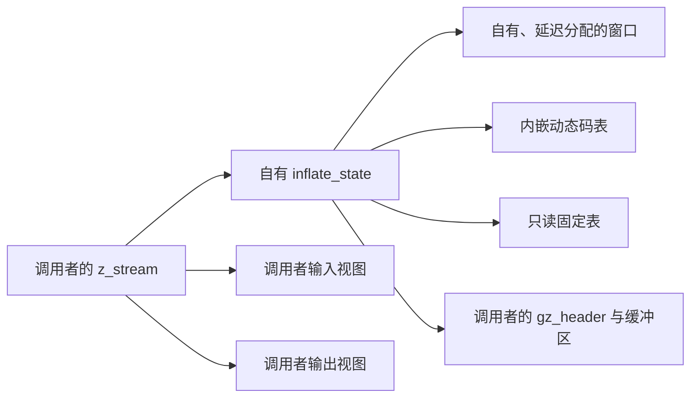
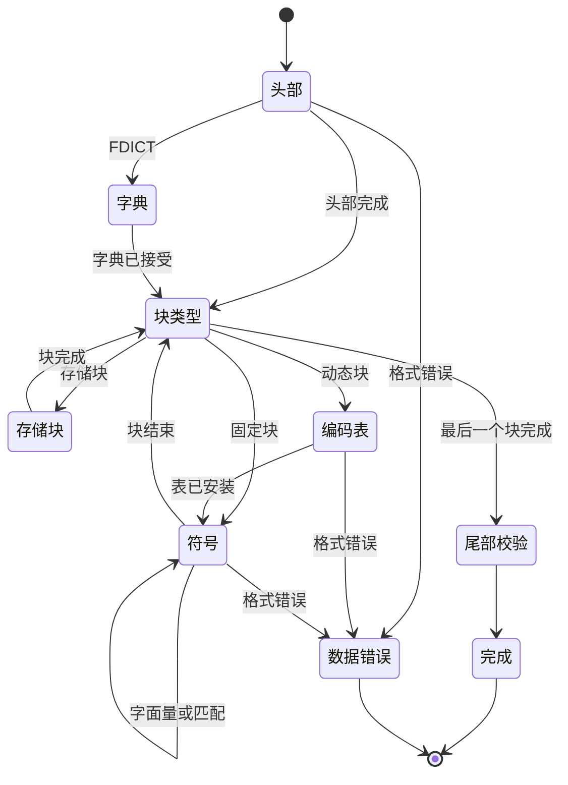

<!-- source-sha256: c783f77406a2fa8e8c5092bbaaecc72b2a6c612105cdef81c22d23070594f39d -->
# 流式解码：模式、历史与调用组合

解压器的工作是从压缩比特中识别字面量和匹配，再按顺序恢复原文。例如，先恢复两个字面量 `AB`，再遇到“距离 2、长度 6”，就应继续产生 `ABABAB`，得到 `ABABABAB`。输出缓冲区可能在中途用完；本页的证明必须把读位、查表、历史复制和下一次调用连接成这同一个解码过程。

源文件：`zlib/inflate.c`；翻译：`ZlibF/Zlib/inflate.c.lean`。
公开行为见 [API 指南](../spec/api/README.md)，解出的流见[格式指南](../spec/format/README.md)，
窗口更新见[内部契约](../spec/internal-contracts.md)中的 `I-uw-*`。

`inflate` 在每个输入和缓冲区的每种切分上都是安全的，对它的调用序列也是如此。本页解释证明如何组合。它使用[解码表](inftrees.md)、[快速解码](inffast.md)、[Adler-32](adler32.md)、[CRC-32](crc32.md)与[分配](zutil.md)。

## 已证明什么

| 结果 | 类别 | 定理 | 模块 |
| --- | --- | --- | --- |
| `Goal.inflate_sequence_safety`（`ZlibF/Spec/Safety/Sequences.lean`）：每个可达历史上不变量成立；下一次调用安全，分配账目准确；`inflateEnd` 释放流拥有的一切 | 安全，必需 | `inflate_sequence_safety_public`，由 `inflate_sequence_safety` 得到 | `ZlibF/Proof/public-inflate-sequence-safety.lean`、`inflate.c.sequence-safety.lean` |
| 逐函数的安全目标：`inflate`、`inflateSetDictionary`、`inflateGetDictionary`、`inflateSync`、`inflateReset`、`inflateReset2`、`inflatePrime`、`inflateMark`、`inflateGetHeader`、`inflateEnd`（`ZlibF/Spec/Safety/Streams.lean`） | 安全，必需 | `inflate_safety` 及其他 `inflate*_safety` 定理 | `ZlibF/Proof/public-stream-call-safety.lean` |
| `Goal.inflateInit__safety`、`Goal.inflateInit2__safety` | 安全，必需 | `inflateInit__safety`、`inflateInit2__safety` | `ZlibF/Proof/public-init-safety.lean` |
| `Goal.inflateCopy_safety` | 安全，必需 | `inflateCopy_safety` | `ZlibF/Proof/public-inflate-copy-safety.lean` |
| `Goal.inflate_refusal`：每个函数都拒绝未初始化的流，并保持堆不变 | 安全，必需 | `inflate_refusal` | `ZlibF/Proof/public-stream-refusal.lean` |
| `Goal.inflate_initialisation_domain`：序列目标的前提可以被满足 | 非空泛性，必需 | `inflate_initialisation_domain_public` | `ZlibF/Proof/public-inflate-init.lean` |
| `Goal.inflate`：单次调用的完整契约，包括进展、返回码、计数器、帧和所有权 | 功能性，保留；`uncompress*` 和 gzip 读取侧的安全证明用到它 | `inflate_public` | `ZlibF/Proof/public-inflate.lean` |
| 其他函数的完整契约，例如 `Goal.inflateCopy`、`Goal.inflateReset`、`Goal.inflateSetDictionary` | 功能性，保留 | `inflate_copy_public`、`reset_public`、`inflateSetDictionary_public` 等 | `ZlibF/Proof/public-inflate-*.lean` |

这些定理登记在 `tests/audit/theorems.txt` 中，并在提交 `bde170e9` 上被接受（[进度，范围](../progress.md#scope)）。

逐函数的安全定理是序列定理的推论。序列定理建立在一个不变量 `InflateInv`（`ZlibF/Proof/inflate.c.invariant.lean`）之上。初始化对每个被接受的 `windowBits` 建立它；调用者更换缓冲区、每个流操作以及 `inflateCopy` 都保持它（`reachable_invariant_kind`，`ZlibF/Proof/inflate.c.reachable.lean`）。

不是必需的、也不在计划内的是：`inflate` 的输出等于输入在格式下的含义。下面各节会指出哪些论证只属于功能性证明。

下文中说明某一步“尚未完成”或“仍需证明”的段落，是对 C 源代码的解读，这里列出的定理没有以那种形式陈述它。定理是依据翻译检查的，而不是依据这段文字。

## 假设了什么

- 每个字节对象小于 `2^63` 字节（`ByteObjectsFit`）。
- 流使用默认分配器。
- 输入范围和输出范围相互分离，并且位于流所拥有的存储之外（`StreamBuffers`）。字典缓冲区与窗口分离。
- `inflate` 把 gzip 头读入所附的 `gz_header` 时，该记录的 `extra` 缓冲区与未读输入分离（`InflateHeaderProgress`）。

每个前提都明确写在陈述中，并在[偏差记录](../deviations.md)中各占一行。

## 穿过解码器的各条路径

可用输入字节、输出空间和已持有的位数决定是否走快速路径。一次调用可以交替走快速路径和慢速路径。定理覆盖小缓冲区、部分输入和动态 Huffman 块：表构造、分派和退出在各次调用返回的堆上传递同一个不变量。参数范围的名称见[输入配置](../spec/input-configurations.md#inflate-inputs)。

## 内存与所有权

状态块保存解码器处理到哪个阶段、还持有多少未消费比特，以及怎样查表。历史窗口保存较早恢复的字节，供后续匹配回引。调用者的输入与输出则只是本轮借给解码器的区间；换一个输出数组，并不表示解码任务重新开始。

几个数组有不同用途：`lens` 暂存符号码长，`work` 暂存按码长排列的符号，`codes` 保存实际解码表项。`lencode` 用来查字面量／长度，`distcode` 用来查距离；它们可能指向固定只读表，也可能指向当前状态中的动态表。

流拥有其已分配状态及窗口。`lens[320]`、`work[288]` 和 `codes[1444]` 内嵌在状态中。
`lencode` 与 `distcode` 选择静态固定表或 `codes` 的区域；`next` 跟踪表构造。
`head` 指向调用者拥有的头部存储。不变量记录这些替代情形、已初始化范围及获准访问的字节视图。

初始化必须在指针字段读取前建立它们。运行时把新分配指针表示为空指针的约定，
并不能证明这种先写后读的时序事实，见[安全规范](../spec/safety.md#uninitialised-memory)。
不变量也应涵盖错误模式，以保证拒绝或数据错误后仍能安全清理。

## 窗口不变量 W 与 F4

先为环中的量命名，单位都是字节：`wsize` 是容量，`whave` 是已经保存的有效历史数量，`wnext` 是下一次写入的下标；`wbits` 是容量指数，容量为 `2^wbits`。下面的粗体 W 是这组形状条件的名字，不是容量本身。为直观理解，容量为 8 的教学环若只写入 `ABC`，就有 `whave = 3`、`wnext = 3`；写满后，游标才会循环复用旧位置。

用 **W** 表示环形缓冲区的形状：

1. `wsize = 0` 或 `wsize = 2^wbits`。
2. `window` 为空指针，或指向已分配的 `2^wbits` 字节块；`wsize > 0` 蕴含存储非空。
3. `whave ≤ wsize`；若 `wsize > 0`，则 `wnext < wsize`；否则 `wnext = 0`。
4. 若 `whave < wsize`，则 `wnext = whave`。

初始化建立空窗口。必须逐一检查各个重置变体：重置计数、保留已有存储、改变窗口大小是不同操作。
只有实际释放存储的大小变更路径，才可移除相应所有权声明。

仅属于功能性证明：为了正确性，要给 W 加上环中内容。有效的 `whave` 个字节按环顺序对应逻辑历史的适当后缀。
预置字典字节贡献历史，但不成为输出。仅有 W 的形状只能说明向后引用读在窗口之内，不能说明它返回正确字节。

### `updatewindow(strm, end, copy)`

这个辅助函数把一段最新数据加入历史。`strm` 指向公开流记录，`end` 指向源数据末尾的后一位置，`copy` 是要加入的字节数，所以源区间从 `end-copy` 开始。下文局部量 `dist` 表示第一次能连续写到环末尾的字节数；它不是压缩符号中的回退距离。

`I-uw-pre` 提供可读源区间 `[end-copy, end)`，以及每次 `memcpy` 所需的不重叠事实。
源可以是最近输出，也可以是获准的字典范围。公开调用者必须提供这些事实，不能默默排除合法视图。

若需要分配但分配失败，函数返回 1，且不取得窗口块。
必须证明准确的字段／帧效果，不能由失败码推断整个堆不变。
如果成功分配后 `wsize` 为零，则把它设为 `2^wbits`，并初始化 `wnext = whave = 0`。

对 `copy ≥ wsize`，只保留 `[end-wsize, end)`，写整个窗口，并设 `wnext = 0`、`whave = wsize`。

对 `copy < wsize`，令 `dist = min(wsize-wnext, copy)`。
第一次复制把源前缀写入 `[wnext, wnext+dist)`。
若仍有字节，则 `dist = wsize-wnext`；第二次复制写 `[0, copy-dist)`，此时环已填满。
设置 `wnext = copy-dist`、`whave = wsize`。

若没有剩余字节，则把 `wnext` 增加 `dist`，并在 `wsize` 处回绕。
若旧环未填满，W.4 给出 `whave = wnext`，同样的加法使 `whave` 增加到不超过 `wsize`；
仍未满时恢复 W.4。若旧环已满，则保持已满。以上建立形状保持论证。
内容论证要在同样的分支中跟踪最新后缀。
还应涵盖零字节复制，以及实际源视图所对应的准确指针形成。

## 模式证明

“模式”说明接下来要识别什么：头部、块类型、码表、字面量／匹配，或尾部校验。输出空间不足时，模式和未完成的长度会保存在状态中。证明因此不能只检查一次成功循环，而要说明从每个暂停点恢复后，仍会接着完成同一个字段或复制。

每个实际模式在共同不变量下有一个执行分支。分组图展示数据流，不能替代源代码中的各模式或出口。

读取宏使用几个局部寄存器：`have` 是本轮剩余输入字节数，`left` 是本轮剩余可写输出字节数，`hold` 是装入的比特值，`bits` 是其中有效、尚未消费的位数。`length` 在复制模式中记录尚需复制的字节数。建表时，`nlen`、`ndist`、`ncode` 分别计数字面量／长度符号、距离符号与码长符号；同一个局部计数在其他模式可能承担不同任务，必须按实际模式解释。

| 源代码分组 | 所需执行事实 |
| --- | --- |
| 入口检查 | 无效流／参数返回规定错误，效果恰好在许可范围内。只有契约明确规定时，才可断言整个堆不变。 |
| `PULLBYTE` | `have == 0` 时在读取前离开；否则读取与游标增加消费一个有效字节。 |
| `NEEDBITS`、`BITS`、`DROPBITS` | 为每个实际请求的位数建立界限，并在减法前保证已有足够比特。移入字节时位数必须有效；默认 64 位 `hold` 保留读入比特。 |
| `HEAD` 到 `HCRC` | 验证包装字段；只在调用者提供容量内写 `extra`、`name`、`comment`。无符号减法前为 `length` 与进度计数建立界限。 |
| `DICTID`、`DICT` | 保持需要字典的状态及校验和效果；拒绝字典不能凭空产生已解码输出。 |
| `STORED`、`COPY` | `copy ≤ min(length, have, left)` 同时限制两个视图。为 `memcpy` 提供 API 中有依据的不重叠条件。 |
| `TABLE` | 默认检查给出 `nlen ≤ 286`、`ndist ≤ 30`，因而 `nlen+ndist ≤ 316 < 320`。 |
| `LENLENS` | `have < ncode ≤ 19` 限制 `order[have]`；补零完成提供给码长表的 19 个长度。 |
| `CODELENS` | 码 16 需要先前长度；重复次数检查防止写到 `nlen+ndist` 之外。 |
| 表安装 | 证明 `inflate_table` 的执行、表项含义及总预留量 `852+592 = 1444`，并安装所得表谓词。 |
| `LEN` 到 `DISTEXT` | 根表／子表读取使用已初始化项，恰好消费支撑该码字和附加位的比特。选择快速分支时证明其入口前提。 |
| `MATCH`、`LIT` | 限制输出写入，证明历史／窗口源有效，包括顺序输出内部的重叠。 |
| `CHECK`、`LENGTH` | 按规定宽度，把正确的包装校验和／长度与实际产生字节比较。 |
| `inf_leave` | 写回准确的游标／计数／比特，必要时更新历史，并保持规定的返回行为。 |

这里请求量 `n` 按比特计数。例如还缺一个 12 位字段、当前仅有 5 位时，补入一个字节后有 13 位，足以消费字段并留下 1 位。下面的 39 位界限来自“至多缺 32 位时再补入一个字节”的具体读位顺序，而不是任意状态都自动满足的常量。

补充输入时，若请求 `n ≤ 32`，只有 `bits < n` 才会读入字节；
所以字节移位至多为 31，读入后的位数至多为 39。
其他掩码与丢弃操作需要各自与源代码对应的界限。
不能把每个 `BITS` 用法都当成固定的小常数：动态表宽度及链接项的界限来自表谓词。

外层循环需要考虑模式的度量。有些转换既不消费输入，也不产生输出。
应为进展点或返回点之间的内部转换建立界限，再与有限输入／输出及复制度量组合。
每个模式分别终止，并不能单独建立完整的执行步数预算界限。

## 因果关系与跨调用历史

本节是功能性的，不是必需的。它记录早先两个模型陈述为什么是错的，以及正确的功能性陈述需要什么。

需要区分“为确定当前符号已经检查的比特”和“为了快速查表提前读入的比特”。例如当前字面量只由前 3 位决定，寄存器可能已经读入整字节；后面 5 位不必已经构成一个合法的后续符号。当前输出的依据是前 3 位，证明不能把更远预读错误地当成已经解释完的输入。

功能正确性必须独立于实现状态确定输出。解出的一个符号需要一段支撑它的源比特前缀。
解码器可能推测性地读到该前缀之后，也可能在离开快速路径前归还完整预读字节。
应把发出的符号与支撑比特关联，不能要求符号含义与所有推测性预读都一致。

早期针对整个预读区间的一致性条件是错误的。修正后的支撑比特前缀关系区分了两者。
同样，固定八字节的数据错误检测延迟存在反例。
没有证明就增大常数，不能建立因果错误定理。这些是规范和模型方面的经验，
并非上游内存问题。修正后的关系登记为 `inflate_deferred_distance` 和 `inflate_deferred_distance_rejects_legacy_consistency`，对应的回归是 `tests/regression/inflate-deferred-distance`。

跨调用应保持累计比特前缀、输出前缀、逻辑历史、包装／校验和状态及字典需求。
应量化所有许可的输入拆分、输出空间拆分及刷新值。
后续失败可能发生在实际输出之后：延迟窗口分配可在解压已经写出字节后返回 `Z_MEM_ERROR`。
错误契约必须保留这些效果，不能要求输出为空。

预置字典带来已知校验和要求，也可能提供在调用者给出字典前内容未知的历史。
要把这种未知历史与输出字节区分开。裸 DEFLATE 字典替换、头部操作、位预置和恢复需要各自精确的 API 效果；
普通数据阶段的细化不会自动涵盖所有此类序列。
负值位预置也需要一般的比特级连接，不能只依靠有限执行矩阵或模型见证。

## 生命周期与辅助函数

| 函数 | 证明必须组合的内容 |
| --- | --- |
| `inflateInit_`、`inflateInit2_` | 版本／大小及参数拒绝、状态分配、初始化写入、成功不变量与准确的失败清理。 |
| `inflateReset`、`inflateResetKeep`、`inflateReset2` | 各自不同的计数／历史／头部效果、许可的窗口大小变化及对应所有权转换。 |
| `inflateEnd` | 窗口与状态各释放一次，清空流状态，并恢复调用者先前的存活块集合。 |
| `inflatePrime` | 负计数重置与非负比特插入；移位、低位含义和计数上限拒绝。 |
| `inflateSetDictionary`、`inflateGetDictionary` | 文档规定的字典模式、校验和判定，以及按时间顺序的环形复制；历史不等于已产生输出。 |
| `inflateCopy` | 独立状态／窗口分配与失败清理；复制内容，重定位动态 `lencode`、`distcode`、`next`，保留静态指针，并证明未来行为等价。 |
| `inflateSync`、`syncsearch` | 有界扫描、恢复状态变化，以及丢弃输入与重新开始的解码阶段之间的关系。 |
| `inflateGetHeader` | 保存获准的调用者存储，并保持其生命周期／容量要求直到头处理完成。 |
| `inflateMark`、`inflateSyncPoint`、`inflateCodesUsed` | 每个许可模式中的准确数值／查询行为，包括拒绝情形。 |
| `inflateValidate`、`inflateUndermine` | 准确状态更新、支持／不支持的行为及不变量保持。 |

未打补丁的 `inflateCopy` 用 `>=` 和 `<=` 比较指向静态固定表的指针和指向状态 `codes` 数组的指针。它们是不同对象，所以这种比较是未定义的。补丁 0001 把它换成指针相等比较（[发现](../findings/inflate-copy-fixed/README.md)，`patches/README.md`）。翻译和 `inflateCopy_safety` 针对的是打过补丁的源代码。

序列定理使用初始化结果，以及各函数已证明的保持、帧与所有权效果。它并不把内部历史和表谓词连接到独立的格式关系。这种连接是功能性的，不在计划内；抽象的模型定理 `inflate_decodes` 只是关于模型的陈述。

## 与 C 的对应检查

### 控制流与位缓冲区

翻译后的辅助函数需要保留 C 的跳转效果。`IL` 是当前局部寄存器的记录，`StateT` 表示寄存器随执行变化，`ExceptT` 用来区分跳出分派、统一离开及直接返回。下面的类型表达式只是实现这些控制转移的机制；它不额外证明循环会终止。

`inflate` 把 C 寄存器保存在 `IL` 中。每个模式是 `ExceptT Ex (StateT IL M)` 中的辅助函数。
`switch` 的 `break` 返回分派器。`Ex.leave` 携带当前寄存器跳至 `inf_leave`，不回滚先前读写。
`Ex.ret` 是直接的 C 返回。贯穿执行会调用下一个模式体。
分派器每轮从堆读取 `state->mode`。

以下细节可被观察到，必须跨辅助函数边界保持：

- `TYPE` 不写 `mode` 就进入 `TYPEDO`。若读块头时输入耗尽，保存的模式仍是 `TYPE`。
  这会影响 `data_type` 与下次入口。
- `PULLBYTE` 在改变任何内容前检查输入。失败的 `NEEDBITS` 保留此前迭代已经读入的全部字节。
  `DROPBITS` 先改变 `hold` 再从 `bits` 减去位数；`BYTEBITS` 的两个表达式都使用旧位数。
- `BITS(n)` 在与 `(1U << n) - 1` 做掩码前把 `hold` 转为无符号 `int`。
  `hold` 本身是无符号 `long`。该转换和移位宽度都不能简化。
- `HEAD` 中头部取模表达式在 64 位算术中，将无符号 32 位移位项加到 `hold >> 8`。
  位预置的高位参与该表达式。
- `DICT` 在 `RESTORE` 和输入总数更新后返回 `Z_NEED_DICT`，绕过普通收尾。
  `MEM` 与 `SYNC` 也直接返回。
- `CHECK` 更新输出总数和校验和，再重置局部输出基线。
  收尾使用已改变的基线，避免再次计算同一批字节。
- `inf_leave` 先恢复寄存器，再更新窗口。窗口分配失败在后续总数／校验和更新前返回 `Z_MEM_ERROR`。
  已写输出仍然存在；内存错误不意味着输出为空。

通常的规范化位缓冲区事实是 `bits ≤ 39`、`hold < 2^bits`。
它们是证明义务，并非对任意状态记录都成立的假设。
`inflatePrime` 在位数为负时清空缓冲区，拒绝超过 16 的计数或超过 32 的合计位数，
并先用有符号 `long` 表达式对 `value` 做掩码，再转为无符号 `long`。负值必须遵循这个转换顺序。

`inflateMark` 也需要精确转换：对 `back` 符号扩展，转为无符号 `long`，左移 16 位，
转回有符号 `long`，再加无符号条件项。默认平台上超出范围的转换按模进行。
错误结果是 `-65536`。

### 窗口、字典、复制与缓冲区视图

保留历史是按时间顺序的数据，不只是任意存储中的 `whave` 个字节。
对于已分配窗口，`8 ≤ wbits ≤ 15`、`whave ≤ wsize`，且 `wsize > 0` 时 `wnext < wsize`；
未填满窗口满足 `wnext = whave`。完整环的时间顺序从 `wnext` 开始。
匹配证明必须把这个顺序连接到先前输出与字典。

`updatewindow` 分配未初始化字节，然后复制最后一个完整窗口，或绕环边界分成两段的后缀。
只能读取已写入的历史。`inflateGetDictionary` 先返回 `window + wnext` 起的尾部，再返回前缀。
`inflateSetDictionary` 在 `DICT` 验证 Adler 标识，并把字典末尾传给 `updatewindow`；
裸 DEFLATE 替换的阶段语义不同于单个预置字典。
`inflateResetKeep` 保留历史；`inflateReset` 恢复请求设置并清空历史，释放大小改变的窗口。

`inflateCopy` 通过源分配器分配；若窗口分配失败，则释放新状态；
源检查或分配失败时清空 `dest->state`。成功时复制两个记录，修复流反向指针，
重定位内部表指针，并只复制 `whave` 个窗口字节。
`next` 始终指向状态的 `codes` 数组；`lencode`／`distcode` 指向该数组或共用固定表。
`InflateInv` 的子句 `origin`（即 `CopyTableOrigin`）只携带其中一部分：`lencode` 指向 `codes[0]`，或者 `lencode` 与 `distcode` 就是两张固定表。关于 `next` 以及动态 `distcode`（都是 `codes` 中的偏移；`next` 可以指向其末尾之后一位）的事实来自 `Good` 的子句 `inv.ptr`（`CopyTableOrigin.dynamic_geometry`，`ZlibF/Proof/inflate.c.copy-origin.lean`）。源、目标记录不得重叠。

固定版本的上游源代码用 `>=` 和 `<=` 检查 `lencode` 是否位于 `codes` 内。
使用固定表时，它们是不同对象。补丁 0001 把这个检查换成指针相等比较，翻译遵循打过补丁的源代码。
[复现](../findings/inflate-copy-fixed/README.md)展示了运行时检测器对未打补丁的 C 给出的报告。

字节输入、输出、头部、字典范围必须满足各自实际访问要求。
运行时现在允许 `memcpy` 在同一字节对象内使用不相交区间；早先要求不同块的说法已经过时。
重叠仍会触发故障。要求不同原始块的局部快速解码器引理，并不覆盖全部公开缓冲区视图，
见[偏离与限制](../deviations.md)。

### 初始化、恢复与指针表示

`inflateInit2_` 在设置字段并调用重置前将已分配状态清零。
版本检查只读取第一个版本字节及流大小；本构建中流大小为 112。
`inflateReset2` 在取负前拒绝小于 `-15` 的负值，因此 `INT_MIN` 不会到达取负操作。
自定义分配器不在所表示的默认分配器定义域内。

`inflateStateCheck` 保留解引用前的短路检查。把 deflate 状态强转到这里会在对象模型中故障；
布局数值巧合不能证明它是有效 inflate 状态。
初始化家族必须成对使用：`inflateBackInit_` 不能与 `inflateInit2_` 互换，
其结束函数拥有的对象也不同。

`inflateGetHeader` 保存调用者指针，并无条件写 `head->done`。
所以它需要非空记录，以及容量符合声明且仍存活的辅助缓冲区。
文档规定的时机关系到 `extra_len - length`。
应保留 `EXTRA` 条件内部的赋值，以及 `NAME`、`COMMENT` 中的后置递增。

`syncsearch` 返回更新后的标量 `have`；`inflateSync` 在源调用边界保存它。
恢复先搜索完整缓冲字节，再搜索调用者输入，并在重置后恢复保存的总数和包装事实。
用于恢复及头部 CRC 的局部四字节数组有真实临时字节存储，所有返回路径都会释放。
`inflateGetDictionary` 把可选标量长度输出参数表示为返回值。
这并不建模调用者标量指针的任意别名；公开定义域审阅必须考虑这种表示选择。

## 表与尾部语句边界

这一节区分“已经证明执行会怎样返回”与“已经证明结果表示什么”。`Good3 lens have` 说明码长数组前 `have` 项满足已写入的前缀条件；`StaticsOK` 说明静态校验表符合所需条件；`PutAt` 定位本次写出的字节。单有存储定位或容量界限，并不自动给出字节的格式含义。

以下是表模式和尾部模式的局部运行引理的陈述。它们已登记，并服务于序列定理。

`inflate_TABLE_run` 描述计数提取，以及“长度或距离符号过多”的出口。
`inflate_LENLENS_run` 使用 `have <= ncode <= 19` 与 `Good3 lens have`。
`TABLE` 建立计数界限；此前循环迭代建立已写前缀条件。
相关结果 `ll1_run`、`lz_run`、`llTail_run` 展示循环结构。

码长构造器调用使用 `inflate_table_safe` 与 `inflate_table_correct_ret`。
这些结果建立执行安全及返回分类。表项的形状来自 `inflate_table_decoder_safe`；见[解码表](inftrees.md)。

`inflate_CHECK_run` 对校验表使用 `StaticsOK`，对本次调用写出的字节使用 `PutAt`。
当先前校验和不规范化时，单字节 Adler 行为有它自己的关系（[Adler-32](adler32.md)）。
公开定义域没有缩到规范化种子。