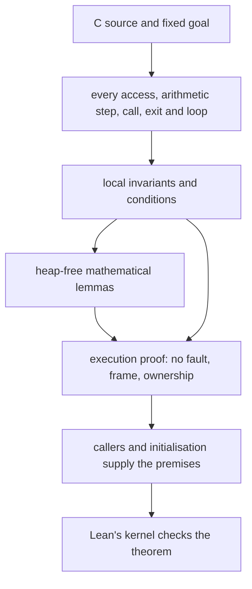
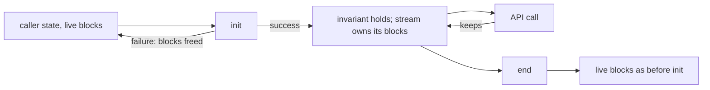

# Proving one function

This page explains how a proof about one C function is built in this project. It is a
description of method. It states no result of its own; the [map](README.md) lists the theorems,
and the component pages give the arguments.

The required goals are safety goals: a call returns without undefined behaviour or a memory
error, it terminates, it changes only the memory it is entitled to change, and it leaks nothing.
[Safety](../spec/safety.md) defines these claims. A functional goal says in addition what the
call computes. Functional goals are not required for the safety results. The method is the same
for both kinds, and this page says where a step is functional only.

## Fix the question first

A proof starts from three things that are fixed before it begins.

- **The C.** The pinned `zlib/` source with the patches of `patches/README.md` applied.
- **The translation.** Each C file is translated into Lean statement by statement: each
  branch, read, write and conversion of the C has its counterpart, in the same order. Unsigned
  arithmetic wraps. Signed overflow, an invalid shift and an invalid pointer operation raise a
  fault. A statement is not replaced by an equivalent-looking one to make a proof easier. Order
  matters also for reads: reading a field before another write is not the same as using a value
  cached earlier.
- **The goal.** A Lean proposition that names the caller's obligations, the result for each
  return value, the memory the call may write, and its allocations.

A public goal has to cover what `zlib.h` permits. Any premise narrower than `zlib.h` is written
in the docstring of the goal and has a row in [deviations](../deviations.md). An internal
theorem, about a function that only the library calls, may assume more, for example a table of
a certain shape; then every caller proves that premise at every call.

## Build the argument

What has to be shown at each kind of statement:

| Statement | To show |
| --- | --- |
| Read or write through a pointer | The object is live, the pointer has the right kind, and the offset is inside the object |
| Pointer arithmetic | The result is inside the object or one past its end |
| Shift, signed operation | The operands are in the range where C defines the result |
| Loop | An invariant, and a measure that falls on every round and is below the loop fuel |
| Call | The premises of the callee's theorem hold in the current state |

Two points are easy to miss.

**Loop fuel.** Every loop of the translation runs at most `2^64` rounds, and running out is the
fault `outOfFuel`. So a termination argument has to do more than show that the loop is finite
in the mathematical sense: it has to bound the number of rounds below the fuel.

**No callee contracts as assumptions.** A call is handled with a theorem that was proved about
the translated callee. A hypothesis of the form "the callee meets its specification" is not
allowed.

Arithmetic and combinatorial lemmas that need no heap are proved apart from the memory model. A
memory proof applies them to the cells that the C reads and writes. A theorem about canonical
codes, for instance, serves the decoder only after a second theorem shows that `inflate_table`
wrote those entries into the heap.

## When a proof does not go through

A proof attempt that fails has one of four causes: a lemma or an invariant clause is missing; the
goal is wrong, and a permitted execution contradicts it; the translation differs from the C, for
example in evaluation order or a conversion; or the C itself faults on a permitted input. None
of them is assumed in advance, and narrowing the caller's domain solves none of them.

Each cause other than the first has its own evidence. A wrong goal has a counterexample: a
permitted execution for which the stated result is false. The goal is then corrected. A
translation mismatch is a difference between the translation and the real C on some input, the
kind of difference that a differential test detects. The translation is then corrected. A zlib
bug is settled on the real C: on a concrete input, the C run under a sanitizer reports the
fault. [Findings](../findings.md) lists the confirmed ones. A confirmed zlib bug can justify a
minimal patch of the verified source; `patches/README.md` lists the patches and says which of
them match a fix submitted upstream. A limit of the model is not a zlib bug.

## One representation invariant

Each stateful component has one representation invariant: a property of the state that
initialisation establishes and every operation keeps. So it holds after every permitted series
of calls. A theorem that only *assumes* the invariant is not a sequence result; the sequence
theorem also proves that the invariant is reached.

| Component | Invariant | Explained in |
| --- | --- | --- |
| `inflate` | `InflateInv` | [stream decoding](inflate.md#the-invariant) |
| `deflate` | `DInv`, with `HeaderInv` and `CallFacts` between calls | [stream compression](deflate.md#the-invariant) |
| gzip files | `GzInv` | [gzip files](gzip.md) |
| callback decoder | `BackValid` between calls, `PInv` inside the dispatch loop | [callback decoder](callbacks.md) |

The sequence goals state the invariant through a smaller public predicate, `StreamInvariant`.
The proof invariants imply it.

An invariant that is too weak shows up as a counterexample, not as a hard proof. One example: a
`deflate` invariant that allows the state `EXTRA_STATE` with a `NULL` `gz_header` pointer is too
weak, because a `deflate(Z_BLOCK)` run from such a state faults. So the invariant has the clause
`HeaderInv.record`, which says the pointer is not `NULL` in the four header states that read
it, and a theorem shows that every reachable state has it (`reachable_inv_of`). That theorem
takes one hypothesis, `SequenceFacts`: three facts about one `deflate` call. Each has the same
premises: the state before the call has `DInv`, `HeaderInv` and `CallFacts`, and the call has
the buffers and the header that the goal asks for (`StreamBuffers`, `ActiveHeader`). The call
returns and keeps `DInv` and the owned blocks; it keeps `HeaderInv`; it keeps `CallFacts`.
The three facts are themselves proved: `sequence_facts` has no hypothesis, and
`deflate_copy_public` applies `reachable_inv_of` to it. So the hypothesis is discharged, not
assumed.

Functional only: bounds do not say which bytes are decoded. A functional proof adds a relation
between the state and the format, for the same executions, and shows how each step changes it.

## Initialisation, frame and ownership

**Initialisation** establishes the invariant on success and accounts for every allocation
failure. The default allocator does not zero memory: an integer field of fresh memory has an
arbitrary value. So a clause of the invariant about such a field holds only because the proof
shows the write that sets the field. For pointer fields the model is weaker than C: a
pointer field in fresh memory reads as `NULL` without a fault. So a proof does not show that
a pointer field is written before it is read: that is **to confirm** by source review; see
[safety](../spec/safety.md#uninitialised-memory) and the [trusted base](../trusted-base.md).

**Uninitialised integers** have an arbitrary value, and a theorem holds for every such value.
`slide_hash`, for example, reads every slot of `prev`, written or not; a chain walk reaches
only slots that were written ([stream compression](deflate.md#hashing-chains-that-can-be-followed)).
The model gives each never-written cell one value for a whole run, so two reads of it agree. C
does not promise that. Whether any proof depends on such an agreement has not been checked
systematically; the row "One garbage value per cell" of [model limits](../model-limits.md)
records this limit.

**The frame** of a call is the memory it may change: the stream record, the blocks the stream
owns, and the caller ranges given to this call. Everything else is unchanged. Error returns have
their own effects: some write nothing, others have updated the state or produced output before
they return. A negative return code does not by itself mean an unchanged heap.

**Ownership** (`Owns`) tracks the live blocks that belong to a stream. An allocation adds a
block, and a free removes it exactly once. A copy creates new blocks and points the interior
pointers at them. A failed initialisation or copy frees every block it had obtained and leaves
earlier ownership as it was. Freedom from leaks follows from these steps over a whole history,
failure paths included.

## Non-vacuity and composition

An invariant that no state satisfies would make every "if the invariant holds" theorem true and
worthless. The initialisation theorem rules this out: it shows that the invariant is reached,
for the whole permitted parameter range. A top-level goal also has a non-vacuity theorem, which
exhibits a concrete heap and call that meet all its premises.

Calls are composed by induction over the permitted histories. Initialisation gives the
invariant. Each call gives the next invariant, its frame and its ownership step. Reset,
dictionaries, priming, recovery, copying and partly filled buffers are cases of that induction
wherever the API permits them.

## Check each proof interface

Before two proved parts are joined, the relation that the first establishes and the relation
that the second requires are compared, on the same heap and the same registers. Two theorems
with matching names are not thereby connected.

For a stream engine there are six such interfaces.

1. Initialisation establishes the invariant.
2. The entry of a call derives the local relation of the dispatch loop from it.
3. Each mode keeps that relation or establishes the exact relation of its exit.
4. Each round of the dispatch loop lowers a bounded rank.
5. Every exit restores the public accounting, the frame and the ownership relation. Direct
   returns and the common exit path each need this.
6. Every other permitted operation keeps the invariant.

Table construction has two different obligations. Index bounds and valid leaf shapes make a
lookup safe. Agreement with the canonical code makes a lookup mean the right symbol. A proof
that the writes land in the table gives neither.

## Structural facts used by several proofs

The component pages refer to these facts by number.

| ID | Fact | Used by | Explained in |
| --- | --- | --- | --- |
| F1 | The writes of table construction stay inside the table space, and a finished table has an entry at every index a reader can form | `inflate_table`, `inflate`, `inflate_fast` | [decode tables](inftrees.md#every-index-is-covered) |
| F2 | The counting offsets sort the coded symbols into distinct `work` slots, all written | `inflate_table` | [decode tables](inftrees.md#sorting-f2) |
| F3 | A match copy that reaches into the window has tested its distance against `whave` | `inflate`, `inflate_fast` | [fast decoding](inffast.md#match-copies-f3-and-f4) |
| F4 | In a window that is not full, `wnext = whave` | `updatewindow` | [stream decoding](inflate.md#window-shape-w), W.5 |
| F5 | A hash-chain walk reaches only inserted positions, through `prev` slots that were written | `longest_match` | [stream compression](deflate.md#inside-one-deflate-call) |
| F6 | The comparisons of a match, up to offset 258, are inside the window | `longest_match`, `deflate_rle` | [stream compression](deflate.md#inside-one-deflate-call) |
| F7 | The active heap, the stored nodes and the tree indices stay inside their arrays | `build_tree`, `pqdownheap` | [trees](trees.md#building-a-tree-f7) |
| F8 | The length repair finds a nonempty shorter class, and the count of the longest class does not go below zero | `gen_bitlen` | [trees](trees.md#limiting-the-code-lengths-f8) |
| F9 | Pending output never overwrites an unread symbol, and a whole block fits the shared buffer | the block writers | [trees](trees.md#the-overlay-lemma-f9) |

F3 and F4 do different work. F3 keeps a window read of a match inside the block. F4 lets
`updatewindow` keep `whave ≤ wsize`. The match copies do not need F4 for their bounds; it also
tells that the bytes they read were written, which is a reading that no safety theorem states.

## What the kernel check and the tests add

Lean's kernel checks every theorem. A goal counts as proved only when a theorem has exactly the
goal as its statement, and the proof uses no axiom beyond the three standard ones of Lean
(`propext`, `Classical.choice`, `Quot.sound`). So a result does not rest on the proof scripts
being right. It rests on the kernel, on the goal saying what was meant, and on the translation
and the runtime model agreeing with the C; the [trusted base](../trusted-base.md) lists these.

The tests bear on the last of these. Differential tests compare the translation with the real C
on the same inputs; they are evidence of fidelity, not proof. Proof mutants are further
evidence of the same kind: a copy of the translation is changed in one place, for example by a
dropped check, a changed return value, a wrong field or an index off by one, to see that the
proof of the changed function then fails.
