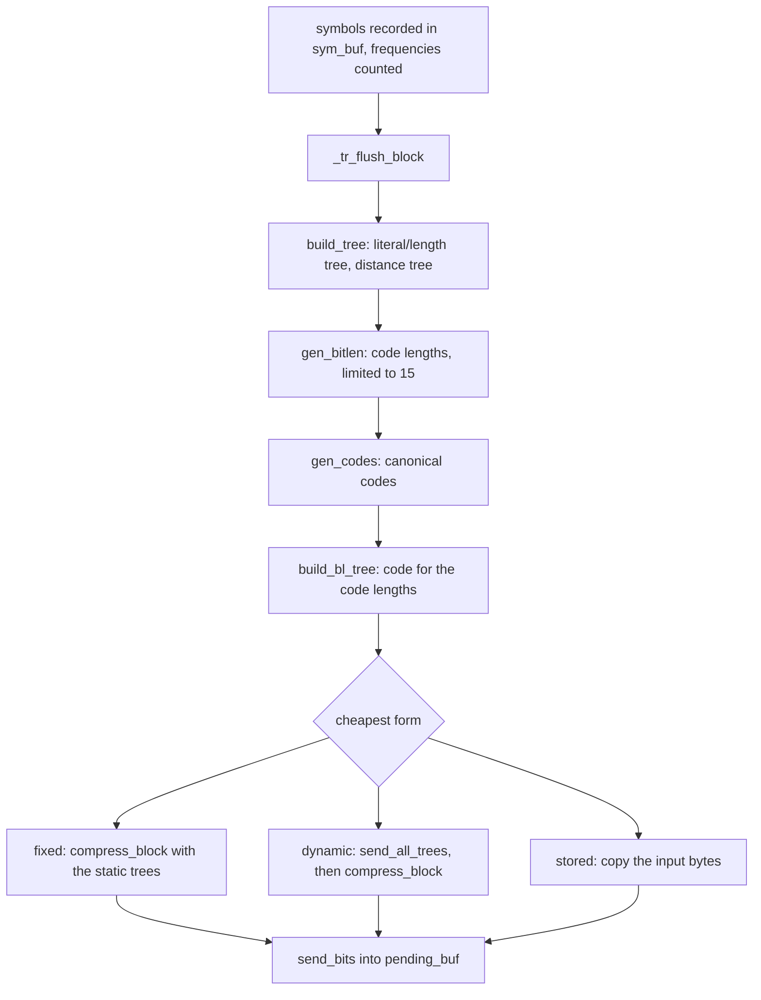

# Trees and block output: why a block flush is safe

Source: `zlib/trees.c`, with the symbol layout in `zlib/deflate.h`.
Translation: `ZlibF/Zlib/trees.c.lean`.

When `deflate` closes a block it calls `_tr_flush_block`. That function builds two Huffman
trees from the recorded symbols, picks the cheapest of three block forms, and writes the block.
It writes into the same buffer from which it is still reading the symbols. This page explains
why every array access of tree construction is in range, and why the output never overwrites a
symbol that has not been read yet. The second fact, F9, is the hardest step of the whole
`deflate` proof.

`trees.c` has no public function. Its theorems serve the safety of `deflate`
([stream compression](deflate.md)). Notes on how the translation follows the C are in the
[source notes for the compressor](deflate-source-notes.md#treesc). The internal contracts of
this file are `I-bt-*`, `I-gb-*`, `I-gc-*`, `I-cb-*`, `I-tf-*`, `I-fp-*` and `I-pb-room` in
[internal contracts](../spec/internal-contracts.md).

## Results

Modules are under `ZlibF/Proof/`. "Registered" theorems are accepted on commit `bde170e9`.
"Checked" theorems are not in the registry themselves; they lie inside the proof of the
registered theorem `Zlib.Deflate.Universal.deflate_sequence_safety`
([levels](README.md#status-levels)).

| Result | Theorem | Module | Level |
| --- | --- | --- | --- |
| `FLUSH_BLOCK_ONLY` is safe for every block form and every `memLevel`, given the overlay room of the dynamic form | `flush_block_only_safe`, from `tr_flush_block_safe` | `trees.c.universal-flush.lean`, `trees.c.universal-block.lean` | checked |
| The three block forms | `stored_block_safe`, `fixed_block_safe`, `dynamic_block_safe` | `trees.c.universal-stored.lean`, `-fixed.lean`, `-dynamic.lean` | checked |
| Overlay room F9, `B ≥ 2048` (`memLevel ≥ 5`) | `dynamic_overlay_large` | `trees.c.universal-block.lean` | checked |
| Overlay room F9, `B = 512` and `1024` (`memLevel` 3 and 4) | `dynamic_overlay_mid` | `trees.c.universal-overlay-mid.lean` | checked |
| Overlay room F9, `B = 256` and `128` (`memLevel` 2 and 1) | `tinyOverlayAt_256`, `tinyOverlayAt_128`, `tinyOverlay` | `deflate.c.engine.overlay-header-ref.lean` | registered |
| `gen_bitlen` never shortens a code of a tree whose weight is below 1597 | `ws_gen_bitlen_fib_plus` | `trees.c.universal-overlay-fibplus.lean` | checked |
| The heap operations, `gen_bitlen`, the bit output and the tally | `pqdownheap_safe`, `pqremove_safe`, `gen_bitlen_safe`, `kraft_clamped`, `send_bits_spec`, `bi_flush_spec`, `bi_windup_spec`, `bi_reverse_safe`, `init_block_spec`, `tr_init_spec`, `tr_tally_spec` | `trees.c.heap.*.lean`, `trees.c.bits.lean`, `trees.c.tally.lean` and the modules beside them | registered |

`B` is `lit_bufsize = 2^(memLevel + 6)`. Because F9 is proved for all nine values of
`memLevel`, the sequence theorem of `deflate` has no premise about it.

Functional theorems also exist (`gen_bitlen_correct`, `pqdownheap_correct`,
`bi_reverse_correct` and others: the lengths form a complete prefix code, the bits written are
the ones intended). They are registered, and they are not required for the safety results. No
theorem says that the emitted block decodes to the recorded symbols. Earlier notes on what such
a proof has to cover are kept in the [history](../history/proof-functional-notes.md).

## Assumptions

`flush_block_only_safe` is an internal theorem. Its premises are facts about the compressor
state, and the strategies prove them at every flush from the invariant `DInv`
([stream compression](deflate.md#the-invariant)).

- The state is well formed (`DGood`, `TreesInvAt`): array sizes, tree descriptors, the block
  that holds `pending_buf` and `sym_buf`.
- The level is positive. Level 0 does not build trees.
- **H0, the entry accounting.** `pending = 0`, `pending_out = pending_buf`, and `bi_valid ≤ 7`.
- The recorded symbols are described by a list (`SymbolLedger`): `sym_next = 3n`, the bytes in
  `sym_buf` are the `n` symbols, each has a length byte below 256 and a distance of at most
  32768, and the frequencies in `dyn_ltree` and `dyn_dtree` count exactly these symbols.
- The cost fields `opt_len` and `static_len` and the bit-length frequencies are zero
  (`BlockClear`).
- `-2^62 ≤ block_start ≤ strstart ≤ window_size`.
- The caller's output pointer is not `NULL`, and the stream's buffers are as
  `StreamBuffers` says.

H0 holds at every flush. `bi_valid ≤ 7` is the clause `biValid` of the invariant: every path
that sends bits ends with `bi_flush` or `bi_windup`. `pending = 0` is part of the loop state of
each strategy (`BlockReady`, `ZlibF/Proof/deflate.c.universal-strategies.lean`): `deflate`
calls a strategy only with an empty pending buffer, and after a flush that leaves bytes pending
the strategy returns instead of going on.

## What a flush does



The buffer that `send_bits` writes is the one `compress_block` reads:

```
pending_buf   0 .......... pending ......... B ......... B + 3k ......... B + 3n ...... 4B
              | output written |    free     | symbols read | symbols unread |   free   |
                               --> grows                    --> moves
```

The "invariant" of this page is the picture: while a block is written, `pending` stays below
`B + 3k`, the start of the next unread symbol. Everything else is ordinary array bounds.

## Why each step is safe

### Building a tree: F7

Let `elems` be 286, 30 or 19 for the literal/length, distance or bit-length tree.
`HEAP_SIZE = 573`. The arrays `heap`, `depth` and `dyn_ltree` have 573 entries, `dyn_dtree` has
61 and `bl_tree` has 39.

`build_tree` first puts every symbol with a nonzero frequency on the heap. If fewer than two
are found, it adds symbols with frequency 1 until there are two. So the heap holds `N` leaves
with `2 ≤ N ≤ elems`, at `heap[1..N]`.

`pqdownheap(k)` reads the left child `heap[2k]` only when `2k ≤ heap_len` and the right child
`heap[2k+1]` only when `2k < heap_len`. Each round moves `k` to a child, so the loop runs at
most as many times as the heap is deep.

The merge loop takes the two smallest nodes off the heap, stores them at the top of `heap`, and
puts a new parent node on the heap. After `t` merges

```
heap_len = N - t
heap_max = HEAP_SIZE - 2t
```

A merge happens only while `t ≤ N - 2`. It writes `heap[HEAP_SIZE - 2t - 1]` and
`heap[HEAP_SIZE - 2t - 2]`. These indices are positive and above the active heap:

```
HEAP_SIZE - 2t - 2 > N - t      because N ≤ 286 and t ≤ N - 2
```

The new node has number at most `elems + N - 2 ≤ 2 * elems - 2`: 570, 58 or 36. That fits the
tree array (573, 61, 39). The last root write goes to `heap[HEAP_SIZE - 2N + 1]`, an index of
at least 2. These bounds are fact **F7** of
[the method](method.md#structural-facts-used-by-several-proofs). `pqdownheap_safe` and
`pqremove_safe` cover the heap operations, and `ws_build_tree_complete`
(`trees.c.build.complete.lean`) the whole function.

`depth` is an `unsigned char` and its increment can wrap. That is defined behaviour and has no
effect on any index. Frequencies of parent nodes are sums of leaf frequencies; a block has
fewer than `B ≤ 32768` symbols, so the sums fit in 16 bits.

### Limiting the code lengths: F8

`gen_bitlen` walks the nodes that `build_tree` stored in `heap[heap_max..HEAP_SIZE)`. A parent
is stored at a smaller index than its children, so the walk meets every parent first. Let `L`
be the length limit: 15 for the two data trees, 7 for the bit-length tree.

**First pass.** Each node gets `Len = min(Len(parent) + 1, L)`. `overflow` counts the nodes,
leaves and inner nodes, whose true depth is greater than `L`. `bl_count[l]` counts the leaves
of length `l`.

**The Kraft sum after clamping.** In a full binary tree the leaves satisfy `Σ 2^-depth = 1`.
Take an inner node `v` at true depth `L`, with `m_v` leaves below it. Before clamping those
leaves weigh `2^-L` together. After clamping each weighs `2^-L`, so together `m_v * 2^-L`. The
subtree has `2 m_v - 2` nodes below `v`, all deeper than `L`. Every node deeper than `L` lies
under exactly one such `v`. Summing over all `v`:

```
overflow          = Σ_v (2 m_v - 2)
Σ_leaves 2^-Len   = 1 + (overflow / 2) * 2^-L
```

So `overflow` is even (`kraft_clamped`, `trees.c.heap.gbtree.lean`).

**Repair.** While `overflow > 0` the C does

```c
bits = max_length - 1;
while (s->bl_count[bits] == 0) bits--;
s->bl_count[bits]--;          /* one leaf of length bits becomes an inner node ...  */
s->bl_count[bits + 1] += 2;   /* ... with two leaves below it                      */
s->bl_count[max_length]--;    /* one of them is a leaf moved up from the last level */
overflow -= 2;
```

One round lowers the Kraft sum by `2^-L` and `overflow` by 2, and keeps the number of leaves
(`round_kraft`). Two things have to be true for it not to fault.

- **F8(i): the downward scan stops at a positive index.** Suppose every leaf had length `L`
  while `overflow > 0`. The identity would give `n * 2^-L > 1`, so `n > 2^L`. But `n ≤ 286 <
  2^15` for the data trees and `n ≤ 19 < 2^7` for the bit-length tree. So some class below `L`
  is not empty (`exists_short`).
- **F8(ii): `bl_count[max_length]` does not go below zero.** At the start it is at least
  `overflow / 2 + 1`: the leaves under the nodes `v` number `Σ m_v = overflow / 2 + (number of
  such v)`, and there is at least one `v`. Each round takes one from it and one from
  `overflow / 2`. So it is at least 2 at every round.

`overflow` goes down through even values to 0, and then the Kraft sum is 1.

**Second pass.** The C hands out the lengths again: `bl_count[bits]` leaves get length `bits`,
taken from `heap[--h]` and skipping inner nodes. There are `n` leaves among the stored nodes
and `Σ bl_count = n`, so `h` does not go below `heap_max`.

`gen_bitlen_safe` (`trees.c.heap.gbtop.lean`, registered) is the whole function.

### Codes and the tree description

`gen_codes` computes the first code of each length from `bl_count` and gives each symbol with a
nonzero length the next code of its length, bit-reversed by `bi_reverse`. The local array
`next_code[16]` is written at indices 1 to 15 before it is read. `bi_reverse` is called with a
length between 1 and 15 and loops that many times (`bi_reverse_safe`).

| Function | Why its accesses are in range |
| --- | --- |
| `scan_tree` | It runs on the two data trees. It writes a guard value `0xffff` at `tree[max_code + 1]`; that index is at most 286 or 30, inside the arrays of 573 and 61 entries. Real lengths are 0 to 15 and index `bl_tree` at 0 to 18; the guard is compared, never used as an index |
| `build_bl_tree` | It scans `bl_order[max_blindex]` down from 18 and stops at 3 at the latest |
| `send_all_trees` | It sends `lcodes - 257`, `dcodes - 1` and `blcodes - 4` in 5, 5 and 4 bits, then `blcodes ≤ 19` three-bit lengths |
| `send_tree` | It repeats the scan of `scan_tree` and reads the same entries |

### Bits and pending bytes

`send_bits(s, value, length)` adds `length` bits to the 16-bit buffer `bi_buf`. When the buffer
would overflow it writes two bytes to `pending_buf` and keeps the rest. It does not check the
room in `pending_buf`. `send_bits_spec` assumes `0 ≤ length ≤ 15`, a value below `2^length`,
and room for the bits; every call in `trees.c` sends at most 15 bits. With `bi_valid ≤ 16` and
`length ≤ 15` all shifts are by at most 16 on 32-bit operands.

If `S` bits were sent from a state with `v` bits held, then

```
pending ≤ base + 2 * floor((S + v) / 16)
```

Equality need not hold at a multiple of 16: the C keeps a full bit buffer until the next write.
With `v ≤ 7` this gives `pending ≤ base + S / 8 + 1`.

`compress_block` reads the three bytes of symbol `k` and then sends its code. For a match the
length byte `lc ≤ 255` indexes `_length_code`, and the distance minus one, at most 32767,
indexes `_dist_code` through
`d_code(x) = x < 256 ? _dist_code[x] : _dist_code[256 + (x >> 7)]`, at most index 511 of 512.

These bounds hold only if the bytes read are the ones recorded. If output had overwritten an
unread symbol, the distance could be any 16-bit value and `d_code` could index 767. So F9
protects a read of a static table as well as the writes.

## The overlay lemma F9

Write `B = lit_bufsize`. The buffer has `4B` bytes. Symbols start at offset `B`, take three
bytes each, and number `n ≤ B - 1`. Symbol `k` is at `[B + 3k, B + 3k + 3)`.

**F9.** While a block is written, after the header and after each of the first `k` symbols,

```
8 * pending + bi_valid + 15 ≤ 8 * (B + 3k)          (prefix room)
```

and when the block is complete, with its end code and the final alignment, it fits in `4B`
bytes (block room). The 15 bits of slack cover the bits held in `bi_buf` and the two-byte step
of `send_bits`. In Lean this is `DynamicRoom` (`trees.c.universal-dynamic.lean`) for the dynamic
form; it is written with the entry state and the bit costs of the header and of each symbol.

A symbol frees 24 bits of buffer when it is read. So the question is how much more than 24
bits a symbol's code can take, and how many bits the block header takes before the first
symbol.

### Stored and fixed blocks

A stored block is chosen only when its length plus 4 is at most the cost of the other forms.
Once it is chosen the symbols are not read again, so the copy may overwrite them
(`stored_block_safe`).

With the fixed codes a literal costs at most 9 bits and a match at most `8 + 5 + 5 + 13 = 31`.
The header has 3 bits. From H0, after `q` symbols

```
pending ≤ (7 + 3 + 31 q) / 8 + 1
```

For the smallest buffer, `B = 128` with `q = 127`: `pending ≤ 494`, and the next symbol starts
at `128 + 3 * 127 = 509`. In general the bound is below `B + 3q` whenever `B > 11`
(`fixed_block_safe`).

### Dynamic blocks

A dynamic block sends its tree description first, and its codes can be 15 bits long. Comparing
the total size with a fixed block is not enough: long codes may come early and short ones late.
The proof bounds the whole block instead. Let

```
header = bits of the tree description
excess = Σ over the symbols of max(0, cost - 24)
```

Any prefix of `k` symbols costs at most `24k + excess`. With H0 (7 held bits), 3 block-type
bits and the 15 bits of slack, prefix room follows from the **budget**

```
header + excess + 25 ≤ 8B
```

The budget is proved in three ranges of `B`.

| `B` | `8B` | Proved bound on `header + excess` | With the 25 |
| --- | --- | --- | --- |
| 2048 and above | 16384 and above | `2283 + 6.257 (B + 2)`, which is 15110 at `B = 2048` | 15135 at `B = 2048` |
| 1024 | 8192 | `2283 + 3678 = 5961` | 5986 |
| 512 | 4096 | `2283 + 1777 = 4060` | 4085 |
| 256 | 2048 | 2023 | 2048 |
| 128 | 1024 | 999 | 1024 |

**The header bound 2283.** The description has 14 count bits, at most 19 three-bit lengths, and
one code of at most 7 bits for each of at most `286 + 30` code lengths:
`14 + 57 + 7 * 316 = 2283` (`build_bl_tree_header_budget`, `trees.c.header-budget.lean`).

**`B ≥ 2048`.** In a Huffman tree a frequent symbol has a short code: a leaf of frequency `f`
at depth `l` forces the total weight to be at least about `f` times the Fibonacci number
`F(l + 1)`. Summing the worst case over both alphabets, with their extra bits and with the
effect of the length repair, gives an excess of at most 6.257 bits per symbol, counted over
`n + 3` (`source_trees_symbol_excess_engine`, `deflate.c.engine.symbol-excess.lean`, from
`symbol_excess_from_fib`, `ZlibF/Math/DeflateSymbolExcess.lean`). The 3 are the end-of-block
symbol and the up to two symbols that `build_tree` adds. With `n ≤ B - 1` the budget holds from
`B = 1332` up. At `B = 1024` it fails: `2283 + 6.257 * 1026 + 25 = 8728 > 8192`.

**`B = 512` and `1024`.** The trees weigh at most `B + 2 ≤ 1026`. A tree lighter than
`F(17) = 1597` has no node deeper than 15: such a node has a parent at depth 15 or more, and a
node that deep forces a total weight of at least `F(16) + F(15) = 1597`. So `gen_bitlen` repairs
nothing in the two data trees
(`ws_gen_bitlen_fib_plus`), every length is the true depth, and each symbol satisfies
`f * F(l + 1) + F(l) ≤ W`. Under that constraint the largest possible excess is 1777 bits for a
weight of at most 514 and 3678 bits for a weight of at most 1026
(`ZlibF/Math/DeflateOverlaySmall.lean`).

**`B = 256` and `128`.** The general header bound is too large here: `2283 > 2048`. The proof
bounds the header of the block at hand. It is `14 + 3 (max_blindex + 1)` bits, at most 71, plus
the cost of the code-length symbols. At `B = 256` every data code is at most 11 bits long, so
the code-length symbols 12 to 15 do not occur; at `B = 128` every code is at most 9 bits long.
The cost of the remaining symbols is bounded against a fixed complete code
(`deflate.c.engine.overlay-header-ref.lean`). One more inequality is used: the dynamic form was
chosen, so its rounded cost is below the cost of the fixed form. A heap-free certificate
combines these facts into `header + excess ≤ 2023` and `≤ 999`
(`deflate.c.engine.overlay-mem2c.lean`, `deflate.c.engine.overlay-mem1w.lean`). In both cases
the proved bound meets the budget exactly.

An earlier development reached the same bound by other routes; see the
[earlier proof notes](../history/proof-earlier-notes.md#overlay-bound-earlier-routes).

## Why the loops end

- `pqdownheap`: `k` at least doubles each round and stays at most `heap_len ≤ 573`.
- The merge loop of `build_tree`: `heap_len` falls by one per round, from `N` to 1.
- `gen_bitlen`: the first and second pass run over the stored nodes; the repair loop lowers
  `overflow` by 2 per round; the downward scan stops by F8(i).
- `gen_codes`, `scan_tree`, `send_tree`: fixed ranges up to `max_code`.
- `compress_block`: one round per recorded symbol, `sym_next / 3` rounds.
- `bi_reverse`: `len` rounds, with `1 ≤ len ≤ 15`.

Each bound is at most a few thousand, far below the loop fuel of `2^64`. The safety theorems
named above include termination.

## Where the hard part is

F9 for a dynamic block, at small `memLevel`. Array bounds do not give it, and neither does the
comparison of block costs. It needs a fact about the code lengths of the tree that was actually
built: no cheap sequence of symbols can have codes long enough to catch up with the read
position. For `B ≥ 2048` a general bound per symbol is enough. For the two smallest buffers
the proved bound has no slack, and the proof has to use the exact header of the block and the
fact that the dynamic form was chosen.

## Readings of the C that no theorem states

- Every `depth` value that the tie-break of `pqdownheap` reads was written during the same
  `build_tree` call. No theorem states it. In the model a read of an integer that was never
  written returns an arbitrary value and is not a fault, and the theorems hold for every such
  value ([trusted base](../trusted-base.md)). **to confirm**.
