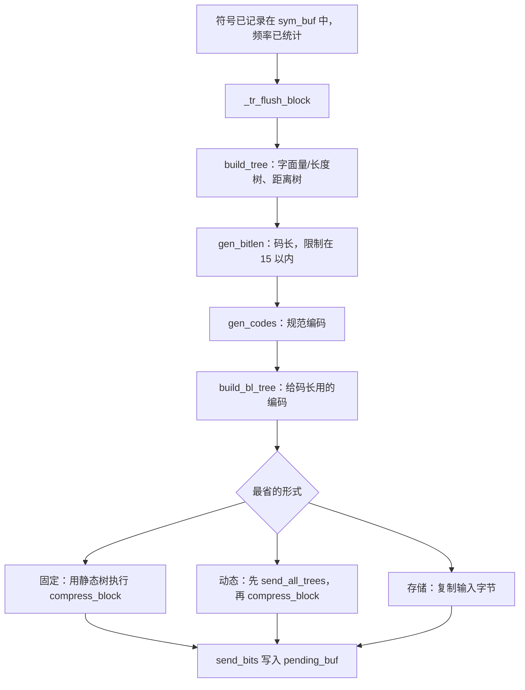

<!-- source-sha256: f44c7b5308f6f89cc0ecbc1324ed43ec0d6ad2d05e2e600d22f4f30372481b72 -->
# 树与块输出：块刷新为什么是安全的

源文件：`zlib/trees.c`，符号布局在 `zlib/deflate.h` 中。翻译：`ZlibF/Zlib/trees.c.lean`。

`deflate` 结束一个块时调用 `_tr_flush_block`。这个函数由已记录的符号建两棵 Huffman 树，在三种块形式里挑最省的一种，然后把块写出去。它写入的缓冲区，正是它还在从中读取符号的那个缓冲区。本页解释两件事：建树时每一次数组访问为什么不越界；输出为什么永远不会覆盖还没读的符号。第二件事叫 F9，是整个 `deflate` 证明里最难的一步。

`trees.c` 没有公开函数。它的定理服务于 `deflate` 的安全性（[流式压缩](deflate.md)）。翻译怎样跟随 C 的细节，见[压缩器的源码笔记](deflate-source-notes.md#treesc)。这个文件的内部契约是[内部契约](../spec/internal-contracts.md)中的 `I-bt-*`、`I-gb-*`、`I-gc-*`、`I-cb-*` 和 `I-tf-*`。那里还有两组契约与块输出有关。`I-pb-room` 是位写入函数需要的空间：涉及本文件的 `put_short` 和 `send_bits`，以及 `deflate.h` 的宏 `put_byte`。`I-fp-*` 是 `flush_pending` 的契约；它是 `deflate.c` 的函数，`FLUSH_BLOCK_ONLY` 在 `_tr_flush_block` 之后调用它。

## 结论

模块在 `ZlibF/Proof/` 下。表中的定理服务于 `Zlib.Deflate.Universal.deflate_sequence_safety` 的证明，即 `deflate` 的序列定理。第五行和最后一行的定理列在 `tests/audit/theorems.txt` 中；其余的是那个证明内部的引理，本身没有列出。那项结论的层级记录在[进度，范围](../progress.md#scope)中。

| 结论 | 定理 | 模块 |
| --- | --- | --- |
| 给定动态形式的共用缓冲区余量，`FLUSH_BLOCK_ONLY` 对每种块形式、每个 `memLevel` 都安全 | `flush_block_only_safe`，来自 `tr_flush_block_safe` | `trees.c.universal-flush.lean`、`trees.c.universal-block.lean` |
| 三种块形式 | `stored_block_safe`、`fixed_block_safe`、`dynamic_block_safe` | `trees.c.universal-stored.lean`、`-fixed.lean`、`-dynamic.lean` |
| 共用缓冲区余量 F9，`B ≥ 2048`（`memLevel ≥ 5`） | `dynamic_overlay_large` | `trees.c.universal-block.lean` |
| 共用缓冲区余量 F9，`B = 512` 和 `1024`（`memLevel` 为 3 和 4） | `dynamic_overlay_mid` | `trees.c.universal-overlay-mid.lean` |
| 共用缓冲区余量 F9，`B = 256` 和 `128`（`memLevel` 为 2 和 1） | `tinyOverlayAt_256`、`tinyOverlayAt_128`、`tinyOverlay` | `deflate.c.engine.overlay-header-ref.lean` |
| 对权重小于 1597 的树，`gen_bitlen` 不会缩短任何编码 | `ws_gen_bitlen_fib_plus` | `trees.c.universal-overlay-fibplus.lean` |
| 堆操作、`gen_bitlen`、位输出和符号记录 | `pqdownheap_safe`、`pqremove_safe`、`gen_bitlen_safe`、`kraft_clamped`、`send_bits_spec`、`bi_flush_spec`、`bi_windup_spec`、`bi_reverse_safe`、`init_block_spec`、`tr_init_spec`、`tr_tally_spec` | `trees.c.heap.*.lean`、`trees.c.bits.lean`、`trees.c.tally.lean` 以及它们旁边的模块 |

`B` 是 `lit_bufsize = 2^(memLevel + 6)`。因为 F9 对 `memLevel` 的全部九个值都证明了，所以 `deflate` 的序列定理没有关于它的前提。

也有功能定理（`gen_bitlen_correct`、`pqdownheap_correct`、`bi_reverse_correct` 等：码长构成完整的前缀码，写出的位就是想写的位）。它们已证明，但不是安全结论所必需的。没有定理说写出的块能解码回已记录的符号。关于这样的证明需要涵盖什么，早先的笔记保存在[历史](../history/proof-functional-notes.md)中。

## 假设

`flush_block_only_safe`（`ZlibF/Proof/trees.c.universal-flush.lean`）是内部定理。它的前提是关于压缩器状态的事实，各策略在每次刷新处由不变量 `DInv` 证明它们（[流式压缩](deflate.md#the-invariant)）。下面列出 Lean 命题的每一条前提。

- 状态是良构的（`DGood`、`TreesInvAt`）：数组大小、树描述符、存放 `pending_buf` 和 `sym_buf` 的那个块。
- 窗口指针指向一个存活字节块的开头。
- 级别为正。级别 0 不建树。
- **H0，入口处的计数。** `pending = 0`，`pending_out = pending_buf`，并且 `bi_valid ≤ 7`。
- 已记录的符号由一个列表描述（`SymbolLedger`）：`sym_next = 3n`，`sym_buf` 里的字节就是这 `n` 个符号，每个符号的长度字节小于 256、距离至多 32768，`dyn_ltree` 和 `dyn_dtree` 里的频率恰好统计了这些符号。
- 代价字段 `opt_len` 和 `static_len` 以及码长的频率都是零（`BlockClear`）。
- `-2^62 ≤ block_start ≤ strstart ≤ window_size`。第一个界使块长 `strstart - block_start` 落在 `long` 的范围内；窗口滑动之后 `block_start` 可以是负的。
- `StreamBuffers` 成立，并且 `next_out` 指向堆上一个字节块的内部，或者指向某个 deflate 状态记录的 `depth` 数组内部。模型里可写的字节存储只有这两种；各策略由 `StreamBuffers` 和不为 `NULL` 的 `next_out` 得到这条前提（`output_reference`）。
- **动态形式的共用缓冲区余量**（`DynamicOverlay`，`trees.c.universal-block.lean`）。这条前提是一个假设，不是关于大小的事实。它有这样几个条件：在这个状态上建树，并且建树只改变树的各字段和两个代价；树的描述至多 2283 位；各符号的代价超出每符号 24 位的部分，对已记录的 `n` 个符号求和，满足 `1000 * bitExcess ≤ 6257 * (n + 3)`；代价选中了动态形式。在这些条件下，准备好的状态具有[事实 F9](#the-overlay-lemma-f9) 的余量 `DynamicRoom`。“结论”表中的三条共用缓冲区定理对每一个 `B` 证明了它。`FlushSafeAt L`（`deflate.c.universal-strategies.lean`）是去掉这条假设之后、针对 `lit_bufsize` 为 `L` 的状态的 `flush_block_only_safe` 命题；各策略用的就是它，各自取自己的缓冲区大小。

这条定理对参数 `last` 的两个值都成立。

H0 在每次刷新处都成立。`bi_valid ≤ 7` 是不变量的子句 `biValid`：每条发送位的路径都以 `bi_flush` 或 `bi_windup` 结束。`pending = 0` 是每种策略的循环状态的一部分（`BlockReady`，`ZlibF/Proof/deflate.c.universal-strategies.lean`）：`deflate` 只在待输出缓冲为空时才调用策略；刷新之后如果还有字节待输出，策略就返回，不再往下走。

## 一次刷新做了什么



`send_bits` 写的缓冲区，就是 `compress_block` 读的那个：

```
pending_buf   0 .......... pending ......... B ......... B + 3k ......... B + 3n ...... 4B
              |  已写的输出  |    空闲      | 已读的符号 |  未读的符号   |   空闲   |
                           --> 增长                     --> 前移
```

本页的“不变量”就是这张图：写一个块的过程中，`pending` 始终在 `B + 3k` 之下，也就是在下一个未读符号的起点之下。其余的都是普通的数组界。

## 每一步为什么安全

### 建一棵树：F7

设 `elems` 对字面量/长度树、距离树、码长树分别是 286、30、19。`HEAP_SIZE = 573`。数组 `heap`、`depth` 和 `dyn_ltree` 各有 573 项，`dyn_dtree` 有 61 项，`bl_tree` 有 39 项。

`build_tree` 先把每个频率非零的符号放进堆。如果找到的不足两个，它补入频率为 1 的符号，直到有两个。所以堆里有 `N` 个叶子，`2 ≤ N ≤ elems`，位于 `heap[1..N]`。

`pqdownheap(k)` 只在 `2k ≤ heap_len` 时读左孩子 `heap[2k]`，只在 `2k < heap_len` 时读右孩子 `heap[2k+1]`。每轮把 `k` 移到一个孩子上，所以循环的轮数不超过堆的深度。

合并循环从堆里取出最小的两个结点，把它们存到 `heap` 的顶端，再把一个新的父结点放进堆。经过 `t` 次合并之后

```
heap_len = N - t
heap_max = HEAP_SIZE - 2t
```

只有在 `t ≤ N - 2` 时才会再合并一次。它写 `heap[HEAP_SIZE - 2t - 1]` 和 `heap[HEAP_SIZE - 2t - 2]`。这两个下标是正的，并且在活动堆之上：

```
HEAP_SIZE - 2t - 2 > N - t      因为 N ≤ 286 且 t ≤ N - 2
```

新结点的编号至多是 `elems + N - 2 ≤ 2 * elems - 2`：570、58 或 36。这在树数组（573、61、39）之内。最后一次写根，写的是 `heap[HEAP_SIZE - 2N + 1]`，下标至少是 2。这些界就是[方法](method.md#structural-facts-used-by-several-proofs)里的事实 **F7**。`pqdownheap_safe` 和 `pqremove_safe` 涵盖堆操作，`ws_build_tree_complete`（`trees.c.build.complete.lean`）涵盖整个函数。

`depth` 是 `unsigned char`，它的自增可能回绕。这是有定义的行为，对任何下标都没有影响。父结点的频率是叶子频率之和；一个块里的符号少于 `B ≤ 32768` 个，所以这些和放得进 16 位。

### 限制码长：F8

`gen_bitlen` 遍历 `build_tree` 存在 `heap[heap_max..HEAP_SIZE)` 里的结点。父结点的下标比它的孩子小，所以遍历总是先遇到父结点。设 `L` 是码长上限：两棵数据树是 15，码长树是 7。

**第一遍。** 每个结点得到 `Len = min(Len(父结点) + 1, L)`。`overflow` 统计真实深度大于 `L` 的结点个数，叶子和内部结点都算。`bl_count[l]` 统计码长为 `l` 的叶子个数。

**截断之后的 Kraft 和。** 在满二叉树里，叶子满足 `Σ 2^-深度 = 1`。取一个真实深度为 `L` 的内部结点 `v`，它下面有 `m_v` 个叶子。截断之前，这些叶子的权重合起来是 `2^-L`。截断之后每个叶子的权重是 `2^-L`，合起来是 `m_v * 2^-L`。这棵子树在 `v` 之下有 `2 m_v - 2` 个结点，全都比 `L` 深。每个比 `L` 深的结点恰好在一个这样的 `v` 之下。对所有 `v` 求和：

```
overflow          = Σ_v (2 m_v - 2)
Σ_叶子 2^-Len     = 1 + (overflow / 2) * 2^-L
```

所以 `overflow` 是偶数（`kraft_clamped`，`trees.c.heap.gbtree.lean`）。

**修复。** 只要 `overflow > 0`，C 就执行

```c
bits = max_length - 1;
while (s->bl_count[bits] == 0) bits--;
s->bl_count[bits]--;          /* 一个码长为 bits 的叶子变成内部结点……     */
s->bl_count[bits + 1] += 2;   /* ……它下面挂两个叶子                        */
s->bl_count[max_length]--;    /* 其中一个是从最后一层移上来的叶子           */
overflow -= 2;
```

每一轮使 Kraft 和减少 `2^-L`，使 `overflow` 减少 2，叶子个数不变（`round_kraft`）。要它不出故障，有两点必须成立。

- **F8(i)：向下的扫描停在一个正的下标处。** 假设 `overflow > 0` 时所有叶子的码长都是 `L`。上面的等式给出 `n * 2^-L > 1`，即 `n > 2^L`。但数据树有 `n ≤ 286 < 2^15`，码长树有 `n ≤ 19 < 2^7`。所以 `L` 之下总有某一类是非空的（`exists_short`）。
- **F8(ii)：`bl_count[max_length]` 不会减到零以下。** 开始时它至少是 `overflow / 2 + 1`：各个 `v` 之下的叶子共有 `Σ m_v = overflow / 2 +（这样的 v 的个数）` 个，而这样的 `v` 至少有一个。每一轮从它里面拿走一个，也从 `overflow / 2` 里拿走一个。所以在每一轮它都至少是 2。

`overflow` 经过一串偶数降到 0，这时 Kraft 和是 1。

**第二遍。** C 重新分发码长：有 `bl_count[bits]` 个叶子得到码长 `bits`，这些叶子取自 `heap[--h]`，内部结点被跳过。已存放的结点里有 `n` 个叶子，而 `Σ bl_count = n`，所以 `h` 不会降到 `heap_max` 之下。

`gen_bitlen_safe`（`trees.c.heap.gbtop.lean`，列在 `tests/audit/theorems.txt` 中）涵盖整个函数。

### 编码与树的描述

`gen_codes` 由 `bl_count` 算出每个码长的第一个编码，再给每个码长非零的符号分配该码长的下一个编码，并用 `bi_reverse` 做位反转。局部数组 `next_code[16]` 的下标 1 到 15 在被读之前都写过。调用 `bi_reverse` 时长度在 1 到 15 之间，它循环这么多次（`bi_reverse_safe`）。

| 函数 | 它的访问为什么不越界 |
| --- | --- |
| `scan_tree` | 它作用于两棵数据树。它在 `tree[max_code + 1]` 处写一个哨兵值 `0xffff`；这个下标至多是 286 或 30，在 573 项和 61 项的数组之内。真实的码长是 0 到 15，用来访问 `bl_tree` 的下标是 0 到 18；哨兵只参与比较，从不用作下标。`ws_scan_tree`（`trees.c.scan-tree.lean`）证明这个函数会返回。它假设到 `max_code` 为止的码长至多是 15，对 `max_code + 1` 处的表项不作任何假设。它的结论还说明：之后的树是数组 `scGuard`，即原数组只把 `max_code + 1` 处的码长改成 `0xffff`。`scGuard_lengths` 是关于这个数组的码长的引理，不是关于这个函数的。这两条定理和 `send_tree_emit` 不在登记表里 |
| `build_bl_tree` | 它从 18 往下扫描 `bl_order[max_blindex]`，最迟在 3 处停下 |
| `send_all_trees` | 它分别用 5、5、4 位发送 `lcodes - 257`、`dcodes - 1` 和 `blcodes - 4`，然后发送 `blcodes ≤ 19` 个三位码长 |
| `send_tree` | 它重复 `scan_tree` 的扫描，读的是同样的表项，包括哨兵。`send_tree_emit`（`trees.c.send-tree.lean`）证明它会返回，条件是到 `max_code` 为止的码长至多是 15，`max_code + 1` 处可以是任意 16 位值，并且出现的位长符号都有合适的码，`pending_buf` 里有容纳这些位的空间 |

### 位与待输出字节

`send_bits(s, value, length)` 往 16 位缓冲 `bi_buf` 里加 `length` 位。缓冲要溢出时，它往 `pending_buf` 写两个字节，留下其余的位。它不检查 `pending_buf` 里的空间。`send_bits_spec` 假设 `0 ≤ length ≤ 15`、值小于 `2^length`，并且这些位放得下；`trees.c` 里的每次调用至多发送 15 位。由于 `bi_valid ≤ 16` 且 `length ≤ 15`，所有移位都是在 32 位操作数上移至多 16 位。

如果从缓冲里留有 `v` 位的状态出发发送了 `S` 位，那么

```
pending ≤ base + 2 * floor((S + v) / 16)
```

在 16 的倍数处等号不一定成立：C 会把装满的位缓冲留到下一次写。当 `v ≤ 7` 时，由此得到 `pending ≤ base + S / 8 + 1`。

`compress_block` 读出符号 `k` 的三个字节，然后发送它的编码。对匹配，长度字节 `lc ≤ 255` 用作 `_length_code` 的下标；距离减一至多是 32767，它通过 `d_code(x) = x < 256 ? _dist_code[x] : _dist_code[256 + (x >> 7)]` 访问 `_dist_code`，下标至多是 512 项中的 511。

这些界只有在读到的字节就是当初记录的字节时才成立。如果输出覆盖了一个未读的符号，距离就可能是任意的 16 位值，`d_code` 的下标可能到 767。所以 F9 既保护写操作，也保护对静态表的读。

## 共用缓冲区引理 F9

记 `B = lit_bufsize`。缓冲区有 `4B` 字节。符号从偏移 `B` 开始，每个占三个字节，个数 `n ≤ B - 1`。符号 `k` 位于 `[B + 3k, B + 3k + 3)`。

**F9。** 写一个块的过程中，在头部之后以及前 `k` 个符号的每一个之后，

```
8 * pending + bi_valid + 15 ≤ 8 * (B + 3k)          （前缀余量）
```

而且整个块连同它的结束符和最后的对齐，放得进 `4B` 字节（整块余量）。15 位的宽裕量涵盖 `bi_buf` 里留着的位，以及 `send_bits` 一次写两个字节的步长。在 Lean 里，对动态形式这就是 `DynamicRoom`（`trees.c.universal-dynamic.lean`）；它是用入口状态以及头部和每个符号的位代价写出来的。

读出一个符号，就腾出 24 位的缓冲空间。所以问题在于：一个符号的编码能比 24 位多出多少，以及第一个符号之前块头部占多少位。

### 存储块与固定块

只有当存储块的长度加 4 不超过其他形式的代价时，才会选它。一旦选了它，符号就不会再被读，所以复制可以覆盖它们（`stored_block_safe`）。

用固定编码时，字面量至多 9 位，匹配至多 `8 + 5 + 5 + 13 = 31` 位。头部有 3 位。由 H0，写完 `q` 个符号之后

```
pending ≤ (7 + 3 + 31 q) / 8 + 1
```

对最小的缓冲区 `B = 128`、`q = 127`：`pending ≤ 494`，而下一个符号从 `128 + 3 * 127 = 509` 开始。一般地，只要 `B > 11`，这个界就小于 `B + 3q`（`fixed_block_safe`）。

### 动态块

动态块先发送树的描述，它的编码可以长达 15 位。只把总大小和固定块相比是不够的：长编码可能排在前面，短编码排在后面。证明改为给整个块定界。令

```
header = 树描述的位数
excess = 对各符号求和 max(0, 代价 - 24)
```

任意 `k` 个符号的前缀，代价至多是 `24k + excess`。加上 H0（留着的 7 位）、3 位块类型和 15 位宽裕量，前缀余量可由下面的**预算**推出：

```
header + excess + 25 ≤ 8B
```

这个预算按 `B` 的三个范围分别证明。

| `B` | `8B` | 对 `header + excess` 证明的界 | 加上 25 |
| --- | --- | --- | --- |
| 2048 及以上 | 16384 及以上 | `2283 + 6.257 (B + 2)`，在 `B = 2048` 时是 15110 | `B = 2048` 时是 15135 |
| 1024 | 8192 | `2283 + 3678 = 5961` | 5986 |
| 512 | 4096 | `2283 + 1777 = 4060` | 4085 |
| 256 | 2048 | 2023 | 2048 |
| 128 | 1024 | 999 | 1024 |

**头部的界 2283。** 描述包括 14 个计数位、至多 19 个三位码长，以及至多 `286 + 30` 个码长各自一个至多 7 位的编码：`14 + 57 + 7 * 316 = 2283`（`build_bl_tree_header_budget`，`trees.c.header-budget.lean`）。

**`B ≥ 2048`。** 在 Huffman 树里，出现得多的符号编码短：频率为 `f`、深度为 `l` 的叶子，迫使总权重至少约为 `f` 乘以斐波那契数 `F(l + 1)`。把两个字母表的最坏情形连同附加位和码长修复的影响加起来，得到每个符号的多余位数至多是 6.257，按 `n + 3` 个计（`source_trees_symbol_excess_engine`，`deflate.c.engine.symbol-excess.lean`，来自 `ZlibF/Math/DeflateSymbolExcess.lean` 中的 `symbol_excess_from_fib`）。这 3 个是块结束符，以及 `build_tree` 至多补入的两个符号。由 `n ≤ B - 1`，预算从 `B = 1332` 起成立。在 `B = 1024` 时它不成立：`2283 + 6.257 * 1026 + 25 = 8728 > 8192`。

**`B = 512` 和 `1024`。** 树的权重至多是 `B + 2 ≤ 1026`。权重小于 `F(17) = 1597` 的树没有深度超过 15 的结点：这样的结点的父结点深度至少是 15，而这么深的结点迫使总权重至少是 `F(16) + F(15) = 1597`。所以 `gen_bitlen` 在两棵数据树里不做任何修复（`ws_gen_bitlen_fib_plus`），每个码长就是真实深度，每个符号都满足 `f * F(l + 1) + F(l) ≤ W`。在这个约束下，权重至多 514 时多余位数最大是 1777，权重至多 1026 时最大是 3678（`ZlibF/Math/DeflateOverlaySmall.lean`）。

**`B = 256` 和 `128`。** 一般的头部界在这里太大了：`2283 > 2048`。证明改为给眼前这个块的头部定界。它是 `14 + 3 (max_blindex + 1)` 位，至多 71 位，再加上各个码长符号的代价。在 `B = 256` 时每个数据编码至多 11 位，所以码长符号 12 到 15 不出现；在 `B = 128` 时每个编码至多 9 位。其余符号的代价对照一个固定的完整编码来定界（`deflate.c.engine.overlay-header-ref.lean`）。还用到一个不等式：选中的是动态形式，所以它取整后的代价小于固定形式的代价。一份不涉及堆的证书把这些事实合成 `header + excess ≤ 2023` 和 `≤ 999`（`deflate.c.engine.overlay-mem2c.lean`、`deflate.c.engine.overlay-mem1w.lean`）。两种情况下，证明出来的界都恰好等于预算。

早先的一个开发用别的路线得到过同样的界，见[早先的证明笔记](../history/proof-earlier-notes.md#overlay-bound-earlier-routes)。

## 循环为什么会结束

- `pqdownheap`：`k` 每轮至少翻倍，并且始终不超过 `heap_len ≤ 573`。
- `build_tree` 的合并循环：`heap_len` 每轮减一，从 `N` 减到 1。
- `gen_bitlen`：第一遍和第二遍遍历已存放的结点；修复循环每轮使 `overflow` 减 2；向下的扫描由 F8(i) 保证停下。
- `gen_codes`、`scan_tree`、`send_tree`：范围固定，到 `max_code` 为止。
- `compress_block`：每个已记录的符号一轮，共 `sym_next / 3` 轮。
- `bi_reverse`：`len` 轮，`1 ≤ len ≤ 15`。

最大的界是 `compress_block` 的：一个块至多有 `B - 1 ≤ 32767` 个符号。其他循环的界至多是几百轮。它们都远小于 `2^64` 的循环燃料。上面提到的安全定理都包含终止性。

## 难点在哪里

难点是小 `memLevel` 下动态块的 F9。数组的界给不出它，块代价的比较也给不出它。它需要一条关于实际建出来的那棵树的码长的事实：任何便宜的符号序列，都不可能有长到足以追上读位置的编码。对 `B ≥ 2048`，每个符号一个一般的界就够了。对最小的两个缓冲区，证明出来的界没有任何宽裕量，证明必须用到这个块确切的头部，以及“选中的是动态形式”这条事实。

## 没有定理陈述的 C 解读

- `pqdownheap` 做平局判定时读到的每个 `depth` 值，都是在同一次 `build_tree` 调用期间写的。没有定理陈述这一点。在模型里，读一个从未写过的整数会得到任意值，不算故障，而定理对每一个这样的值都成立（[可信基础](../trusted-base.md)）。**尚未由证明确认**。
