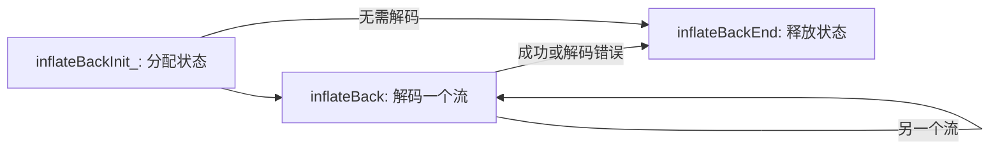

<!-- source-sha256: 9d417128109c384b885ae5d8530fe8c01d098b717782130476b75c739d58ab70 -->

# 回调解压

[API 手册](README.md) · [共享流规则](streams.md) · [流式解压](inflate-stream.md)

回调接口允许调用者提供输入块，并直接从窗口接收解码输出。
先用 [inflateBackInit_](#inflatebackinit_) 初始化，再用 [inflateBack](#inflateback) 解码，
最后用 [inflateBackEnd](#inflatebackend) 释放状态。窗口始终由调用者拥有。

这些聚焦契约对应固定版本的 [infback.c](../../../zlib/infback.c) 和
[zlib.h](../../../zlib/zlib.h)，针对默认 LP64 Linux 构建。
定义域和效果标签见[契约约定](contracts.md)。

**已证明的内容。** 每个函数的必需目标是它的安全目标：没有未定义行为、没有内存错误、没有泄漏，并且终止（见[安全性](../safety.md)）。各条目在“证明目标”下写出这个目标及其前提。证明所假设的是这些前提，而不是文档中的前置条件；两者不同时，以 Lean 陈述为准。这里描述的返回值、输出字节和状态变化属于功能行为：它们读自 C 源码，凡是没有已登记定理陈述的，都**尚未由证明确认**。它们不在计划的证明目标之内。每个目标的层级见[进度](../../progress.md)。

每个函数都有自己的必需安全目标：`Goal.inflateBackInit__safety`、`Goal.inflateBack_safety` 和
`Goal.inflateBackEnd_safety`，在 [Safety/Back.lean](../../../ZlibF/Spec/Safety/Back.lean) 中。
[Sequences.lean](../../../ZlibF/Spec/Common/Sequences.lean) 中的序列目标 `Goal.inflate_back_sequence_safety`
同样是必需的。它多说一点：每段历史之后，解码器状态都是有效的；它的调用子句和结束子句，就是 `inflateBack` 和
`inflateBackEnd` 的目标所重复的子句。功能目标 `Goal.inflateBackInit_`、`Goal.inflateBack`
和 `Goal.inflateBackEnd` 在 [Back.lean](../../../ZlibF/Spec/Common/Back.lean) 中。
`Goal.inflateBack` 的解码子句（什么数据到达 `out`）不在计划内。

<a id="callback-decoder-history"></a>
`inflateBack` 和 `inflateBackEnd` 的目标所覆盖的，是**回调解码器历史**（`BackSafeReachable`）。
历史从一次返回 `Z_OK` 的 `inflateBackInit_` 调用开始：

- 堆是库堆（`Fresh`、`Uniq`、`LibraryGlobals`），`stream_size` 为 112，`version` 的首字节是 `'1'`；
  大小或版本字节不同的调用不会返回 `Z_OK`；
- 流记录可读，其 `zalloc` 和 `zfree` 各自为 NULL 或默认函数，其他字段（包括 `state`）取任意值（`BackInitArguments`）；
- `windowBits` 为 8 到 15，窗口非 NULL，有 `2^windowBits` 个可写字节，并且是某个堆字节块的一段。

此后可以接任意多步，每步是下面两种之一。一种是一次 `inflateBack` 调用，它满足[其目标](#inflateback)的条件
2、3、5 和 6，并且已经返回。另一种是调用者编辑：只改 `next_in`、`avail_in`、`next_out`、`avail_out`
以及流不拥有的内存，并且保持窗口这一段的字节不变。编辑还保持每个仍然存活的块的只读标志不变，而 C 代码本来就无法改变这个标志。
比 `zlib.h` 窄的前提，都是[偏离记录](../../deviations.md#callback-decoder)中的行。

`inflateBack` 解码 raw DEFLATE。任何 zlib/gzip 头部、尾部和校验和都由调用者处理。
调用者拥有一个至少 `2^windowBits` 字节的可写窗口，它同时也是输出缓冲区。
`windowBits` 是窗口字节数的二进制指数：15 表示 `2^15 = 32768` 字节。对一般流使用这个配置；更小窗口可能拒绝有效的长距离引用。



回调让库在需要数据时主动调用应用代码。输入回调的参数 `in_desc` 是应用自己的上下文；`buf` 接收下一块输入的起始指针，返回值给出这块输入的字节数。输出回调的 `out_desc` 也是应用上下文；`buf` 和 `len` 给出本次可以读取的输出范围，`len` 以字节计。库把指针和长度交给回调，不转移窗口的所有权。

回调类型如下：

```c
typedef unsigned (*in_func)(void FAR *, z_const unsigned char FAR * FAR *);
typedef int (*out_func)(void FAR *, unsigned char FAR *, unsigned);
```

`in(in_desc, &buf)` 返回字节数并设置 `buf`；零表示没有输入，此时忽略 `buf`。
`out(out_desc, buf, len)` 接收至多一个窗口的字节；零表示成功。
若回调支持 NULL，描述参数可以为 NULL。

## inflateBackInit_

```c
int ZEXPORT inflateBackInit_(z_streamp strm, int windowBits, unsigned char FAR *window,
                             const char *version, int stream_size);
```

**用途。** 分配解码器状态并关联调用者的窗口。
`inflateBackInit` 宏提供 `version` 和 `stream_size`。

### 返回值与后续调用 {#api-inflatebackinit_-returns}

**返回值类型。** `int` — zlib 状态码

结果说明回调解码状态是否已建立并关联调用者窗口。

| 返回值 | 含义与出现条件 | 调用者接下来 |
| --- | --- | --- |
| `Z_OK`<br>**回调解码器已建立** | 版本和流大小匹配，8 <= windowBits <= 15，窗口非 NULL 且状态分配成功。 | 保持窗口存活并用 inflateBack 解码；最终调用 inflateBackEnd。 |
| `Z_VERSION_ERROR`<br>**版本或结构大小不匹配** | version 为 NULL、主版本字节不同或 stream_size 错误；在访问流前返回。 | 修正版本及结构大小后重新初始化；本次失败无需结束。 |
| `Z_STREAM_ERROR`<br>**流、窗口或位数被拒绝** | strm 或 window 为 NULL，或 windowBits 不在 8..15 范围内。 | 提供有效的非活跃流、窗口及位数后重新初始化；本次失败无需结束。 |
| `Z_MEM_ERROR`<br>**状态分配失败** | 未能分配状态；msg 和默认分配器字段可能改变，旧 state 字段保留。 | 资源可用时可重新初始化；未保留新分配，本次失败无需 inflateBackEnd。 |

**判读要点。**

- 窗口始终属于调用者；此函数只建立回调 API 状态，不能作为普通 inflate 状态使用。

### 调用条件与效果 {#api-inflatebackinit_-contract}

**定义域。** 受限定义域：有效调用者内存、未活动的流和默认分配器。

**前置条件。** 非 NULL 的 `strm` 指向可写 `z_stream`，其 `zalloc`、`zfree` 和
`opaque` 已初始化。使用 NULL 或默认分配／释放函数对；不得覆盖仍活跃的库状态。
非 NULL 的 `version` 的首字节可读。在初始化路径上，`window` 提供与流分离的
`2^windowBits` 个可写字节。该切片须保持存活直到结束操作。

**效果。** 可能初始化分配器字段和 `opaque`，清除 `msg`，并分配一个状态。
窗口仍由调用者拥有，此处不分配、不清空，也不释放窗口。

**证明目标。**

- **目标。** `Goal.inflateBackInit__safety`（[Safety/Back.lean](../../../ZlibF/Spec/Safety/Back.lean)）；必需。定理：`ZlibF.Spec.Public.BackSafetyProof.inflateBackInit__safety`（[public-back-safety.lean](../../../ZlibF/Proof/public-back-safety.lean)）。
- **适用条件**（1 到 3 是 `InitArguments`，即 `inflateInit2_` 的条件）：
    1. 堆是库堆（`Fresh`、`Uniq`、`LibraryGlobals`）；
    2. `version` 为 NULL，或其首字节可读（`VersionValue`）；
    3. `strm` 为 NULL；或者指向一个可读的流记录，其 `zalloc` 和 `zfree` 各自为 NULL 或默认函数（`DefaultOrNull`）；
    4. 当 `window` 不为 NULL 且 `windowBits` 为 8 到 15 时，`window` 覆盖 `2^windowBits` 个可写字节（`Writable`）。
- **无条件覆盖。** 每一个 `windowBits`，包括 8 到 15 之外的值；`window` 为 NULL；每一个 `stream_size`；`version` 首字节的每一个取值；记录中其他字段的每一个取值，包括 `state`；每一种分配结果。本目标比前置条件宽：它还覆盖 `strm` 为 NULL、版本或 `stream_size` 不对，以及 `state` 不为 NULL 的记录。如果该记录原本是一个存活的解码器，而调用返回 `Z_OK`，旧状态仍处于已分配状态，而记录不再指向它：账本如实记下这次泄漏，并不排除它。
- **保证。**
    - *返回。* 调用返回。`strm` 为 NULL 时，返回值是 `Z_VERSION_ERROR` 或 `Z_STREAM_ERROR`。
    - *状态。* 返回 `Z_OK` 时，流记录指向新块中一个有效的回调解码器状态，这个状态的窗口就是 `window`（`BackValid`）。
    - *写入。* `strm` 为 NULL 时不写任何内容：堆不变。否则只写流记录和调用自己分配的块（`Frame`）。
    - *分配。* 返回 `Z_OK` 时，恰好新增一个块，即状态记录，并且不释放任何块（`LiveChange`）。返回其他值时，已分配的块与调用前相同。
- **不在本目标内。** `zalloc` 或 `zfree` 是自定义函数的流：在所有目标之外（见[偏离记录](../../deviations.md)）。每种拒绝和分配失败各返回哪个值，以及调用之后各字段的值：功能目标 `Goal.inflateBackInit_`，安全结论不需要它。合法的调用确实返回 `Z_OK`：`Goal.inflate_back_initialisation_domain`（[Common/Domains.lean](../../../ZlibF/Spec/Common/Domains.lean)），必需。

<details markdown="1" class="ar-return-exact" data-return-exact="inflateBackInit_"><summary>完整返回条件与边界</summary>

**后置条件。** `Z_OK` 关联供 `inflateBack` 使用的新状态，且 `8 <= windowBits <= 15`。
输入／输出指针、可用计数、累计计数、`adler` 和 `data_type` 不变。
只初始化指定的状态字段；该状态须用于回调 API。

**错误。** NULL 版本、主版本字节不同或流大小错误，会在访问流前返回 `Z_VERSION_ERROR`。
NULL `strm`／`window`，或位数不在 8..15 内，返回 `Z_STREAM_ERROR`。
分配失败返回 `Z_MEM_ERROR`：`msg` 和默认分配器字段可能已改变，但保留原 `state` 字段。
没有分配状态，因此在此未活动流定义域内，初始化失败后不需要结束调用。

</details>

## inflateBack

```c
int ZEXPORT inflateBack(z_streamp strm, in_func in, void FAR *in_desc,
                        out_func out, void FAR *out_desc);
```

**用途。** 通过输入和输出回调解码一个完整 raw 流。

### 返回值与后续调用 {#api-inflateback-returns}

**返回值类型。** `int` — zlib 状态码

结果覆盖一个完整 raw 流的回调解码。此函数不返回 Z_OK，每次调用都会从一个新流开始。

| 返回值 | 含义与出现条件 | 调用者接下来 |
| --- | --- | --- |
| `Z_STREAM_END`<br>**raw 流及输出已完成** | 完整 raw DEFLATE 流已解码，且每个输出回调均返回零。 | 保留 next_in/avail_in 指示的未读后缀；可解码另一个独立流，或调用 inflateBackEnd。 |
| `Z_BUF_ERROR`<br>**输入回调没有更多数据** | 返回时 next_in 为 NULL；输入回调返回零，输入耗尽。 | 当前解码未完成；可结束，或准备完整输入后从头开始新的解码，不能当作暂停续接。 |
| `Z_BUF_ERROR`<br>**输出回调失败** | 返回时 next_in 非 NULL；输出回调返回非零。最终输出失败会把原 Z_STREAM_END 改为此值。 | 处理调用者输出故障；可结束，或从头开始独立解码，不能按普通 inflate 的方式续接。 |
| `Z_DATA_ERROR`<br>**DEFLATE 格式错误** | 发现畸形 raw DEFLATE 并设置 msg；此前可能已经输出数据，最终输出失败不覆盖此错误。 | 可调用 inflateBackEnd；再次 inflateBack 会从新流开始，须重新准备输入。 |
| `Z_STREAM_ERROR`<br>**缺少流或状态** | strm 或 state 为 NULL；不调用回调。 | 先用 inflateBackInit_ 建立有效回调解码器；普通 inflate 状态不可用于此接口。 |

**判读要点。**

- Z_BUF_ERROR 时用 next_in 是否为 NULL 区分输入耗尽与输出失败；这不是普通 inflate 的缓冲重试协议。
- 输入回调返回字节数，零表示无输入；输出回调返回零表示成功。错误之前及最终错误路径都可能交付输出。

### 调用条件与效果 {#api-inflateback-contract}

**定义域。** 受限定义域：活跃的回调解码器、有效且分离的切片，以及有限、会返回的
回调协议。包括任意畸形输入字节。

**前置条件。** 初始化成功且尚未结束。保持流、状态和窗口存活。
初始化 `next_in`；NULL 表示立即请求回调输入，并忽略 `avail_in`。
否则初始化 `avail_in`，并在 `next_in` 提供相应数量的可读字节。
初始输入切片和回调提供的输入切片均不与窗口、流或私有状态重叠。
两个回调均非 NULL。每次回调都安全返回，且提供的输入总量有界。

回调只能读取收到的输入／输出字节以及自身的有效对象。
可以修改、分配或释放自身内存，但须保持流、私有状态和窗口切片不变。
输入块在下一次输入回调或函数返回前须持续可读且不变，包括跨越输出回调时。
输出回调最多读取 `len` 个窗口字节。
若所用字节切片不重叠，回调存储与窗口可共用一次分配。
禁止对该流进行并发或重入访问。

**效果。** 重置解码以处理新流，消费输入、写窗口并调用回调。
完整窗口和最终非空的部分窗口均交给 `out`，包括错误路径。
因此回调可能在后续格式或输入失败之前已观察到输出。
库本身不分配或释放内存；回调分配的内存仍由调用者负责。

**证明目标。**

- **目标。** `Goal.inflateBack_safety`（[Safety/Back.lean](../../../ZlibF/Spec/Safety/Back.lean)）；必需。定理：`ZlibF.Spec.Public.BackSafetyProof.inflateBack_safety`（[public-back-safety.lean](../../../ZlibF/Proof/public-back-safety.lean)）。这个目标有三个子句：对 NULL 流的拒绝，对状态为 NULL 的流记录的拒绝，以及历史上的一次调用。第一个和第三个是序列目标 `Goal.inflate_back_sequence_safety` 的子句 1 和子句 3。
- **适用条件。** 第一个拒绝子句没有条件。第二个要求 `strm` 指向一个可读的流记录。历史上的调用要求：
    1. `strm` 有一段[回调解码器历史](#callback-decoder-history)（`BackSafeReachable`）；前提 `BackValid` 给它的记录和状态命名；
    2. `next_in` 为 NULL，或者覆盖 `avail_in` 个可读字节（`Bytes`）且不与窗口重叠（`Separate`）；
    3. 回调遵守一个协议（`CallbackProtocol`），其不变量在调用时成立：`in` 和 `out` 各自返回，只改变回调自己的块，并且保持窗口这一段的字节不变；`in` 交出一个可读的、不与窗口重叠的片段；`out` 保持当前输入片段可读（全部子句见[偏离记录](../../deviations.md#callback-decoder)）；
    4. 协议的输入总量（包括第一个片段）少于 `2^48` 字节（`inputBound`）；
    5. 平台大小上界在调用时成立，并且每个回调步骤都保持它（`ByteObjectsFit`、`BackPlatform`）；
    6. 每个输入片段都位于堆字节块中：第一个片段（`BackFirstChunk`）和 `in` 交出的每一个片段（`BackPlatform`）。
- **无条件覆盖。** 每一个输入字节序列，无论是否合法，以及把它切分成片段的每一种方式；`in` 返回 0；`out` 报告失败；`in_desc` 和 `out_desc` 的每个取值；回调分配和释放自己的内存。在第二个拒绝子句中，记录其他字段的每一个取值。
- **保证。**
    - *返回。* `strm` 为 NULL 时，以及流记录的 `state` 为 NULL 时，调用返回 `Z_STREAM_ERROR`。在历史上，它返回 `Z_STREAM_END`、`Z_DATA_ERROR` 或 `Z_BUF_ERROR`。
    - *状态。* 在历史上，流在同一个窗口上保持有效的回调解码器状态，窗口大小不变（`BackValid`），并且协议的不变量在调用后成立。于是流又有了一段历史，下一次调用的目标适用。
    - *写入。* 两种拒绝都不写任何内容：堆不变。在历史上，只写流记录、状态记录、回调自己的块和窗口所在的块；如果这个块不是回调自己的块，则只写其中窗口这一段（`CallbackFrame`）。
    - *分配。* 在历史上，回调自己的块之外的每个块，调用后是否已分配都与调用前相同：库不分配也不释放任何东西。
- **不在本目标内。** 非 NULL 状态不是来自 `inflateBackInit_` 的流记录，例如来自 `inflateInit_` 的状态：没有目标覆盖它。什么数据到达 `out`，三个返回值中返回哪一个，以及调用后的 `next_in` 和 `avail_in`：功能目标 `Goal.inflateBack`，安全结论不需要它；它不在计划内。条件 4 到 6、窗口必须在堆字节块中以及对调用者编辑的规定都比 `zlib.h` 窄：见[偏离记录](../../deviations.md#callback-decoder)中的行。

<details markdown="1" class="ar-return-exact" data-return-exact="inflateBack"><summary>完整返回条件与边界</summary>

**后置条件。** `Z_STREAM_END` 表示完整 raw 流已解码，且每次输出调用都成功。
拼接各块得到其未压缩字节，不使用预置字典。
`next_in`／`avail_in` 指出初始输入块或最后一个回调块的未读后缀。
输入耗尽后两者为 NULL／零；否则指针按已消费字节数前移。
累计计数、`adler` 和 `data_type` 不变；`next_out`／`avail_out` 不用于输出接口。
流保留状态和窗口，可供下次独立解码或结束操作使用。

**错误。** `Z_BUF_ERROR` 表示输入耗尽或输出结果非零；本函数从不返回 `Z_OK`。
对 `Z_BUF_ERROR`，NULL `next_in` 表示输入耗尽，非 NULL 表示输出失败。
`Z_DATA_ERROR` 表示畸形 DEFLATE，并设置 `msg`。
最终输出失败会将 `Z_STREAM_END` 改为 `Z_BUF_ERROR`，但不替换此前已选定的其他错误。
NULL `strm` 或 NULL 状态返回 `Z_STREAM_ERROR`，不调用回调。
其他无效状态不在本定义域内：普通 `inflateInit_` 产生的状态不是回调解码器。
解码错误后，结束操作仍释放状态；再次调用则从一个新流开始。

</details>

## inflateBackEnd

```c
int ZEXPORT inflateBackEnd(z_streamp strm);
```

**用途。** 释放回调初始化所分配的状态。

### 返回值与后续调用 {#api-inflatebackend-returns}

**返回值类型。** `int` — zlib 状态码

结果说明内部回调状态是否已释放；调用者窗口始终由调用者管理。

| 返回值 | 含义与出现条件 | 调用者接下来 |
| --- | --- | --- |
| `Z_OK`<br>**内部状态已释放** | 有效回调解码器的内部状态已释放，state 置为 NULL；窗口及其他字段不变。 | 现在可释放或复用调用者窗口；再次解码前重新初始化。 |
| `Z_STREAM_ERROR`<br>**未执行释放** | strm、state 或 zfree 为 NULL；不释放任何内存。 | 确认生命周期及匹配的释放函数；不能由这些检查推断任意非 NULL 状态有效。 |

### 调用条件与效果 {#api-inflatebackend-contract}

**定义域。** 受限定义域：使用有效默认释放函数的活跃回调解码器，另包括经检查的
NULL 流、NULL 状态和 NULL 释放函数拒绝情形。

**前置条件。** 清理时初始化已成功、尚未结束，且没有解码或回调正在活动。
流和所关联状态仍有效；保留匹配的 `zfree` 和 `opaque`。
成功解码或任何解码错误后均允许清理。

**效果。** 恰好释放内部状态，并清除 `state`。

**证明目标。**

- **目标。** `Goal.inflateBackEnd_safety`（[Safety/Back.lean](../../../ZlibF/Spec/Safety/Back.lean)）；必需。定理：`ZlibF.Spec.Public.BackSafetyProof.inflateBackEnd_safety`（[public-back-safety.lean](../../../ZlibF/Proof/public-back-safety.lean)）。这个目标有三个子句：对 NULL 流的拒绝，对 `state` 或 `zfree` 为 NULL 的流记录的拒绝，以及历史的结束。第三个是序列目标 `Goal.inflate_back_sequence_safety` 的子句 4。
- **适用条件。** 第一个拒绝子句没有条件。第二个要求 `strm` 指向一个可读的流记录。历史的结束要求：
    1. `strm` 有一段[回调解码器历史](#callback-decoder-history)（`BackSafeReachable`）。
- **无条件覆盖。** 每一段历史：刚初始化之后，以及一次返回 `Z_STREAM_END`、`Z_DATA_ERROR` 或 `Z_BUF_ERROR` 的解码之后。结束子句没有平台前提。在第二个拒绝子句中，记录其他字段的每一个取值。
- **保证。**
    - *返回。* `strm` 为 NULL 时，以及流记录的 `state` 或 `zfree` 为 NULL 时，调用返回 `Z_STREAM_ERROR`。在历史上，它返回 `Z_OK`。
    - *状态。* 在历史上，调用之后流记录的 `state` 字段为 NULL。历史到此结束。
    - *写入。* 两种拒绝都不写任何内容：堆不变。在历史上，只写流记录和状态块（`Frame`）。
    - *分配。* 在历史上，恰好释放状态块，并且不分配任何块（`LiveChange`）。
- **不在本目标内。** 非 NULL 状态不是来自 `inflateBackInit_` 的流记录：没有目标覆盖它。调用之后其他字段的值：功能目标 `Goal.inflateBackEnd`，安全结论不需要它。

<details markdown="1" class="ar-return-exact" data-return-exact="inflateBackEnd"><summary>完整返回条件与边界</summary>

**后置条件。** `Z_OK` 使 `state` 为 NULL。调用者的窗口及其他所有流字段不变。
调用者此时可释放或复用窗口；库从不释放它。

**错误。** NULL `strm`、NULL 状态或 NULL `zfree` 返回 `Z_STREAM_ERROR`，不释放任何内存。
这些检查不会验证任意非 NULL 状态，也不会检测所有权错误。

[返回 API 手册](README.md) · [契约约定](contracts.md)

</details>
