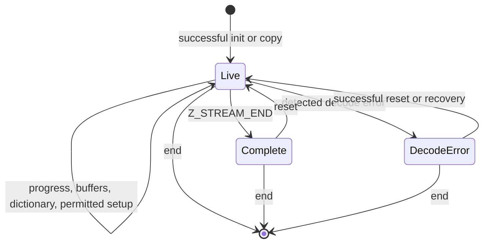

# Shared stream rules

[API manual](README.md) · [How to read a contract](contracts.md)

A stream (`z_stream`) keeps compression or decompression state between calls. This page
gathers the rules that every stream function shares: who owns which memory, what the buffers
must be, and in which order calls may come. The function entries refer to these rules and do
not repeat them.

**What is proved.** The safety of every permitted call sequence on a stream:
`Goal.inflate_sequence_safety` and `Goal.deflate_sequence_safety`, each with a theorem of
exactly its type ([safety, calls and sequences](../safety.md#2-calls-and-sequences)). **What is not proved
here.** The rules below also describe functional behaviour: return codes, output bytes,
flush markers. That part is read from the pinned C and `zlib.h`, is **to confirm**, and is not
required for the safety results. The page uses the default LP64 Linux build and the default
allocator.

## Stream lifetime

A successful init starts a lifetime. It ends only when the matching End function releases the
state. A successful copy starts a second lifetime with its own End. The diagram shows the
ordinary lifetimes; the function entries give the rules for finishing, memory errors, recovery
and the advanced operations.

The sequence rule: calls that satisfy their own Pre and the call-order rules
keep the stream invariant, terminate without a fault, leave unrelated memory unchanged and
account for every allocation. For safety this is the statement
`StreamSequenceSafety`, for both kinds of stream. Init establishes the invariant; no call
assumes it.

## The rule identifiers

Each rule in the tables below has an identifier of the form `A-…`. The comments of the Lean
functional specifications cite a rule by it. A rule with an identifier is not thereby a
theorem.

## Stream storage and ownership

The caller owns the `z_stream` and its buffers. The library owns `state` and what it
allocates for it.

| Field | Who writes it |
| --- | --- |
| `next_in`, `avail_in` | The caller sets them to the unread input. The library advances them. |
| `next_out`, `avail_out` | The caller sets them to the room for output. The library advances them. |
| `total_in`, `total_out`, `msg`, `data_type`, `adler` | The library. The counters wrap at their C unsigned width; `uLong` has 64 bits in this build. |
| `state` and everything it points to | The library. The caller does not touch it. |
| `zalloc`, `zfree`, `opaque` | The caller sets them before init. Init replaces a `NULL` `zalloc` or `zfree` by the default function. |

| Topic | Rule |
| --- | --- |
| Init: what the caller provides (`A-stream-init`) | A writable `z_stream` that holds no live stream, with `zalloc`, `zfree` and `opaque` set. In this scope `zalloc` and `zfree` are `NULL`, which selects the default allocator. The safety goals of the init functions ask for less: see [inflateInit2_](inflate-stream.md#inflateinit2_) and [deflateInit2_](deflate-stream.md#deflateinit2_). |
| Init: what it establishes (`A-stream-init`) | Only a successful init gives a live stream with a non-NULL `state`. A wrong version, a wrong structure size or a wrong parameter is refused as the function entry says. |
| Input (`A-stream-in`) | When a call uses input, `next_in` covers `avail_in` readable bytes. `NULL` is allowed only with a zero count. |
| Output (`A-stream-out`) | When a call uses output, `next_out` covers `avail_out` writable bytes. `inflate` and `deflate` require a non-NULL `next_out` even with zero room; their entries say what happens then. |
| Separation (`A-stream-disjoint`) | The caller's ranges are separate from the library's storage and from the stream record, and the input range does not overlap the output range. The entries state the further rules for dictionaries and headers. An overlap that these rules exclude is not thereby undefined behaviour in C. |
| Lifetime and sequencing (`A-stream-single`) | Calls on one stream are sequential. Caller storage stays valid for every call that can access it. |
| End (`A-stream-end`) | A successful End releases the state. Initialise again before further work on the record. A call on an ended record is refused with an error code; that is different from a permitted call on a live stream. |
| Progress accounting (`A-stream-progress`) | Each byte consumed or produced advances the matching pointer by one and decreases its count by one. The totals follow each function's rules, with the exception for a late memory error described below. |
| Deallocation and copy (`A-stream-dealloc`) | End frees each allocation of the library once and never frees a caller buffer. A copy has its own separately owned state; caller pointers held by the source are copied as pointers, not as data. |
| Balanced ownership (`A-leak-free`) | A failed init or copy frees what that attempt allocated. End frees the blocks the stream owns; other blocks stay. Over a completed lifetime, allocations and frees balance. |

A call changes only the stream, the storage the stream owns and the caller destinations that
its entry names. Input bytes and unrelated objects are unchanged.

A gzip header record passed to `deflateSetHeader` or `inflateGetHeader` stays the caller's. The
library keeps a pointer to it across calls. Keep a header for compression readable while the
library may read it, and a header for decompression writable while parsing may write it.

`deflateReset` and `inflateReset` abandon the data stream and keep the allocations, as their
entries describe. The two `ResetKeep` functions also keep the history and have their own
entries.

## Decoding and errors

| Topic | Rule |
| --- | --- |
| Wrapper and window (`A-wbits-range`) | The accepted `windowBits` values and what each selects are listed under [inflateInit2_](inflate-stream.md#inflateinit2_) and [deflateInit2_](deflate-stream.md#deflateinit2_). For inflate they include 0, 16 and 32: 0 and 32 take the size from a zlib header, and 16, or 32 on a gzip stream, uses 15, so the accepted set is not one interval. The order of refusals matters: inflate may attempt its allocation before it rejects the value. |
| Decoding progress (`A-inflate-progress`) | With valid buffers, `inflate` consumes input and emits decoded bytes until it needs input or room, reaches a requested boundary, finishes, or finds an error. In an ordinary valid run the output is a prefix of the decoded data, complete at `Z_STREAM_END`. Input after the end of the stream is left unread. |
| Malformed input (`A-inflate-err-data`) | Any compressed bytes, malformed ones included, are valid input for the call. A detected format error or a failed integrity check returns `Z_DATA_ERROR` without a fault. A malformed prefix that is incomplete or not yet detectable need not return that code at once; no fixed detection lag is promised. |
| Decode error cleanup (`A-inflate-no-leak`) | After an error the stream still owns its storage, so reset, recovery or End remain possible as the entries permit. `inflateEnd` is safe after a data error and after a failed window allocation. |
| Header destinations (`A-header-fill`) | The buffers of a gzip header record receive at most `extra_max`, `name_max` and `comm_max` bytes. A terminating zero of the name or comment is written only if it fits. `done` starts at 0, becomes 1 when the gzip header is complete, and -1 when a zlib stream is detected. See [inflateGetHeader](inflate-stream.md#inflategetheader). |

Notes on the return codes:

- `Z_BUF_ERROR` can mean that no progress was possible, or that `Z_FINISH` could not finish.
  More input or more room can allow the call to continue.
- `Z_NEED_DICT` asks for the matching zlib dictionary.
- `inflateSync` is a separate search for a recovery point. It does not promise that the byte
  pattern it finds starts a valid remainder.
- A window allocation can fail late, after input was consumed and output written. The
  pointers and counts then show that progress, but the usual update of the totals and of the
  checksum is skipped. `Z_MEM_ERROR` does not imply unchanged output.

## Compression and flushes

| Topic | Rule |
| --- | --- |
| Compression level (`A-deflate-level`) | In this build -1 selects 6, and level 0 stores. With the ordinary strategy, levels 1 to 3 use fast matching and levels 4 to 9 lazy matching. The Huffman-only and run-length strategies use their own paths. |
| Strategy (`A-deflate-strategy`) | The strategies are 0 default, 1 filtered, 2 Huffman only, 3 run-length, 4 fixed codes. The output of each is still bound by the [format](../format/README.md). |
| Flush (`A-deflate-flush`) | `Z_NO_FLUSH` leaves the choice of block ends to the compressor. `Z_BLOCK` completes a block without padding to a byte. `Z_PARTIAL_FLUSH` adds an empty fixed block. `Z_SYNC_FLUSH` adds an empty stored block and aligns to a byte. `Z_FULL_FLUSH` does the same and then discards the match history. `Z_FINISH` completes the stream. |
| Encode error cleanup (`A-deflate-no-leak`) | After an error on a live stream, `deflateEnd` can still release its allocations. `deflateEnd` frees them also when it returns `Z_DATA_ERROR` for a stream ended before it finished; that code is not a leak. |
| Capacity bound (`A-deflate-bound`) | The bound of [deflateBound_z](deflate-stream.md#deflatebound_z) guarantees room only under the procedure in [sizing output](#sizing-output-with-deflatebound) and the conditions of its entry. It is a different statement from the equality of the returned number with a formula. |

### Flush and finish procedure

1. If a flush fills the output, call `deflate` again with the same flush value and more room,
   until the flush is complete.
2. For `Z_SYNC_FLUSH` and `Z_FULL_FLUSH`, give more than six bytes of room when the marker
   begins. Otherwise the marker can be emitted twice.
3. After the first `deflate(Z_FINISH)`, supply no new input. Call again with `Z_FINISH` until
   the call returns `Z_STREAM_END` or an error.
4. After `Z_STREAM_END`, reset the stream or end it.

A zlib dictionary is set before compression starts. Replacing the dictionary of a raw stream
needs a completed block, not only a call boundary. Header setup and parameter changes follow
their entries.

### Sizing output with `deflateBound`

To size one output buffer for one `deflate(Z_FINISH)` call:

1. Init the stream, then set any header or dictionary.
2. Call `deflateBound` (or `deflateBound_z`) with the input length `n`.
3. Do not change the configuration afterwards.
4. Give all `n` input bytes and at least the returned number of output bytes to the first
   `deflate(Z_FINISH)`. Both sizes must fit `avail_in` and `avail_out` and describe real
   buffers.

The bound on the total output also holds when only `Z_NO_FLUSH` calls precede `Z_FINISH`.
Other flush schedules can exceed it.

Limits. These are functional readings of the C, **to confirm**, and not required for the
safety results:

- A bound that saturated at the largest value of its type does not show that a buffer of that
  size exists.
- With a gzip `extra` field, the C computes `2 + extra_len` at `unsigned` width before it adds
  the result to the bound, so that sum can wrap for an extreme `extra_len`.
- The contracts on these pages assume `extra_len <= 65535`. The functional goal
  `Goal.deflateBound_z` (not planned; not done) is stated for every header length.

The safety goals `Goal.deflateBound_safety` and `Goal.deflateBound_z_safety` say that the
call itself is safe. They say nothing about the size of the later output.

## Related function pages

The individual entries give the accepted arguments, the return values and the effects of
each error:

| Manual | Scope |
| --- | --- |
| [Stream decompression](inflate-stream.md) | Init, decode, reset, dictionaries, headers, recovery, copy, end |
| [Stream compression](deflate-stream.md) | Init, encode, flush, tuning, bounds, copy, end |
| [Callback decoding](inflate-back.md) | Caller window and input/output callbacks |
| [Buffer utilities and library information](utility.md) | Whole-buffer operations, bounds, version, flags and errors |
| [Checksums](checksums.md) | Adler-32, CRC-32 and combination |
| [Gzip files](gz-file.md) | File handles, I/O, seeking and close |
