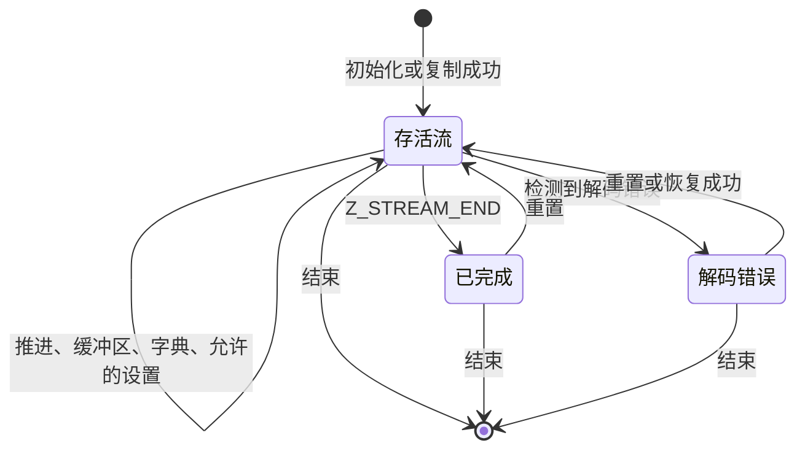

<!-- source-sha256: db103694cc7b97847852521ed011ae579c739edd1be6e58496dfa2bd8eb25ccd -->

# 共享流规则

[API 手册](README.md) · [如何阅读契约](contracts.md)

流（`z_stream`）在调用之间保留压缩或解压状态。本页汇总每个流函数共用的规则：
哪块内存归谁所有，缓冲区必须是什么样，调用可以按什么顺序进行。各函数条目引用这些规则，不再重复。

**已证明的内容。** 流上每个允许的调用序列的安全性：`Goal.inflate_sequence_safety` 和
`Goal.deflate_sequence_safety`，两者各有一条类型完全相同的定理（见[安全性，调用与调用序列](../safety.md#2-calls-and-sequences)）。
**这里没有证明的内容。** 下面的规则也描述功能行为：返回码、输出字节、刷新标记。
这一部分读自固定版本的 C 和 `zlib.h`，**尚未由证明确认**，也不是安全结论所必需的。
本页采用默认 LP64 Linux 构建和默认分配器。

## 流的生命周期

一次成功的初始化开始一个生命周期。只有相应的 End 函数释放状态时，它才结束。
一次成功的复制开始第二个生命周期，它有自己的 End。
图中画的是通常的生命周期；关于完成、内存错误、恢复和高级操作的规则见各函数条目。

序列规则：满足各自前置条件和调用顺序规则的调用保持流不变量，
终止且不出故障，不改变无关的内存，并且对每一次分配都有交代。
对安全性来说，这就是命题 `StreamSequenceSafety`，两种流都有。
不变量由初始化建立；没有哪次调用假设它。

## 规则标识符

下面各表中的每条规则都有一个形如 `A-…` 的标识符。Lean 功能规格的注释用它来引用规则。
一条规则有标识符，并不因此就是定理。

## 流的存储与所有权

调用者拥有 `z_stream` 及其缓冲区。库拥有 `state` 以及为它分配的存储。

| 字段 | 谁来写 |
| --- | --- |
| `next_in`、`avail_in` | 调用者把它们设为尚未读取的输入。库推进它们。 |
| `next_out`、`avail_out` | 调用者把它们设为输出空间。库推进它们。 |
| `total_in`、`total_out`、`msg`、`data_type`、`adler` | 库。计数器按各自的 C 无符号宽度回绕；在本构建中 `uLong` 是 64 位。 |
| `state` 及其指向的一切 | 库。调用者不碰它。 |
| `zalloc`、`zfree`、`opaque` | 调用者在初始化之前设置。初始化把为 `NULL` 的 `zalloc` 或 `zfree` 换成默认函数。 |

| 主题 | 规则 |
| --- | --- |
| 初始化：调用者提供什么（`A-stream-init`） | 一个可写的 `z_stream`，其中没有存活流，并且已设置 `zalloc`、`zfree` 和 `opaque`。在本范围内 `zalloc` 和 `zfree` 是 `NULL`，即选用默认分配器。初始化函数的安全目标要求得更少：见 [inflateInit2_](inflate-stream.md#inflateinit2_) 和 [deflateInit2_](deflate-stream.md#deflateinit2_)。 |
| 初始化：它建立什么（`A-stream-init`） | 只有成功的初始化才给出一个 `state` 非 NULL 的存活流。版本不对、结构大小不对或参数不对时，按函数条目所述拒绝。 |
| 输入（`A-stream-in`） | 调用使用输入时，`next_in` 覆盖 `avail_in` 个可读字节。只有计数为零时才允许 `NULL`。 |
| 输出（`A-stream-out`） | 调用使用输出时，`next_out` 覆盖 `avail_out` 个可写字节。`inflate` 和 `deflate` 即使空间为零也要求 `next_out` 非 NULL；这时会发生什么，见它们的条目。 |
| 分离（`A-stream-disjoint`） | 调用者的范围与库的存储分离，也与流记录分离；输入范围与输出范围不重叠。对字典和头部的进一步规则见各条目。被这些规则排除的重叠，并不因此就是 C 中的未定义行为。 |
| 生命周期与顺序（`A-stream-single`） | 对同一个流的调用是顺序的。凡是可能访问调用者存储的调用，在其执行期间该存储都保持有效。 |
| 结束（`A-stream-end`） | 成功的 End 释放状态。要在这个记录上继续工作，须重新初始化。对已结束的记录的调用会被拒绝并返回错误码；这不同于对存活流的允许的调用。 |
| 进度记账（`A-stream-progress`） | 每消费或产生一个字节，相应的指针前进一，相应的计数减一。总计数遵循各函数的规则，例外是下文所述的迟发内存错误。 |
| 释放与复制（`A-stream-dealloc`） | End 把库的每个分配释放一次，从不释放调用者的缓冲区。复制得到的流有自己单独拥有的状态；源流持有的调用者指针按指针复制，不复制数据。 |
| 所有权平衡（`A-leak-free`） | 失败的初始化或复制会释放这次尝试所分配的存储。End 释放流拥有的块；其他块保留。在一个完整的生命周期里，分配与释放相抵。 |

一次调用只改变流、流拥有的存储，以及其条目点名的调用者目的位置。输入字节和无关对象不变。

传给 `deflateSetHeader` 或 `inflateGetHeader` 的 gzip 头记录仍归调用者所有。库在多次调用之间保留指向它的指针。
用于压缩的头，在库可能读它期间须保持可读；用于解压的头，在解析可能写它期间须保持可写。

`deflateReset` 和 `inflateReset` 放弃当前的数据流并保留分配，详见它们的条目。
两个 `ResetKeep` 函数还保留历史，各有自己的条目。

## 解码与错误

| 主题 | 规则 |
| --- | --- |
| 封装与窗口（`A-wbits-range`） | 可接受的 `windowBits` 取值及其含义列在 [inflateInit2_](inflate-stream.md#inflateinit2_) 和 [deflateInit2_](deflate-stream.md#deflateinit2_) 之下。对 inflate，它们包括 0、16 和 32：0 和 32 从 zlib 头取得窗口大小，16 以及 gzip 流上的 32 使用 15，所以可接受的集合不是一个区间。拒绝的先后顺序有影响：inflate 可能先尝试分配，再拒绝这个值。 |
| 解码进度（`A-inflate-progress`） | 缓冲区合法时，`inflate` 消费输入并发出解码后的字节，直到它需要输入或空间、到达所请求的边界、完成，或发现错误。在通常的合法运行中，输出是解码数据的一个前缀，到 `Z_STREAM_END` 时完整。流结束之后的输入保持未读。 |
| 畸形输入（`A-inflate-err-data`） | 任何压缩字节，包括畸形的，都是这次调用的合法输入。检测到格式错误或完整性校验失败时返回 `Z_DATA_ERROR`，不出故障。不完整的或暂时还检测不出的畸形前缀不一定立刻返回这个码；不承诺固定的检测延迟。 |
| 解码错误后的清理（`A-inflate-no-leak`） | 出错之后流仍然拥有它的存储，所以在条目允许的范围内仍可以重置、恢复或结束。数据错误之后、窗口分配失败之后，`inflateEnd` 都是安全的。 |
| 头部的目的缓冲区（`A-header-fill`） | gzip 头记录的各缓冲区至多收到 `extra_max`、`name_max` 和 `comm_max` 个字节。名称或注释的结尾零字节只在放得下时才写入。`done` 起初为 0，gzip 头完成时变为 1，检测到 zlib 流时变为 -1。见 [inflateGetHeader](inflate-stream.md#inflategetheader)。 |

关于返回码的说明：

- `Z_BUF_ERROR` 可以表示无法取得任何进展，也可以表示 `Z_FINISH` 没能完成。
  提供更多输入或更多空间后，调用可以继续。
- `Z_NEED_DICT` 要求提供匹配的 zlib 字典。
- `inflateSync` 是另一种操作：搜索一个恢复点。它不承诺找到的字节模式之后是一段合法的余下数据。
- 窗口分配可能很晚才失败，那时输入已被消费、输出已经写出。
  指针和计数会反映这些进展，但平常会做的总计数更新和校验和更新这时被跳过。`Z_MEM_ERROR` 并不意味着输出没有改变。

## 压缩与刷新

| 主题 | 规则 |
| --- | --- |
| 压缩级别（`A-deflate-level`） | 在本构建中，-1 选择 6，级别 0 直接存储。使用普通策略时，级别 1 到 3 用快速匹配，级别 4 到 9 用惰性匹配。仅 Huffman 策略和游程策略走各自的路径。 |
| 策略（`A-deflate-strategy`） | 策略有 0 默认、1 过滤、2 仅 Huffman、3 游程、4 固定码。每种策略的输出仍受[格式](../format/README.md)约束。 |
| 刷新（`A-deflate-flush`） | `Z_NO_FLUSH` 把块在哪里结束交给压缩器决定。`Z_BLOCK` 完成一个块，但不填充到字节边界。`Z_PARTIAL_FLUSH` 追加一个空的固定块。`Z_SYNC_FLUSH` 追加一个空的存储块并对齐到字节。`Z_FULL_FLUSH` 做同样的事，然后丢弃匹配历史。`Z_FINISH` 完成整个流。 |
| 编码错误后的清理（`A-deflate-no-leak`） | 存活流出错之后，`deflateEnd` 仍然可以释放它的分配。流在完成之前被结束时，`deflateEnd` 返回 `Z_DATA_ERROR`，但同样会释放它们；这个码不表示泄漏。 |
| 容量上界（`A-deflate-bound`） | [deflateBound_z](deflate-stream.md#deflatebound_z) 的上界只在[确定输出大小](#sizing-output-with-deflatebound)一节的步骤和其条目的条件下保证空间足够。它与“返回的数等于某个公式”是两个不同的命题。 |

### 刷新与结束的步骤

1. 如果一次刷新把输出填满了，用同一个 `flush` 值和更多空间再次调用 `deflate`，直到这次刷新完成。
2. 对 `Z_SYNC_FLUSH` 和 `Z_FULL_FLUSH`，在标记开始时提供多于六个字节的空间。否则标记可能被发出两次。
3. 第一次 `deflate(Z_FINISH)` 之后，不再提供新输入。继续用 `Z_FINISH` 调用，
   直到调用返回 `Z_STREAM_END` 或一个错误。
4. `Z_STREAM_END` 之后，重置这个流，或者结束它。

zlib 字典在压缩开始之前设置。替换裸流的字典需要一个已完成的块，而不只是一次调用的边界。
头部设置和参数更改遵循各自的条目。

### 用 `deflateBound` 确定输出大小

为一次 `deflate(Z_FINISH)` 调用确定一个输出缓冲区的大小：

1. 初始化流，然后设置头部或字典（如果有）。
2. 用输入长度 `n` 调用 `deflateBound`（或 `deflateBound_z`）。
3. 此后不再更改配置。
4. 把全部 `n` 个输入字节和至少等于返回值的输出字节数交给第一次 `deflate(Z_FINISH)`。
   两个大小都必须放得进 `avail_in` 和 `avail_out`，并且对应真实的缓冲区。

如果 `Z_FINISH` 之前只有 `Z_NO_FLUSH` 调用，这个对总输出的上界同样成立。
其他刷新安排可能超过它。

限制。以下是对 C 的功能性解读，**尚未由证明确认**，也不是安全结论所必需的：

- 上界如果在其类型的最大值处饱和，并不说明存在这么大的缓冲区。
- 有 gzip `extra` 字段时，C 先在 `unsigned` 宽度上计算 `2 + extra_len`，再把结果加到上界上，
  所以 `extra_len` 极大时这个和可能回绕。
- 这些页面上的契约假设 `extra_len <= 65535`。功能目标 `Goal.deflateBound_z`（不在计划内；未完成）是对每个头部长度陈述的。

安全目标 `Goal.deflateBound_safety` 和 `Goal.deflateBound_z_safety` 说的是这次调用本身是安全的。
它们对之后的输出有多大什么也没说。

## 相关函数页面

各函数条目给出可接受的参数、返回值，以及每种错误的效果：

| 手册 | 范围 |
| --- | --- |
| [流式解压](inflate-stream.md) | 初始化、解码、重置、字典、头部、恢复、复制、结束 |
| [流式压缩](deflate-stream.md) | 初始化、编码、刷新、调优、上界、复制、结束 |
| [回调解码](inflate-back.md) | 调用者窗口与输入／输出回调 |
| [缓冲区工具与库信息](utility.md) | 整缓冲区操作、上界、版本、标志和错误 |
| [校验和](checksums.md) | Adler-32、CRC-32 及其组合 |
| [Gzip 文件](gz-file.md) | 文件句柄、I/O、定位和关闭 |

自定义分配器不在本页范围之内。
