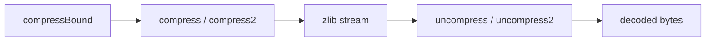

# Buffer utilities and library information

[API manual](README.md) · [Shared stream rules](streams.md) · [Checksums](checksums.md)

Use the buffer utilities when the complete input and output capacity are known at the call.
They manage a temporary stream internally. Use the stream pages when you need incremental
I/O, a different wrapper, a dictionary or explicit flush boundaries.

| Task | Entries |
| --- | --- |
| Compress a buffer | [Choose a level](#compress2_z), [default level](#compress_z), [size the destination](#compressbound_z) |
| Decompress a buffer | [Report input consumed](#uncompress2_z), [output only](#uncompress_z) |
| Inspect the library | [Version](#zlibversion), [compile flags](#zlibcompileflags), [error text](#zerror) |

The contracts follow the pinned `compress.c`, `uncompr.c`, `zutil.c` and `zlib.h` in the default
LP64 Linux build. No patch touches these three C files ([patches](../../../patches/README.md)).
`_z` forms use `z_size_t`; plain forms use `uLong`. Both are 64-bit here.
See [contract conventions](contracts.md) for domain/effect labels.
These are focused contracts: Pre describes ordinary correct use and is deliberately narrower than
what the function accepts. A call outside Pre is not thereby undefined, and it need not return an
error code.

**What is proved.** Safety only: each call returns without undefined behaviour or a memory error,
writes only what its goal names, and leaks nothing ([safety](../safety.md)). Each entry gives its
goal under **Proof goals**, in the five items and with the fixed phrases that
[Reading a Proof goals paragraph](contracts.md#reading-a-proof-goals-paragraph) defines: the goal and its theorem; the conditions under which it
applies, in the order of the Lean statement; what it covers for every value; what it guarantees
(returns, state, writes, allocations); and what it leaves to another goal. The proof assumes the
conditions listed there, not the documentary Pre. Post, the return tables and the notes describe
functional behaviour. They are read from the C, are **to confirm** where no theorem
states them, and are not required for the safety results. [Progress](../../progress.md) says which
goals are done.

The safety goals of the buffer utilities instantiate three statements
([Common/Utilities.lean](../../../ZlibF/Spec/Common/Utilities.lean)): `CompressorSafety` for the
four compression functions, `UncompressCountedSafe` for `uncompress2` and `uncompress2_z`, and
`UncompressSingleSafe` for `uncompress` and `uncompress_z`.

The buffer utilities create and release a local stream with the zlib wrapper and default settings.
The stream record is an automatic variable, not a heap block, so it takes no allocation attempt.
The allocation attempts of a call are those of the codec. A `compress*` call attempts at most
five, all in `deflateInit`: the state, the window, `prev`, `head` and the pending buffer; it
attempts none when it refuses its arguments or the level. An `uncompress*` call attempts the
decoder state in `inflateInit`, and the window inside `inflate` when decoding needs it.
A differential [test](../../../tests/regression/compress-allocation/README.md) compares the
allocation attempts of the four compression functions with the real C.

First the convention for the lengths. `sourceLen` gives the number of readable input bytes.
`*destLen` is the writable capacity of the destination array before the call, and the number of
bytes written after it. For example, with a destination of 1000 bytes into which 120 bytes are
written, set `*destLen = 1000` before the call and read 120 after a successful return. The length
cell is itself caller storage that stays live, readable and writable. For `uncompress2_z`,
`*sourceLen` likewise gives the available input before the call and reports the bytes consumed
after it.

The bound functions only compute a number; they do not allocate the destination array.



### Common conventions

For buffer calls, the domain is restricted to valid memory:
non-NULL sources cover the stated readable input; non-NULL destinations cover the stated
writable capacity. Non-NULL length pointers name readable, writable scalar cells.
Input, output and length cells are separate, including the two length cells when both occur.
The caller keeps those objects live and does not modify them during the call.
Each entry states its allowed NULL cases. Other invalid pointers are outside this scope.
Decompression error handling needs no valid compressed-data assumption.

**Common effects.** Every in-scope call terminates without a fault. Buffer calls preserve input
and memory outside the output and length cells. They write at most the original capacity.
All internal allocations are released before return, including on allocation failure;
the call leaves the caller no local stream and no allocation of its own. Pointer-valued queries return borrowed immutable storage.
The safety goals named under **Proof goals** state these effects, without the claim about
borrowed storage; the content of the output is functional behaviour.

**Length cells in the model.** For `compress`, `compress2` and their `_z` forms, the translation
passes `*destLen` as a value: the function takes the capacity, or the fact that `destLen` is NULL,
and returns the length to store. The cell is not memory in the model, so the safety goals of these
four functions cannot speak about a cell that overlaps the source or the destination
([deviations](../../deviations.md), row "Whole-buffer compression"). For the `uncompress` family
the cells are memory, 8 readable and writable bytes each, and their separation from the buffers
is a stated condition of the goal.

## compress2_z

```c
int ZEXPORT compress2_z(Bytef *dest, z_size_t *destLen, const Bytef *source,
                        z_size_t sourceLen, int level);
```

Compresses the input into one complete zlib stream at the requested level.

### Return values and next calls {#api-compress2_z-returns}

**Return type.** `int` — zlib status code; output length is written separately

The status says whether the whole buffer became a complete zlib stream. The byte count is in `*destLen`.

| Returned value | Meaning and conditions | Caller’s next step |
| --- | --- | --- |
| `Z_OK`<br>**Complete compression** | The output is a complete zlib encoding; `*destLen` is the number of bytes written. | Use exactly `*destLen` bytes as the compressed result. |
| `Z_BUF_ERROR`<br>**Output capacity exhausted** | Capacity was filled with an encoding prefix; a non-NULL destination with zero capacity also returns this after successful initialization. `*destLen` reports bytes written. | For a complete retry from the original input, first restore `*destLen` to the destination capacity. Provide a larger destination and call again from the original input; this prefix is not a complete stream. |
| `Z_MEM_ERROR`<br>**Allocation failed without output** | After early argument checks and a valid level, initialization allocation fails. No output was written; `*destLen` is zero. | For a complete retry from the original input, first restore `*destLen` to the destination capacity. Make a new complete call only when resources permit; this call produced no compressed result. |
| `Z_STREAM_ERROR`<br>**Early argument rejection** | source is NULL with sourceLen > 0, or dest is NULL with positive original capacity. destLen == NULL is also checked and rejected. Existing length values are unchanged. | Correct the rejected arguments and call again with valid buffers. |
| `Z_STREAM_ERROR`<br>**Invalid compression level** | After early argument checks, level is outside -1 and 0–9; `*destLen` is zeroed before any allocation. | Choose -1 or 0–9 and reset the output capacity for a new call. |
| `Z_STREAM_ERROR`<br>**NULL destination with zero capacity** | After early argument checks and a valid level, dest == NULL with zero capacity and initialization succeeds; `*destLen` is zero. Allocation failure instead returns Z_MEM_ERROR. | Provide a valid destination and sufficient capacity, then make a new call. |

### Calling conditions and effects {#api-compress2_z-contract}

**Domain.** Restricted domain.

**Pre.** Restricted buffer domain above. `source` may be NULL for zero input or checked rejection.
`destLen` may be NULL for checked rejection. `dest` may be NULL for checked rejection,
including the zero-capacity case below. Levels -1 and 0–9 are valid; -1 selects level 6.

**Effects.** Stateful; common effects apply. A NULL source with nonzero input, NULL `destLen`,
or NULL destination with nonzero capacity gives `Z_STREAM_ERROR` before any length write.
Otherwise `*destLen` is cleared before initialisation. A bad level returns `Z_STREAM_ERROR`
with length zero before any allocation. Later returns store the number of bytes written.

**Proof goals.**

- **Goal.** `Goal.compress2_z_safety` ([Safety/Utilities.lean](../../../ZlibF/Spec/Safety/Utilities.lean); the statement is `CompressorSafety` in [Common/Utilities.lean](../../../ZlibF/Spec/Common/Utilities.lean)); required. Theorem: `ZlibF.Spec.Public.Proofs.Compress.compress2_z_safety` ([public-compress-safe-mid.lean](../../../ZlibF/Proof/public-compress-safe-mid.lean)).
- **Applies when** (`CompressorSafety`):
    1. the heap is a library heap (`Fresh`, `Uniq`, `LibraryGlobals`);
    2. the platform size bound holds (`ByteObjectsFit`);
    3. either the arguments are ones the call refuses (`destLen` is NULL, `source` is NULL with a nonzero `sourceLen`, or `dest` is NULL with a nonzero `*destLen`; `compressRejected`), or `source` points to `sourceLen` readable bytes, `dest` points to `*destLen` writable bytes, and the two ranges do not overlap (`CompressArguments`). A NULL `source` or `dest` counts as a range of zero bytes.
- **Covered without condition.** A NULL `destLen`, which the call refuses; every `level`, valid or not; every content of the source bytes; every allocation outcome. The length cell `*destLen` is a value in the translation, not memory ([common conventions](#common-conventions)): the goal says nothing about a cell that overlaps a buffer, which Pre excludes as well.
- **Guarantees.**
    - *Returns.* The call returns. With refused arguments the code is `Z_STREAM_ERROR`. `Z_MEM_ERROR` is returned only after an allocation failed (`AllocationFailed`).
    - *State.* None is kept: no stream, state or buffer of the call exists afterwards.
    - *Writes.* Only bytes at `dest`, at most the `*destLen` given on entry; with refused arguments nothing, and the length value is unchanged. Every other object is unchanged (`Store`, `SameObjectsUpToTableShape`).
    - *Allocations.* Every block the call allocated is freed before it returns, on every path: the allocated blocks are the same as before the call.
- **Not in this goal.** Overlapping `source` and `dest`: outside every goal ([deviations](../../deviations.md), row "Whole-buffer compression"). Which code is returned for accepted arguments, the bytes written and the length stored: functional goal `Goal.compress2_z` (not planned; not done).

<details markdown="1" class="ar-return-exact" data-return-exact="compress2_z"><summary>Complete return conditions and boundaries</summary>

**Post.** `Z_OK` means the output is a complete zlib encoding of the input and `*destLen`
is its length. `Z_BUF_ERROR` means the capacity was filled with a prefix of that encoding.
`Z_MEM_ERROR` means allocation failed and no output was written.

**Edges.** NULL destination with zero capacity reaches initialisation: it returns `Z_MEM_ERROR`
if allocation fails, otherwise `Z_STREAM_ERROR`, with length zero. A non-NULL destination
with zero capacity gives `Z_BUF_ERROR` after successful initialisation. Empty input is valid.

</details>

## compress2

```c
int ZEXPORT compress2(Bytef *dest, uLongf *destLen, const Bytef *source,
                      uLong sourceLen, int level);
```

The `uLong` form of [compress2_z](#compress2_z).

### Return values and next calls {#api-compress2-returns}

**Return type.** `int` — zlib status code; output length is written separately

The status says whether the whole buffer became a complete zlib stream. The byte count is in `*destLen`.

| Returned value | Meaning and conditions | Caller’s next step |
| --- | --- | --- |
| `Z_OK`<br>**Complete compression** | The output is a complete zlib encoding; `*destLen` is the number of bytes written. | Use exactly `*destLen` bytes as the compressed result. |
| `Z_BUF_ERROR`<br>**Output capacity exhausted** | Capacity was filled with an encoding prefix; a non-NULL destination with zero capacity also returns this after successful initialization. `*destLen` reports bytes written. | For a complete retry from the original input, first restore `*destLen` to the destination capacity. Provide a larger destination and call again from the original input; this prefix is not a complete stream. |
| `Z_MEM_ERROR`<br>**Allocation failed without output** | After early argument checks and a valid level, initialization allocation fails. No output was written; `*destLen` is zero. | For a complete retry from the original input, first restore `*destLen` to the destination capacity. Make a new complete call only when resources permit; this call produced no compressed result. |
| `Z_STREAM_ERROR`<br>**Early argument rejection** | source is NULL with sourceLen > 0, or dest is NULL with positive original capacity. Existing length values are unchanged. | Correct the rejected arguments and call again with valid buffers. |
| `Z_STREAM_ERROR`<br>**Invalid compression level** | After early argument checks, level is outside -1 and 0–9; `*destLen` is zeroed before any allocation. | Choose -1 or 0–9 and reset the output capacity for a new call. |
| `Z_STREAM_ERROR`<br>**NULL destination with zero capacity** | After early argument checks and a valid level, dest == NULL with zero capacity and initialization succeeds; `*destLen` is zero. Allocation failure instead returns Z_MEM_ERROR. | Provide a valid destination and sufficient capacity, then make a new call. |

### Calling conditions and effects {#api-compress2-contract}

**Domain.** Restricted domain.

**Pre.** Restricted domain of `compress2_z`, with a non-NULL `destLen` cell.
The wrapper reads that cell before calling the checked `_z` entry.

**Effects.** Stateful; the buffer and cleanup effects are those of `compress2_z`. The wrapper copies the length back
on every return, including errors. Early argument rejection preserves its original value;
invalid level or allocation failure leaves it zero.

**Proof goals.**

- **Goal.** `Goal.compress2_safety` ([Safety/Utilities.lean](../../../ZlibF/Spec/Safety/Utilities.lean); the statement is `CompressorSafety` in [Common/Utilities.lean](../../../ZlibF/Spec/Common/Utilities.lean)); required. Theorem: `ZlibF.Spec.Public.Proofs.Compress.compress2_safety` ([public-compress-safe-mid.lean](../../../ZlibF/Proof/public-compress-safe-mid.lean)).
- **Applies when** (`CompressorSafety`):
    1. the heap is a library heap (`Fresh`, `Uniq`, `LibraryGlobals`);
    2. the platform size bound holds (`ByteObjectsFit`);
    3. `destLen` is not NULL;
    4. either the arguments are ones the call refuses (`source` is NULL with a nonzero `sourceLen`, or `dest` is NULL with a nonzero `*destLen`; `compressRejected`), or `source` points to `sourceLen` readable bytes, `dest` points to `*destLen` writable bytes, and the two ranges do not overlap (`CompressArguments`). A NULL `source` or `dest` counts as a range of zero bytes.
- **Covered without condition.** Every `level`, valid or not; every content of the source bytes; every allocation outcome. The length cell `*destLen` is a value in the translation, not memory ([common conventions](#common-conventions)): the goal says nothing about a cell that overlaps a buffer, which Pre excludes as well.
- **Guarantees.**
    - *Returns.* The call returns. With refused arguments the code is `Z_STREAM_ERROR`. `Z_MEM_ERROR` is returned only after an allocation failed (`AllocationFailed`).
    - *State.* None is kept: no stream, state or buffer of the call exists afterwards.
    - *Writes.* Only bytes at `dest`, at most the `*destLen` given on entry; with refused arguments nothing, and the length value is unchanged. Every other object is unchanged (`Store`, `SameObjectsUpToTableShape`).
    - *Allocations.* Every block the call allocated is freed before it returns, on every path: the allocated blocks are the same as before the call.
- **Not in this goal.** Overlapping `source` and `dest`: outside every goal ([deviations](../../deviations.md), row "Whole-buffer compression"). Which code is returned for accepted arguments, the bytes written and the length stored: functional goal `Goal.compress2` (not planned; not done).

<details markdown="1" class="ar-return-exact" data-return-exact="compress2"><summary>Complete return conditions and boundaries</summary>

**Post.** Same encoding and return-code contract as `compress2_z`.

</details>

## compress_z

```c
int ZEXPORT compress_z(Bytef *dest, z_size_t *destLen, const Bytef *source, z_size_t sourceLen);
```

Compresses at the default level (-1, selecting level 6).

### Return values and next calls {#api-compress_z-returns}

**Return type.** `int` — zlib status code; output length is written separately

The status says whether the whole buffer became a complete zlib stream. The byte count is in `*destLen`.

| Returned value | Meaning and conditions | Caller’s next step |
| --- | --- | --- |
| `Z_OK`<br>**Complete compression** | The output is a complete zlib encoding; `*destLen` is the number of bytes written. | Use exactly `*destLen` bytes as the compressed result. |
| `Z_BUF_ERROR`<br>**Output capacity exhausted** | Capacity was filled with an encoding prefix; a non-NULL destination with zero capacity also returns this after successful initialization. `*destLen` reports bytes written. | For a complete retry from the original input, first restore `*destLen` to the destination capacity. Provide a larger destination and call again from the original input; this prefix is not a complete stream. |
| `Z_MEM_ERROR`<br>**Allocation failed without output** | After early argument checks, initialization allocation fails. No output was written; `*destLen` is zero. | For a complete retry from the original input, first restore `*destLen` to the destination capacity. Make a new complete call only when resources permit; this call produced no compressed result. |
| `Z_STREAM_ERROR`<br>**Early argument rejection** | source is NULL with sourceLen > 0, or dest is NULL with positive original capacity. destLen == NULL is also checked and rejected. Existing length values are unchanged. | Correct the rejected arguments and call again with valid buffers. |
| `Z_STREAM_ERROR`<br>**NULL destination with zero capacity** | After early argument checks, dest == NULL with zero capacity and initialization succeeds; `*destLen` is zero. Allocation failure instead returns Z_MEM_ERROR. | Provide a valid destination and sufficient capacity, then make a new call. |

### Calling conditions and effects {#api-compress_z-contract}

**Domain.** Restricted domain.

**Pre.** Restricted domain of [compress2_z](#compress2_z), without a level argument.

**Effects.** Stateful; the same length writes, checked NULL cases and complete cleanup as
`compress2_z`.

**Proof goals.**

- **Goal.** `Goal.compress_z_safety` ([Safety/Utilities.lean](../../../ZlibF/Spec/Safety/Utilities.lean); the statement is `CompressorSafety` in [Common/Utilities.lean](../../../ZlibF/Spec/Common/Utilities.lean)); required. Theorem: `ZlibF.Spec.Public.Proofs.Compress.compress_z_safety` ([public-compress-safe-mid.lean](../../../ZlibF/Proof/public-compress-safe-mid.lean)).
- **Applies when** (`CompressorSafety`):
    1. the heap is a library heap (`Fresh`, `Uniq`, `LibraryGlobals`);
    2. the platform size bound holds (`ByteObjectsFit`);
    3. either the arguments are ones the call refuses (`destLen` is NULL, `source` is NULL with a nonzero `sourceLen`, or `dest` is NULL with a nonzero `*destLen`; `compressRejected`), or `source` points to `sourceLen` readable bytes, `dest` points to `*destLen` writable bytes, and the two ranges do not overlap (`CompressArguments`). A NULL `source` or `dest` counts as a range of zero bytes.
- **Covered without condition.** A NULL `destLen`, which the call refuses; every content of the source bytes; every allocation outcome. The length cell `*destLen` is a value in the translation, not memory ([common conventions](#common-conventions)): the goal says nothing about a cell that overlaps a buffer, which Pre excludes as well.
- **Guarantees.**
    - *Returns.* The call returns. With refused arguments the code is `Z_STREAM_ERROR`. `Z_MEM_ERROR` is returned only after an allocation failed (`AllocationFailed`).
    - *State.* None is kept: no stream, state or buffer of the call exists afterwards.
    - *Writes.* Only bytes at `dest`, at most the `*destLen` given on entry; with refused arguments nothing, and the length value is unchanged. Every other object is unchanged (`Store`, `SameObjectsUpToTableShape`).
    - *Allocations.* Every block the call allocated is freed before it returns, on every path: the allocated blocks are the same as before the call.
- **Not in this goal.** Overlapping `source` and `dest`: outside every goal ([deviations](../../deviations.md), row "Whole-buffer compression"). Which code is returned for accepted arguments, the bytes written and the length stored: functional goal `Goal.compress_z` (not planned; not done).

<details markdown="1" class="ar-return-exact" data-return-exact="compress_z"><summary>Complete return conditions and boundaries</summary>

**Post.** Same as `compress2_z` at the default level.

</details>

## compress

```c
int ZEXPORT compress(Bytef *dest, uLongf *destLen, const Bytef *source, uLong sourceLen);
```

The `uLong` compressor at the default level.

### Return values and next calls {#api-compress-returns}

**Return type.** `int` — zlib status code; output length is written separately

The status says whether the whole buffer became a complete zlib stream. The byte count is in `*destLen`.

| Returned value | Meaning and conditions | Caller’s next step |
| --- | --- | --- |
| `Z_OK`<br>**Complete compression** | The output is a complete zlib encoding; `*destLen` is the number of bytes written. | Use exactly `*destLen` bytes as the compressed result. |
| `Z_BUF_ERROR`<br>**Output capacity exhausted** | Capacity was filled with an encoding prefix; a non-NULL destination with zero capacity also returns this after successful initialization. `*destLen` reports bytes written. | For a complete retry from the original input, first restore `*destLen` to the destination capacity. Provide a larger destination and call again from the original input; this prefix is not a complete stream. |
| `Z_MEM_ERROR`<br>**Allocation failed without output** | After early argument checks, initialization allocation fails. No output was written; `*destLen` is zero. | For a complete retry from the original input, first restore `*destLen` to the destination capacity. Make a new complete call only when resources permit; this call produced no compressed result. |
| `Z_STREAM_ERROR`<br>**Early argument rejection** | source is NULL with sourceLen > 0, or dest is NULL with positive original capacity. Existing length values are unchanged. | Correct the rejected arguments and call again with valid buffers. |
| `Z_STREAM_ERROR`<br>**NULL destination with zero capacity** | After early argument checks, dest == NULL with zero capacity and initialization succeeds; `*destLen` is zero. Allocation failure instead returns Z_MEM_ERROR. | Provide a valid destination and sufficient capacity, then make a new call. |

### Calling conditions and effects {#api-compress-contract}

**Domain.** Restricted domain.

**Pre.** Restricted domain of [compress2](#compress2); `destLen` must be non-NULL.

**Effects.** Stateful; same length writes and complete cleanup as `compress2`.

**Proof goals.**

- **Goal.** `Goal.compress_safety` ([Safety/Utilities.lean](../../../ZlibF/Spec/Safety/Utilities.lean); the statement is `CompressorSafety` in [Common/Utilities.lean](../../../ZlibF/Spec/Common/Utilities.lean)); required. Theorem: `ZlibF.Spec.Public.Proofs.Compress.compress_safety` ([public-compress-safe-mid.lean](../../../ZlibF/Proof/public-compress-safe-mid.lean)).
- **Applies when** (`CompressorSafety`):
    1. the heap is a library heap (`Fresh`, `Uniq`, `LibraryGlobals`);
    2. the platform size bound holds (`ByteObjectsFit`);
    3. `destLen` is not NULL;
    4. either the arguments are ones the call refuses (`source` is NULL with a nonzero `sourceLen`, or `dest` is NULL with a nonzero `*destLen`; `compressRejected`), or `source` points to `sourceLen` readable bytes, `dest` points to `*destLen` writable bytes, and the two ranges do not overlap (`CompressArguments`). A NULL `source` or `dest` counts as a range of zero bytes.
- **Covered without condition.** Every content of the source bytes; every allocation outcome. The length cell `*destLen` is a value in the translation, not memory ([common conventions](#common-conventions)): the goal says nothing about a cell that overlaps a buffer, which Pre excludes as well.
- **Guarantees.**
    - *Returns.* The call returns. With refused arguments the code is `Z_STREAM_ERROR`. `Z_MEM_ERROR` is returned only after an allocation failed (`AllocationFailed`).
    - *State.* None is kept: no stream, state or buffer of the call exists afterwards.
    - *Writes.* Only bytes at `dest`, at most the `*destLen` given on entry; with refused arguments nothing, and the length value is unchanged. Every other object is unchanged (`Store`, `SameObjectsUpToTableShape`).
    - *Allocations.* Every block the call allocated is freed before it returns, on every path: the allocated blocks are the same as before the call.
- **Not in this goal.** Overlapping `source` and `dest`: outside every goal ([deviations](../../deviations.md), row "Whole-buffer compression"). Which code is returned for accepted arguments, the bytes written and the length stored: functional goal `Goal.compress` (not planned; not done).

<details markdown="1" class="ar-return-exact" data-return-exact="compress"><summary>Complete return conditions and boundaries</summary>

**Post.** Same as `compress2` at level -1.

</details>

## compressBound_z

```c
z_size_t ZEXPORT compressBound_z(z_size_t sourceLen);
```

Calculates the numeric bound used to size a default zlib compression buffer.

### Return values and next calls {#api-compressbound_z-returns}

**Return type.** `z_size_t` — Saturated compression-capacity value

Computes the capacity value used for default compression settings; allocates no buffer.

| Returned value | Meaning and conditions | Caller’s next step |
| --- | --- | --- |
| `min(2^64 - 1, n + (n >> 12) + (n >> 14) + (n >> 25) + 13)`<br>**Capacity value** | n = sourceLen may be any unsigned 64-bit value; sum mathematically, then saturate at the maximum. n == 0 returns 13. | Use the value to plan valid destination capacity. |

### Calling conditions and effects {#api-compressbound_z-contract}

**Domain.** Full type domain.

**Pre.** Full type domain: every 64-bit `sourceLen`, including zero and the maximum.

**Effects.** Pure. No pointer access, allocation, state change or error return.

**Scope.** This contract specifies the number. The bound is meant for compression with the
default wrapper, window and memory settings, as `compress` uses them. It gives no bound for
arbitrary raw or gzip stream settings.

**Proof goals.**

- **Goal.** `Goal.compressBound_z` ([Functional/Queries.lean](../../../ZlibF/Spec/Functional/Queries.lean)); required. It is the function's whole contract and stands for its safety goal, which is not stated separately. Theorem: `ZlibF.Spec.Public.Proofs.compressBound_z` ([public-compress-bound.lean](../../../ZlibF/Proof/public-compress-bound.lean)).
- **Applies when.** Always: the statement has no premise.
- **Covered without condition.** Every `sourceLen`.
- **Guarantees.**
    - *Returns.* The translation is a total function from the argument to the result. It takes no heap and has no fault case, so the call returns for every argument; the goal adds that the result is the saturated formula given under Post.
    - *State, writes, allocations.* None: the function has no access to memory.
- **Not in this goal.** That the output of a compressor fits in a destination of this size. For the translated `compress` and `compress_z`, when every allocation succeeds, `Goal.compress_completes` and `Goal.compress_z_completes` state it ([the round trip](../../proof/roundtrip.md)). For the other levels of `compress2`, the theorem `compress_bound_adequate` states it for the heap-free [API model](../../design/api-model.md) only; no theorem says that the translated `compress2` follows that model.

<details markdown="1" class="ar-return-exact" data-return-exact="compressBound_z"><summary>Complete return conditions and boundaries</summary>

**Post.** Returns `min(2^64 - 1, n + (n >> 12) + (n >> 14) + (n >> 25) + 13)`
for `n = sourceLen`, with the sum interpreted mathematically. Zero gives 13;
an overflowing sum gives the maximum value.

</details>

## compressBound

```c
uLong ZEXPORT compressBound(uLong sourceLen);
```

The `uLong` form of the numeric bound.

### Return values and next calls {#api-compressbound-returns}

**Return type.** `uLong` — Saturated compression-capacity value

Computes the capacity value used for default compression settings; allocates no buffer.

| Returned value | Meaning and conditions | Caller’s next step |
| --- | --- | --- |
| `min(2^64 - 1, n + (n >> 12) + (n >> 14) + (n >> 25) + 13)`<br>**Capacity value** | n = sourceLen may be any unsigned 64-bit value; sum mathematically, then saturate at the maximum. n == 0 returns 13. | Use the value to plan valid destination capacity. |

### Calling conditions and effects {#api-compressbound-contract}

**Domain.** Full type domain.

**Pre.** Full type domain: every 64-bit `sourceLen`.

**Effects.** Pure. No memory access or error return. The scope of [compressBound_z](#compressbound_z) applies.

**Proof goals.**

- **Goal.** `Goal.compressBound` ([Functional/Queries.lean](../../../ZlibF/Spec/Functional/Queries.lean)); required. It is the function's whole contract and stands for its safety goal, which is not stated separately. Theorem: `ZlibF.Spec.Public.Proofs.compressBound` ([public-compress-bound.lean](../../../ZlibF/Proof/public-compress-bound.lean)).
- **Applies when.** Always: the statement has no premise.
- **Covered without condition.** Every `sourceLen`.
- **Guarantees.**
    - *Returns.* The translation is a total function from the argument to the result. It takes no heap and has no fault case, so the call returns for every argument; the goal adds that the result is the saturated formula given under Post.
    - *State, writes, allocations.* None: the function has no access to memory.
- **Not in this goal.** That the output of a compressor fits in a destination of this size. For the translated `compress` and `compress_z`, when every allocation succeeds, `Goal.compress_completes` and `Goal.compress_z_completes` state it ([the round trip](../../proof/roundtrip.md)). For the other levels of `compress2`, the theorem `compress_bound_adequate` states it for the heap-free [API model](../../design/api-model.md) only; no theorem says that the translated `compress2` follows that model.

<details markdown="1" class="ar-return-exact" data-return-exact="compressBound"><summary>Complete return conditions and boundaries</summary>

**Post.** Same formula and saturation as [compressBound_z](#compressbound_z) on this build.

</details>

## uncompress2_z

```c
int ZEXPORT uncompress2_z(Bytef *dest, z_size_t *destLen, const Bytef *source, z_size_t *sourceLen);
```

Decodes the first zlib stream and reports both output size and input consumption.

### Return values and next calls {#api-uncompress2_z-returns}

**Return type.** `int` — zlib status code; counts are reported through length parameters

The status says whether the first zlib stream decoded completely. Length values report output and input consumption.

| Returned value | Meaning and conditions | Caller’s next step |
| --- | --- | --- |
| `Z_OK`<br>**Complete decoding** | The first zlib stream decoded completely and passed its checks; `*destLen` reports bytes written and `*sourceLen` reports bytes consumed. Trailing input is unused. | Use exactly `*destLen` output bytes. Use `*sourceLen` to locate unused input. |
| `Z_BUF_ERROR`<br>**Output full with input remaining** | Output filled the capacity and input remains; `*destLen` reports bytes written and `*sourceLen` reports bytes consumed. Already written output remains available. | For a complete retry from the original input, first restore `*destLen` to the destination capacity and `*sourceLen` to the full original input length. For a complete result, enlarge the destination and make a new call from the original input; this utility returns no stream to resume. |
| `Z_DATA_ERROR`<br>**Data, completeness or dictionary error** | Input is malformed or incomplete, or needs a preset dictionary; raw and gzip inputs are also error cases. Empty input after successful initialization is a data error. Decoder Z_BUF_ERROR with no input remaining also maps to this code. | Do not treat partial output as a checked complete result; check the format, input completeness and dictionary requirement, then use an appropriate call. |
| `Z_MEM_ERROR`<br>**Initialization allocation failure** | Initialization fails; existing length values are unchanged and no output is written. | For a complete retry from the original input, first restore `*destLen` to the destination capacity and `*sourceLen` to the full original input length. When resources permit, make a new complete call from the original input and supply the capacity again. |
| `Z_MEM_ERROR`<br>**Allocation failure during decoding** | Allocation fails after successful initialization, possibly after partial output; `*destLen` reports bytes written and `*sourceLen` reports bytes consumed. | For a complete retry from the original input, first restore `*destLen` to the destination capacity and `*sourceLen` to the full original input length. Retain written bytes if needed; they are not a fully checked result. A new call must start from the original input with capacity reset. |
| `Z_STREAM_ERROR`<br>**Argument rejection before initialization** | NULL source for nonempty input, or NULL dest for positive capacity, or NULL destLen or NULL sourceLen is rejected before initialization; existing length values are unchanged. | Correct the rejected arguments, then make a new call. |

### Calling conditions and effects {#api-uncompress2_z-contract}

**Domain.** Restricted domain.

**Pre.** Restricted buffer domain above. `*sourceLen` is the available input and `*destLen`
the output capacity. Either length pointer may be NULL for checked rejection.
A NULL data pointer is allowed only with a zero corresponding length, or for checked rejection.
Malformed, truncated, raw, gzip and dictionary-dependent input are included as error cases.

**Effects.** Stateful; common effects apply. The argument checks precede initialisation:
NULL `sourceLen`, nonempty NULL source, NULL `destLen`, or positive-capacity NULL destination
returns `Z_STREAM_ERROR` with both existing length cells unchanged.
Initialisation failure also preserves both lengths and writes no output.
After initialisation, every return stores bytes consumed in `*sourceLen` and bytes produced
in `*destLen`, including later memory failure. Output already written remains available.

**Proof goals.**

- **Goal.** `Goal.uncompress2_z_safe` ([Safety/Utilities.lean](../../../ZlibF/Spec/Safety/Utilities.lean); the statement is `UncompressCountedSafe` in [Common/Utilities.lean](../../../ZlibF/Spec/Common/Utilities.lean)); required. Theorem: `ZlibF.Spec.Public.Proofs.Uncompress.uncompress2_z_safe` ([public-uncompress-safe.lean](../../../ZlibF/Proof/public-uncompress-safe.lean)).
- **Applies when** (`UncompressCountedSafe`):
    1. the heap is a library heap (`Fresh`, `Uniq`, `LibraryGlobals`);
    2. the platform size bound holds (`ByteObjectsFit`);
    3. a non-NULL `destLen` points to a readable and writable 8-byte cell, and so does a non-NULL `sourceLen` (`LengthCell`);
    4. a non-NULL `source` points to `*sourceLen` readable bytes;
    5. a non-NULL `dest` points to `*destLen` writable bytes;
    6. the `dest` range, the `source` range and the two length cells do not overlap one another (`UtilitySeparation`).
- **Covered without condition.** A NULL `destLen` or `sourceLen`, which the call refuses; every content of the source bytes: a valid zlib stream, a truncated or malformed one, raw or gzip data; every allocation outcome. The memory conditions are those of Pre.
- **Guarantees.**
    - *Returns.* The call returns. If `sourceLen` or `destLen` is NULL, `source` is NULL with a nonzero `*sourceLen`, or `dest` is NULL with a nonzero `*destLen`, the code is `Z_STREAM_ERROR`. Otherwise it is `Z_OK`, `Z_BUF_ERROR`, `Z_DATA_ERROR` or `Z_MEM_ERROR`, and `Z_MEM_ERROR` is returned only after an allocation failed (`AllocationFailed`).
    - *State.* None is kept: no stream, state or window of the call exists afterwards.
    - *Writes.* With `Z_STREAM_ERROR` for the arguments just listed, nothing. Otherwise only: bytes at `dest`, at most the `*destLen` given on entry; `*sourceLen`, which receives a count not above its entry value; and `*destLen`, which receives the number of bytes written. With `Z_MEM_ERROR` it can also be that no byte is written and both cells keep their entry values. Every other object is unchanged (`Store`, `SameObjectsUpToTableShape`).
    - *Allocations.* Every block the call allocated is freed before it returns, on every path: the allocated blocks are the same as before the call.
- **Not in this goal.** A length cell that overlaps a buffer or the other cell, and overlapping `source` and `dest`: outside every goal ([deviations](../../deviations.md), row "Counted decompression"). Which code is returned for which input, and the bytes written: functional goal `Goal.uncompress2_z` (not planned; not done).

<details markdown="1" class="ar-return-exact" data-return-exact="uncompress2_z"><summary>Complete return conditions and boundaries</summary>

**Post.** `Z_OK` means a complete checked zlib stream decoded to the output.
Trailing input is unused. `Z_BUF_ERROR` means output filled the capacity and input remains.
`Z_DATA_ERROR` covers malformed or incomplete input and a required preset dictionary.
`Z_MEM_ERROR` means allocation failed and can follow partial output.

**Edges.** NULL destination with zero capacity is accepted using a private output pointer;
a complete empty stream can succeed. Empty input is a data error after successful initialisation.
The exact final mapping is `Z_STREAM_END` to `Z_OK`, `Z_NEED_DICT` to `Z_DATA_ERROR`,
and `Z_BUF_ERROR` to `Z_DATA_ERROR` when no input remains. Other decoder codes are retained.

</details>

## uncompress2

```c
int ZEXPORT uncompress2(Bytef *dest, uLongf *destLen, const Bytef *source, uLong *sourceLen);
```

The `uLong` decoder with an input-consumption count.

### Return values and next calls {#api-uncompress2-returns}

**Return type.** `int` — zlib status code; counts are reported through length parameters

The status says whether the first zlib stream decoded completely. Length values report output and input consumption.

| Returned value | Meaning and conditions | Caller’s next step |
| --- | --- | --- |
| `Z_OK`<br>**Complete decoding** | The first zlib stream decoded completely and passed its checks; `*destLen` reports bytes written and `*sourceLen` reports bytes consumed. Trailing input is unused. | Use exactly `*destLen` output bytes. Use `*sourceLen` to locate unused input. |
| `Z_BUF_ERROR`<br>**Output full with input remaining** | Output filled the capacity and input remains; `*destLen` reports bytes written and `*sourceLen` reports bytes consumed. Already written output remains available. | For a complete retry from the original input, first restore `*destLen` to the destination capacity and `*sourceLen` to the full original input length. For a complete result, enlarge the destination and make a new call from the original input; this utility returns no stream to resume. |
| `Z_DATA_ERROR`<br>**Data, completeness or dictionary error** | Input is malformed or incomplete, or needs a preset dictionary; raw and gzip inputs are also error cases. Empty input after successful initialization is a data error. Decoder Z_BUF_ERROR with no input remaining also maps to this code. | Do not treat partial output as a checked complete result; check the format, input completeness and dictionary requirement, then use an appropriate call. |
| `Z_MEM_ERROR`<br>**Initialization allocation failure** | Initialization fails; existing length values are unchanged and no output is written. | For a complete retry from the original input, first restore `*destLen` to the destination capacity and `*sourceLen` to the full original input length. When resources permit, make a new complete call from the original input and supply the capacity again. |
| `Z_MEM_ERROR`<br>**Allocation failure during decoding** | Allocation fails after successful initialization, possibly after partial output; `*destLen` reports bytes written and `*sourceLen` reports bytes consumed. | For a complete retry from the original input, first restore `*destLen` to the destination capacity and `*sourceLen` to the full original input length. Retain written bytes if needed; they are not a fully checked result. A new call must start from the original input with capacity reset. |
| `Z_STREAM_ERROR`<br>**Argument rejection before initialization** | NULL source for nonempty input, or NULL dest for positive capacity is rejected before initialization; existing length values are unchanged. | Correct the rejected arguments, then make a new call. |

### Calling conditions and effects {#api-uncompress2-contract}

**Domain.** Restricted domain.

**Pre.** Restricted domain of [uncompress2_z](#uncompress2_z), with both length cells non-NULL
because the wrapper reads them before the `_z` checks.

**Effects.** Stateful; the output and cleanup effects are those of `uncompress2_z`. Both lengths are copied back on every
return, including errors. Argument rejection and initialisation failure preserve their values.

**Proof goals.**

- **Goal.** `Goal.uncompress2_safe` ([Safety/Utilities.lean](../../../ZlibF/Spec/Safety/Utilities.lean); the statement is `UncompressCountedSafe` in [Common/Utilities.lean](../../../ZlibF/Spec/Common/Utilities.lean)); required. Theorem: `ZlibF.Spec.Public.Proofs.Uncompress.uncompress2_safe` ([public-uncompress-safe.lean](../../../ZlibF/Proof/public-uncompress-safe.lean)).
- **Applies when** (`UncompressCountedSafe`):
    1. the heap is a library heap (`Fresh`, `Uniq`, `LibraryGlobals`);
    2. the platform size bound holds (`ByteObjectsFit`);
    3. a non-NULL `destLen` points to a readable and writable 8-byte cell, and so does a non-NULL `sourceLen` (`LengthCell`);
    4. `destLen` and `sourceLen` are not NULL;
    5. a non-NULL `source` points to `*sourceLen` readable bytes;
    6. a non-NULL `dest` points to `*destLen` writable bytes;
    7. the `dest` range, the `source` range and the two length cells do not overlap one another (`UtilitySeparation`).
- **Covered without condition.** Every content of the source bytes: a valid zlib stream, a truncated or malformed one, raw or gzip data; every allocation outcome. The memory conditions are those of Pre.
- **Guarantees.**
    - *Returns.* The call returns. If `source` is NULL with a nonzero `*sourceLen`, or `dest` is NULL with a nonzero `*destLen`, the code is `Z_STREAM_ERROR`. Otherwise it is `Z_OK`, `Z_BUF_ERROR`, `Z_DATA_ERROR` or `Z_MEM_ERROR`, and `Z_MEM_ERROR` is returned only after an allocation failed (`AllocationFailed`).
    - *State.* None is kept: no stream, state or window of the call exists afterwards.
    - *Writes.* With `Z_STREAM_ERROR` for the arguments just listed, nothing. Otherwise only: bytes at `dest`, at most the `*destLen` given on entry; `*sourceLen`, which receives a count not above its entry value; and `*destLen`, which receives the number of bytes written. With `Z_MEM_ERROR` it can also be that no byte is written and both cells keep their entry values. Every other object is unchanged (`Store`, `SameObjectsUpToTableShape`).
    - *Allocations.* Every block the call allocated is freed before it returns, on every path: the allocated blocks are the same as before the call.
- **Not in this goal.** A length cell that overlaps a buffer or the other cell, and overlapping `source` and `dest`: outside every goal ([deviations](../../deviations.md), row "Counted decompression"). Which code is returned for which input, and the bytes written: functional goal `Goal.uncompress2` (not planned; not done).

<details markdown="1" class="ar-return-exact" data-return-exact="uncompress2"><summary>Complete return conditions and boundaries</summary>

**Post.** Same decoding, return codes and consumed count as `uncompress2_z`.

</details>

## uncompress_z

```c
int ZEXPORT uncompress_z(Bytef *dest, z_size_t *destLen, const Bytef *source, z_size_t sourceLen);
```

Decodes without exposing the consumed-input count.

### Return values and next calls {#api-uncompress_z-returns}

**Return type.** `int` — zlib status code; counts are reported through length parameters

The status says whether the first zlib stream decoded completely. Length values report output, without an input-consumption count.

| Returned value | Meaning and conditions | Caller’s next step |
| --- | --- | --- |
| `Z_OK`<br>**Complete decoding** | The first zlib stream decoded completely and passed its checks; `*destLen` reports bytes written; the consumed-input count is not exposed to the caller. Trailing input is unused. | Use exactly `*destLen` output bytes. This entry gives no count for locating trailing input. |
| `Z_BUF_ERROR`<br>**Output full with input remaining** | Output filled the capacity and input remains; `*destLen` reports bytes written; the consumed-input count is not exposed to the caller. Already written output remains available. | For a complete retry from the original input, first restore `*destLen` to the destination capacity. For a complete result, enlarge the destination and make a new call from the original input; this utility returns no stream to resume. |
| `Z_DATA_ERROR`<br>**Data, completeness or dictionary error** | Input is malformed or incomplete, or needs a preset dictionary; raw and gzip inputs are also error cases. Empty input after successful initialization is a data error. Decoder Z_BUF_ERROR with no input remaining also maps to this code. | Do not treat partial output as a checked complete result; check the format, input completeness and dictionary requirement, then use an appropriate call. |
| `Z_MEM_ERROR`<br>**Initialization allocation failure** | Initialization fails; existing length values are unchanged and no output is written. | For a complete retry from the original input, first restore `*destLen` to the destination capacity. When resources permit, make a new complete call from the original input and supply the capacity again. |
| `Z_MEM_ERROR`<br>**Allocation failure during decoding** | Allocation fails after successful initialization, possibly after partial output; `*destLen` reports bytes written; the consumed-input count is not exposed to the caller. | For a complete retry from the original input, first restore `*destLen` to the destination capacity. Retain written bytes if needed; they are not a fully checked result. A new call must start from the original input with capacity reset. |
| `Z_STREAM_ERROR`<br>**Argument rejection before initialization** | NULL source for nonempty input, or NULL dest for positive capacity, or NULL destLen is rejected before initialization; existing length values are unchanged. | Correct the rejected arguments, then make a new call. |

### Calling conditions and effects {#api-uncompress_z-contract}

**Domain.** Restricted domain.

**Pre.** Restricted domain of [uncompress2_z](#uncompress2_z); `sourceLen` is passed by value.
`destLen` may be NULL for checked rejection.

**Effects.** Stateful; the same output-length writes and complete cleanup as `uncompress2_z`.
The consumed count is local.

**Proof goals.**

- **Goal.** `Goal.uncompress_z_safe` ([Safety/Utilities.lean](../../../ZlibF/Spec/Safety/Utilities.lean); the statement is `UncompressSingleSafe` in [Common/Utilities.lean](../../../ZlibF/Spec/Common/Utilities.lean)); required. Theorem: `ZlibF.Spec.Public.Proofs.Uncompress.uncompress_z_safe` ([public-uncompress-safe.lean](../../../ZlibF/Proof/public-uncompress-safe.lean)).
- **Applies when** (`UncompressSingleSafe`):
    1. the heap is a library heap (`Fresh`, `Uniq`, `LibraryGlobals`);
    2. the platform size bound holds (`ByteObjectsFit`);
    3. a non-NULL `destLen` points to a readable and writable 8-byte cell (`LengthCell`);
    4. a non-NULL `source` points to `sourceLen` readable bytes;
    5. a non-NULL `dest` points to `*destLen` writable bytes;
    6. the `dest` range, the `source` range and the length cell do not overlap one another (`Separate`).
- **Covered without condition.** A NULL `destLen`, which the call refuses; every content of the source bytes: a valid zlib stream, a truncated or malformed one, raw or gzip data; every allocation outcome. The memory conditions are those of Pre.
- **Guarantees.**
    - *Returns.* The call returns. If `destLen` is NULL, `source` is NULL with a nonzero `sourceLen`, or `dest` is NULL with a nonzero `*destLen`, the code is `Z_STREAM_ERROR`. Otherwise it is `Z_OK`, `Z_BUF_ERROR`, `Z_DATA_ERROR` or `Z_MEM_ERROR`, and `Z_MEM_ERROR` is returned only after an allocation failed (`AllocationFailed`).
    - *State.* None is kept: no stream, state or window of the call exists afterwards.
    - *Writes.* With `Z_STREAM_ERROR` for the arguments just listed, nothing. Otherwise only: bytes at `dest`, at most the `*destLen` given on entry; and `*destLen`, which receives the number of bytes written. With `Z_MEM_ERROR` it can also be that no byte is written and the cell keeps its entry value. Every other object is unchanged (`Store`, `SameObjectsUpToTableShape`).
    - *Allocations.* Every block the call allocated is freed before it returns, on every path: the allocated blocks are the same as before the call.
- **Not in this goal.** The length cell overlapping a buffer, and overlapping `source` and `dest`: outside every goal ([deviations](../../deviations.md), row "Counted decompression"). Which code is returned for which input, and the bytes written: functional goal `Goal.uncompress_z` (not planned; not done).

<details markdown="1" class="ar-return-exact" data-return-exact="uncompress_z"><summary>Complete return conditions and boundaries</summary>

**Post.** Same output and return codes as `uncompress2_z`. Trailing bytes are ignored;
the caller receives no count with which to locate them.

</details>

## uncompress

```c
int ZEXPORT uncompress(Bytef *dest, uLongf *destLen, const Bytef *source, uLong sourceLen);
```

The `uLong` decoder without a consumed-input count.

### Return values and next calls {#api-uncompress-returns}

**Return type.** `int` — zlib status code; counts are reported through length parameters

The status says whether the first zlib stream decoded completely. Length values report output, without an input-consumption count.

| Returned value | Meaning and conditions | Caller’s next step |
| --- | --- | --- |
| `Z_OK`<br>**Complete decoding** | The first zlib stream decoded completely and passed its checks; `*destLen` reports bytes written; the consumed-input count is not exposed to the caller. Trailing input is unused. | Use exactly `*destLen` output bytes. This entry gives no count for locating trailing input. |
| `Z_BUF_ERROR`<br>**Output full with input remaining** | Output filled the capacity and input remains; `*destLen` reports bytes written; the consumed-input count is not exposed to the caller. Already written output remains available. | For a complete retry from the original input, first restore `*destLen` to the destination capacity. For a complete result, enlarge the destination and make a new call from the original input; this utility returns no stream to resume. |
| `Z_DATA_ERROR`<br>**Data, completeness or dictionary error** | Input is malformed or incomplete, or needs a preset dictionary; raw and gzip inputs are also error cases. Empty input after successful initialization is a data error. Decoder Z_BUF_ERROR with no input remaining also maps to this code. | Do not treat partial output as a checked complete result; check the format, input completeness and dictionary requirement, then use an appropriate call. |
| `Z_MEM_ERROR`<br>**Initialization allocation failure** | Initialization fails; existing length values are unchanged and no output is written. | For a complete retry from the original input, first restore `*destLen` to the destination capacity. When resources permit, make a new complete call from the original input and supply the capacity again. |
| `Z_MEM_ERROR`<br>**Allocation failure during decoding** | Allocation fails after successful initialization, possibly after partial output; `*destLen` reports bytes written; the consumed-input count is not exposed to the caller. | For a complete retry from the original input, first restore `*destLen` to the destination capacity. Retain written bytes if needed; they are not a fully checked result. A new call must start from the original input with capacity reset. |
| `Z_STREAM_ERROR`<br>**Argument rejection before initialization** | NULL source for nonempty input, or NULL dest for positive capacity is rejected before initialization; existing length values are unchanged. | Correct the rejected arguments, then make a new call. |

### Calling conditions and effects {#api-uncompress-contract}

**Domain.** Restricted domain.

**Pre.** Restricted buffer domain of [uncompress2](#uncompress2), with non-NULL `destLen`.

**Effects.** Stateful; the same output-length writes, retained partial output and complete
cleanup as `uncompress2`.

**Proof goals.**

- **Goal.** `Goal.uncompress_safe` ([Safety/Utilities.lean](../../../ZlibF/Spec/Safety/Utilities.lean); the statement is `UncompressSingleSafe` in [Common/Utilities.lean](../../../ZlibF/Spec/Common/Utilities.lean)); required. Theorem: `ZlibF.Spec.Public.Proofs.Uncompress.uncompress_safe` ([public-uncompress-safe.lean](../../../ZlibF/Proof/public-uncompress-safe.lean)).
- **Applies when** (`UncompressSingleSafe`):
    1. the heap is a library heap (`Fresh`, `Uniq`, `LibraryGlobals`);
    2. the platform size bound holds (`ByteObjectsFit`);
    3. a non-NULL `destLen` points to a readable and writable 8-byte cell (`LengthCell`);
    4. `destLen` is not NULL;
    5. a non-NULL `source` points to `sourceLen` readable bytes;
    6. a non-NULL `dest` points to `*destLen` writable bytes;
    7. the `dest` range, the `source` range and the length cell do not overlap one another (`Separate`).
- **Covered without condition.** Every content of the source bytes: a valid zlib stream, a truncated or malformed one, raw or gzip data; every allocation outcome. The memory conditions are those of Pre.
- **Guarantees.**
    - *Returns.* The call returns. If `source` is NULL with a nonzero `sourceLen`, or `dest` is NULL with a nonzero `*destLen`, the code is `Z_STREAM_ERROR`. Otherwise it is `Z_OK`, `Z_BUF_ERROR`, `Z_DATA_ERROR` or `Z_MEM_ERROR`, and `Z_MEM_ERROR` is returned only after an allocation failed (`AllocationFailed`).
    - *State.* None is kept: no stream, state or window of the call exists afterwards.
    - *Writes.* With `Z_STREAM_ERROR` for the arguments just listed, nothing. Otherwise only: bytes at `dest`, at most the `*destLen` given on entry; and `*destLen`, which receives the number of bytes written. With `Z_MEM_ERROR` it can also be that no byte is written and the cell keeps its entry value. Every other object is unchanged (`Store`, `SameObjectsUpToTableShape`).
    - *Allocations.* Every block the call allocated is freed before it returns, on every path: the allocated blocks are the same as before the call.
- **Not in this goal.** The length cell overlapping a buffer, and overlapping `source` and `dest`: outside every goal ([deviations](../../deviations.md), row "Counted decompression"). Which code is returned for which input, and the bytes written: functional goal `Goal.uncompress` (not planned; not done).

<details markdown="1" class="ar-return-exact" data-return-exact="uncompress"><summary>Complete return conditions and boundaries</summary>

**Post.** Same output and return codes as `uncompress2`; trailing input is ignored.

</details>

## zlibVersion

```c
const char * ZEXPORT zlibVersion(void);
```

Returns the linked library's release string.

### Return values and next calls {#api-zlibversion-returns}

**Return type.** `const char *` — Borrowed immutable version-string pointer

Returns the version string of the linked library.

| Returned value | Meaning and conditions | Caller’s next step |
| --- | --- | --- |
| `ZLIB_VERSION`<br>**Library version string** | No arguments; returns a non-NULL, NUL-terminated string, `1.4` in the pinned source. | Read this static string; do not write to or free it. |

### Calling conditions and effects {#api-zlibversion-contract}

**Domain.** Full type domain.

**Pre.** Full type domain; no arguments or caller state are required.

**Effects.** Read-only. The result is borrowed immutable static storage;
the caller must neither write it nor free it. No allocation or heap change occurs.

**Proof goals.**

- **Goal.** `Goal.zlibVersion_safety` ([Safety/Queries.lean](../../../ZlibF/Spec/Safety/Queries.lean)); required. Theorem: `ZlibF.Spec.Public.StatelessSafetyProof.zlibVersion_safety` ([public-stateless-safety.lean](../../../ZlibF/Proof/public-stateless-safety.lean)).
- **Applies when.** Always: the statement has no premise.
- **Covered without condition.** Every heap, also one that is not a library heap.
- **Guarantees.**
    - *Returns.* The call returns.
    - *State, writes, allocations.* None: the heap after the call is the heap before it.
- **Not in this goal.** The string the result points to: functional goal `Goal.zlibVersion` (not planned; a theorem proves it).

<details markdown="1" class="ar-return-exact" data-return-exact="zlibVersion"><summary>Complete return conditions and boundaries</summary>

**Post.** Returns a non-NULL pointer to NUL-terminated `ZLIB_VERSION` (`1.4` in the pinned source).

</details>

## zlibCompileFlags

```c
uLong ZEXPORT zlibCompileFlags(void);
```

Reports the build's type sizes and compile-time options.

### Return values and next calls {#api-zlibcompileflags-returns}

**Return type.** `uLong` — Build-information bit fields

Returns encoded type sizes and compile options for this build. The value is not a status code.

| Returned value | Meaning and conditions | Caller’s next step |
| --- | --- | --- |
| `169 (0xa9)`<br>**Selected build flags** | In this build uInt is 4 bytes; uLong, pointers and z_off_t are 8 bytes; other flags are zero. | Read the build information by fields; two-bit size fields encode 2, 4, 8 and other byte sizes as 0, 1, 2 and 3. |

### Calling conditions and effects {#api-zlibcompileflags-contract}

**Domain.** Full type domain.

**Pre.** Full type domain; no arguments or caller state are required.

**Effects.** Pure scalar query. No allocation, memory write or error return.

**Proof goals.**

- **Goal.** `Goal.zlibCompileFlags_safety` ([Safety/Queries.lean](../../../ZlibF/Spec/Safety/Queries.lean)); required. Theorem: `ZlibF.Spec.Public.StatelessSafetyProof.zlibCompileFlags_safety` ([public-stateless-safety.lean](../../../ZlibF/Proof/public-stateless-safety.lean)).
- **Applies when.** Always: the statement has no premise.
- **Covered without condition.** Every heap, also one that is not a library heap.
- **Guarantees.**
    - *Returns.* The call returns.
    - *State, writes, allocations.* None: the heap after the call is the heap before it.
- **Not in this goal.** The value returned: functional goal `Goal.zlibCompileFlags` (not planned; a theorem proves it).

<details markdown="1" class="ar-return-exact" data-return-exact="zlibCompileFlags"><summary>Complete return conditions and boundaries</summary>

**Post.** Returns 169 (`0xa9`) for this build: `uInt` is 4 bytes; `uLong`, pointers
and `z_off_t` are 8 bytes. Their two-bit fields encode sizes 2, 4, 8 and other
as 0, 1, 2 and 3. Other flags are zero in the selected build.

</details>

## zError

```c
const char * ZEXPORT zError(int err);
```

Returns the text associated with a zlib result code.

### Return values and next calls {#api-zerror-returns}

**Return type.** `const char *` — Borrowed immutable error-text pointer

Maps the supplied result code to text. The function itself always returns a non-NULL string pointer.

| Returned value | Meaning and conditions | Caller’s next step |
| --- | --- | --- |
| `"need dictionary"`<br>**need dictionary text** | err == 2. | Read the borrowed static text; do not write to or free it. |
| `"stream end"`<br>**stream end text** | err == 1. | Read the borrowed static text; do not write to or free it. |
| `"file error"`<br>**file error text** | err == -1. | Read the borrowed static text; do not write to or free it. |
| `"stream error"`<br>**stream error text** | err == -2. | Read the borrowed static text; do not write to or free it. |
| `"data error"`<br>**data error text** | err == -3. | Read the borrowed static text; do not write to or free it. |
| `"insufficient memory"`<br>**insufficient memory text** | err == -4. | Read the borrowed static text; do not write to or free it. |
| `"buffer error"`<br>**buffer error text** | err == -5. | Read the borrowed static text; do not write to or free it. |
| `"incompatible version"`<br>**incompatible version text** | err == -6. | Read the borrowed static text; do not write to or free it. |
| `""`<br>**Empty text** | err == 0, or err is outside -6–2, including the minimum and maximum int. | Read the empty string as needed; this is neither a NULL pointer nor another error code. |

### Calling conditions and effects {#api-zerror-contract}

**Domain.** Full type domain.

**Pre.** Full type domain: every `int`, including its minimum and maximum values.

**Effects.** Read-only. The result is borrowed immutable static storage; do not write or free it.
No allocation, heap change or error return occurs. Values outside -6–2 are checked before
index arithmetic, so both scalar extremes safely return empty text.

**Proof goals.** No required goal: `zlib.h` declares this function under "undocumented functions (not part of the zlib API)". A goal is stated for it: functional goal `Goal.zError` (not planned; a theorem proves it), in [Functional/Queries.lean](../../../ZlibF/Spec/Functional/Queries.lean), with the theorem `ZlibF.Spec.Public.Proofs.zError` ([public-zerror.lean](../../../ZlibF/Proof/public-zerror.lean)). It is called a functional goal because it fixes the returned text; it states the safety facts as well. For every heap and every `err` the goal states that the call returns, that the heap after the call is the heap before it (nothing is written, allocated or freed), and that the result points to read-only static storage that holds the text given under Post.

<details markdown="1" class="ar-return-exact" data-return-exact="zError"><summary>Complete return conditions and boundaries</summary>

**Post.** Returns a non-NULL pointer to the following NUL-terminated text.

| `err` | Text |
| --- | --- |
| 2 | `need dictionary` |
| 1 | `stream end` |
| -1 | `file error` |
| -2 | `stream error` |
| -3 | `data error` |
| -4 | `insufficient memory` |
| -5 | `buffer error` |
| -6 | `incompatible version` |
| 0 or any other value | empty string |

</details>

[Back to the API manual](README.md) · [Contract conventions](contracts.md)
