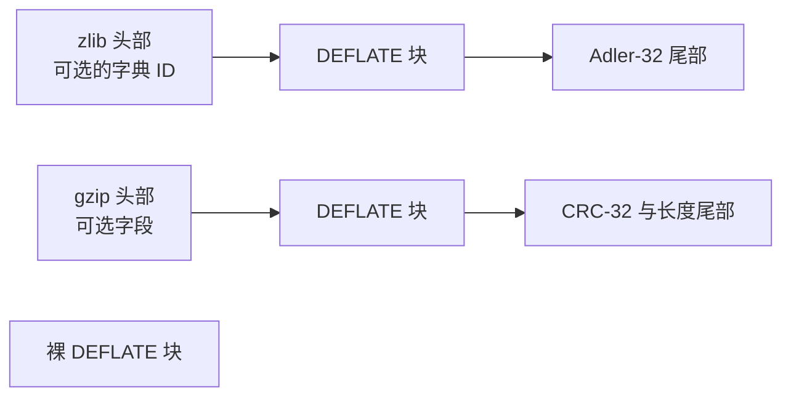

<!-- source-sha256: 8e816e68cb4af762971183db7ee0a0ec552095432044811cfa6a597154571cb2 -->

# 数据格式

[文档首页](../../README.md) · [API 指南](../api/README.md) · [Lean 模型](model.md)

DEFLATE 描述压缩后的字节。zlib 格式和 gzip 格式在这些字节外面加上头部和校验和。
本指南解释 `inflate` 必须解读、`deflate` 必须产生的数据。
本页陈述的是义务，并不声称实现满足这些义务。
已验收的结果和剩余工作记录在[进度](../../progress.md)中。

先读分层和位序，再读块和符号的规则。讲封装的两节解释字典和校验和。
[模型参考](model.md)把这些规则对应到 Lean。
缓冲区管理、返回码和合法的调用序列属于[流 API](../api/streams.md)。

格式的依据是：DEFLATE 的 [RFC 1951](https://www.rfc-editor.org/rfc/rfc1951.html)、
zlib 的 [RFC 1950](https://www.rfc-editor.org/rfc/rfc1950.html) 和
gzip 的 [RFC 1952](https://www.rfc-editor.org/rfc/rfc1952.html)。
下面的规则把 zlib 接受的变体和 zlib 加的限制都明确写出。
`F-*` 名称标识规格和证明文档用到的各项义务。

## 分层与流的边界



裸 DEFLATE 没有封装的校验和，也没有字典标识。一个 zlib 流有一个 DEFLATE 载荷。
一个 gzip 成员有一个 DEFLATE 载荷；一个 gzip 文件可以由多个成员拼接而成。
`windowBits` 选择 API 读写哪一层。

完整的流在最后一个块及其封装尾部（如果有）之后结束。
最后一个 DEFLATE 字节中没有用到的位可以是任意值。多出来的字节是另外的尾随部分。
精确流关系要求尾随部分为空；前缀关系则把它记录下来。
一次 `inflate` 调用到达 `Z_STREAM_END` 时，调用者的缓冲区里可以还有字节。
这并不使那些字节成为已完成的流的一部分。

## 位与块

位从每个字节的最低有效位开始向上依次放入。普通的数值字段（包括额外位的值）先放最低有效位。
Huffman 码则在同一串字节位位置上，先放码字的最高有效位。

例如，值为 6（二进制 `110`）的三位普通字段，发送的位依次是 0、1、1：最低有效位在前。
码字的各位为 `110` 的 Huffman 码，发送的位依次是 1、1、0：码字的第一位在前。
两者按同样的顺序占用字节中的位位置；不同的只是读回数值的方式。

`F-bit-order`：解码器把字节追加到位缓冲区的高端，从低端消费位。
要得到一个 `l` 位 Huffman 码的规范数值，须把缓冲区接下来的 `l` 个低位反转。
这种反转只用于 Huffman 码，不用于普通字段。

每个块以一个 `BFINAL` 位和一个两位的数 `BTYPE` 开始。`BFINAL = 1` 标记最后一个块。
否则后面紧跟另一个块；块的边界不必是字节边界。

| `BTYPE` | 块体 |
| --- | --- |
| 0 | 存储的字节 |
| 1 | 用固定 Huffman 码编码的符号 |
| 2 | 码的描述，后面是用这些动态 Huffman 码编码的符号 |
| 3 | 无效 |

`F-block-type-3`：块类型 3 被拒绝（`invalid block type`）。

### 存储块

存储块先跳到下一个字节边界。被跳过的位可以是任意值。
然后是两个小端 16 位字段 `LEN` 和 `NLEN`，后面恰好是 `LEN` 个未压缩的字节。

`F-stored-complement`：`NLEN = 65535 - LEN`。不相符时被拒绝
（`invalid stored block lengths`）。长度为零的存储块是允许的。

## 规范 Huffman 码

码的描述给每个符号一个长度。长度为零表示这个符号没有用到。
对字面量／长度字母表和距离字母表，非零长度至多为 15。
规范码由这些长度和符号的顺序决定；它的位模式不需要传输。

设 `count[l]` 为长度为 `l` 的符号个数，`code_start[l]` 为分给长度为 `l` 的第一个符号的值：

```text
code_start[1] = 0
code_start[l] = (code_start[l - 1] + count[l - 1]) * 2    for l >= 2
```

对一个固定的长度 `l`，按符号递增的顺序，从 `code_start[l]` 开始分配连续的值。
每个值恰好写成 `l` 位。例如，符号 0、1、2 的长度为 1、2、2 时，
`code_start[1] = 0`，`code_start[2] = (0 + 1) * 2 = 2`，所以三个码是 `0`、`10` 和 `11`。

`F-code-fits`：对 1 到 15 的每个 `l`，`code_start[l] + count[l] ≤ 2^l`。
等价的说法是：对所有用到的符号，`2^(-length)` 之和至多为 1；
一个长度为 `l` 的码占去码空间的 `2^(-l)`。长度 1、2、2 分别占去 1/2、1/4 和 1/4，正好占满。
和超过 1 就是超额分配。

`F-code-complete`：这个和等于 1 时码是完整的，小于 1 时是不完整的。
zlib 的建表函数采用下面的接受规则：

| 长度集合 | 是否接受 |
| --- | --- |
| 超额分配 | 拒绝 |
| 完整 | 接受 |
| 不完整，恰好用到一个符号，其长度为 1 | 对字面量／长度码和距离码接受；对码长码拒绝 |
| 所有长度都为零 | 作为空表接受；每次试图解码符号都会失败 |
| 其他不完整的集合 | 拒绝 |

接受一张空表，不等于接受一个无法解码的块。动态的字面量／长度表还必须含有块结束符号。
空的距离表可以用于没有匹配的块。空的码长表无法解码后面必须有的那些长度。
距离码的单符号例外是 RFC 描述的；zlib 对字面量／长度码也允许这一例外。

### 固定码

`F-fixed-lengths`：固定块使用下面的字面量／长度码长：

| 符号 | 长度 |
| --- | --- |
| 0–143 | 8 |
| 144–255 | 9 |
| 256–279 | 7 |
| 280–287 | 8 |

全部 32 个距离符号的长度都是 5。这些表里有保留符号：
解码出字面量／长度 286 或 287，或者距离 30 或 31，是错误
（`invalid literal/length code` 或 `invalid distance code`）。
它们出现在固定表中，并不表示可以使用。

### 动态码

动态块描述三套码：码长码、字面量／长度码和距离码。紧跟在块头之后，依次读取：

1. 5 位的 `HLIT`：字面量／长度字母表有 `HLIT + 257` 项。
2. 5 位的 `HDIST`：距离字母表有 `HDIST + 1` 项。
3. 4 位的 `HCLEN`：后面有 `HCLEN + 4` 个码长项。
4. 这些项，每项 3 位，按下面的符号顺序排列：
   `16 17 18 0 8 7 9 6 10 5 11 4 12 3 13 2 14 1 15`。
   没有发送的码长项为零，所以这套码的长度至多为 7。
5. 合在一起的字面量／长度码长和距离码长，用上面那套码长码解码。

合在一起的列表先是全部字面量／长度项，然后是全部距离项。码长符号按下表展开：

| 符号 | 展开 |
| --- | --- |
| 0–15 | 一项，长度就是这个数 |
| 16 | 把前一个长度重复 `3 + x` 次；`x` 读自 2 个额外位 |
| 17 | 追加 `3 + x` 个零；读 3 个额外位 |
| 18 | 追加 `11 + x` 个零；读 7 个额外位 |

`F-dynamic-limits`：zlib 要求 `HLIT + 257 ≤ 286` 且 `HDIST + 1 ≤ 30`。
这两个字段能表示更大的个数；zlib 拒绝它们（`too many length or distance symbols`）。

`F-dynamic-repeat`：符号 16 之前必须已有一项。任何重复都不得超出合在一起的总项数
（`invalid bit length repeat`）。重复可以跨过两个字母表的分界。

`F-dynamic-eob`：字面量／长度符号 256 的长度必须不为零
（`invalid code -- missing end-of-block`）。

`F-dynamic-valid`：三套码各自必须满足上面的接受规则。失败时报告为
`invalid code lengths set`、`invalid literal/lengths set` 或 `invalid distances set`。

## 字面量、匹配与历史

在 Huffman 块内，一个字面量／长度符号有三种含义之一：

| 符号 | 含义 |
| --- | --- |
| 0–255 | 把这个字节追加到输出 |
| 256 | 结束这个块 |
| 257–285 | 读长度的额外位、一个距离符号和距离的额外位；然后复制一个匹配 |

对每个表项，把额外位的数值加到它的基值上。额外位采用普通的最低有效位在前的顺序。

`F-length-table`：

| 符号 | 额外位 | 长度范围，按符号顺序 |
| --- | --- | --- |
| 257–264 | 0 | 3, 4, 5, 6, 7, 8, 9, 10 |
| 265–268 | 1 | 11–12, 13–14, 15–16, 17–18 |
| 269–272 | 2 | 19–22, 23–26, 27–30, 31–34 |
| 273–276 | 3 | 35–42, 43–50, 51–58, 59–66 |
| 277–280 | 4 | 67–82, 83–98, 99–114, 115–130 |
| 281–284 | 5 | 131–162, 163–194, 195–226, 227–257；例外见下文 |
| 285 | 0 | 258 |

`F-length-284`：zlib 还接受符号 284 配额外值 31，作为长度 258。
RFC 的表把长度 258 分给符号 285，而没有用到这个组合。格式模型保留 zlib 接受的这个组合。
有一次记录在案的对真实库的检查：先是字面量 `a`，然后是符号 284 配额外值 31 和距离 1，得到 259 个字节。
这是忠实性的证据，不是对翻译后的解码器的证明。

`F-distance-table`：

| 符号 | 额外位 | 距离范围，按符号顺序 |
| --- | --- | --- |
| 0–3 | 0 | 1, 2, 3, 4 |
| 4, 5 | 1 | 5–6, 7–8 |
| 6, 7 | 2 | 9–12, 13–16 |
| 8, 9 | 3 | 17–24, 25–32 |
| 10, 11 | 4 | 33–48, 49–64 |
| 12, 13 | 5 | 65–96, 97–128 |
| 14, 15 | 6 | 129–192, 193–256 |
| 16, 17 | 7 | 257–384, 385–512 |
| 18, 19 | 8 | 513–768, 769–1024 |
| 20, 21 | 9 | 1025–1536, 1537–2048 |
| 22, 23 | 10 | 2049–3072, 3073–4096 |
| 24, 25 | 11 | 4097–6144, 6145–8192 |
| 26, 27 | 12 | 8193–12288, 12289–16384 |
| 28, 29 | 13 | 16385–24576, 24577–32768 |

`F-match-copy`：长度为 `L`、距离为 `D` 的匹配，从往回 `D` 个字节的位置起，一次复制一个字节。
每个字节在下一次复制之前就加入历史。所以 `L` 可以大于 `D`：距离 1 把最近的那个字节重复 `L` 次。
预置字典在这段历史中排在输出之前，它本身不是输出。

`F-distance-bound`：匹配之前必须有足够的历史。声明式的模型使用
`D ≤ length(dictionary ++ output_so_far)`；距离表还保证 `D ≤ 32768`。
执行中的解码器则需要被引用的字节在它保存的窗口里，或在本次调用的输出里。
取不到的距离是 `invalid distance too far back`。

配置的窗口较小时，这两个条件并不相同。默认的 C 路径可以在当前输出缓冲区内往回复制得更远，
超出保存的窗口在两次调用之间能留住的范围。`INFLATE_STRICT` 另外加上一项检查，对照 zlib 头声明的上限。
这些条件跨输出缓冲区边界的完整细化**尚未由证明确认**；
不得把格式关系说成一项保证，好像缓冲区怎样切分都会接受同一个流。
见[模型的选择](model.md#model-choices-and-boundaries)和 [inflate API](../api/inflate-stream.md)。

## zlib 封装

各字段按下面的顺序出现：

| 字段 | 编码与规则 |
| --- | --- |
| `CMF` | 一个字节：低四位 `CM = 8`；高四位 `CINFO ≤ 7`，声明窗口大小为 `2^(CINFO + 8)` |
| `FLG` | 一个字节：`(CMF * 256 + FLG) mod 31 = 0`；第 5 位是 `FDICT`；第 6–7 位是仅供参考的 `FLEVEL` |
| `DICTID` | 仅当有 `FDICT` 时：整个预置字典的 Adler-32，四字节大端 |
| 载荷 | DEFLATE 块，在被忽略的填充位之后结束于字节边界 |
| `ADLER32` | 未压缩输出的 Adler-32，四字节大端 |

`F-zlib-header`：头部校验、方法字段和窗口字段必须合法。对应的错误是
`incorrect header check`、`unknown compression method` 和 `invalid window size`。
API 还会把声明的窗口与它配置的上限作比较。

有 `FDICT` 时，调用者提供一个字典，其 Adler-32 与 `DICTID` 相符。
只有它最后的 `2^(CINFO + 8)` 个字节可以用作初始历史。校验和仍然针对所提供的整个字典。
`FDICT` 未置位时，格式关系的字典参数被忽略。空字典的标识是 1。

`F-zlib-check`：尾部必须等于只对输出字节计算的 Adler-32。不相符是 `incorrect data check`。
字典不计入这个校验和。返回 `Z_NEED_DICT` 以及随后的字典调用属于 [API 行为](../api/inflate-stream.md)。

## gzip 封装

下面的字段描述一个成员：

| 字段 | 编码与规则 |
| --- | --- |
| `ID1`、`ID2`、`CM` | 字节 31、139、8 |
| `FLG` | 一个字节：第 0 位 `FTEXT`，第 1 位 `FHCRC`，第 2 位 `FEXTRA`，第 3 位 `FNAME`，第 4 位 `FCOMMENT`；第 5–7 位必须为零 |
| `MTIME`、`XFL`、`OS` | 四字节小端的时间，然后额外标志和操作系统各一个字节 |
| extra 字段 | 有 `FEXTRA` 时：两字节小端的长度，后面是这么多个字节 |
| 名称 | 有 `FNAME` 时：以零结尾的字节串 |
| 注释 | 有 `FCOMMENT` 时：以零结尾的字节串 |
| 头部 CRC | 有 `FHCRC` 时：此前全部头部字节的 CRC-32 的低 16 位，小端 |
| 载荷 | DEFLATE 块，在被忽略的填充位之后结束于字节边界 |
| `CRC32` | 未压缩输出的 CRC-32，四字节小端 |
| `ISIZE` | 输出长度模 `2^32`，四字节小端 |

可选字段按表中的顺序出现。`FTEXT`、`MTIME`、`XFL` 和 `OS` 不影响解码。
保留标志被拒绝（`unknown header flags set`）。gzip 不带预置字典的标识。

`F-gzip-check`：尾部的 CRC 和长度必须相符。CRC 不对是 `incorrect data check`；
长度不对是 `incorrect length check`。可选的头部 CRC 另行检查。
读多个成员、透明输入和文件错误属于 [gzip 文件 API](../api/gz-file.md)。

## 校验和的数学定义

Adler-32 从 `s1 = 1` 和 `s2 = 0` 开始。对每个字节 `b`，按下面的顺序更新：

```text
s1 = (s1 + b) mod 65521
s2 = (s2 + s1) mod 65521
adler = s2 * 65536 + s1
```

空序列的 Adler-32 是 1。`F-adler-incremental`：从一个片段的校验和出发接着处理下一个片段，
结果等于对两个片段的拼接计算校验和。

CRC-32 使用反射多项式 `0xEDB88320`。它的内部寄存器从 `0xFFFFFFFF` 开始。
每个字节按最低有效位在前的顺序处理，最后把寄存器与 `0xFFFFFFFF` 异或。
空序列的 CRC-32 是 0。`F-crc-incremental`：从已公布的校验和出发接着处理另一个片段，
结果同样等于对拼接一次算出的校验和。
初始化、更新和组合这几种调用由[校验和 API](../api/checksums.md)规定。

## 压缩器必须确立什么

`F-deflate-valid`：把一段一直进行到 `Z_FINISH` 的完整压缩调用序列的输出收集起来。
它必须是所选那一层的合法的流，并且用相符的字典解码它，必须恰好得到输入。
这是针对完整的流的往返要求，封装和校验和也在其中。

`F-deflate-matches`：发出的匹配长度为 3–258，距离为 1 到 `w_size - 262`，
其中 `w_size` 是压缩器的窗口大小，以字节计。262 就是 `MIN_LOOKAHEAD`
（`deflate.h` 中的 `MAX_MATCH + MIN_MATCH + 1`），即压缩器希望备好的预读量；
窗口为 32768 字节时，最大的距离是 32506。
这个距离上界是 zlib 的算法选择，比格式的最大值 32768 更严。

`F-deflate-flush`：完成 `Z_SYNC_FLUSH` 或 `Z_FULL_FLUSH`，会发出一串完整的块，以一个空的存储块结尾。
这时解码器可以产生到这次刷新为止所提供的全部输入。
输出空间不够的调用者必须继续调用，直到刷新完成；单独一次调用不一定发出这个边界。
[deflate API](../api/deflate-stream.md)描述这个协议，以及完全刷新额外做的历史重置。

这些义务没有规定压缩后的字节是什么。不同的合法编码器可以为同一个输入选择不同的块、码和匹配。
它们必须保留输入，并满足格式、安全性和 API 的要求。
