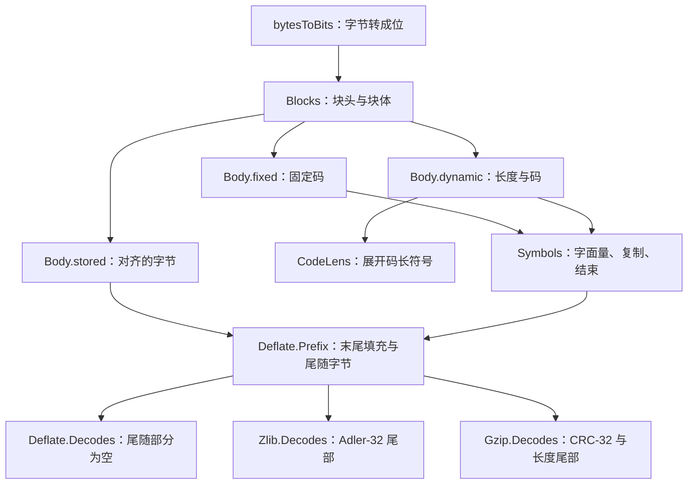

<!-- source-sha256: 7dcb5370c1689cdaa7eb3f677e28449ef944dd8ae2059b1f584397311363247b -->

# Lean 中的格式模型

[文档首页](../../README.md) · [数据格式](README.md) · [API 指南](../api/README.md)

格式模型描述压缩后的字节怎样决定未压缩的字节。它没有堆，也没有指针。
它是一份有待细化的规格，不是流 API 的实现。
规则见[格式指南](README.md)，调用、缓冲区和返回值见 [API 模型](../../design/api-model.md)。
已验收的结果和剩余工作记录在[进度](../../progress.md)中。

总模块是 [`ZlibF/Spec/Functional/Format.lean`](../../../ZlibF/Spec/Functional/Format.lean)。
记号扩展需要另行导入。下面的定义都在命名空间 `ZlibF.Spec` 中，
只有局部的记号关系在 `ZlibF.Spec.Token` 中。

## 模块一览

| 模块 | 内容 |
| --- | --- |
| [`Bits.lean`](../../../ZlibF/Spec/Functional/Format/Bits.lean) | 数值读取函数、大端和小端的字节编码。字节到位的顺序（`byteBits`、`bytesToBits`）在 [`Public/Bits.lean`](../../../ZlibF/Spec/Public/Bits.lean) 中 |
| [`Checksum.lean`](../../../ZlibF/Spec/Functional/Format/Checksum.lean) | 逐字节的 Adler-32 和 CRC-32、更新函数和追加定律 |
| [`Huffman.lean`](../../../ZlibF/Spec/Functional/Format/Huffman.lean) | 规范码、被接受的长度集合、固定码、长度表和距离表 |
| [`Deflate.lean`](../../../ZlibF/Spec/Functional/Format/Deflate.lean) | 符号关系和块关系、裸流的前缀关系和精确流关系 |
| [`Wrapper.lean`](../../../ZlibF/Spec/Functional/Format/Wrapper.lean) | zlib 和 gzip 的头部、尾部和精确流关系 |
| [`Token.lean`](../../../ZlibF/Spec/Functional/Format/Token.lean) | 单个记号的解码与拒绝，以及把它们与块语法联系起来的义务 |
| [`Examples.lean`](../../../ZlibF/Spec/Functional/Format/Examples.lean) | 接受和拒绝的具体例子 |

## 从字节到输出

`readBits`、`readBytes` 和 `decodeSym` 这类读取函数要么返回 `none`，要么返回一个值连同剩下的位。
关系的构造子要求相应的读取等式成立。
无效的块类型、保留的长度符号或距离符号，都没有构造子。

这些关系共用同一组参数。`dict` 是预置字典，`h` 是到这一点为止已经产生的输出，不含字典。
`inp` 是尚未读取的位序列，`rest` 是关系结束时它剩下的部分。
`out` 是那时的全部输出：`h` 后接新产生的字节。
`L` 和 `D` 分别给出每个字面量／长度符号和每个距离符号的码长，以位计。

`Symbols L D dict h inp rest out` 从历史 `h` 开始，使用字面量／长度码长 `L` 和距离码长 `D`，
到块结束符号为止。它把 `inp` 消费到只剩 `rest`，留下输出 `out`。
`copyBack` 每复制一个字节就先把它追加上去，再读下一个，
所以自相重叠的匹配具有通常的逐字节含义。

`Blocks dict h inp rest out` 把块体一个接一个组合起来，直到一个 `BFINAL = 1` 的块。
块语法使用的位来自整数个输入字节。在这个入口条件下，`inp.length % 8` 就是到下一个字节边界之前还剩的位数；
存储块的块体丢掉这么多位。例如，一个存储块的三个块头位是某个字节的头三位时，
这个字节还剩五位；块体丢掉它们，从下一个字节读 `LEN`。

公开的格式关系的区别，在于它们对最后一个块之后的要求：

| 关系 | 含义 |
| --- | --- |
| `Deflate.Prefix dict stream tail out` | 从 `stream` 的开头解码各块；忽略最后一个字节的填充；要求余下的字节等于 `tail` |
| `Deflate.Decodes dict stream out` | 同一个关系，取 `tail = []` |
| `Zlib.Decodes dict stream out` | 恰好一个 zlib 流，带有经过检查的头部、可选的字典 ID 和 Adler-32 尾部 |
| `Gzip.Decodes stream out` | 恰好一个 gzip 成员，带有可选的头部 CRC 和 CRC-32／长度尾部 |

两种封装使用 `Deflate.Prefix`，把必须出现的尾部字节作为它的 `tail`。
它们描述的仍然是精确的流：尾部之后的字节被排除在外。
关于 `Z_STREAM_END` 之后剩余输入的 API 定理，需要另外一条关于已消费前缀的命题。

## 规则对照

`F-*` 规则在[格式指南](README.md)中定义。
本表指出每条规则对应的形式化定义，但不对实现的正确性作任何断言。

| 规则 | 定义或义务 |
| --- | --- |
| `F-bit-order` | `byteBits`、`bytesToBits`、`readBits`、`natToBitsMSB` |
| `F-block-type-3` | `Body` 没有类型 3 的构造子 |
| `F-stored-complement` | `Body.stored`：`nlen = 65535 - len` |
| `F-code-fits` | `count`、`codeStart`、`codeOf`、`Fits` |
| `F-code-complete` | `Complete`、`CodeKind`、`Acceptable` |
| `F-fixed-lengths` | `fixedLitLens`、`fixedDistLens`、`Body.fixed`；`Symbols.copy` 限制长度符号和距离符号 |
| `F-dynamic-limits` | `DynamicCountsOK`，是 `Body.dynamic` 的要求 |
| `F-dynamic-repeat` | `CodeLens.rep16`、`.rep17`、`.rep18`；关于前一项和总项数的前提 |
| `F-dynamic-eob` | `HasEndOfBlock`，是 `Body.dynamic` 的要求 |
| `F-dynamic-valid` | `Acceptable .codeLength`、`.litLen`、`.dist`，是 `Body.dynamic` 的要求 |
| 动态块头的顺序 | `Body.dynamic`、`clOrder`、`readCodeLenLens` |
| `F-length-table`、`F-length-284` | `lengthBases`、`lengthExtras`、`Symbols.copy`；基值 227 加额外值 31 仍是 258 |
| `F-distance-table` | `distBases`、`distExtras`、`Symbols.copy` |
| `F-match-copy` | `copyBack` |
| `F-distance-bound` | `Symbols.copy` 要求距离至多为 `(dict ++ h).length` |
| 块的顺序与最后一块 | `Blocks.more`、`Blocks.last` |
| `F-zlib-header` | `Zlib.HeaderOK`、`Zlib.windowSize`、`Zlib.Decodes` |
| `F-zlib-check` | `Zlib.Decodes` 要求尾随部分为 `be32 (adler32 out).toNat` |
| gzip 头部 | `Gzip.header`，以及 `Gzip.Decodes` 中对头部的约束 |
| `F-gzip-check` | `Gzip.Decodes` 要求尾随部分为 `le32 (crc32 out).toNat ++ le32 (out.length % 2^32)` |
| `F-adler-incremental` | `adler32Update`、`adler32Update_append` |
| `F-crc-incremental` | `crc32Update`、`crc32Update_append` |
| `F-deflate-valid` | `Deflate.Valid`、`Zlib.Valid`、`Zlib.ValidWith`、`Gzip.Valid` |
| `F-deflate-matches` | 压缩器的义务；格式语法中没有额外的限制 |
| `F-deflate-flush` | 流调用序列的义务；一次完成的刷新不是一个完整的最终流 |

各个 `Valid` 谓词把 `Decodes` 的重点反过来：压缩后的那个参数必须解码成所给的输入。
它们不指定唯一的一种编码。`Zlib.ValidWith` 带有预置字典；表中其他的 `Valid` 谓词不用字典。

## 模型的选择与边界

**历史与小窗口。** `Symbols.copy` 使用完整的历史 `dict ++ h`，而不是一个显式的“保存的窗口”状态。
距离表把引用限制在 32768 以内。zlib 头的窗口字段限制初始字典取多长的后缀，
但没有给 `Symbols.copy` 增加关于距离的前提。
这样就把模型已有的这一选择明确保留下来：默认的解码可以使用本次调用的输出中超出较小的保存窗口的部分，
而之后的调用可能已经没有这些字节。C 另有一项单独的 `INFLATE_STRICT` 检查。
对所有配置窗口和输出缓冲区边界的细化**尚未由证明确认**。
单凭声明式的关系，不能确立每一种切分在运行时都被接受。

**字典。** 有 `FDICT` 时，`Zlib.Decodes dict` 检查所提供的整个字典的 Adler-32，
但只把它最后的 `Zlib.windowSize cmf` 个字节传给 DEFLATE 关系。
没有 `FDICT` 时，它传 `[]`，忽略 `dict`。Adler-32 为 1 的字典可以是空的。
裸流的 `Deflate.Decodes` 直接取它的字典作为历史。gzip 从空历史开始。

**表的接受。** `Acceptable` 对三种码都允许全零的长度集合。这样的集合解不出任何符号。
只用到一个长度为 1 的符号的集合，只对字面量／长度码和距离码允许。
`HasEndOfBlock` 另外排除空的动态字面量／长度码。
表被接受也好，局部的一个记号解码成功也好，都不蕴含整个块合法。

**填充。** 存储块的对齐和最后一个字节的填充丢掉一些位，不要求它们为零。
多出来的完整字节由显式的 `tail` 处理，不算填充。

**gzip 元数据。** `Gzip.Decodes` 要求 `MTIME` 是四个字节、保留标志位为零、
extra 字段的长度小于 `2^16`，以及所取的名称和注释中不含零字节。
除此之外，`FTEXT`、`MTIME`、`XFL` 和 `OS` 不受约束。
标志未置位的可选字段，其见证不贡献任何字节；空的见证就能满足它们的约束。
一个关系覆盖一个成员，不是整个拼接而成的 gzip 文件。

**局部解码。** `Token.Step` 描述一个字面量、一个匹配或一个块结束，不假设后面的输入合法。
`Token.Rejected` 描述无法挽回的情况：无效的码，或取不到的历史。
目标 `step_composes_symbols`、`symbols_exposes_step` 和 `rejected_has_no_symbols`
把这些局部关系与原来的 `Symbols` 语法联系起来。
这条边界防止把“后面的输入将来能合法地补全”当作假设，用来为 API 调用已经返回的输出辩护。

## 哪些内容不属于格式关系

| 事项 | 规格的边界 |
| --- | --- |
| 错误码、诊断字符串、`Z_NEED_DICT` 和字典调用的顺序 | [Inflate API](../api/inflate-stream.md) |
| 缓冲区大小、不完整的输入、封装的自动检测、位预置和恢复 | [流 API](../api/streams.md)和 [API 模型](../../design/api-model.md) |
| 压缩时匹配的选择、刷新的完成和输出上界 | [Deflate API](../api/deflate-stream.md) |
| 拼接的成员、透明读取和文件错误 | [Gzip 文件 API](../api/gz-file.md) |
| 校验和组合的各个入口 | [校验和 API](../api/checksums.md) |
| 解码表的分配和 `ENOUGH` 容量上界 | [表的证明指南](../../proof/inftrees.md) |
| 翻译后的实现的内存安全、所有权和终止 | [安全性](../safety.md)和[证明方法](../../proof/method.md) |

`Examples.lean` 给出对规格的具体正面检查和反面检查。
它的证明使用内核求值，以及关系的构造子或反演。
这些例子有助于审查定义；它们不能确立定义与 RFC 的每一种情况相符，也不能确立定义与翻译后的实现相符。
差分测试同样只是忠实性的证据，不是证明。
实现细化的验收状态见[进度](../../progress.md)。
