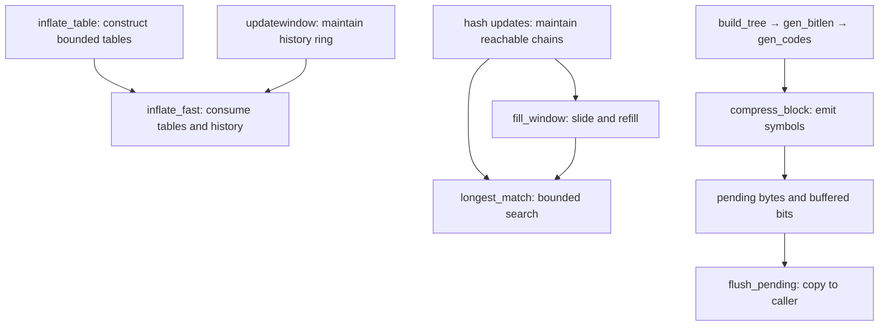

# Obligations at internal calls

This page describes, in words, what the main internal helpers of the default build need from
the function that calls them and what they deliver. A helper is a function that `zlib.h` does
not declare, such as `inflate_table` or `longest_match`. The page is a reading aid for the
proofs of the public functions. It is not a list of theorems, and no proof assumes a row.

**Status.** Each row is a reading of the C, **to confirm** unless the proof guide of its
section names a theorem for it. What is proved about the helpers follows from the public
goals: the safety goals of `inflate`, `deflate` and the other public functions are registered
([progress](../progress.md#scope)), and each is about the whole translated body, helper calls
included. So every helper call that a public call makes returns without a fault. A row's own
wording, for example an exact postcondition, is not thereby a theorem. The
[proof guides](../proof/README.md) list the theorems about each helper.

**What a row is needed for.** The required target is safety. A row matters as far as the
safety proof of a public caller uses it: bounds, termination, frames, and the facts those rest
on. A `Post` that only describes content, such as `I-it-canonical` or `I-uw-content`, is a
functional fact. It is in scope only where a safety proof depends on it.

**No hidden restriction on callers.** The precondition of a helper can be stronger than the
precondition of the public function that reaches it. The proof of the public function derives
it from the invariant that init established and from the state at the call. It is never
passed on to the application. In particular the public proofs cover small memory levels,
arbitrary contents of fresh integer memory, and the documented error cases.

## How to read the entries

Each identifier `I-*` names one obligation, so that the proof guides can cite it.

| Label | Meaning |
| --- | --- |
| `Pre` | What holds when the helper is called. |
| `Post` | What holds when it returns. |
| `Effects` | What it may read or write. |
| `Intermediate` | A fact that holds at a named point inside the helper, before the C reuses the same fields for another purpose. |

Every entry also includes the common memory facts: the storage it uses is live, represented
as the entry says and in bounds; writes go to writable storage; `memcpy` ranges do not
overlap; a pointer field was written before it is read. For each helper the proof of its
caller shows termination, no fault, and that storage outside `Effects` is unchanged.

In the diagram an arrow from A to B means that B uses data that A builds or maintains. It is
not a complete C call graph.

## Construct decode tables: `inflate_table`

Purpose: turn the code length of each symbol into a table that decodes a symbol by lookup.
`type` selects one of three alphabets: code lengths (`CODES`), literal/length (`LENS`) or
distance (`DISTS`). `codes` is the number of symbols, and `lens` holds their code lengths in
bits. `bits` is the number of bits one lookup in the root table examines. `table` is where
entries are written, and `work` is a temporary array used for sorting. Array capacities here
count entries, not bytes.

Call: `inflate_table(type, lens, codes, &table, &bits, work)`; `base` is the value of `*table`
at entry. Proof guide: [inftrees](../proof/inftrees.md).

| Part / ID | Contract |
| --- | --- |
| Pre `I-it-pre-lens` | `lens[0..codes)` is readable, with lengths in `0..15`. For `CODES`, lengths are at most 7 and the requested `*bits` is at least 7. |
| Pre `I-it-pre-codes` | `type` is `CODES`, `LENS` or `DISTS`; `codes` is at most 19, 288 or 32, respectively. |
| Pre `I-it-pre-work` | `work[0..codes)` is writable scratch, disjoint from other arguments. |
| Pre `I-it-pre-table` | `table`/`bits` are writable cells; `base` holds 128/852/592 entries for `CODES`/`LENS`/`DISTS`, disjoint from other arguments. |
| Post `I-it-ret` | Returns 0 on success, -1 for invalid lengths, or 1 for a `LENS`/`DISTS` capacity refusal. Empty codes succeed with invalid entries. |
| Effects `I-it-writes` | Changes only scratch, pointer/width cells and in-capacity table entries. Success constructs `[base, base + used)`; errors may leave partial writes. |
| Post `I-it-advance` | On success, `*table = base + used` and `*bits` is the actual root width. |
| Post `I-it-complete` | Success writes every constructed entry, including an invalid entry for a permitted one-symbol code, or two invalid entries for an empty code. |
| Post `I-it-links` | Every successful root link and its entire sub-table lie in `[base, base + used)`. |
| Post `I-it-canonical` | Success decodes the [canonical assignment](format/README.md), with invalid markers for reserved symbols. |
| Post `I-it-term` | The call ends under the stated domain. |

## Decode with margins: `inflate_fast`

Purpose: decode many symbols at once while the caller has left enough input and output, until
room is low, a block ends or the data is invalid. `avail_in` and `avail_out` count the
remaining input and output bytes; `start` is the output room the outer `inflate` call began
with. `hold` holds the bits that were read and not yet used, and `bits` counts them. The
window that keeps the history has `wsize` bytes, of which `whave` are valid; `wnext` is the
index of the next write.

Proof guide: [inffast](../proof/inffast.md).

| Part / ID | Contract |
| --- | --- |
| Pre `I-if-pre-room` | Mode is `LEN`; `avail_in ≥ 6`, `avail_out ≥ 258`, `start ≥ avail_out`. `next_out - (start - avail_out)` begins readable earlier output of the outer `inflate` call, in the same object. Input/output are disjoint. |
| Pre `I-if-pre-bits` | `bits < 8`; `hold` contains exactly those buffered low bits and no other set bits. |
| Pre `I-if-pre-tables` | `lencode`/`distcode` and root widths satisfy successful-table entry/link rules, including fixed tables. |
| Pre `I-if-pre-window` | `whave ≤ wsize`; `wsize = 0` implies `whave = wnext = 0`; otherwise `wnext < wsize` and `window` holds `wsize` bytes. Its valid history has `whave` bytes; `sane` is set. |
| Effects `I-if-reads` | Byte reads use entry input, prior outer-call output or valid window history; table reads stay in the decoding tables. |
| Effects `I-if-writes` | Writes only entry output, stream cursors/counts/`msg` and state `hold`/`bits`/`mode`; no allocation. |
| Post `I-if-post` | Cursors/counts record consumed input/output. Whole unused input bytes are returned; `bits < 8`. Mode is `LEN`, `TYPE` or `BAD`; `BAD` may consume a partial invalid symbol. |
| Post `I-if-dist` | A distance beyond the bytes produced by the outer `inflate` call plus `whave` sets `BAD` before copying that match. |

## Preserve decoder history: `updatewindow`

Purpose: append newly produced output, or dictionary bytes, to the history, so that later
back-references can be copied. `end` points to the end of the segment and `copy` is its
length, so the segment is `[end - copy, end)`. The configured exponent `wbits` gives a window
of `2^wbits` bytes; `whave` is the length of the valid history, and `wnext` marks where the
last write into the ring ended.

Proof guide: [inflate](../proof/inflate.md).

| Part / ID | Contract |
| --- | --- |
| Pre `I-uw-pre` | All four hold: 1. `[end - copy, end)` is readable and disjoint from the destination window. 2. `wbits` is in the configured inflate range. 3. An existing window has `2^wbits` writable bytes. 4. The ring is unused (`wsize = 0`), or it has `wsize = 2^wbits`, `whave ≤ wsize`, `wnext < wsize`, and `whave < wsize → wnext = whave`. |
| Effects `I-uw-alloc` | Allocates only an absent window. Returns 1 on allocation failure, else 0. Writes only window storage/fields and allocator state; failure preserves existing history. |
| Post `I-uw-inv` | On return 0, `wsize = 2^wbits`, `whave ≤ wsize`, `wnext < wsize`, and `whave < wsize → wnext = whave`. |
| Post `I-uw-content` | Success keeps the suffix, at most `wsize` bytes, of old history concatenated with input; `whave` counts it and ring order ends at `wnext`. |

## Refill and slide: `fill_window`, `slide_hash`, `read_buf`

Purpose: refill the input not yet processed, and keep its position relative to the processed
history. `w_size` is the configured window size; the byte array has `window_size` bytes,
normally twice that. `strstart` is the array index of the next byte to process, and
`lookahead` is the number of bytes read from there on and not yet processed. `MIN_LOOKAHEAD`
is the 262 bytes the compressor normally wants ready. `insert` counts the positions that
still need a hash entry. A slide changes these array indices, not the input bytes they refer
to.

Proof guide: [deflate](../proof/deflate.md).

| Part / ID | Contract |
| --- | --- |
| Pre `I-fw-pre` | `fill_window` has `lookahead < MIN_LOOKAHEAD`, `window_size = 2*w_size`, `strstart + lookahead ≤ window_size`, and `insert ≤ strstart`. Window, hash sizes/masks, high-water mark, search settings and position ranges satisfy the configured deflate state, including `I-hc-inv`. Input has a readable `avail_in` view. |
| Post `I-fw-post-room` | `fill_window` leaves `strstart ≤ window_size - MIN_LOOKAHEAD`. |
| Post `I-fw-post-lookahead` | It leaves `lookahead ≥ MIN_LOOKAHEAD` or `avail_in = 0`. Newly read bytes extend the current lookahead in order. |
| Effects `I-fw-slide` | Sliding moves live upper-window bytes down by `w_size`, adjusts positions/`insert` with C arithmetic and calls `slide_hash`. Other writes are input/checksum accounting, hashes and high-water padding. |
| Pre / Post `I-sh-total` | `slide_hash` requires positive `hash_size` and `w_size`, and writable `head[0..hash_size)`/`prev[0..w_size)`. Each entry becomes `m - w_size` if `m ≥ w_size`, else `NIL`; it sets `slid = 1`. Unreachable `prev` values need not be initialised. |
| Pre / Post `I-rb-copy` | `read_buf` needs a writable destination for `n = min(avail_in, size)` bytes, disjoint from input. It returns `n`, copies that prefix, advances `next_in`, reduces `avail_in`, adds to `total_in`, and updates Adler-32/CRC-32 for the active wrapper. For `n = 0`, it changes nothing. |

## Search valid hash chains: `longest_match`

Purpose: follow the chain of candidates in one hash bucket of three-byte strings to find a
repetition, with a bound on the comparison work. `cur_match` is the array index of the
current candidate; `strstart` is the current input position, and their difference is the
match distance. `MAX_DIST = w_size - 262` is the farthest distance this implementation
searches, and `MAX_MATCH = 258` is the most bytes one match copies. `prev_length` is the
length a candidate has to improve on. `head` holds the start of each bucket's chain, `prev`
links a candidate to an earlier position, and `NIL` ends a chain.

Proof guide: [deflate](../proof/deflate.md).

| Part / ID | Contract |
| --- | --- |
| Pre / Post `I-hc-inv` | `INSERT_STRING`, `slide_hash`, `CLEAR_HASH`, `fill_window` and `deflateSetDictionary` maintain heads naming inserted positions and reachable `prev[p mod w_size]` slots written with `NIL` or smaller same-hash positions. Positions agree with current window/lookahead. |
| Pre `I-lm-pre` | `cur_match` is a nonzero head for the current string's hash, `cur_match < strstart`, and distance is at most `MAX_DIST`. `I-hc-inv` holds; `strstart ≤ window_size - MIN_LOOKAHEAD`, `1 ≤ prev_length ≤ MAX_MATCH`, and configured search settings give a positive chain budget after any reduction. |
| Effects `I-lm-reads` | Reads window through `strstart + MAX_MATCH` inclusive, possibly past lookahead, and written reachable `prev` slots. Only `match_start` changes. The padding bytes past the lookahead never make a match valid. |
| Post `I-lm-ret` | Returns at most `min(MAX_MATCH, lookahead)`. Improvement sets a valid `match_start`; otherwise it may retain `prev_length`, capped by lookahead, without a new `match_start` guarantee. |
| Post `I-lm-term` | Ends within the chain budget; traversed nonzero positions strictly decrease. No global maximum is promised. |

## Construct and emit Huffman trees: `trees.c`

Purpose: build Huffman codes within the length limit from the symbol frequencies, then write
the symbols as a compressed block. A descriptor selects the literal/length tree, the distance
tree or the code-length tree. `bl_count[l]` is the number of symbols whose code has `l` bits,
and `max_length` is the longest code that kind of tree allows. In the output phase `sym_next`
counts bytes, at three bytes per recorded symbol, and `pending` counts the compressed bytes
produced and not yet handed over.

Proof guide: [trees](../proof/trees.md).

| Part / ID | Contract |
| --- | --- |
| Pre `I-bt-pre` | `build_tree` receives a descriptor for 286/30/19 literal-length/distance/bit-length leaves, set frequencies and room for internal nodes/heap/depth. Frequency sums after forced-leaf repair fit their fields. |
| Effects `I-bt-heap` | Heap indices stay below 573; nodes stay in their tree. Writes: descriptor maximum, nodes, heap/depth, bit counts and costs. |
| Intermediate `I-bt-forest` | Before lengths/codes overwrite parent/frequency fields, nodes form a full binary tree over positive-frequency symbols, with forced leaves to reach two. Parent frequencies sum child frequencies. |
| Pre / Post `I-gb-len` | Given that tree, ordered heap and descriptor, `gen_bitlen` writes active leaf lengths in `1..max_length` (15 or 7), Kraft sum 1, counts and costs. |
| Post `I-gb-count` | `bl_count[l]` counts active leaves of length `l`; `bl_count[0] = 0`. |
| Pre / Post `I-gc-code` | `gen_codes` needs lengths in `0..15` through `max_code` and matching complete-code counts. It writes only positive-length code fields: bit-reversed canonical words in symbol order. |
| Pre / Effects `I-cb-reads` | `compress_block` requires complete three-byte symbols in `sym_buf[0..sym_next)`, valid literal/match ranges, matching trees with usable codes, and pending/bit-buffer room. It reads symbols in order and emits their codes/extra bits followed by `END_BLOCK`. |
| Post `I-cb-pending` | After symbol `k` (from 0), `pending < lit_bufsize + 3*(k+1)`. Emission also leaves every unread symbol intact. Callers do not supply this bound; it is a property of `compress_block` itself. |
| Pre `I-tf-choice` | `_tr_flush_block` requires valid block symbols/frequencies, `last` in `0..1` and pending capacity. For a block that will be stored it also requires `stored_len ≤ 65535` and readable `buf[0..stored_len)`. |
| Post `I-tf-choice` (the choice) | It chooses stored if `buf != NULL` and `stored_len + 4 ≤ opt_lenb`; otherwise fixed if `static_lenb = opt_lenb`; otherwise dynamic. `opt_lenb` is the smaller of the two compressed sizes, each rounded up to bytes, except that the `Z_FIXED` strategy selects the fixed size first. At level 0 no trees are built and `opt_lenb = static_lenb = stored_len + 5`, which forces a stored block. |
| Effects `I-tf-choice` | It resets the block accounting, and aligns the bit buffer to a byte if `last`. |

The symbol buffer `sym_buf` shares its storage with the pending output buffer `pending_buf`:
this is the *overlay*. `I-cb-pending` is the bound that keeps output from overwriting symbols
not yet read. The [trees guide](../proof/trees.md) lists the theorems that give it for every
memory level a caller may pass, so it does not restrict callers.

## Drain pending output: `flush_pending` and bit writers

Purpose: first turn the buffered bits that make whole bytes into bytes, then hand the pending
bytes to the caller. `bi_buf` is the bit register that holds code words, and `bi_valid` is the
number of valid bits in it. `pending_buf` is the internal byte array, `pending_out` points to
the next bytes to hand over, and `pending` is their count. `avail_out` is the room the caller
still offers in this call; it is a different count.

Proof guides: [deflate](../proof/deflate.md), [trees](../proof/trees.md).

| Part / ID | Contract |
| --- | --- |
| Pre / Post `I-fp-inv` | `pending_out` lies in the pending allocation and `pending_out + pending ≤ pending_buf + pending_buf_size`. This interval condition alone does not give the writers room: each writer needs room at the offset it writes to. |
| Pre / Post `I-fp-copy` | `flush_pending` requires writable `avail_out` output disjoint from pending storage and valid bit-buffer state with room for `_tr_flush_bits`. It first flushes whole buffered bytes, then copies `n = min(pending, avail_out)`, advances both cursors, adds to `total_out`, and subtracts from both counts. After a nonzero copy empties pending, `pending_out = pending_buf`. Only pending/bit fields, stream output fields and the copied output bytes change. |
| Pre / Post `I-pb-room` | `put_byte` and `put_short` require one/two writable bytes at their pending offsets. `send_bits` requires `1 ≤ length ≤ 16`, a value fitting that length, valid `bi_valid`/`bi_buf`, and room for a possible short write. They append bytes/bits without checking capacity, so room is a fact their callers hold; in the overlay, `I-cb-pending` gives it. |

The [translation rules](../design/translation.md) explain the operations these obligations refer to.
The [API model](../design/api-model.md) explains how byte histories differ from concrete heap effects.

[Design guide](../design/README.md) · [Documentation home](../README.md)
