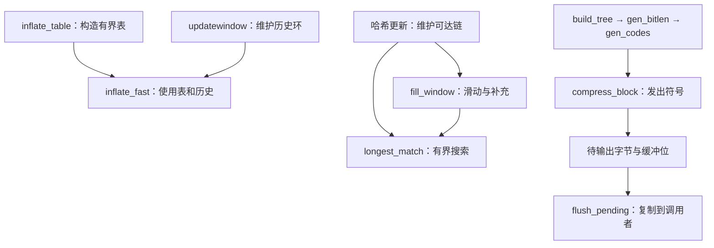

<!-- source-sha256: 5eee50223848852c1bc082d377faf004f3ee637f718d0bbd51ff65ddd4b716e6 -->

# 内部调用处的义务

本页用文字说明默认构建中主要的内部辅助函数需要调用它的函数提供什么，以及它们交付什么。
辅助函数指 `zlib.h` 没有声明的函数，例如 `inflate_table` 或 `longest_match`。
本页是阅读公开函数证明时的辅助材料。它不是定理列表，也没有哪个证明假设其中的某一行。

**已证明的内容。** 每一行都是对 C 的解读；除非所在小节的证明指南为它指明了定理，否则**尚未由证明确认**。
关于辅助函数已经证明的内容来自公开目标：`inflate`、`deflate` 和其他公开函数的安全目标已完成
（见[进度](../progress.md#scope)），每个目标说的都是整个翻译后的函数体，包括其中对辅助函数的调用。
所以，公开调用所做的每一次辅助函数调用都返回，不出故障。
但某一行自己的措辞（例如一条精确的后置条件）并不因此成为定理。
关于每个辅助函数的定理列在[证明指南](../proof/README.md)中。

**一行有什么用。** 必需的结论是安全性。一行的作用以公开调用者的安全证明用到它的程度为限：
边界、终止、帧性质，以及这些所依赖的事实。只描述内容的后置条件（例如 `I-it-canonical` 或 `I-uw-content`）是功能性事实。
只有安全证明依赖它时，它才在范围之内。

**不对调用者暗加限制。** 辅助函数的前置条件可以强于到达它的公开函数的前置条件。
公开函数的证明从初始化建立的不变量和调用时的状态推出它。它从不转嫁给应用程序。
特别是，公开证明覆盖较小的内存级别、新分配整数内存的任意内容，以及文档规定的错误情况。

## 如何阅读条目

每个 `I-*` 标识符命名一项义务，供证明指南引用。

| 标签 | 含义 |
| --- | --- |
| 前置条件 | 辅助函数被调用时成立的条件。 |
| 后置条件 | 它返回时成立的条件。 |
| 效果 | 它可以读写什么。 |
| 中间事实 | 在辅助函数内部某个指明的位置成立的事实，即在 C 把同一批字段挪作他用之前。 |

每个条目还包含公共的内存事实：它使用的存储存活、按条目所说的方式表示、不越界；
写入的目的地是可写存储；`memcpy` 的范围不重叠；指针字段在读取前已写入。
对每个辅助函数，其调用者的证明要说明终止、不出故障，以及效果之外的存储不变。

图中从 A 到 B 的箭头表示 B 使用 A 构造或维护的数据。它不是完整的 C 调用图。

## 构造解码表：`inflate_table`

用途：把每个符号的码长变成可以通过查表解出符号的解码表。`type` 在三种字母表中选一种：
码长（`CODES`）、字面量／长度（`LENS`）或距离（`DISTS`）。`codes` 是符号个数，`lens` 存放各符号的码长，以位为单位。
`bits` 是根表一次查询查看的位数。`table` 是写入表项的位置，`work` 是排序用的临时数组。
这里的数组容量按表项数计，不按字节数计。

调用形式：`inflate_table(type, lens, codes, &table, &bits, work)`；`base` 是入口时 `*table` 的值。
证明指南：[inftrees](../proof/inftrees.md)。

| 类别／ID | 契约 |
| --- | --- |
| 前置条件 `I-it-pre-lens` | `lens[0..codes)` 可读，长度处于 `0..15`。对于 `CODES`，长度至多为 7，请求的 `*bits` 至少为 7。 |
| 前置条件 `I-it-pre-codes` | `type` 是 `CODES`、`LENS` 或 `DISTS`；`codes` 分别至多为 19、288 或 32。 |
| 前置条件 `I-it-pre-work` | `work[0..codes)` 是可写临时区，与其他参数互不重叠。 |
| 前置条件 `I-it-pre-table` | `table`／`bits` 是可写单元；对于 `CODES`／`LENS`／`DISTS`，`base` 分别容纳 128／852／592 项，并与其他参数互不重叠。 |
| 后置条件 `I-it-ret` | 成功返回 0，无效长度返回 -1，`LENS`／`DISTS` 容量不足拒绝返回 1。空码集合以无效表项成功构造。 |
| 效果 `I-it-writes` | 只修改临时区、指针／位宽单元及容量内表项。成功构造 `[base, base + used)`；错误可能留下部分写入。 |
| 后置条件 `I-it-advance` | 成功时，`*table = base + used`，`*bits` 是实际根表位宽。 |
| 后置条件 `I-it-complete` | 成功时写入全部已构造项，包括允许的单符号码对应的一个无效项，或空码集合对应的两个无效项。 |
| 后置条件 `I-it-links` | 每个成功构造的根表链接及其完整子表都位于 `[base, base + used)`。 |
| 后置条件 `I-it-canonical` | 成功时按照[规范赋码](format/README.md)解码，并为保留符号设置无效标记。 |
| 后置条件 `I-it-term` | 在所述定义域下，调用会终止。 |

## 留足余量进行解码：`inflate_fast`

用途：在调用者留足输入和输出的情况下成批解码符号，直到余量不足、一个块结束或数据无效。
`avail_in` 和 `avail_out` 分别是剩余的输入和输出字节数；`start` 是外层 `inflate` 调用开始时的输出空间。
`hold` 存放已读入而尚未使用的位，`bits` 是这些位的个数。
保存历史的窗口有 `wsize` 字节，其中 `whave` 字节有效；`wnext` 是下一次写入的下标。

证明指南：[inffast](../proof/inffast.md)。

| 类别／ID | 契约 |
| --- | --- |
| 前置条件 `I-if-pre-room` | 模式为 `LEN`；`avail_in ≥ 6`、`avail_out ≥ 258`、`start ≥ avail_out`。`next_out - (start - avail_out)` 是外层 `inflate` 调用此前输出的起点，位于同一对象且可读。输入／输出互不重叠。 |
| 前置条件 `I-if-pre-bits` | `bits < 8`；`hold` 恰好包含这些缓冲的低位，其他位均未置位。 |
| 前置条件 `I-if-pre-tables` | `lencode`／`distcode` 及根表位宽满足成功建表的表项／链接规则，包括固定表。 |
| 前置条件 `I-if-pre-window` | `whave ≤ wsize`；`wsize = 0` 蕴含 `whave = wnext = 0`；否则 `wnext < wsize`，且 `window` 容纳 `wsize` 字节。有效历史有 `whave` 字节；`sane` 已设置。 |
| 效果 `I-if-reads` | 字节读取使用入口输入、外层调用此前输出或有效窗口历史；表读取保持在解码表内。 |
| 效果 `I-if-writes` | 只写入入口输出、流的游标／计数／`msg`，以及状态的 `hold`／`bits`／`mode`；不分配内存。 |
| 后置条件 `I-if-post` | 游标／计数记录已消费输入与输出。未使用的完整输入字节被退回；`bits < 8`。模式为 `LEN`、`TYPE` 或 `BAD`；`BAD` 可能已消费无效符号的一部分。 |
| 后置条件 `I-if-dist` | 若距离超过外层 `inflate` 调用已产生字节数加 `whave`，则在复制该匹配前设置 `BAD`。 |

## 保持解码器历史：`updatewindow`

用途：把新产生的输出或字典字节追加到历史中，以便之后复制向后引用。
`end` 指向这一段的末尾，`copy` 是它的长度，所以这一段是 `[end - copy, end)`。
配置的指数 `wbits` 给出 `2^wbits` 字节的窗口；`whave` 是有效历史的长度，`wnext` 标记环中上一次写入结束的位置。

证明指南：[inflate](../proof/inflate.md)。

| 类别／ID | 契约 |
| --- | --- |
| 前置条件 `I-uw-pre` | 下面四条都成立： 1. `[end - copy, end)` 可读，且与目的窗口不重叠。 2. `wbits` 位于配置允许的 inflate 范围内。 3. 已有的窗口具有 `2^wbits` 个可写字节。 4. 环尚未使用（`wsize = 0`），或者满足 `wsize = 2^wbits`、`whave ≤ wsize`、`wnext < wsize`，以及 `whave < wsize → wnext = whave`。 |
| 效果 `I-uw-alloc` | 仅在窗口不存在时分配。分配失败返回 1，否则返回 0。只写窗口存储／字段和分配器状态；失败保持已有历史。 |
| 后置条件 `I-uw-inv` | 返回 0 时，`wsize = 2^wbits`、`whave ≤ wsize`、`wnext < wsize` 且 `whave < wsize → wnext = whave`。 |
| 后置条件 `I-uw-content` | 成功时保留旧历史与输入拼接后的后缀，至多 `wsize` 字节；`whave` 记录其长度，环形顺序在 `wnext` 处结束。 |

## 补充与滑动：`fill_window`、`slide_hash`、`read_buf`

用途：补充尚未处理的输入，并保持它相对于已处理历史的位置。
`w_size` 是配置的窗口大小；字节数组有 `window_size` 字节，通常是它的两倍。
`strstart` 是下一个待处理字节的数组下标，`lookahead` 是从这里起已读入而尚未处理的字节数。
`MIN_LOOKAHEAD` 是压缩器通常希望备好的 262 字节。`insert` 是仍需建立哈希表项的位置个数。
滑动改变的是这些数组下标，不是它们所指的输入字节。

证明指南：[deflate](../proof/deflate.md)。

| 类别／ID | 契约 |
| --- | --- |
| 前置条件 `I-fw-pre` | `fill_window` 满足 `lookahead < MIN_LOOKAHEAD`、`window_size = 2*w_size`、`strstart + lookahead ≤ window_size` 及 `insert ≤ strstart`。窗口、哈希大小／掩码、高水位、搜索设置和位置范围满足配置的 deflate 状态，包括 `I-hc-inv`。输入具有可读的 `avail_in` 视图。 |
| 后置条件 `I-fw-post-room` | `fill_window` 返回后满足 `strstart ≤ window_size - MIN_LOOKAHEAD`。 |
| 后置条件 `I-fw-post-lookahead` | 返回后满足 `lookahead ≥ MIN_LOOKAHEAD` 或 `avail_in = 0`。新读入字节按顺序接在当前预读之后。 |
| 效果 `I-fw-slide` | 滑动将上半窗口的存活字节下移 `w_size`，用 C 算术调整位置／`insert`，并调用 `slide_hash`。其他写入包括输入／校验和核算、哈希及高水位填充。 |
| 前置／后置条件 `I-sh-total` | `slide_hash` 要求正的 `hash_size` 和 `w_size`，以及可写的 `head[0..hash_size)`／`prev[0..w_size)`。每项在 `m ≥ w_size` 时变为 `m - w_size`，否则变为 `NIL`；并设置 `slid = 1`。不可达的 `prev` 值不必初始化。 |
| 前置／后置条件 `I-rb-copy` | `read_buf` 要求可写入 `n = min(avail_in, size)` 字节的目的缓冲区，并与输入互不重叠。它返回 `n`、复制该前缀、推进 `next_in`、减少 `avail_in`、增加 `total_in`，并为当前封装更新 Adler-32／CRC-32。`n = 0` 时不改变任何内容。 |

## 搜索有效哈希链：`longest_match`

用途：沿着同一个三字节串哈希桶里的候选链寻找重复，并限制比较的工作量。
`cur_match` 是当前候选的数组下标；`strstart` 是当前输入位置，两者之差是匹配距离。
`MAX_DIST = w_size - 262` 是本实现搜索的最远距离，`MAX_MATCH = 258` 是一个匹配最多复制的字节数。
`prev_length` 是候选必须超过的长度。`head` 存放每个桶的链头，`prev` 把候选链接到更早的位置，`NIL` 表示链结束。

证明指南：[deflate](../proof/deflate.md)。

| 类别／ID | 契约 |
| --- | --- |
| 前置／后置条件 `I-hc-inv` | `INSERT_STRING`、`slide_hash`、`CLEAR_HASH`、`fill_window` 和 `deflateSetDictionary` 保持：链头指向已插入位置，可达 `prev[p mod w_size]` 槽已写入 `NIL` 或更小的同哈希位置。位置与当前窗口／预读一致。 |
| 前置条件 `I-lm-pre` | `cur_match` 是当前字符串哈希的非零链头，`cur_match < strstart`，且距离至多为 `MAX_DIST`。`I-hc-inv` 成立；`strstart ≤ window_size - MIN_LOOKAHEAD`、`1 ≤ prev_length ≤ MAX_MATCH`。对链预算没有前提：`deflateTune` 接受 `max_chain_length = 0`。 |
| 效果 `I-lm-reads` | 读取窗口直到并包括 `strstart + MAX_MATCH`，可能越过预读；还读取已写入的可达 `prev` 槽。只修改 `match_start`。预读之后的填充字节从不使一个匹配成为有效匹配。 |
| 后置条件 `I-lm-ret` | 返回至多 `min(MAX_MATCH, lookahead)`。找到更优结果时设置有效的 `match_start`；否则可以保留 `prev_length`，再以 `lookahead` 为上限，但不提供新的 `match_start` 保证。 |
| 后置条件 `I-lm-term` | 因为遍历的位置严格递减而结束：循环的证明（`lm_loop_ok`，`deflate.c.engine.lmmain.lean`）以 `cur_match` 为度量，对任何链预算都成立。链预算可以让遍历提前结束，但终止不依赖它：预算为 0 时，`--chain_length` 回绕成一个很大的值。不保证全局最优匹配。 |

## 构造并发出 Huffman 树：`trees.c`

用途：根据符号频次构造满足长度限制的 Huffman 码，再把符号写成一个压缩块。
描述符选择字面量／长度树、距离树或码长树。`bl_count[l]` 是码长为 `l` 位的符号个数，
`max_length` 是这一类树允许的最长码长。在输出阶段，`sym_next` 按字节计，每个已记录的符号占三个字节；
`pending` 是已产生而尚未交出的压缩字节数。

证明指南：[trees](../proof/trees.md)。

| 类别／ID | 契约 |
| --- | --- |
| 前置条件 `I-bt-pre` | `build_tree` 接收对应 286／30／19 个字面量-长度／距离／位长度叶子的描述符、已设置的频次，以及容纳内部节点／堆／深度的空间。用强制叶子补足之后，频次总和放得进各自的字段。 |
| 效果 `I-bt-heap` | 堆索引小于 573；节点保持在各自树内。写入描述符最大值、节点、堆／深度、位数统计和成本。 |
| 中间事实 `I-bt-forest` | 在长度／编码覆盖父节点／频次字段前，节点在正频次符号上形成满二叉树，并用强制叶子补足到两个。父节点频次等于子节点频次之和。 |
| 前置／后置条件 `I-gb-len` | 给定该树、有序堆和描述符，`gen_bitlen` 写入活跃叶子长度，位于 `1..max_length`（15 或 7），并满足 Kraft 和为 1，同时写入计数和成本。 |
| 后置条件 `I-gb-count` | `bl_count[l]` 统计长度为 `l` 的活跃叶子；`bl_count[0] = 0`。 |
| 前置／后置条件 `I-gc-code` | `gen_codes` 要求直到 `max_code` 的长度处于 `0..15`，且完整码计数匹配。它只写正长度的编码字段：按符号顺序排列的位反转规范码字。 |
| 前置条件／效果 `I-cb-reads` | `compress_block` 要求 `sym_buf[0..sym_next)` 中有完整三字节符号、有效的字面量／匹配范围、与之对应且编码可用的树，以及待输出／位缓冲空间。它按顺序读取符号，发出对应编码／额外位，最后发出 `END_BLOCK`。 |
| 后置条件 `I-cb-pending` | 在符号 `k`（从 0 开始）之后，`pending < lit_bufsize + 3*(k+1)`。发出过程也让每个未读符号保持原样。这个上界不由调用者提供；它是 `compress_block` 自身的性质。 |
| 前置条件 `I-tf-choice` | `_tr_flush_block` 要求有效的块符号／频次、处于 `0..1` 的 `last`，以及待输出容量。对将要存储的块，还要求 `stored_len ≤ 65535` 和可读的 `buf[0..stored_len)`。 |
| 后置条件 `I-tf-choice`（块的选择） | 若 `buf != NULL` 且 `stored_len + 4 ≤ opt_lenb`，选择存储块；否则若 `static_lenb = opt_lenb`，选择固定编码块；否则选择动态编码块。`opt_lenb` 是两种压缩大小（各自向上取整到字节）中较小的一个，但 `Z_FIXED` 策略会先选固定编码的大小。级别为 0 时不构造树，`opt_lenb = static_lenb = stored_len + 5`，这就强制使用存储块。 |
| 效果 `I-tf-choice` | 它重置块的核算；若 `last` 成立，把位缓冲对齐到字节。 |

符号缓冲区 `sym_buf` 与待输出缓冲区 `pending_buf` 共用存储：这就是*共用缓冲区*。
`I-cb-pending` 这个上界保证输出不会覆盖尚未读取的符号。
[trees 指南](../proof/trees.md)列出了对调用者可以传入的每个内存级别给出这个上界的定理，所以它不限制调用者。

## 排出待输出内容：`flush_pending` 与位写入函数

用途：先把已经凑成整字节的缓冲位转成字节，再把待输出字节交给调用者。
`bi_buf` 是存放码字的位寄存器，`bi_valid` 是其中的有效位数。
`pending_buf` 是内部字节数组，`pending_out` 指向下一批要交出的字节，`pending` 是它们的个数。
`avail_out` 是调用者在这次调用中还提供的空间；它是另一个计数。

证明指南：[deflate](../proof/deflate.md)、[trees](../proof/trees.md)。

| 类别／ID | 契约 |
| --- | --- |
| 前置／后置条件 `I-fp-inv` | `pending_out` 位于待输出分配内，且 `pending_out + pending ≤ pending_buf + pending_buf_size`。仅凭这个区间条件，并不能保证写入函数有空间：每个写入函数需要在它写入的偏移处有空间。 |
| 前置／后置条件 `I-fp-copy` | `flush_pending` 要求可写的 `avail_out` 输出，与待输出存储互不重叠，并要求位缓冲状态有效，且有空间供 `_tr_flush_bits` 使用。它先排出完整的缓冲字节，再复制 `n = min(pending, avail_out)`，推进两个游标、增加 `total_out`，并从两个计数中减去 `n`。非零复制清空待输出内容后，`pending_out = pending_buf`。只修改待输出／位字段、流的输出字段和已复制输出字节。 |
| 前置／后置条件 `I-pb-room` | `put_byte` 和 `put_short` 要求各自的待输出偏移处有一个／两个可写字节。`send_bits` 要求 `1 ≤ length ≤ 16`、数值放得进这个长度、有效的 `bi_valid`／`bi_buf`，并为可能的双字节写入留出空间。它们追加字节或位而不检查容量，所以空间是它们的调用者持有的事实；在共用缓冲区中，由 `I-cb-pending` 给出。 |

[翻译规则](../design/translation.md)解释这些义务引用的操作。
[API 模型](../design/api-model.md)解释字节历史与具体堆效果的区别。

[设计指南](../design/README.md) · [文档首页](../README.md)
