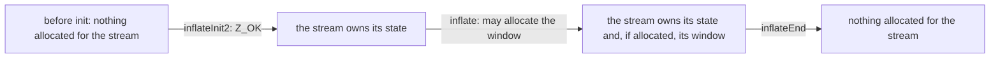
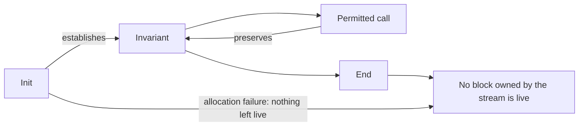

# Safety: what the goals state

This page defines "safe", the property the project proves of every documented public function
of zlib in the default x86_64 Linux build. A safe call has no undefined behaviour, returns,
writes only the memory its goal names, and leaks nothing. The page gives the definition, one
worked example, what is proved and what is assumed, and then the limits of the model in which
the theorems are stated.

## The definition

Every theorem is about the Lean translation of the C source, run on a model of memory (the
**heap**: a table of **blocks**, one block per allocated object or caller object). A **goal** is
the Lean statement to be proved for one function or one call sequence. A call is **safe** when
all four clauses hold.

| # | Clause | In C words | In the model |
| --- | --- | --- | --- |
| 1 | No undefined behaviour, no memory error | No out-of-bounds read or write, no null dereference, no use after free, no double free, no signed overflow, no invalid shift, and none of the other operations in the [table of obligations](#the-obligations). | The run does not end in `Fault.ub`. |
| 2 | Termination | The call returns. | The run does not end in `Fault.outOfFuel`: no loop reaches the bound of `2^64` iterations. |
| 3 | Frame | The call writes only the memory its goal names: for `inflate`, the `z_stream`, the library's own allocations for that stream, `avail_out` bytes at `next_out`, and, when a gzip header record is attached, that record and its three buffers. Every other object keeps its content. | `Frame`, `BufferFrame`. |
| 4 | No leak | When the call returns, the allocated blocks are those allocated before, plus the blocks the stream owns that are new, minus the blocks the stream owned and gave up. No other block appears or disappears. | `LiveChange`, with ownership read from the pointers in the state. |

Clauses 1 and 2 together are written "the call **returns**" on the API pages: in the model the
run ends in `.ok` with a value and a heap. An error code of the C, such as `Z_DATA_ERROR` for
malformed input or `Z_MEM_ERROR` after a failed `malloc`, is a normal return and is covered.

The goals state this for every argument value, every input byte sequence and every outcome of
every `malloc`, on every state that a sequence of calls can reach. What the output bytes are
and which code is returned is functional behaviour. It is not part of safety and is not
required for the safety results ([progress, Scope](../progress.md#scope)).

## A worked example

Three calls on one stream:

```c
z_stream s;                           /* automatic storage: not zeroed */
s.zalloc = Z_NULL; s.zfree = Z_NULL; s.opaque = Z_NULL;
s.next_in = Z_NULL; s.avail_in = 0;

int r = inflateInit2(&s, 15);         /* call 1 */
if (r != Z_OK) return r;

s.next_in  = in;   s.avail_in  = n;   /* the caller's edit */
s.next_out = out;  s.avail_out = m;

r = inflate(&s, Z_NO_FLUSH);          /* call 2 */
inflateEnd(&s);                       /* call 3 */
```

**Call 1.** `inflateInit2` is a macro for `inflateInit2_(&s, 15, ZLIB_VERSION, sizeof(z_stream))`.
Its goal is `Goal.inflateInit2__safety`
([Safety/Initialisation.lean](../../ZlibF/Spec/Safety/Initialisation.lean)), proved by the
theorem `InitSafetyProof.inflateInit2__safety`
([Proof/public-init-safety.lean](../../ZlibF/Proof/public-init-safety.lean)).

- It applies when `s.zalloc` and `s.zfree` are each `Z_NULL` or the default allocator's function
  (`InitArguments`). The other fields of `s` may hold anything: the record need not be zeroed.
  The goal also covers a `NULL` stream pointer, every `windowBits`, every `stream_size`, and a
  version pointer that is `NULL` or has one readable byte of any value. The heap must be a
  library heap, which is a condition on the model
  ([object representation](#object-representation)), not on the caller.
- The call returns. It writes only `s`. If it returns `Z_OK`, `s` is a reachable stream, and
  every block that the call allocated and did not free is owned by that stream. With any other code the
  allocated blocks are the same as before the call (`InitResultSafe`).

**The caller's edit.** Between calls the caller may change `next_in`, `avail_in`, `next_out`
and `avail_out`, and any memory the stream does not own (`Rebuffer`). The stream stays
reachable. (The two conditions on the model stay as they were: the heap is a library heap and
satisfies the platform size bound.)

**Call 2.** The goal is `Goal.inflate_safety`
([Safety/Streams.lean](../../ZlibF/Spec/Safety/Streams.lean)), proved by
`StreamCallSafetyProof.inflate_safety`
([Proof/public-stream-call-safety.lean](../../ZlibF/Proof/public-stream-call-safety.lean)).

- It applies when the stream is reachable, `in` is `NULL` or has `n` readable bytes, `out` is
  `NULL` or has `m` writable bytes, the two ranges do not overlap, and neither lies in memory
  the library allocated for the stream (`StreamCallDomain`). It also takes the
  [platform size bound](platform.md).
- For every `flush` value and every content of `in[0..n)`, well formed or not, the call
  returns. The stream still satisfies its invariant, so another call can follow. The call
  writes only `s`, the stream's own blocks and the bytes `out[0..m)`. The bytes of `in`, the
  bytes after `out[m)` and every other object are unchanged. If the call allocated the sliding
  window, the stream owns it afterwards (`StreamCallSafe`).
- With any return code the stream is still reachable, so call 3 is covered.

**Call 3.** The goal is `Goal.inflateEnd_safety` (same files as call 2). On every reachable
stream the call returns `Z_OK`, sets `s.state` to `NULL`, writes only `s` and the stream's own
blocks, and frees exactly the blocks the stream owns.

**Together.** Every block that one of the three calls allocated is freed when `inflateEnd`
returns: init and `inflate` leave a new block only if the stream owns it, and `inflateEnd`
frees every block the stream owns.



The theorems do not say what `r` is or what `inflate` wrote to `out`. Those are functional
facts.

## What is proved, what is assumed

**Proved.** The required goals are named in `tests/audit/public-api.json`: the `safety_goal` of
each of the 86 documented functions, the further goals of the list `safety_goals` (the sequence
goals, the refusal goals and the goal of `gzvprintf`), and the `nonvacuity_goals`. Each has a
theorem of exactly its type, listed in `tests/audit/theorems.txt`, and each goal is listed in
`tests/audit/proved-goals.txt`. The level of each result, the commit of its acceptance run and
the number of goals are recorded in [progress](../progress.md#scope); the
[glossary](../glossary.md#status) defines the levels.

**Assumed.**

- The [platform size bound](platform.md): no byte object has `2^63` bytes or more.
- The [caller obligations](#4-caller-obligations) below. Every premise that is narrower than
  `zlib.h` has a row in [deviations](../deviations.md).
- The [model limits](#3-faults-undefined-behaviour-and-model-gaps) below: the cases in which a
  proof about the model does not settle the C.
- The [trusted base](../trusted-base.md): the runtime, the hand translation, the compiler, the
  operating system.

The [proof method](../proof/method.md) explains how the goals are proved.

## Six cases to keep apart {#terms-and-reading-guide}

**Undefined behaviour (UB)** is a program action for which the C standard gives no guarantee
([C draft N1570, section 3.4.3](https://www.open-std.org/jtc1/sc22/wg14/www/docs/n1570.pdf)).
A crash is not required. A run that succeeds, or agrees with a test, does not show that the
action is defined.

| Case | Meaning in this project |
| --- | --- |
| Defined error return | The C refuses a request through a documented result. Malformed compressed bytes may return `Z_DATA_ERROR` without UB. Safety covers these calls. |
| Outside a goal's premises | The goal says nothing about that call. This alone does not make the C execution UB. |
| C UB | The C rules give no guarantee for the operation. |
| `Fault.ub` | The model detected a violation. The model does not detect every C UB ([model limits](#3-faults-undefined-behaviour-and-model-gaps)). |
| `Fault.outOfFuel` | A loop of the model used its `2^64` iterations. Non-termination is not C UB, but it is a safety failure here. |
| Leak | A block is still allocated and the goal's account does not name it. A leak is a safety failure here, even when no C operation has UB. |

An implementation-defined choice is stated for the selected build. An unspecified outcome
needs a proof for every admitted outcome where it affects the result. Neither is UB.

Some terms used below are in the [glossary](../glossary.md): goal, history, refusal,
non-vacuity, registered. The others are defined where they first appear.

## One call {#1-what-a-function-theorem-must-say}

A safety goal has this form: for every heap and every argument that satisfy the premises, the
translated call returns `.ok` with a value and a heap, and the heap after the call satisfies
the clauses below. A run in the model has the type `Heap → Except Fault (value × Heap)`
([Runtime/Monad.lean](../../ZlibF/Runtime/Monad.lean)): it ends in a fault, or in `.ok` with a
value and the heap after the call.

| Clause | Lean definition | What it says |
| --- | --- | --- |
| The call returns | `call = .ok (value, after)` | The run is not `Fault.ub` and not `Fault.outOfFuel`. |
| Invariant | `StreamInvariant`, `GzInv`, `BackValid` | The state after the call is one the next call can start from. |
| Frame | `Frame`, `BufferFrame`, `CallbackFrame` | Objects outside the named set are unchanged. |
| Allocation account | `LiveChange` | The allocated blocks after the call are those before, minus the removed set, plus the created set. |

None of these holds by definition: each clause fails for a wrong translation or a wrong zlib.

### Frames

A block is **live** when it is allocated: it holds an object and has not been freed.

`Frame before after changed` ([Public/Initialisation.lean](../../ZlibF/Spec/Public/Initialisation.lean))
says that every block that was live before the call and is not in the set `changed` has the
same content and the same read-only flag afterwards. It also says that three parts of the model
are unchanged: the library's constant tables, the function that decides which future
allocations fail (the **allocation oracle**), and the function that gives uninitialised
integers their values ([uninitialised memory](#uninitialised-memory)). New blocks are the
subject of the allocation account, not of the frame.

`BufferFrame before after changed regions` ([Public/History.lean](../../ZlibF/Spec/Public/History.lean))
adds caller byte ranges. A region is a pointer and a length. Inside a region the call may
write. Outside every region the bytes of the same object are unchanged, and the object keeps
its size. This is how a goal says "`inflate` writes at most `avail_out` bytes at `next_out`".

The frame of one stream call (`StreamCallSafe`, [Safety/Streams.lean](../../ZlibF/Spec/Safety/Streams.lean)) is:

| Part | Content |
| --- | --- |
| Blocks that may change | The `z_stream` record (`StreamRoot`). The blocks the stream owns (`StreamOwned`). A gzip header record: the one passed to `inflateGetHeader`, or during `inflate` the one attached to the stream (`StreamHeaderRecord`). |
| Caller ranges that may be written (`StreamWriteRegions`) | For `inflate`, `deflate` and `deflateParams`: `avail_out` bytes at `next_out`; for an inflate stream also the `extra`, `name` and `comment` buffers of an attached header. For `inflateGetDictionary` and `deflateGetDictionary`: 32768 bytes at the dictionary pointer. For the other calls: nothing. |

### The allocation account {#the-leak-ledger}

`LiveChange before after created removed` ([Public/Initialisation.lean](../../ZlibF/Spec/Public/Initialisation.lean)) is

```text
for every block b:
    b is live after  ⇔  (b is live before and not removed b) or created b
```

The project also calls this the **ledger**. It is an equivalence, so it is exact in both
directions. A block cannot disappear unless the goal names it as removed. No block can stay
allocated unless it was allocated before or the goal names it as created. "No leak" is this
second direction together with ownership:

| Call | created | removed |
| --- | --- | --- |
| a stream call | blocks the stream owns afterwards that were not live before | blocks the stream owned before and does not own afterwards |
| init with `Z_OK` | a set of blocks, all owned by the new stream | none |
| init with another code | none | none |
| `inflateEnd`, `deflateEnd` | none | exactly the blocks the stream owned |
| copy with `Z_OK` | the blocks the new state owns | none |
| copy with `Z_MEM_ERROR` | none | none |
| a refused `NULL` or inconsistent stream | none | none |
| checksums, `zlibVersion`, `zlibCompileFlags` | the heap after is the heap before | |

**Ownership** (`StreamOwned`, `GzOwned`) is read from the pointers in the state after the
call: the state record, the window and the other buffers those pointers name. A proof cannot
choose it. So a block that the library allocated and lost track of would be live, not owned,
and not in `created`: the account would be false.

**Init or copy onto a record that already holds a stream.** The four init goals put no condition
on the `state` field of the record (`InitArguments`), and the two copy goals put none on the
destination record, so these goals also hold when that record still holds a live stream. The
call does not free the old state. Its blocks were live before the call and stay live, which the
account allows, and the record no longer points to them. For init and copy, "no leak" therefore
means that the call leaks none of its own allocations. Ending a stream before its record is
used again is the caller's duty, as in C.

For `compress*` and `uncompress*` the goal says the same in another form. The heap after the
call is the heap before it with the output bytes written (for `uncompress*` also the length
cells), and nothing else is changed. The temporary stream and its allocations are gone: no new
live object remains (`SameObjectsUpToTableShape`,
[Public/Memory.lean](../../ZlibF/Spec/Public/Memory.lean)). "Up to table shape" allows only
bookkeeping of the model to differ: an internal table may have grown by empty entries, and the
next block number and the allocation counter may have advanced. An empty entry is not a live
block, and no C operation observes the table length or either counter. The read-only flag is
compared only for the blocks that were live before the call.

### Initialisation and callees

Init establishes the invariant from the caller's memory; no goal assumes it. The specification
of a callee is a theorem about the translated callee. It is never an assumption of its caller.



## Calls and sequences {#2-calls-and-sequences}

A goal about one call must say which states the call can start from. The goals use
**reachable** states: those that an actual sequence of calls produces. Such a sequence is a
**history**.

A stream is reachable (`StreamReachable`, [Public/History.lean](../../ZlibF/Spec/Public/History.lean))
when it is the result of one of these steps:

| Step | Condition |
| --- | --- |
| Init | `inflateInit2_` or `deflateInit2_` returned `Z_OK`. The heap was a library heap, `zalloc` and `zfree` of the record were each `NULL` or the default allocator's function, the version string started with `'1'`, and `stream_size` was `sizeof(z_stream)`. |
| Caller edit (`Rebuffer`) | From a reachable stream: the caller replaced `next_in`, `avail_in`, `next_out` or `avail_out`, or changed memory the stream does not own. The heap is still a library heap. |
| Call | From a reachable stream: a permitted call (`StreamOperation`) with valid arguments (`StreamArguments`) returned, with any return code. |
| Copy | `inflateCopy` or `deflateCopy` from a reachable source into another record returned `Z_OK`; the destination is reachable. |

For an inflate stream the caller edit and the call also carry the
[platform size bound](platform.md).

No specification of an earlier call is assumed: a history is a list of actual runs.

`StreamSequenceSafety` ([Public/Sequences.lean](../../ZlibF/Spec/Public/Sequences.lean)) has
three clauses. `Goal.inflate_sequence_safety` and `Goal.deflate_sequence_safety`
([Safety/Sequences.lean](../../ZlibF/Spec/Safety/Sequences.lean)) are this statement for the
two kinds of stream.

1. Every reachable stream satisfies the invariant.
2. On a reachable stream, one more permitted call returns, keeps the invariant, and has the
   frame and the allocation account described above.
3. On a reachable stream, the End call returns `Z_OK` (for deflate also `Z_DATA_ERROR`, when
   the stream is ended before it finished), sets the state pointer to `NULL`, writes only the
   record and the owned blocks, and removes exactly the owned blocks.

The goal of one function, `Goal.<function>_safety`, has two parts. The first is the refusal of
a `NULL` or inconsistent stream (A1 under [caller obligations](#4-caller-obligations)); it is
not a clause of the sequence statement, because a refused stream has no history. The second is
clause 2 restricted to calls of that function, or clause 3 for `inflateEnd` and `deflateEnd`.
For clause 2 its premises are `StreamCallDomain`: the stream is reachable, every byte object has
fewer than `2^63` bytes ([platform](platform.md)), and `StreamArguments` holds. For the two End
goals this part has one premise only: the stream is reachable.

**Non-vacuity.** A goal over "every reachable stream" would hold trivially if no stream were
reachable. The non-vacuity goals exclude this: a concrete heap satisfies the premises of init,
and init succeeds on it and gives a reachable stream
(`Goal.inflate_initialisation_domain`, `Goal.deflate_initialisation_domain`).

The gzip file interface and the callback decoder have the same structure with their own
histories: `GzHistory` ([Public/GzSafety.lean](../../ZlibF/Spec/Public/GzSafety.lean)) and
`BackSafeReachable` ([Public/Sequences.lean](../../ZlibF/Spec/Public/Sequences.lean)). A gz
history also has a step for the outside world between calls: the file system and the
descriptors (the **world**) may change to any well-formed state. Each function of the two
families also has a goal of its own, which restricts one clause of the sequence goal to that
function ([Safety/GzCalls.lean](../../ZlibF/Spec/Safety/GzCalls.lean),
[Safety/Back.lean](../../ZlibF/Spec/Safety/Back.lean)). The goal of `inflateBackInit_` needs no
history: it covers every call `zlib.h` allows, also one that fails or is refused. The
[gzip file contracts](api/gz-file.md) and the [callback contracts](api/inflate-back.md) state
them.

### Termination and loop fuel

Every loop of the translation may run for at most `2^64` iterations (`C.fuel`,
[Runtime/Monad.lean](../../ZlibF/Runtime/Monad.lean)). This bound is called **fuel**. Each
loop gets it when the loop is entered; it is not one budget for the whole call. A loop that
uses it all ends the run in `Fault.outOfFuel`. A goal that concludes `.ok` therefore proves
that every loop of the call ends within `2^64` iterations. This is the termination claim.

The bound hides no behaviour of the C: no real execution performs `2^64` iterations of a loop.
Undefined behaviour that grows with the iteration count, such as a signed 64-bit counter that
advances each time, occurs within `2^63` iterations and is reported as `Fault.ub` before the
fuel ends ([trusted base, item 2](../trusted-base.md#2-runtime-and-object-schema)).

The stream goals, the init, end and copy goals, the checksum and query goals and the
whole-buffer goals conclude `.ok` with no premise about termination. Two families need one,
because the C itself may not terminate there:

| Family | Statement | Reason |
| --- | --- | --- |
| Reading from a gzip file: `gzread`, `gzfread`, `gzgetc`, `gzgetc_`, `gzgets`, `gzungetc` (`NeedsReadBound`) | Without a premise: the run does not end in `Fault.ub`; the only error it can end in is out of fuel. With the premise `ReadsFinite` (the descriptor can still deliver fewer than `2^61` bytes): the run is `.ok`. | A source that delivers empty gzip members forever keeps one `gzread` running forever in C. `2^61` is the model's figure: it keeps the loop measures below `2^64`. |
| `inflateBack` | With `protocol.inputBound < 2^48` (the call is offered fewer than `2^48` input bytes in all): the run is `.ok`. | `zlib.h` puts no limit on what the `in` callback supplies. |

`ReadsFinite` also says that the descriptor number is not negative. `gzopen` returns only such
handles (stated in `GzOpenSafe`), and `gzdopen` returns `NULL` for a negative descriptor
(`zlib/gzlib.c`).

So the safety goals allow exactly one error outcome: out of fuel, for the six gzip
reading calls, when the read budget is not assumed. For those calls the goal has two halves:
no undefined behaviour and no memory error in every world, and termination under the premise.
Every other gz call terminates in every world. Both premises are rows of
[deviations](../deviations.md).

## Caller obligations {#4-caller-obligations}

Each goal states its premises explicitly. The table names the kinds of premise; the Lean
definition is what counts, and the "Proof goals" paragraph of each
[API entry](api/README.md) lists the premises of that function. A value that `zlib.h`
documents as refused is inside the domain and gets a clean error return; it is not a caller
obligation.

| ID | Obligation or scope | Lean premise |
| --- | --- | --- |
| A1 | **Init.** The stream pointer is `NULL` or points to a `z_stream` whose `zalloc` and `zfree` are each `NULL` or the default allocator's function. The other fields, `state` included, may hold anything. The version pointer is `NULL` or has one readable byte. **Later calls.** The stream is reachable. A `NULL` or inconsistent stream is refused: the safety goal of every stream function except the four init functions has a clause for it ([appendix](#where-the-goals-are)). The value returned is `Z_STREAM_ERROR`, except `-65536` for `inflateMark` and the bound of a `NULL` stream for `deflateBound` and `deflateBound_z`. The refusal changes nothing, except that a copy from a refused source sets `dest->state` to `NULL`; for `inflate` and `inflateSync` the clause says that no block that was live is written and that the live blocks stay as they were ([deviations](../deviations.md#note-2-refused-streams)). | `InitArguments`; `StreamReachable`; `RefusedInflate`, `RefusedDeflate` |
| A2 | The caller provides the readable input and writable output ranges the call uses. | `StreamBuffers`, `CallerRange`, `Bytes`, `Writable` |
| A3 | Caller regions with no reason to overlap are separate: input, output, dictionary, the gzip header record and its buffers, length cells. They may lie in one object. `zlib.h` does not state this for every pair; each such premise has a row in [deviations](../deviations.md). | `Separate`, `ActiveHeader`, `UtilitySeparation` |
| A4 | Calls on the same stream are not concurrent. | The model is sequential. |
| A5 | The default allocator. Its failures are in scope: every goal holds whichever `malloc` calls fail. An init call with a custom `zalloc` or `zfree`, and a live stream that has one, are outside every goal. A record with a custom allocator whose `state` is `NULL` is still refused under A1. | `DefaultOrNull`, `DefAlloc` |
| A6 | No use after end or close. A new init starts a new lifetime. | Histories end at End; a record after End is in the refusal domain. |
| A7 | Every scalar value is classified: normal use, documented refusal, or an explicit caller restriction. An invalid value is never dropped to avoid an error path. | The goals quantify over every `flush`, `level`, `windowBits` and so on. |
| A8 | Every byte object has fewer than `2^63` bytes. This is a fact of the platform, not a duty of the caller. | `ByteObjectsFit` ([platform](platform.md)) |

Three kinds of record are outside A1 for the calls after init, neither reachable nor refused
([deviations](../deviations.md), row "Refused streams"): a record whose `state` field holds a
garbage address, as in a `z_stream` that was never initialised; a record whose `state` points
to a freed state; and a record whose `state` points to a state of the other kind (a deflate
state passed to an inflate function). In C each of these calls reads through the bad pointer,
which is undefined behaviour.

## Model limits {#3-faults-undefined-behaviour-and-model-gaps}

**A theorem that the model does not fault is not, alone, a proof that the C has no undefined
behaviour.** The model detects most undefined behaviour and raises `Fault.ub`. This section
lists what it detects and where it does not. The main gaps are two null-pointer operations,
uninitialised pointers, and object layout and types. Each is a stated limit of the result, also
recorded in [trusted base, item 2](../trusted-base.md#2-runtime-and-object-schema).

### The obligations

| ID | Obligation | Does the model detect a violation? |
| --- | --- | --- |
| U1 | No read or write outside an object | Yes. |
| U2 | Pointer arithmetic stays within an object or one past it | Yes, except `NULL + 0` ([below](#null-pointers-and-pointer-differences)). |
| U3 | No null dereference | Yes. |
| U4 | No use after free or double free | Yes. A freed block number is never reused, so a dangling pointer faults. |
| U5 | No invalid use of uninitialised data | Integers: every theorem holds for every value. Pointers: no; no theorem states it, and it is left to source review ([below](#uninitialised-memory)). |
| U6 | No signed overflow | Yes, where the translation uses a checked signed operation. Where a preceding test in the same function keeps the operands in range, the translation uses the plain operator ([working rules, Translation](../../AGENTS.md#translation)); there the test excludes the overflow, and the model does not check it. |
| U7 | No invalid shift | Yes, where the translation uses a checked shift operation. A shift by a literal count, and a few other shifts, are written with the plain operator, which the model does not check ([translation, form 4](../design/translation.md#forms-not-covered-by-the-four-accepted-normalisations-the-owner-has-not-decided)). |
| U8 | No write to a read-only object | Partly: byte objects and static tables carry a read-only flag; other objects do not. |
| U9 | No overlapping `memcpy` | Yes, for every `memcpy` call. |
| U10 | Accesses respect C type and alignment requirements | No. The model has no type tags, no alignment and no complete ABI layout ([below](#object-representation)). |
| U11 | Every call terminates | Yes: `Fault.outOfFuel`. |
| U12 | No memory leak | Not a fault. The allocation account of each goal states it. |

Unsigned arithmetic wraps in the translation, as in C. For U6 and U7 the check is in the
operation the translation uses, so that the right operation was used at each place is part of
the review of the translation ([trusted base, item 3](../trusted-base.md)). U1 to U10 are C
obligations. U11 and U12 add termination and resources; a failure of one is not C UB.

### Null pointers and pointer differences

**The model accepts two null-pointer operations that C leaves undefined: `NULL + 0`, and, in
the helper of `compress` only, `NULL - NULL`. A no-fault theorem does not show that the C
avoids them.** [Model limits](../model-limits.md#conditions-on-the-model-that-goals-state) has the
row "Null pointer arithmetic".

| Operation | What the model does | What a claim about the C still needs |
| --- | --- | --- |
| Null pointer plus integer zero | `Ptr.add` returns the null pointer. No fault. | An argument that each reachable use is defined under the selected C rules. |
| Null pointer plus a nonzero integer | `Ptr.add` raises `Fault.ub`. | Nothing: a no-fault theorem excludes it. |
| Null pointer minus null pointer | `Ptr.diff` raises `Fault.ub`. `Zlib.Compress.ptrDiff` returns zero instead. | For the `compress` helper: an argument that the C expression is defined. |
| Two non-null pointers into the same live array | `Ptr.diff` checks both offsets, permits one past the end, and checks that the difference fits 64 signed bits. | That the model's object is the C object. |
| Pointers into different objects, or dangling pointers | `Ptr.diff` raises `Fault.ub`. | Nothing: a no-fault theorem excludes it. |

The definitions are [Ptr.add and Ptr.diff](../../ZlibF/Runtime/Ptr.lean) and the
[compressor helper](../../ZlibF/Zlib/compress.c.lean). The table is about pointer values, not
about the spelling `NULL`, which can also be an integer constant.

Why the two operations are not settled: C11
([N1570, section 6.5.6](https://www.open-std.org/jtc1/sc22/wg14/www/docs/n1570.pdf)) and the
C23 draft ([N3096, section 6.5.6](https://www.open-std.org/jtc1/sc22/wg14/www/docs/n3096.pdf))
define pointer arithmetic and subtraction only for pointers into an array, and a null pointer
points to no array element. [N3261](https://www.open-std.org/jtc1/sc22/wg14/www/docs/n3261.pdf)
proposes to define the two null operations in a later revision; a proposal is not a rule of
this project's C target. A differential test that agrees and a silent sanitizer do not settle
it either. The comment on `Ptr.diff` in the runtime says the same about the subtraction: C17 and
C23 leave `NULL - NULL` undefined, since neither operand points into an array object, and C++
defines it as 0.

### Uninitialised memory

**Integers are arbitrary.** An integer in freshly allocated memory holds a value from
`Heap.garbage`, a function the theorem knows nothing about. Every goal quantifies over the
whole heap, so it holds for every such function: no proof can rely on what an uninitialised
integer contains.

One limit: the model fixes one value per cell for the run, so two reads of the same cell
agree. It does not model a new unspecified value at every read. A proof must not use that
agreement to justify C behaviour. Copying bytes copies these values.

This matters in `slide_hash`, which visits `prev` entries that were never written, and in
`longest_match`, which compares bytes beyond the real input. The safety goals hold for every
value of those cells: `Goal.deflate_safety` quantifies over every heap.
That the compressed output does not depend on those values is a functional statement. It is
not needed for safety and is not claimed.

**Fresh pointers are NULL in the model. This is weaker than C.** A record made by the model's
allocator has every pointer field `NULL` (`ZStream.garbage` and its siblings in
[Runtime/Schema.lean](../../ZlibF/Runtime/Schema.lean)). In C a pointer read from
uninitialised memory is indeterminate, and using it is undefined. In the model the same read
yields a valid null: a comparison with `NULL`, a copy and `free(NULL)` all succeed. So the
model does not detect a missing write of a pointer field.

No theorem closes this gap, and none can in this model. What the proofs show is that the
invariant of each kind of state (`InflateInv`, `DInv`, `GzInv`) holds on every reachable stream
and on every gz handle with a history; the invariant says what the pointer fields it names
hold. That an earlier statement wrote every pointer field a call reads is **to confirm** by
source review, as the [inflate guide](../proof/inflate.md#readings-of-the-c-that-no-theorem-states) says for the inflate
state. The two init functions zero their newly
allocated state record explicitly, as the C does. That does not initialise a caller's record
or an automatic one. The automatic `z_stream` inside `compress` starts with arbitrary integer
fields and model-null pointers; its fields are written as in the C.

### Object representation

The model stores each kind of object in its own table and has no byte-level layout of
records. The consequences:

| What C has | What the model has | Consequence for a theorem |
| --- | --- | --- |
| Arrays with a declared length | A Lean array of any length; the C length is a separate predicate (`WellFormed`, `Heap.RecordsWellFormed`, `Statics.WellFormed`). | A goal takes the predicate as a premise or proves it. The constant tables must equal the translated C tables (`LibraryGlobals`). |
| Allocations with distinct addresses | Block numbers. A new block gets the next unused number. `Fresh` says that no number from the next one on is in use; `Uniq` says that a number holds one object only. | A heap with both properties and the library's constant tables is a **library heap** ([deviations](../deviations.md) calls it a well-formed heap). It is a premise on the heap a history starts from and on each heap the caller hands back. It is a condition on the model, not a duty of a C caller. |
| Initialised and uninitialised bytes | No initialisation bits. | See [uninitialised memory](#uninitialised-memory). |
| `const` objects | A read-only flag on byte objects and on the static tables. Records and 16-bit word arrays have none. | A write to a `const` record is not detected. |
| Pointer equality | Equal when the object and the offset are equal. Pointers to different objects compare unequal. Comparing a dangling pointer does not fault. | A proof must not depend on an outcome that C does not guarantee, such as equality at the boundary of two adjacent objects. |
| Addresses and alignment | Only the low three address bits, and only for the CRC code, which reads eight bytes at a time. A heap byte block starts at an aligned address; a static or embedded byte array has an arbitrary fixed residue. | The checksum goals hold for every residue. No other proof may use an address. |
| Effective types and aliasing rules | Not modelled. A word read is assembled from bytes. | Whether a C cast respects the aliasing rules is outside the theorems. |

[Model limits](../model-limits.md#conditions-on-the-model-that-goals-state), rows "Heap
well-formedness" and "CRC address and word access", and
[trusted base, item 2](../trusted-base.md#2-runtime-and-object-schema) record these limits.

## Outside safety

- **Functional correctness.** What the output bytes are and which code a call returns. It is
  not required for the safety results; [progress, Scope](../progress.md#scope) says which
  functional results are planned. The functional goals are in `ZlibF/Spec/Functional/`;
  those already proved are kept, and a functional fact that a safety proof depends on
  is in scope. The [format](format/README.md) and the [API contracts](api/README.md) describe
  the intended behaviour.
- **Other configurations.** Custom allocators and every build other than the default x86_64
  Linux LP64 static build.
- **The environment.** Correctness of the compiler and the operating system, performance, stack
  depth, and limits against decompression bombs. The [trusted base](../trusted-base.md) records
  these boundaries.

Malformed input is inside the safety domain: an error return must not hide a fault.

## Appendix: where the goals are {#where-the-goals-are}

Every safety goal is a Lean definition `ZlibF.Spec.Public.Goal.<name>`. It is in
`ZlibF/Spec/Safety/`, or in `ZlibF/Spec/Public/` for the sequence, refusal and non-vacuity goals
of the gzip file interface and of the callback decoder. `ZlibF/Spec/Public/` also holds the definitions the goals use. There are two
exceptions and one addition:

- `Goal.compressBound` and `Goal.compressBound_z` are in `ZlibF/Spec/Functional/Queries.lean`
  (row below).
- The invariants and some gz premises are defined with the proofs: `Good` in
  `ZlibF/Proof/inflate.c.base.lean`, `DGood` in `ZlibF/Proof/deflate.c.base.lean`, and `GzInv`,
  `ReadsFinite` and `NeedsReadBound` in `ZlibF/Proof/gz.inv-model.lean`.

No module of the two directories may import a functional specification
(`ZlibF/Spec/Functional/`). The fast gate runs `scripts/check-spec-layers.py`, which rejects
such an import. The script allows one import: `Public/GzState.lean` imports the gz mode
decoder from `ZlibF/Spec/Api/Gz.lean`. The functional gz and callback goals
(`Goal.gz_sequence`, `Goal.inflate_back_sequence`, the `Goal.gz*` result contracts) are also in
`ZlibF/Spec/Public/`; they are not required
([the split](../design/safety-functional-split.md), step 4).

| Function | Safety goal | File |
| --- | --- | --- |
| `inflate`, `deflate` and the other calls on a live stream | `Goal.<function>_safety`: the refusal of a `NULL` or inconsistent stream, and one more call on a reachable stream ([calls and sequences](#2-calls-and-sequences)) | [Safety/Streams.lean](../../ZlibF/Spec/Safety/Streams.lean) |
| `inflateEnd`, `deflateEnd` | `Goal.<function>_safety`: the refusal of a `NULL` or inconsistent stream, and on a reachable stream the stream frees what it owns | [Safety/Streams.lean](../../ZlibF/Spec/Safety/Streams.lean) |
| `inflateInit_`, `inflateInit2_`, `deflateInit_`, `deflateInit2_` | `Goal.<function>_safety`: every call that `zlib.h` allows, a `NULL` stream included | [Safety/Initialisation.lean](../../ZlibF/Spec/Safety/Initialisation.lean) |
| `inflateCopy`, `deflateCopy` | `Goal.<function>_safety`: the refusal of a `NULL` argument and of an inconsistent source, and the copy from a reachable source | [Safety/Copy.lean](../../ZlibF/Spec/Safety/Copy.lean) |
| every inflate or deflate call sequence | `Goal.inflate_sequence_safety`, `Goal.deflate_sequence_safety` | [Safety/Sequences.lean](../../ZlibF/Spec/Safety/Sequences.lean) |
| a `NULL` or inconsistent stream | A clause of each `Goal.<function>_safety` in the rows above for the calls on a live stream, for `inflateEnd` and `deflateEnd`, and for the two copies. `Goal.inflate_refusal` and `Goal.deflate_refusal` state it once more, in one statement each, for the functions they list ([deviations, note 2](../deviations.md#note-2-refused-streams)) | [Safety/Refusals.lean](../../ZlibF/Spec/Safety/Refusals.lean) |
| checksums | `Goal.<function>_safety`: the call returns and the heap is unchanged | [Safety/Checksums.lean](../../ZlibF/Spec/Safety/Checksums.lean) |
| `zlibVersion`, `zlibCompileFlags` | `Goal.<function>_safety`: the call returns and the heap is unchanged | [Safety/Queries.lean](../../ZlibF/Spec/Safety/Queries.lean) |
| `compress*`, `uncompress*` | `Goal.compress*_safety`, `Goal.uncompress*_safe` | [Safety/Utilities.lean](../../ZlibF/Spec/Safety/Utilities.lean) |
| `compressBound`, `compressBound_z` | `Goal.compressBound`, `Goal.compressBound_z`: the full contract. The translation is a pure function with no heap and no fault, so a separate safety goal would hold by definition. | [Functional/Queries.lean](../../ZlibF/Spec/Functional/Queries.lean) |
| the gzip file functions, and `gzvprintf` | `Goal.<function>_safety`: one call on a handle of any history, with the refusal of a `NULL` handle; for the three open functions, the open | [Safety/GzCalls.lean](../../ZlibF/Spec/Safety/GzCalls.lean) |
| every history of a gzip file handle | `Goal.gz_sequence_safety`; a `NULL` handle: `Goal.gz_refusal` | [Public/GzSafety.lean](../../ZlibF/Spec/Public/GzSafety.lean), [Public/GzRefusal.lean](../../ZlibF/Spec/Public/GzRefusal.lean) |
| `inflateBackInit_`, `inflateBack`, `inflateBackEnd` | `Goal.<function>_safety`: for init, every call that `zlib.h` allows; for the other two, the call on a history and the refusals | [Safety/Back.lean](../../ZlibF/Spec/Safety/Back.lean) |
| every history of a callback decoder | `Goal.inflate_back_sequence_safety` | [Public/Sequences.lean](../../ZlibF/Spec/Public/Sequences.lean) |
| non-vacuity | `Goal.inflate_initialisation_domain`, `Goal.deflate_initialisation_domain`, `Goal.inflate_back_initialisation_domain`, `Goal.gz_sequence_nonvacuity` | [Safety/Domains.lean](../../ZlibF/Spec/Safety/Domains.lean), [Public/Domains.lean](../../ZlibF/Spec/Public/Domains.lean), [Public/GzSafety.lean](../../ZlibF/Spec/Public/GzSafety.lean) |

`tests/audit/public-api.json` is the list the audit uses. For each function it gives a
`safety_goal` and a `functional_goal`. The required set is every `safety_goal`, the list
`safety_goals` and the list `nonvacuity_goals`. The list `open_safety` names required goals
that have no theorem yet ([progress](../progress.md#scope) says whether there is one). The functions that `zlib.h` declares under
"undocumented functions" have no required goal, except `gzvprintf`: its goal
`Goal.gzvprintf_safety` is in the list `safety_goals`.
