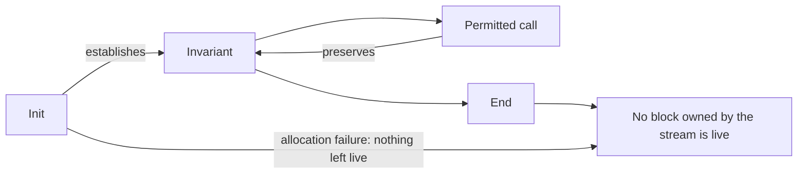

# Safety: what the goals state

Safety is the whole required target of the project. A call is safe when it has

- no undefined behaviour and no memory error: the run never ends in `Fault.ub`;
- termination: the run never ends in `Fault.outOfFuel`;
- a frame: it writes only the storage its goal names;
- no leak: the set of live blocks changes exactly as its ledger says.

The goals state this for every documented public function of the default x86_64 Linux build,
on every reachable state, also over call sequences. The output bytes are not part of safety:
functional correctness is not planned ([progress, Scope](../progress.md#scope)).

**Proved.** Every required goal has a registered theorem of exactly its type: 63 goals in
`tests/audit/public-api.json`, each listed in `tests/audit/proved-goals.txt`.
[Progress](../progress.md#scope) names the commit on which the acceptance suite is green.

**Assumed.** The [platform premises](platform.md), the caller obligations of
[section 4](#4-caller-obligations), the model limits of [section 3](#3-faults-undefined-behaviour-and-model-gaps)
and the [trusted base](../trusted-base.md). Every premise narrower than `zlib.h` has a row in
[deviations](../deviations.md).

**Open.** The per-function safety goals of the gzip file functions and of the three callback
decoder functions are not stated yet. Their required goal today is the sequence goal
(`Goal.gz_sequence_safety`, `Goal.inflate_back_sequence_safety`), which is registered.

The [proof method](../proof/method.md) explains how these statements are proved.

## Where the goals are

Every safety goal is a Lean definition `ZlibF.Spec.Public.Goal.<name>`. The files are under
`ZlibF/Spec/Safety/`, and under `ZlibF/Spec/Public/` for the gzip file interface and the
callback decoder. `ZlibF/Spec/Public/` also holds the definitions the goals use. Neither
directory may import a functional specification (`ZlibF/Spec/Functional/`): the fast gate runs
`scripts/check-spec-layers.py`, which rejects such an import. So these two directories and
what they import are the whole required target.

The split is not finished for the gzip modules. One import is still allowed by the script:
`Public/GzState.lean` imports the gz mode decoder from `ZlibF/Spec/Api/Gz.lean`. The functional
gz and callback goals (`Goal.gz_sequence`, `Goal.inflate_back_sequence`, the `Goal.gz*` result
contracts) are still in `ZlibF/Spec/Public/`; they are not required
([the split](../design/safety-functional-split.md), step 4).

| Function | Safety goal | File |
| --- | --- | --- |
| `inflate`, `deflate` and the other calls on a live stream | `Goal.<function>_safety`: one more call on a reachable stream ([section 2](#2-calls-and-sequences)) | [Safety/Streams.lean](../../ZlibF/Spec/Safety/Streams.lean) |
| `inflateEnd`, `deflateEnd` | `Goal.<function>_safety`: the stream frees what it owns | [Safety/Streams.lean](../../ZlibF/Spec/Safety/Streams.lean) |
| `inflateInit_`, `inflateInit2_`, `deflateInit_`, `deflateInit2_` | `Goal.<function>_safety` on a fresh record | [Safety/Initialisation.lean](../../ZlibF/Spec/Safety/Initialisation.lean) |
| `inflateCopy`, `deflateCopy` | `Goal.<function>_safety` | [Safety/Copy.lean](../../ZlibF/Spec/Safety/Copy.lean) |
| every inflate or deflate call sequence | `Goal.inflate_sequence_safety`, `Goal.deflate_sequence_safety` | [Safety/Sequences.lean](../../ZlibF/Spec/Safety/Sequences.lean) |
| a `NULL` or inconsistent stream | `Goal.inflate_refusal`, `Goal.deflate_refusal` | [Safety/Refusals.lean](../../ZlibF/Spec/Safety/Refusals.lean) |
| checksums | `Goal.<function>_safety`: the call returns and the heap is unchanged | [Safety/Checksums.lean](../../ZlibF/Spec/Safety/Checksums.lean) |
| `zlibVersion`, `zlibCompileFlags` | `Goal.<function>_safety`: the call returns and the heap is unchanged | [Safety/Queries.lean](../../ZlibF/Spec/Safety/Queries.lean) |
| `compress*`, `uncompress*` | `Goal.compress*_safety`, `Goal.uncompress*_safe` | [Safety/Utilities.lean](../../ZlibF/Spec/Safety/Utilities.lean) |
| `compressBound`, `compressBound_z` | the full contract: the translation is a pure function with no heap and no fault | [Functional/Queries.lean](../../ZlibF/Spec/Functional/Queries.lean) |
| gzip file interface | `Goal.gz_sequence_safety`; a `NULL` handle: `Goal.gz_refusal` | [Public/GzSafety.lean](../../ZlibF/Spec/Public/GzSafety.lean), [Public/GzRefusal.lean](../../ZlibF/Spec/Public/GzRefusal.lean) |
| `inflateBackInit_`, `inflateBack`, `inflateBackEnd` | `Goal.inflate_back_sequence_safety` | [Public/Sequences.lean](../../ZlibF/Spec/Public/Sequences.lean) |
| non-vacuity | `Goal.inflate_initialisation_domain`, `Goal.deflate_initialisation_domain`, `Goal.inflate_back_initialisation_domain`, `Goal.gz_sequence_nonvacuity` | [Safety/Domains.lean](../../ZlibF/Spec/Safety/Domains.lean), [Public/Domains.lean](../../ZlibF/Spec/Public/Domains.lean), [Public/GzSafety.lean](../../ZlibF/Spec/Public/GzSafety.lean) |

`tests/audit/public-api.json` gives each function's `safety_goal` and `functional_goal`. The
required set is every `safety_goal`, the list `safety_goals` and the list `nonvacuity_goals`.
The list `open_safety` names required goals without a registered theorem; it is empty. The
functions that `zlib.h` lists as undocumented have no required goal. `Goal.gz_initialisation_domain`
is listed under `not_planned`: it is the functional contract of `gzopen`.

A non-vacuity goal shows that the premises of a family can be met: a concrete heap satisfies
the init domain, and init succeeds from it. Without it a goal over "every reachable stream"
could hold because no stream is reachable.

## Terms and reading guide

**Undefined behaviour (UB)** is a program action for which the C standard gives no guarantee
([C draft N1570, section 3.4.3](https://www.open-std.org/jtc1/sc22/wg14/www/docs/n1570.pdf)).
A crash is not required. A run that succeeds, or agrees with a test, does not show that the
action is defined.

Keep these cases apart:

| Case | Meaning in this project |
| --- | --- |
| Defined error return | A permitted request is refused through the documented result. Malformed compressed bytes may return `Z_DATA_ERROR` without UB. |
| Outside a goal's premises | The goal says nothing about that input. This alone does not make the C execution UB. |
| C UB | The C rules give no guarantee for the operation. |
| `Fault.ub` | The model detected a violation. It is a model result, not a complete detector of C UB ([section 3](#3-faults-undefined-behaviour-and-model-gaps)). |
| `Fault.outOfFuel` | A loop of the model used its `2^64` iterations. Non-termination is not C UB, but it is a safety failure here. |
| Leak | A block is live that the ledger does not account for. A leak is a safety failure here, even when no C operation has UB. |

An implementation-defined choice is stated for the selected build. An unspecified outcome
needs a proof for every admitted outcome where it affects the result. Neither is UB.

The [glossary](../glossary.md) defines the other terms. Read section 1 for one call, section 2
for whole lifetimes, section 3 for the model's limits and section 4 for the caller's side.
The [API contracts](api/README.md) describe each function.

## 1. What a function theorem must say

A safety goal has the form: for every heap and every argument in the domain, the translated
call returns `.ok` with a value and a heap, and the heap after the call satisfies the clauses
below. A run in the model is `Heap → Except Fault (value × Heap)`
([Runtime/Monad.lean](../../ZlibF/Runtime/Monad.lean)); `.ok` excludes both faults. Error
returns of the C, such as `Z_MEM_ERROR` after a failed allocation, are `.ok` runs and are
covered.

| Clause | Lean definition | What it says |
| --- | --- | --- |
| No fault, termination | `call = .ok (value, after)` | The run is not `Fault.ub` and not `Fault.outOfFuel`. |
| Invariant | `StreamInvariant`, `GzInv`, `BackValid` | The state after the call is one the next call can start from. |
| Frame | `Frame`, `BufferFrame`, `CallbackFrame` | Blocks outside the named set are unchanged. |
| Ledger | `LiveChange` | The live blocks after the call are those before, minus the removed set, plus the created set. |

Nothing is true by definition: each clause can fail for a wrong translation or a wrong zlib.

### Frames

`Frame before after changed` ([Public/Initialisation.lean](../../ZlibF/Spec/Public/Initialisation.lean))
says that every block that was live before the call and is not in `changed` has the same
content and the same read-only flag afterwards. It also fixes the static tables, the
allocation oracle and the garbage function. New blocks are the ledger's subject, not the frame's.

`BufferFrame before after changed regions` ([Public/History.lean](../../ZlibF/Spec/Public/History.lean))
adds caller byte ranges. A region is a pointer and a length. Inside a region the call may
write; outside every region the bytes of the same block are unchanged, and the block keeps its
size. This is how a goal says "`inflate` writes at most `avail_out` bytes at `next_out`".

The frame of one stream call (`StreamCallSafe`, [Safety/Streams.lean](../../ZlibF/Spec/Safety/Streams.lean)) is:

- changed blocks: the stream record (`StreamRoot`), the blocks the stream owns (`StreamOwned`),
  and a gzip header record: the one given to `inflateGetHeader`, or during `inflate` the one
  attached to the stream (`StreamHeaderRecord`);
- regions (`StreamWriteRegions`): for `inflate`, `deflate` and `deflateParams` the output range
  `next_out`, `avail_out`, and for an inflate stream the `extra`, `name` and `comment` buffers of
  an attached header; for `inflateGetDictionary` and `deflateGetDictionary` 32768 bytes at the
  dictionary pointer; nothing for the other calls.

### The leak ledger

`LiveChange before after created removed` ([Public/Initialisation.lean](../../ZlibF/Spec/Public/Initialisation.lean)) is

```text
for every block b:
    b is live after  ⇔  (b is live before and not removed b) or created b
```

It is an equivalence, so it is exact in both directions. A block cannot disappear unless the
goal names it as removed, and no block can stay live unless the goal names it as created.
"No leak" is this second direction together with ownership:

| Call | created | removed |
| --- | --- | --- |
| a stream call | blocks the stream owns afterwards that were not live before | blocks the stream owned before and does not own afterwards |
| init with `Z_OK` | a set of blocks, all owned by the new stream | none |
| init with another code | none | none |
| `inflateEnd`, `deflateEnd` | none | exactly the blocks the stream owned |
| copy with `Z_OK` | the blocks the new state owns | none |
| copy with `Z_MEM_ERROR` | none | none |
| a refused `NULL` or inconsistent stream | none | none |
| checksums, queries | the heap after is the heap before | |

Ownership (`StreamOwned`, `GzOwned`) is read from the actual pointers in the state, not chosen
by a proof. So a block the library allocated and lost track of would be live, not owned, and
not in `created`: the ledger would fail. Across a lifetime from init to end the created and
removed sets cancel, and the live blocks are those before init.

The whole-buffer functions state the same with `SameObjectsUpToTableShape`
([Public/Memory.lean](../../ZlibF/Spec/Public/Memory.lean)): after `compress*` or
`uncompress*` the heap equals the heap with only the output and length cells stored, and no
new live object remains.

### Initialisation and callees

Init establishes the invariant from the caller's storage (`InitDomain`,
[Public/Domains.lean](../../ZlibF/Spec/Public/Domains.lean)); no goal assumes it. A callee's
contract is a theorem about the translated callee and is never an assumption of its caller.



## 2. Calls and sequences

A goal over one call would be empty without a statement of which states the call can start
from. The goals use **reachable** states: those an actual history of calls produces.

`StreamReachable kind h r` ([Public/History.lean](../../ZlibF/Spec/Public/History.lean)) is
the least set that contains

- the heap after a successful `inflateInit2_` or `deflateInit2_` on caller storage;
- the heap after a caller edit (`Rebuffer`): the caller may replace `next_in`, `avail_in`,
  `next_out` and `avail_out` and change storage the stream does not own;
- the heap after any permitted call (`StreamOperation`) whose arguments satisfy
  `StreamArguments` and which returned, with any return code;
- the destination after a successful `inflateCopy` or `deflateCopy`.

No specification of an earlier call is assumed: a history is a list of actual runs.

`StreamSequenceSafety kind` ([Public/Sequences.lean](../../ZlibF/Spec/Public/Sequences.lean))
has three clauses. `Goal.inflate_sequence_safety` and `Goal.deflate_sequence_safety` are this
statement for the two kinds.

1. Every reachable stream satisfies the invariant.
2. On a reachable stream, one more permitted call returns `.ok`, keeps the invariant, has the
   frame of section 1 and the ledger of section 1.
3. On a reachable stream, the End call returns `Z_OK` (for deflate also `Z_DATA_ERROR`, when
   the stream is abandoned before it finished), clears the state pointer, writes only the
   record and the owned blocks, and removes exactly the owned blocks.

The per-function goal `Goal.<function>_safety` is clause 2 for the `Call` constructor of that
function, or clause 3 for `inflateEnd` and `deflateEnd`. Its premises are `StreamCallDomain`:
the stream is reachable, every byte object has fewer than `2^63` bytes
([platform](platform.md)), and `StreamArguments` holds.

The gzip file interface and the callback decoder have the same structure with their own
histories: `GzHistory` ([Public/GzSafety.lean](../../ZlibF/Spec/Public/GzSafety.lean)), which
also has a step for the outside world between calls, and `BackSafeReachable`
([Public/Sequences.lean](../../ZlibF/Spec/Public/Sequences.lean)). The [gzip file contracts](api/gz-file.md)
and the [callback contracts](api/inflate-back.md) state them.

### Termination and loop fuel

Every loop of the translation runs on a fuel of `2^64` iterations (`C.fuel`,
[Runtime/Monad.lean](../../ZlibF/Runtime/Monad.lean)). Each loop gets this fuel when it is
entered; it is not one budget for the call. A loop that uses it all ends the run in
`Fault.outOfFuel`. A goal that concludes `.ok` therefore proves that every loop of the call
ends within `2^64` iterations. This is the termination claim. It is a claim about the model:
no real execution performs `2^64` iterations of a loop, so the limit hides no behaviour of the C.
Undefined behaviour that grows with the iteration count, such as a signed 64-bit counter that
advances each time, occurs within `2^63` iterations and is reported as `Fault.ub` before the
fuel ends ([trusted base, item 2](../trusted-base.md#2-runtime-and-object-schema)).

The stream goals, the init, end and copy goals, the checksum and query goals and the
whole-buffer goals all conclude `.ok` with no premise about fuel. Two families need a premise,
because the C itself may not terminate there:

| Family | Statement | Reason |
| --- | --- | --- |
| Reading from a gzip file: `gzread`, `gzfread`, `gzgetc`, `gzgetc_`, `gzgets`, `gzungetc` (`NeedsReadBound`) | With no premise: the only error the run can end in is `outOfFuel`, never `Fault.ub`. With `ReadsFinite` (the descriptor number is not negative and can still deliver fewer than `2^61` bytes): the run is `.ok`. A handle that `gzdopen` made from a negative descriptor other than -1 has no budget, so its termination is not claimed. | A source that delivers empty gzip members forever keeps one `gzread` running forever in C. `2^61` is the model's figure: it keeps the loop measures below `2^64`. |
| `inflateBack` | With `protocol.inputBound < 2^48` (the call is offered fewer than `2^48` input bytes in all): the run is `.ok`. | `zlib.h` puts no limit on what the `in` callback supplies. |

So out-of-fuel is the only error a registered safety goal allows, and only in the first clause
for the gzip reading calls, when the read budget is absent. That clause is partial correctness:
no undefined behaviour and no memory error in every world, with termination stated separately.
Every other gz call terminates in every world. Both premises are rows of
[deviations](../deviations.md).

## 3. Faults, undefined behaviour and model gaps

The identifiers below name the safety obligations. The runtime raises `Fault.ub` for most
violations. A no-fault theorem alone does not establish C safety: the exceptions in this
section and in [trusted base, item 2](../trusted-base.md#2-runtime-and-object-schema) remain
part of the argument.

| ID | Obligation | Main reason it matters |
| --- | --- | --- |
| U1 | No read or write outside an object | Buffer indices and table accesses need bounds. |
| U2 | Pointer arithmetic stays within an object or one past it | Offset updates and back-reference copies need live, bounded pointers. |
| U3 | No null dereference | Stream, state, window and header accesses need the appropriate live pointer. |
| U4 | No use after free or double free | Ownership must persist through copy, failure and end. |
| U5 | No invalid use of uninitialised data | Garbage must not become an unchecked index or address; pointer fields need a write-before-read argument. |
| U6 | No signed overflow | Counters, positions and conversions need explicit range checks. |
| U7 | No invalid shift | Counts must be nonnegative and below the promoted operand's width. |
| U8 | No write to a read-only object | Static data and immutable byte blocks must remain unchanged. |
| U9 | No overlapping `memcpy` | Copies need disjoint ranges; overlapping copies use `memmove`. |
| U10 | Accesses respect C type and alignment requirements | The object heap has no general byte view of records, type tags or complete ABI layout. CRC word reads need separate review. |
| U11 | Every call terminates | Loop measures must rule out fuel exhaustion. |
| U12 | No memory leak | Every exit must preserve ownership or perform exact cleanup. |

Unsigned arithmetic wraps in the translation. Signed arithmetic and shifts are checked by the
translation's operations, not by the computation monad. U1 to U10 are C and representation
obligations. U11 and U12 add termination and resources; a failure of one is not C UB.

### Null pointers and pointer differences

The runtime has these rules:

| Expression or operation | Current model | What a C claim still needs |
| --- | --- | --- |
| Typed null pointer plus integer zero | `Ptr.add` returns the null pointer. | A definedness argument for each reachable use under the selected C rules. No fault is raised for this case. |
| Typed null pointer plus a nonzero integer | `Ptr.add` raises `Fault.ub`. | Exclude the operation in every admitted execution. |
| Null pointer minus null pointer | Generic `Ptr.diff` raises `Fault.ub`; `Zlib.Compress.ptrDiff` instead returns zero. | Review the actual helper used and the C expression it translates. The helper exception is not a proof of definedness. |
| Two nonnull pointers in the same live array | `Ptr.diff` checks both offsets, permits one-past, and checks that the difference fits signed 64 bits. | Establish the actual C object, offsets and `ptrdiff_t` correspondence. |
| Pointers in different objects, or dangling pointers | `Ptr.diff` raises `Fault.ub`. | Exclude subtraction of such values on every admitted path. |
| Addition of two typed pointer values | There is no pointer-plus-pointer primitive. | This violates C's addition operand constraints; it is different from adding integer zero to a null pointer. |

Read the definitions of [Ptr.add and Ptr.diff](../../ZlibF/Runtime/Ptr.lean) and the
[compressor helper](../../ZlibF/Zlib/compress.c.lean); do not infer the rule from the name
"pointer difference". The token `NULL` can expand to a null pointer constant; the table
describes typed pointer values, not macro spelling.

[N1570, section 6.5.6](https://www.open-std.org/jtc1/sc22/wg14/www/docs/n1570.pdf) requires
array-relative pointer arithmetic and same-array subtraction with a representable result.
Null pointers do not denote array elements. The
[C23 draft N3096, section 6.5.6](https://www.open-std.org/jtc1/sc22/wg14/www/docs/n3096.pdf)
retains those conditions. The `Ptr.diff` source comment that attributes a zero result for two
nulls to C23 is therefore inaccurate. It changes neither the executed definition nor the
language rule.

[N3261](https://www.open-std.org/jtc1/sc22/wg14/www/docs/n3261.pdf) proposes relaxed
null/zero operations for a later C revision. That proposal is not authority for treating them
as defined in this project's C target. A differential test that agrees and a silent sanitizer
do not settle it either.

So the model does **not** detect every potentially undefined null-arithmetic operation of C.
This limit is part of the claimed scope. A correction to the runtime or to a translation is
its own reviewed change with renewed proof checks. [Deviations](../deviations.md) has the row
"Null pointer arithmetic".

### Uninitialised memory

**Integers are arbitrary.** A fresh integer cell holds a value from `Heap.garbage`, a function
the theorem does not know. Every goal quantifies over the whole heap, so it holds for every
garbage function: no proof may rely on what an uninitialised integer contains.

The model fixes one value per cell for the run, so two reads of the same cell agree. It does
not model a new unspecified value at every read. A proof must not use that agreement to justify
C behaviour. Copying bytes copies these values, garbage included.

This matters in `slide_hash`, which visits `prev` entries that were never cleared, and in
`longest_match`, which compares bytes beyond the real input. Their source comments explain the
intended independence from those contents. That reading is **to confirm** by the relevant
execution proofs. Quantifying over arbitrary values alone does not prove that the output is
independent of them, or that a hash-chain walk reaches only entries written with real positions.

**Fresh pointers are NULL in the model.** A record made by the model's allocator has every
pointer field `NULL` (`ZStream.garbage` and its siblings in
[Runtime/Schema.lean](../../ZlibF/Runtime/Schema.lean)). This is weaker than C. In C a pointer
read from uninitialised memory is indeterminate, and using it is undefined. In the model the
same read yields a valid null: a comparison with `NULL`, a copy and `free(NULL)` all succeed,
so the runtime does not detect a missing write. The model cannot report this class of error.

The proof closes the gap by hand: for every pointer field a call reads, it shows that an
earlier statement of the translation wrote the field. The two state init translations zero
their allocated state records explicitly. This does not initialise every caller record or
automatic stream record. The automatic stream of `compress` starts with arbitrary integer
fields and model-null pointers; its field writes follow the C.
[Trusted base, item 2](../trusted-base.md#2-runtime-and-object-schema) records the gap.

### Object representation

Declared record-array lengths require `WellFormed` and `Heap.RecordsWellFormed` hypotheses.
Static lengths require `Statics.WellFormed`, and values must match the translated C tables.
A Lean `Array` type does not enforce its C extent. Allocation requires `Fresh` and a valid
cross-table block identity discipline. No initialisation bits or allocation-origin tags are
present. Read-only flags cover byte blocks and represented statics, not all typed objects.

Pointer equality uses object identity and offset. Different objects compare unequal, and
comparing a dangling pointer does not fault. A proof must not depend on those outcomes where
C does not guarantee them. The CRC address helper represents only the low three address bits.
Heap byte blocks retain the aligned-origin convention. Static and embedded byte objects have
arbitrary stable origin residues. This is not a general ABI, effective-type or scalar-alias
model; those limits remain recorded in [deviations](../deviations.md).

## 4. Caller obligations

Each goal states its premises explicitly. The table names the kinds of premise; the Lean
definition is what counts. A value that `zlib.h` documents as refused is inside the domain and
gets a clean error return; it is not a caller obligation.

| ID | Obligation or scope | Lean premise |
| --- | --- | --- |
| A1 | A non-null stream argument is a live `z_stream`. Before init the allocator fields are the default allocator or `NULL`, and the state pointer is `NULL`. A `NULL` or inconsistent stream is refused. | `InitDomain`, `StreamReachable`; `RefusedInflate`, `RefusedDeflate` |
| A2 | The caller provides the readable input and writable output ranges the call uses. | `StreamBuffers`, `CallerRange`, `Bytes`, `Writable` |
| A3 | Caller regions with no reason to overlap are separate: input, output, dictionary, the gzip header record and its buffers, length cells. They may lie in one block. `zlib.h` does not state this for every pair; each such premise has a row in [deviations](../deviations.md). | `Separate`, `ActiveHeader`, `UtilitySeparation` |
| A4 | Calls on the same stream are not concurrent. | The model is sequential. |
| A5 | The default allocator. Its allocation failures are in scope: every goal holds for every allocation oracle. | `DefaultOrNull`, `DefAlloc` |
| A6 | No use after end or close. A new init starts a new lifetime. | Histories end at End; a record after End is in the refusal domain. |
| A7 | Every scalar value is classified: normal use, documented refusal, or an explicit caller restriction. An invalid value is never dropped to avoid an error path. | The goals quantify over every `flush`, `level`, `windowBits` and so on. |
| A8 | Every byte object has fewer than `2^63` bytes. This is a fact of the platform, not a duty of the caller. | `ByteObjectsFit` ([platform](platform.md)) |

## 5. Other properties

Functional correctness is not planned. The functional goals stay in `ZlibF/Spec/Functional/`;
those already proved stay registered, and a functional fact that a safety proof depends on is
in scope. The [format](format/README.md) and the [API contracts](api/README.md) describe the
intended behaviour.

Malformed input is in the safety domain: an error return must not hide a fault. Custom
allocators and other build configurations are not planned: the target is the default x86_64
Linux/LP64 static build. Compiler and operating-system correctness, performance, stack bounds
and resource limits against decompression bombs are outside the model. The
[trusted base](../trusted-base.md) records these boundaries.
