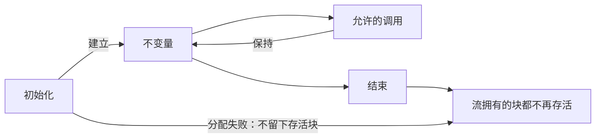

<!-- source-sha256: eb536a58995bbec3b71663aa8697a346c5e4174380896e7360835670d188061b -->

# 安全性：目标陈述了什么

安全性是本项目全部的必需目标。一次调用是安全的，指它满足：

- 没有未定义行为，没有内存错误：执行不会以 `Fault.ub` 结束；
- 终止：执行不会以 `Fault.outOfFuel` 结束；
- 帧性质：它只写目标里点名的存储；
- 无泄漏：存活块集合的变化与账本所述完全一致。

这些目标针对默认 x86_64 Linux 构建中每个有文档的公开函数，覆盖每个可达状态，也覆盖调用序列。
输出字节的内容不属于安全性：功能正确性不在计划内（见[进度的“范围”一节](../progress.md#scope)）。

**已证明。** 每个必需目标都有一条类型与之完全相同的已登记定理：`tests/audit/public-api.json`
中共 63 个目标，逐一列在 `tests/audit/proved-goals.txt` 中。
验收套件在哪个提交上通过，见[进度](../progress.md#scope)。

**所假设的。** [平台前提](platform.md)、[第 4 节](#4-caller-obligations)的调用者义务、
[第 3 节](#3-faults-undefined-behaviour-and-model-gaps)的模型限制，以及[可信基础](../trusted-base.md)。
凡是比 `zlib.h` 更窄的前提，在[偏差](../deviations.md)中都有一行。

**未完成。** gzip 文件函数和回调解码器三个函数的逐函数安全目标尚未写出。
它们目前的必需目标是序列目标（`Goal.gz_sequence_safety`、`Goal.inflate_back_sequence_safety`），这两个目标已登记。

这些陈述如何证明，见[证明方法](../proof/method.md)。

## 目标所在位置

每个安全目标都是一个 Lean 定义 `ZlibF.Spec.Public.Goal.<name>`。文件位于 `ZlibF/Spec/Safety/`；
gzip 文件接口和回调解码器的目标位于 `ZlibF/Spec/Public/`，目标用到的定义也在这个目录。
这两个目录都不得导入功能规范（`ZlibF/Spec/Functional/`）：快速门禁运行
`scripts/check-spec-layers.py`，它拒绝这样的导入。所以这两个目录连同它们导入的内容，就是完整的必需目标。

gzip 模块的拆分还没有做完。脚本目前仍放行一条导入：`Public/GzState.lean` 从 `ZlibF/Spec/Api/Gz.lean`
导入 gz 模式解码器。gz 和回调的功能目标（`Goal.gz_sequence`、`Goal.inflate_back_sequence`、各 `Goal.gz*` 结果契约）
仍在 `ZlibF/Spec/Public/` 中；它们不是必需目标（见[拆分设计](../design/safety-functional-split.md)第 4 步）。

| 函数 | 安全目标 | 文件 |
| --- | --- | --- |
| `inflate`、`deflate` 以及对存活流的其他调用 | `Goal.<function>_safety`：对可达的流再调用一次（[第 2 节](#2-calls-and-sequences)） | [Safety/Streams.lean](../../ZlibF/Spec/Safety/Streams.lean) |
| `inflateEnd`、`deflateEnd` | `Goal.<function>_safety`：流释放它拥有的一切 | [Safety/Streams.lean](../../ZlibF/Spec/Safety/Streams.lean) |
| `inflateInit_`、`inflateInit2_`、`deflateInit_`、`deflateInit2_` | 在新记录上的 `Goal.<function>_safety` | [Safety/Initialisation.lean](../../ZlibF/Spec/Safety/Initialisation.lean) |
| `inflateCopy`、`deflateCopy` | `Goal.<function>_safety` | [Safety/Copy.lean](../../ZlibF/Spec/Safety/Copy.lean) |
| 每个 inflate 或 deflate 调用序列 | `Goal.inflate_sequence_safety`、`Goal.deflate_sequence_safety` | [Safety/Sequences.lean](../../ZlibF/Spec/Safety/Sequences.lean) |
| `NULL` 或不一致的流 | `Goal.inflate_refusal`、`Goal.deflate_refusal` | [Safety/Refusals.lean](../../ZlibF/Spec/Safety/Refusals.lean) |
| 校验和 | `Goal.<function>_safety`：调用返回，堆不变 | [Safety/Checksums.lean](../../ZlibF/Spec/Safety/Checksums.lean) |
| `zlibVersion`、`zlibCompileFlags` | `Goal.<function>_safety`：调用返回，堆不变 | [Safety/Queries.lean](../../ZlibF/Spec/Safety/Queries.lean) |
| `compress*`、`uncompress*` | `Goal.compress*_safety`、`Goal.uncompress*_safe` | [Safety/Utilities.lean](../../ZlibF/Spec/Safety/Utilities.lean) |
| `compressBound`、`compressBound_z` | 完整契约：其翻译是纯函数，不涉及堆，也不会产生故障 | [Functional/Queries.lean](../../ZlibF/Spec/Functional/Queries.lean) |
| gzip 文件接口 | `Goal.gz_sequence_safety`；`NULL` 句柄：`Goal.gz_refusal` | [Public/GzSafety.lean](../../ZlibF/Spec/Public/GzSafety.lean)、[Public/GzRefusal.lean](../../ZlibF/Spec/Public/GzRefusal.lean) |
| `inflateBackInit_`、`inflateBack`、`inflateBackEnd` | `Goal.inflate_back_sequence_safety` | [Public/Sequences.lean](../../ZlibF/Spec/Public/Sequences.lean) |
| 非空性 | `Goal.inflate_initialisation_domain`、`Goal.deflate_initialisation_domain`、`Goal.inflate_back_initialisation_domain`、`Goal.gz_sequence_nonvacuity` | [Safety/Domains.lean](../../ZlibF/Spec/Safety/Domains.lean)、[Public/Domains.lean](../../ZlibF/Spec/Public/Domains.lean)、[Public/GzSafety.lean](../../ZlibF/Spec/Public/GzSafety.lean) |

`tests/audit/public-api.json` 给出每个函数的 `safety_goal` 和 `functional_goal`。
必需集合由每个 `safety_goal`、列表 `safety_goals` 和列表 `nonvacuity_goals` 组成。
列表 `open_safety` 列出尚无已登记定理的必需目标；它现在是空的。
`zlib.h` 列为“未文档化”的函数没有必需目标。`Goal.gz_initialisation_domain` 列在 `not_planned` 下：
它是 `gzopen` 的功能契约。

非空性目标表明一族目标的前提可以满足：有一个具体的堆满足初始化定义域，并且从它出发初始化成功。
没有它，一个针对“每个可达的流”的目标可能只是因为没有任何流可达而成立。

## 术语与阅读指南

**未定义行为（UB）**指 C 标准对其行为不作任何保证的程序操作
（[C 草案 N1570 第 3.4.3 节](https://www.open-std.org/jtc1/sc22/wg14/www/docs/n1570.pdf)）。
它不一定引发崩溃。一次执行成功，或与测试结果一致，都不能说明该操作有定义。

应区分以下情况：

| 情况 | 本项目中的含义 |
| --- | --- |
| 有定义的错误返回 | 通过文档规定的结果拒绝一个允许的请求。格式错误的压缩字节可以返回 `Z_DATA_ERROR`，而不发生 UB。 |
| 不满足目标的前提 | 目标对该输入不作结论。仅凭这一点不能把 C 执行判定为 UB。 |
| C UB | C 规则不保证该操作的行为。 |
| `Fault.ub` | 模型检测到违规。这是模型结果，不是 C UB 的完整检测器（[第 3 节](#3-faults-undefined-behaviour-and-model-gaps)）。 |
| `Fault.outOfFuel` | 模型的一个循环用完了 `2^64` 次迭代。不终止不是 C UB，但在本项目中属于安全性失败。 |
| 泄漏 | 有一个存活块没有被账本记入。即使没有 C 操作发生 UB，泄漏在本项目中也属于安全性失败。 |

由实现定义的选择，按所选构建写明。对于未指定的结果，只要它影响结论，证明就必须覆盖每一种允许的结果。
这两者都不是 UB。

其他术语见[术语表](../glossary.md)。第 1 节讲单次调用，第 2 节讲完整生命周期，第 3 节讲模型的限制，
第 4 节讲调用者一方。各函数的说明见 [API 契约](api/README.md)。

## 1. 单次调用的安全保证

安全目标的形式是：对定义域内的每个堆和每组参数，翻译后的调用返回 `.ok`，带一个值和一个堆，
并且调用后的堆满足下面各条。模型中的一次执行是 `Heap → Except Fault (value × Heap)`
（[Runtime/Monad.lean](../../ZlibF/Runtime/Monad.lean)）；`.ok` 同时排除两种故障。
C 的错误返回，例如分配失败后的 `Z_MEM_ERROR`，也是 `.ok` 的执行，同样被覆盖。

| 条款 | Lean 定义 | 含义 |
| --- | --- | --- |
| 无故障、终止 | `call = .ok (value, after)` | 执行既不是 `Fault.ub`，也不是 `Fault.outOfFuel`。 |
| 不变量 | `StreamInvariant`、`GzInv`、`BackValid` | 调用后的状态可以作为下一次调用的起点。 |
| 帧性质 | `Frame`、`BufferFrame`、`CallbackFrame` | 点名集合之外的块不变。 |
| 账本 | `LiveChange` | 调用后的存活块等于调用前的存活块，去掉被移除的集合，加上新建的集合。 |

没有哪一条是按定义成立的：翻译有误或 zlib 有误时，每一条都可能不成立。

### 帧性质

`Frame before after changed`（[Public/Initialisation.lean](../../ZlibF/Spec/Public/Initialisation.lean)）
的含义是：调用前存活且不在 `changed` 中的每个块，调用后内容相同，只读标记也相同。
它还固定静态表、分配预言和垃圾值函数。新块由账本管，不由帧性质管。

`BufferFrame before after changed regions`（[Public/History.lean](../../ZlibF/Spec/Public/History.lean)）
加入调用者的字节范围。一个区域是一个指针加一个长度。调用可以写区域之内的字节；
同一个块中不属于任何区域的字节保持不变，块的大小也不变。
目标就是这样表达“`inflate` 在 `next_out` 处至多写 `avail_out` 个字节”的。

一次流调用的帧性质（`StreamCallSafe`，[Safety/Streams.lean](../../ZlibF/Spec/Safety/Streams.lean)）是：

- 可改变的块：流记录（`StreamRoot`）、流拥有的块（`StreamOwned`），以及一个 gzip 头记录：
  交给 `inflateGetHeader` 的那个，或者在 `inflate` 期间挂在流上的那个（`StreamHeaderRecord`）；
- 区域（`StreamWriteRegions`）：对 `inflate`、`deflate` 和 `deflateParams`，是输出范围
  `next_out`、`avail_out`，对 inflate 流还包括所挂头记录的 `extra`、`name` 和 `comment` 缓冲区；
  对 `inflateGetDictionary` 和 `deflateGetDictionary`，是字典指针处的 32768 个字节；其他调用没有区域。

### 泄漏账本

`LiveChange before after created removed`（[Public/Initialisation.lean](../../ZlibF/Spec/Public/Initialisation.lean)）是：

```text
对每个块 b：
    b 在调用后存活  ⇔  （b 在调用前存活，且不属于 removed）或 b 属于 created
```

这是一个等价式，所以两个方向都是精确的。一个块只有被目标点名为移除才会消失；
一个块只有被目标点名为新建才能继续存活。“无泄漏”就是后一个方向加上所有权：

| 调用 | 新建 | 移除 |
| --- | --- | --- |
| 一次流调用 | 调用后归流所有、调用前不存活的块 | 调用前归流所有、调用后不再归流所有的块 |
| 初始化返回 `Z_OK` | 一组块，全部归新的流所有 | 无 |
| 初始化返回其他代码 | 无 | 无 |
| `inflateEnd`、`deflateEnd` | 无 | 恰好是流拥有的那些块 |
| 复制返回 `Z_OK` | 新状态拥有的块 | 无 |
| 复制返回 `Z_MEM_ERROR` | 无 | 无 |
| 被拒绝的 `NULL` 流或不一致的流 | 无 | 无 |
| 校验和、查询 | 调用后的堆就是调用前的堆 | |

所有权（`StreamOwned`、`GzOwned`）从状态里实际的指针读出，不是由证明挑选的。
因此，库分配后又丢失的块会是存活的、无主的，而且不在“新建”集合里：账本就不成立。
从初始化到结束的整个生命周期里，新建集合与移除集合相互抵消，存活块回到初始化之前的集合。

整缓冲区函数用 `SameObjectsUpToTableShape`
（[Public/Memory.lean](../../ZlibF/Spec/Public/Memory.lean)）表达同一件事：`compress*` 或 `uncompress*`
返回后的堆，等于只写入了输出和长度单元的那个堆，没有新的存活对象留下。

### 初始化与被调函数

初始化从调用者的存储出发建立不变量（`InitDomain`，
[Public/Domains.lean](../../ZlibF/Spec/Public/Domains.lean)）；没有哪个目标假设不变量成立。
被调函数的契约是关于翻译后被调函数的定理，从不作为调用者的假设。



## 2. 调用与调用序列

只说“一次调用安全”，而不说调用可以从哪些状态开始，这样的目标是空的。
目标使用**可达**状态：由一段真实的调用历史产生的状态。

`StreamReachable kind h r`（[Public/History.lean](../../ZlibF/Spec/Public/History.lean)）是包含以下各项的最小集合：

- 在调用者存储上成功执行 `inflateInit2_` 或 `deflateInit2_` 之后的堆；
- 调用者编辑（`Rebuffer`）之后的堆：调用者可以更换 `next_in`、`avail_in`、`next_out` 和 `avail_out`，
  也可以修改不归流所有的存储；
- 任何一次允许的调用（`StreamOperation`）之后的堆，只要其参数满足 `StreamArguments` 并且调用返回，返回码不限；
- 成功的 `inflateCopy` 或 `deflateCopy` 的目的流。

这里不假设任何更早调用的规范：历史就是一串真实的执行。

`StreamSequenceSafety kind`（[Public/Sequences.lean](../../ZlibF/Spec/Public/Sequences.lean)）有三条。
`Goal.inflate_sequence_safety` 和 `Goal.deflate_sequence_safety` 就是这一陈述分别取两种流。

1. 每个可达的流都满足不变量。
2. 在可达的流上再做一次允许的调用，调用返回 `.ok`，保持不变量，并满足第 1 节的帧性质和账本。
3. 在可达的流上，结束调用返回 `Z_OK`（deflate 在流尚未完成就被放弃时也可能返回 `Z_DATA_ERROR`），
   清空状态指针，只写流记录和自有块，并且恰好移除自有块。

逐函数目标 `Goal.<function>_safety` 是第 2 条取该函数对应的 `Call` 构造子；对 `inflateEnd` 和
`deflateEnd` 则是第 3 条。它的前提是 `StreamCallDomain`：流可达，每个字节对象小于 `2^63` 字节
（见[平台](platform.md)），并且 `StreamArguments` 成立。

gzip 文件接口和回调解码器结构相同，各有自己的历史：`GzHistory`
（[Public/GzSafety.lean](../../ZlibF/Spec/Public/GzSafety.lean)），其中还有一步表示两次调用之间外部世界的变化；
以及 `BackSafeReachable`（[Public/Sequences.lean](../../ZlibF/Spec/Public/Sequences.lean)）。
具体陈述见 [gzip 文件契约](api/gz-file.md)和[回调契约](api/inflate-back.md)。

### 终止与循环燃料

翻译中的每个循环都带 `2^64` 次迭代的燃料（`C.fuel`，
[Runtime/Monad.lean](../../ZlibF/Runtime/Monad.lean)）。每个循环在进入时得到这份燃料；它不是整个调用共用的预算。
用完燃料的循环使执行以 `Fault.outOfFuel` 结束。因此，结论为 `.ok` 的目标证明了调用中的每个循环都在
`2^64` 次迭代之内结束。这就是终止性主张。它是关于模型的主张：真实执行不可能把一个循环跑满 `2^64` 次，
所以这个上限不会遮住 C 的任何行为。随迭代次数增长的未定义行为，例如每轮都前进的有符号 64 位计数器，
会在 `2^63` 次迭代之内发生，并在燃料用完之前报告为 `Fault.ub`
（[可信基础第 2 项](../trusted-base.md#2-runtime-and-object-schema)）。

流目标，初始化、结束和复制目标，校验和与查询目标，以及整缓冲区目标，结论都是 `.ok`，没有关于燃料的前提。
有两族目标需要前提，因为在那里 C 本身就可能不终止：

| 目标族 | 陈述 | 原因 |
| --- | --- | --- |
| 读 gzip 文件：`gzread`、`gzfread`、`gzgetc`、`gzgetc_`、`gzgets`、`gzungetc`（`NeedsReadBound`） | 不加前提：执行可能得到的唯一错误是 `outOfFuel`，绝不是 `Fault.ub`。加上 `ReadsFinite`（描述符还能交付的字节少于 `2^61`）：执行是 `.ok`。 | 一个不断交付空 gzip 成员的数据源，会让 C 中的一次 `gzread` 永远运行。`2^61` 是模型的数字：它让循环度量保持在 `2^64` 以下。 |
| `inflateBack` | 加上 `protocol.inputBound < 2^48`（这次调用总共得到的输入少于 `2^48` 字节）：执行是 `.ok`。 | `zlib.h` 对 `in` 回调提供多少数据没有限制。 |

所以，燃料耗尽是已登记安全目标允许的唯一错误，而且只出现在 gzip 读调用的第一条里，即没有读预算的时候。
那一条是部分正确性：在每个外部世界里都没有未定义行为和内存错误，终止性另行陈述。
其他 gz 调用在每个外部世界里都终止。这两个前提在[偏差](../deviations.md)中各有一行。

## 3. 故障、未定义行为与模型缺口

下面的标识符给安全义务命名。运行时对大多数违规引发 `Fault.ub`。
仅凭无故障定理不能建立 C 的安全性：本节的例外和
[可信基础第 2 项](../trusted-base.md#2-runtime-and-object-schema)仍是论证的一部分。

| ID | 义务 | 主要原因 |
| --- | --- | --- |
| U1 | 不在对象外读写 | 缓冲区索引与表访问需要边界。 |
| U2 | 指针算术保持在对象内或其尾后一位 | 偏移更新和向后引用复制需要存活且有界的指针。 |
| U3 | 不解引用空指针 | 访问流、状态、窗口和头部需要对应的存活指针。 |
| U4 | 无释放后使用或重复释放 | 所有权必须贯穿复制、失败和结束。 |
| U5 | 不无效使用未初始化数据 | 任意垃圾值不能成为未经检查的索引或地址；指针字段需要先写后读的论证。 |
| U6 | 无有符号溢出 | 计数器、位置与转换需要明确的范围检查。 |
| U7 | 无无效移位 | 移位数必须非负且小于整数提升后操作数的位宽。 |
| U8 | 不写只读对象 | 静态数据和不可变字节块必须保持不变。 |
| U9 | 无重叠 `memcpy` | 复制需要互不重叠的范围；重叠复制使用 `memmove`。 |
| U10 | 访问满足 C 的类型和对齐要求 | 对象堆没有记录的一般字节视图、类型标签或完整 ABI 布局。CRC 字读取需要独立审阅。 |
| U11 | 每次调用终止 | 循环度量必须排除燃料耗尽。 |
| U12 | 无内存泄漏 | 每条退出路径都必须保持所有权或进行精确清理。 |

翻译中的无符号算术回绕。有符号算术和移位由翻译的操作检查，而不是由计算单子检查。
U1 到 U10 是 C 和表示方面的义务。U11、U12 加入终止性和资源要求；违反它们不是 C UB。

### 空指针与指针差

运行时有以下规则：

| 表达式或操作 | 当前模型 | 关于 C 的主张还需要什么 |
| --- | --- | --- |
| 有类型的空指针加整数零 | `Ptr.add` 返回空指针。 | 在所选 C 规则下，为每处可达使用论证其有定义。此情况不引发故障。 |
| 有类型的空指针加非零整数 | `Ptr.add` 引发 `Fault.ub`。 | 在每个允许执行中排除该操作。 |
| 空指针减空指针 | 通用 `Ptr.diff` 引发 `Fault.ub`；`Zlib.Compress.ptrDiff` 则返回零。 | 审阅实际使用的辅助函数及其翻译的 C 表达式。辅助函数例外不能证明 C 行为有定义。 |
| 同一存活数组中的两个非空指针 | `Ptr.diff` 检查两个偏移，允许尾后一位，并检查差值适合有符号 64 位。 | 建立实际 C 对象、偏移和 `ptrdiff_t` 的对应关系。 |
| 不同对象中的指针，或悬空指针 | `Ptr.diff` 引发 `Fault.ub`。 | 在每条允许路径上排除这种相减。 |
| 两个有类型指针值相加 | 没有指针加指针的原语。 | 这违反 C 的加法操作数约束；它不同于空指针加整数零。 |

应阅读 [Ptr.add 与 Ptr.diff](../../ZlibF/Runtime/Ptr.lean) 以及[压缩器辅助函数](../../ZlibF/Zlib/compress.c.lean)的定义，
不要从“指针差”这一名称推断规则。`NULL` 可以展开为空指针常量；表格描述的是有类型指针值，而非宏的拼写。

[N1570 第 6.5.6 节](https://www.open-std.org/jtc1/sc22/wg14/www/docs/n1570.pdf)
要求指针算术相对于数组进行，相减的指针属于同一数组，结果也必须可表示。
空指针不指向数组元素。[C23 草案 N3096 第 6.5.6 节](https://www.open-std.org/jtc1/sc22/wg14/www/docs/n3096.pdf)
保留这些条件。因此，`Ptr.diff` 源码注释将两个空指针相减为零归因于 C23，并不准确。
该注释既不改变实际执行的定义，也不改变语言规则。

[N3261](https://www.open-std.org/jtc1/sc22/wg14/www/docs/n3261.pdf)为后续 C 修订版提议放宽空／零操作。
它不能作为依据，让本项目在其 C 目标下把这些操作视为有定义。
差分测试结果一致、运行时检测器未报错，同样不能解决这个问题。

因此，模型**不能**检测 C 中每一种可能未定义的空指针算术操作。
这一限制属于主张范围的一部分。对运行时或翻译的修正是独立审阅的变更，并要重新检查证明。
[偏差](../deviations.md)中有“空指针算术”一行。

### 未初始化内存

**整数是任意的。** 新分配的整数单元取 `Heap.garbage` 给出的值，定理对这个函数一无所知。
每个目标都对整个堆全称量化，所以它对每一种垃圾值函数都成立：
证明不能依赖未初始化整数里装的是什么。

模型在一次执行中为每个单元固定一个值，所以对同一单元的两次读取一致。
它不模拟每次读取都得到新的未指定值。证明不能用这种一致性来论证 C 的行为。
字节复制会原样复制这些值，包括垃圾值。

这一点关系到 `slide_hash`，它访问从未清零的 `prev` 项；也关系到 `longest_match`，它比较真实输入之外的字节。
其源码注释解释了预期结果与这些内容无关。相应的执行证明需要建立这一点，这一读法尚未由证明确认。
仅对任意值量化，不能证明输出与它们无关，也不能证明哈希链遍历只会到达写入过真实位置的项。

**新分配的指针在模型中是 NULL。** 模型分配器建立的记录，每个指针字段都是 `NULL`
（[Runtime/Schema.lean](../../ZlibF/Runtime/Schema.lean) 中的 `ZStream.garbage` 及同类定义）。
这比 C 弱。在 C 中，从未初始化内存读出的指针是不确定值，使用它是未定义行为。
在模型中，同样的读取得到一个合法的空指针：与 `NULL` 比较、复制和 `free(NULL)` 都会成功，
所以运行时检测不到漏掉的写入。模型无法报告这一类错误。

证明用人工论证补上这个缺口：对调用读取的每个指针字段，证明翻译中更早的语句写过它。
两个状态初始化的翻译显式清零它们分配的状态记录。这并不初始化每个调用者记录或自动流记录。
`compress` 的自动流一开始含任意整数字段和模型空指针；它的字段写入遵循 C。
[可信基础第 2 项](../trusted-base.md#2-runtime-and-object-schema)记录了这个缺口。

### 对象表示

声明的记录数组长度需要 `WellFormed` 和 `Heap.RecordsWellFormed` 假设。
静态长度需要 `Statics.WellFormed`，数值必须匹配翻译后的 C 表。
Lean 的 `Array` 类型不会强制 C 数组的长度。分配需要 `Fresh`，以及有效的跨表块标识纪律。
模型没有初始化位或分配来源标签。只读标记覆盖字节块和被表示的静态对象，不覆盖所有有类型对象。

指针相等性使用对象标识和偏移。不同对象比较为不等，比较悬空指针也不引发故障。
在 C 不保证这些结果的地方，证明不能依赖它们。CRC 地址辅助函数只表示地址最低三位。
堆字节块保持起始地址对齐的约定。静态和嵌入字节对象的起始地址具有任意但稳定的余数。
这不是一般的 ABI、有效类型或标量别名模型；这些限制仍记录于[偏差](../deviations.md)。

## 4. 调用者义务

每个目标都明确写出自己的前提。下表给出前提的种类；以 Lean 定义为准。
`zlib.h` 规定应被拒绝的值在定义域之内，得到规范的错误返回；它不是调用者义务。

| ID | 义务或范围 | Lean 前提 |
| --- | --- | --- |
| A1 | 非空的流参数是一个存活的 `z_stream`。初始化之前，分配器字段是默认分配器或 `NULL`，状态指针是 `NULL`。`NULL` 或不一致的流会被拒绝。 | `InitDomain`、`StreamReachable`；`RefusedInflate`、`RefusedDeflate` |
| A2 | 调用者提供调用要用的可读输入范围和可写输出范围。 | `StreamBuffers`、`CallerRange`、`Bytes`、`Writable` |
| A3 | 没有理由重叠的调用者区域互相分离：输入、输出、字典、gzip 头记录及其缓冲区、长度单元。它们可以位于同一个块中。`zlib.h` 并未对每一对都这样规定；每个这样的前提在[偏差](../deviations.md)中都有一行。 | `Separate`、`ActiveHeader`、`UtilitySeparation` |
| A4 | 对同一流的调用不并发。 | 模型是顺序的。 |
| A5 | 使用默认分配器。它的分配失败在范围内：每个目标对每一种分配预言都成立。 | `DefaultOrNull`、`DefAlloc` |
| A6 | 结束或关闭之后不再使用。重新初始化开始新的生命周期。 | 历史在结束调用处终止；结束之后的记录属于拒绝定义域。 |
| A7 | 每个标量值都有归类：正常使用、文档规定的拒绝，或明确的调用者限制。绝不为了回避错误路径而丢掉无效值。 | 目标对每个 `flush`、`level`、`windowBits` 等全称量化。 |
| A8 | 每个字节对象小于 `2^63` 字节。这是平台的事实，不是调用者的责任。 | `ByteObjectsFit`（见[平台](platform.md)） |

## 5. 其他性质

功能正确性不在计划内。功能目标保留在 `ZlibF/Spec/Functional/`；已经证明的继续登记，
安全性证明所依赖的功能事实仍在范围内。[格式](format/README.md)和 [API 契约](api/README.md)描述预期行为。

格式错误的输入属于安全性定义域：错误返回不能掩盖故障。
自定义分配器和其他构建配置不在计划内：目标是默认的 x86_64 Linux/LP64 静态构建。
编译器与操作系统正确性、性能、栈空间上界，以及防解压炸弹的资源限制都在模型之外。
[可信基础](../trusted-base.md)记录这些边界。
