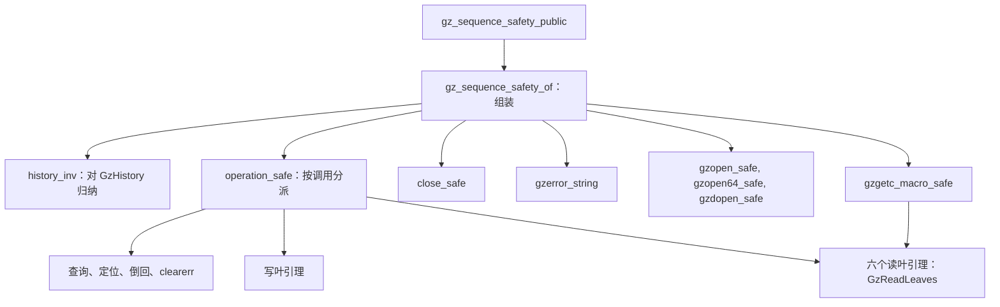
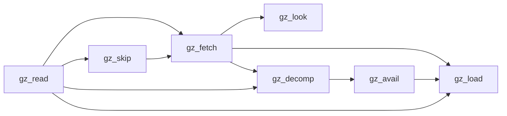

<!-- source-sha256: 6688b0064d9a15bfd13756b3536bb6265b69f8cf036602dc3dddfa37319261ee -->
# Gzip 文件：不变量、历史与操作系统预言

gzip 文件接口（`gzopen`、`gzread`、`gzwrite`、`gzseek`、`gzclose` 以及其他 `gz`
函数）在句柄的每一个历史上都是安全的，无论操作系统返回什么。本页给出这个命题，分清它假设了哪些东西，并解释证明的形状。

源文件：`gzlib.c`、`gzread.c`、`gzwrite.c`、`gzclose.c`、`gzguts.h`，以及 `zlib.h` 中的 `gzgetc`
宏。[API 页面](../spec/api/gz-file.md)给出调用者可见的行为。术语见[术语表](../glossary.md)。

## 结论

| 目标 | 定理 |
| --- | --- |
| `Goal.gz_sequence_safety` | `gz_sequence_safety_public` |
| `Goal.gz_refusal` | `gz_refusal` |
| `Goal.gz_sequence_nonvacuity` | `gz_sequence_nonvacuity_public` |
| `Goal.<function>_safety`，共 32 个目标 | `GzCallSafetyProof.<function>_safety` |

它们都是安全结论，并且都已完成。

31 个有文档的 gz 函数各有自己的安全目标；`gzvprintf` 也有，它在 `zlib.h` 中属于未文档化的函数，而 `gzprintf` 经由它实现。
每个目标是序列目标的一个子句，限制到一个函数的调用上：

- 接受句柄而不关闭它的函数：子句 2，连同 `Goal.gz_refusal` 中属于该函数的子句，所以 `NULL` 句柄被拒绝，什么都不改变。
  `Goal.gzgetc_safety` 还有子句 3（宏）；`Goal.gzerror_safety` 还有子句 4（它返回的字符串）；
- `gzclose`、`gzclose_r` 和 `gzclose_w`：子句 5，连同对 `NULL` 句柄的拒绝；
- `gzopen` 和 `gzopen64`：子句 6。`gzdopen`：子句 7。

这些证明使用 `gz_sequence_safety_public`；对 `NULL` 的拒绝通过求值成立。所以本页余下讲序列目标的内容，同时也就是单函数目标的证明。
每个函数另有一个功能契约 `Goal.<function>`。这些契约不是必需的；哪些有定理，见[最后一节](#functional-results)。

序列目标覆盖下面这样的程序。注释指出覆盖每个调用的是目标的哪个子句。

```c
gzFile f = gzopen(path, "rb");      /* 子句 6：打开会返回；失败时不泄漏 */
n = gzread(f, buf, len);            /* 子句 2；它会返回，这需要输入源有限 */
c = gzgetc(f);                      /* 子句 3：zlib.h 中的宏 */
msg = gzerror(f, &err);             /* 子句 2 和 4：msg 是可读的字符串 */
gzclose(f);                         /* 子句 5：全部释放，close 失败时也一样 */
```

在两次调用之间，程序可以改动它自己的内存，任何人都可以改动文件系统。目标对所有这样的历史成立。

## 目标陈述了什么

一个*世界*是文件系统、描述符表、`errno` 以及预言的一个状态；预言选择系统调用的结果（见[下文](#the-world-and-its-oracle)）。句柄的一个*历史*是一串步骤，从一次成功的打开开始（见[下文](#histories)）。
`Goal.gz_sequence_safety` 有七个子句。

1. **不变量。** 每个历史之后，世界是良构的（`FileSystem`），句柄满足表示不变量 `GzInv`。
2. **再调用一次。** 对每个历史、每个世界，以及句柄上参数符合要求的每一次后续公开调用，以下三部分都成立。
   - (a) *没有未定义行为，没有内存错误。* 运行不以 `Fault.ub` 结束。这一部分没有别的前提。
   - (b) *终止。* 运行不以 `Fault.outOfFuel` 结束，所以连同 (a)，调用会返回。对六个读调用
     `gzread`、`gzfread`、`gzgetc`、`gzgetc_`、`gzgets` 和 `gzungetc`，这一部分需要读取预算前提
     `ReadsFinite`。对其他每个调用，它在每个世界中成立。
   - (c) *已返回的调用的效果。* 已打开描述符的集合不变（`FdsKept`）。句柄再次满足
     `GzInv`，模式和描述符不变。调用只写了句柄的块和为该调用声明的调用者区域。存活块的变化只涉及句柄拥有的块：每个新的存活块都归句柄所有，每个消失的块原先也归它所有（`GzStepPost`）。所以没有泄漏。
3. **`gzgetc()` 宏。** 使用这个宏同样有这三部分，终止性的划分是它自己的（见[宏](#the-gzgetc-macro)）。
4. **`gzerror` 的字符串。** `gzerror` 返回的指针是一个以 NUL 结尾的字符串，在调用之后的堆中可读：它是字面量，或者是句柄的消息。
5. **关闭。** 每个关闭调用都会返回。它要么因模式不对而拒绝，什么都不改；要么释放记录和每个拥有的块，并释放描述符，`close`
   报告 `-1` 时也是如此（`GzReleased`）。
6. **打开。** `gzopen` 和 `gzopen64` 会返回。失败的打开不留下新块，也不留下新打开的描述符。成功的打开给出一个满足
   `GzInv` 的句柄，它恰好拥有那些新块。它的描述符的编号不为负，在调用之前没有打开，其他描述符编号都没有被打开或关闭（`GzOpenSafe`）。这个子句没有说句柄的描述符在调用之后是打开的。
7. **`gzdopen`。** 它会返回，不打开也不关闭任何描述符（`GzDopenSafe`）。

没有 `ReadsFinite` 时，(a) 部分对读调用仍然成立。这时它是部分正确性：在每个循环少于 `2^64`
轮的任何运行中都没有未定义行为。真实的执行达不到这个轮数。

## 假设了什么

这个结论的背后有三样不同的东西：前提、一个可信的模型，以及对源码的补丁。只有第一样在 Lean 命题里。

### 命题中的前提

每一条都明确写在 `Goal.gz_sequence_safety` 中，或者写在它所量化的历史 `GzHistory` 中。对应的行在[偏离记录](../deviations.md#gzip-file-interface)里。

| 前提 | 位置 | 含义 |
| --- | --- | --- |
| 打开时的调用者堆和世界 | `GzHistory.open`、`open64`、`dopen`；`GzOpenSafe`、`GzDopenSafe` | 堆是良构的（`Fresh`、`Uniq`、`LibraryGlobals`），每个字节对象少于 `2^63` 字节（`ByteObjectsFit`），世界是良构的（`FileSystem`），`path` 和 `mode` 是以 NUL 结尾的字符串（在子句 6 和 7 中也可以是 `NULL`）。 |
| 调用者缓冲区 | `GzArguments`，经由 `GzRange` | `gzread`、`gzfread`、`gzwrite`、`gzfwrite`、`gzputs`、`gzgets` 和 `gzerror` 的缓冲区在请求的长度内可读，在调用要向其中存入数据时可写，并且与句柄拥有的块不重叠。`gzputs` 的参数是以 NUL 结尾的字符串。长度为 0 的请求、C 因大小而拒绝的请求、缓冲区为 `NULL` 或长度小于 1 的 `gzgets` 调用，以及 `gzerror` 的 `errnum` 为 `NULL` 的情形，都没有缓冲区前提。 |
| `gzprintf` 和 `gzvprintf` 的参数 | `GzArguments` | 文件以写方式打开且不处于错误状态时，格式串是以 NUL 结尾的字符串，每个指针参数都指向未被释放的块。格式串和每个指针参数都与句柄的块不重叠。`vsnprintf` 调用对格式串和参数在 C 中有定义、且没有 `%n`，由调用者保证：没有前提陈述这一点，而模型不读取格式串中的转换（[可信基础](../trusted-base.md)）。 |
| 读取预算 | `ReadsFinite` | 句柄的描述符还能交付的字节少于 `2^61`。它只是 (b) 部分的前提，并且只针对六个读调用。这个前提还说描述符的编号不为负。库返回的每个句柄都有这样的编号：`GzOpenSafe` 对 `gzopen` 写明了这一点，而 `gzdopen` 对负的描述符返回 `NULL`。 |
| 两次调用之间的调用者步骤 | `GzHistory.caller`：`GzCallerFrame`、`ByteObjectsFit` | 调用者只改动句柄不拥有的块。改动之后的堆是良构的（`Fresh`、`Uniq`、`LibraryGlobals`），其中每个字节对象少于 `2^63` 字节。 |
| 两次调用之间的世界步骤 | `GzHistory.world`：`GzWorldStep` | 新的世界是良构的（`FileSystem`）。此外没有别的要求。 |

### 受信任而不在命题中：世界模型

世界及其预言是用 Lean 写的一个 Linux 模型（[外部 I/O](../design/external-io.md)）。内核对照这个模型检查证明。它不对照
Linux 检查这个模型（[可信基础](../trusted-base.md)）。证明倚重模型的两个事实：

- 对非空缓冲区的 `write` 从不返回 0；
- `close` 失败时也释放描述符。

### 源码是打过补丁的源码

这些命题说的是应用了补丁 0002 到 0006 的 C。未打补丁的 C
在某些历史上有未定义行为：见[源码报告与补丁](#source-reports-and-patches)。

### 为什么要读取预算

一个无穷的输入源会让一次 `gzread` 调用在 C 中永远运行：无穷的 `FNAME`
字段，或者无穷多个空的 gzip 成员。`zlib.h` 没有承诺读调用在这样的输入源上会返回。

`2^61` 这个数字是模型的限制。模型的一个循环有 `2^64` 轮燃料。读循环由度量界定，度量由剩余输入、读取预算和还要交付的字节构成。低于
`2^61` 的预算使这些度量保持在 `2^64` 以下。

这个前提按调用名给出（`NeedsReadBound`）。所以在 C 立即返回的地方也要求它：在写句柄上的读调用，或者长度为 0 的请求。`gzdirect`
没有读循环，不需要预算。`gzseek` 把跳过推迟，也不需要预算。

## 源码报告与补丁

补丁 0002 到 0006 修复未打补丁的 C 的五处缺陷。第一张表每处一行。[发现](../findings.md)列出它们及其证据；补丁以
`patches/README.md` 中的列表为准。这五个补丁都已提交上游，各拉取请求都处于打开状态。不变量之所以是这个形式，是因为前四处缺陷，以及第二张表中的两种情形，后者没有补丁改动。

| 情形 | 未打补丁的 C 的行为 | 证据与修复 |
| --- | --- | --- |
| 负的定位位置 | 在一开始的 `gzungetc` 之后，`GZ_OFF_MAX - pos` 或者后来的位置差使有符号 64 位算术溢出。 | 已在 sanitizer 下复现（[发现](../findings.md)）。补丁 0002，上游 [PR 1361](https://github.com/madler/zlib/pull/1361)。 |
| 部分读取之后出错 | 在 `gz_fetch` 的 `COPY` 分支中，`gz_load` 出错时可能在 `x.next = out` 执行之前留下非零的 `x.have`；`gz_read` 随后从一个过时的指针复制。 | 已在 sanitizer 下复现（[发现](../findings.md)）。补丁 0003，上游 [PR 1363](https://github.com/madler/zlib/pull/1363)。 |
| 读位置溢出 | 在一个 `lseek` 成功却不移动的设备上，透明模式的定位把 `x.pos` 设为 `GZ_OFF_MAX`；下一次读取使它溢出。 | 已在 sanitizer 下复现（[发现](../findings.md)）。补丁 0004，上游 [PR 1405](https://github.com/madler/zlib/pull/1405)，在每个调用返回时保持 `x.pos + x.have ≤ GZ_OFF_MAX`。 |
| 写位置溢出 | 透明写句柄向前定位到接近 `GZ_OFF_MAX`，然后写入，使 `x.pos` 溢出。 | 已在 sanitizer 下复现（[发现](../findings.md)）。补丁 0005，上游 [PR 1406](https://github.com/madler/zlib/pull/1406)，拒绝会越过 `GZ_OFF_MAX` 的写入。 |
| 负的描述符偏移 | `gzoffset64` 只把 `lseek` 返回的 `-1` 当作失败。别的负值减去读句柄已缓冲的输入，使有符号 64 位算术溢出。 | 已在 sanitizer 下复现（[发现](../findings.md)）。补丁 0006，上游 [PR 1404](https://github.com/madler/zlib/pull/1404)，对 `lseek` 的每个负结果都返回 `-1`。 |

| 情形 | C 的行为，打不打补丁都一样 | 证明如何处理 |
| --- | --- | --- |
| 未写入的指针 | `gz_reset` 没有写 `x.next`；`gzseek64` 和 `gz_skip_have` 给它加零。 | 按 C 的条文是未定义的；没有 sanitizer 报告它。模型接受给每一种指针值加零（[模型的限制](../model-limits.md#conditions-on-the-model-that-goals-state)）。 |
| 调用者缓冲区的生命期 | 直接读取把 `x.next` 指进调用者的缓冲区，并在 `x.have = 0` 时保留它。调用者释放缓冲区之后，`gzseek64` 和 `gz_skip_have` 给它加零。 | 按 C 的条文是未定义的；没有 sanitizer 报告它。适用模型的同一条规则。`gzseek64_dangling_next_ok` 表明：读句柄在没有已缓冲输出时向前定位，无论 `x.next` 是什么值都不出故障。 |

## 历史

`GzHistory h fs i` 说的是：堆 `h` 和世界 `fs` 由句柄 `i` 的某个实际历史到达。它有七个构造子；下表把三个打开构造子放在同一行。

| 构造子 | 步骤 |
| --- | --- |
| `open`、`open64`、`dopen` | 一次成功的 `gzopen`、`gzopen64` 或 `gzdopen`，出发的调用者堆和世界满足[前提表](#premises-in-the-statement)的第一行，字符串参数都不是 `NULL`。 |
| `step` | 句柄上的一次公开调用（`GzOperation`），参数符合要求（`GzArguments`），并且已返回。 |
| `getcMacro` | 对 `gzgetc()` 宏的一次使用，并且已返回。 |
| `caller` | 调用者改动它自己的内存：句柄不拥有的任何块。它可以释放自己的缓冲区，包括上一次 `gzread` 的缓冲区。改动之后的堆是良构的（`GzCallerFrame`：`Fresh`、`Uniq`、`LibraryGlobals`），它的字节对象都在大小上限之内（`ByteObjectsFit`）。世界不变。 |
| `world` | 另一方改动世界（`GzWorldStep`）：变成任何良构的文件系统状态。堆不变。 |

`world` 步骤有意定得很宽。另一个句柄或应用程序可以关闭这个句柄的描述符，或者在它的编号下打开另一个文件。下一次读或写于是得到错误，或者落到那个文件上，与
C 中一样。这个步骤还可以替换预言。

`GzHistory` 没有预算前提，所以子句 1 在每个历史上成立。gz 的功能目标是在另一个谓词 `GzReachable` 上表述的；安全目标不使用它。

## 世界及其预言

世界是堆旁边的一个记录 `Fs`。一个 gz
计算接受一个世界和一个堆，返回一个值和这两者，或者返回一个故障。世界里有文件、描述符表、`errno`，还有一个预言：它在每个
`read`、`write`、`lseek`、`close`、`open` 和调用者格式的 `vsnprintf` 的契约之内选择该调用的结果。预言可以选择什么，见[外部 I/O](../design/external-io.md#the-os-oracle)
中的表。

预言比普通文件宽：例如，无论描述符处于什么状态，读取都可以成功。每个子句都对所有世界量化，所以没有哪个证明步骤能依赖文件是普通文件。

外部调用分成两组。

- **五个系统调用不碰堆。** 模型函数 `fsRead`、`fsWrite`、`fsLseek`、`fsClose` 和 `fsOpen`
  接受一个世界，返回一个结果和一个新的世界。对每个预言值，它们各自都是对一个只依赖世界的结果取
  `pure`：从不产生故障，也从不改动堆（`fsRead_pure`、`fsWrite_pure`、`fsLseek_pure`、`fsClose_pure`、`fsOpen_pure`）。`fsRead` 把读到的字节作为一个值返回。随后 `gz_load` 的翻译把它们存到 `buf`
  处（`storeBytes`）；这次存入是一次受检查的堆复制，它是被翻译的 C 的一步，不是系统调用的一步。这次复制经过一个它自己创建并释放的临时块，所以它还会推进堆的块计数器（`nextBlk`）。
- **两个库调用改动堆。** `vsnprintf` 向它的目的地址存入数据：格式化出的字节和一个 NUL；调用失败时，则是预言选择的字节和一个
  NUL。两种情况下都在交给它的 `size` 个字节之内。预言让它失败时调用失败，格式化输出超过 `INT_MAX` 字节时调用也失败。格式串不是字符串，或者是模型的格式化器不能表示的格式，或者目的地址对这些字节不可写时，它产生故障。`vsnprintf_in` 表明：`gzvprintf`
  中的那次调用（目的地址在句柄的 `in` 缓冲区内）对每个预言值都会返回，保持 `GzInv`，并且只写句柄拥有的块。`zstrerror` 是
  `strerror(errno)` 的模型，它不分配任何东西，返回一个借用的字符串，这个字符串不是堆块。它改动堆的一个字段
  `libcErrorBorrow`，这个字段记录当前借出的是哪一段错误文本；块、存活标志和分配器字段都不变（`zstrerror_run`、`zstrerror_no_malloc`）。

`read` 的契约是 `fsRead_contract`，连同它的预算记账（`BudgetAcc`、`fsRead_budget`）。`write`
对每个预言值的契约是 `fsWrite_contract`。

## 证明结构



一个调用的安全性只有一种形状，`GzCallSafe i call`：对每个堆、每个良构的世界、每个满足 `GzInv`
的记录和每个符合要求的参数，子句 2 的三部分成立。*叶引理*是为一个公开函数证明 `GzCallSafe` 的引理。

组装 `gz_sequence_safety_of` 有两步。

- `history_inv` 对 `GzHistory` 归纳。打开的构造子使用打开引理。`step` 使用该调用的叶引理的 (c) 部分。`caller` 步骤使用
  `GzInv.caller`：不变量读的是句柄的块（这一步保持它们），以及整个堆的良构性和字节对象大小（这一步为新的堆提供它们）。`world`
  步骤不改动堆，而不变量不提世界。
- `operation_safe` 把一个调用分派给它的叶引理。`close_safe` 对三个关闭调用做同样的事。

读取一侧的叶引理打包在 `GzReadLeaves` 中：`gzread_step`、`gzfread_step`、`gzgetc_step`、`gzungetc_step`、`gzgets_step` 和
`gzdirect_step`。按定义，`gzgetc_` 就是 `gzgetc`，所以它没有自己的叶引理。（`gzdirect` 属于读取一侧，但不在需要读取预算的六个调用之内。）`gz_sequence_safety_of` 以这个包为唯一的参数，`gz_sequence_safety_public`
提供它。每个叶引理都是没有前提的定理。

## 不变量 `GzInv`

`GzInv h i s` 是记录为 `s` 的已打开句柄 `i`
的表示不变量。它有一个公共部分，每种模式各有一个部分。证明通过它的接口引理使用它（`GzInv.common`、`GzInv.reader`、`GzInv.writer`、`GzInv.state_eq`、`GzInv.pos_lower`）。

它谈到的字段是 `gzguts.h` 中 `gz_state` 的字段：

| 字段 | 在 C 中的含义 |
| --- | --- |
| `x.have`、`x.next`、`x.pos` | 公开前缀 `gzFile_s`：缓冲在 `x.next` 处的输出字节数，以及在未压缩数据中的位置。`gzgetc` 宏直接读写它们 |
| `mode`、`fd`、`path` | 读或写；描述符；用于错误消息的名字 |
| `size`、`want` | 缓冲区大小，缓冲区还不存在时为 0；请求的大小 |
| `in`、`out` | 输入缓冲区和输出缓冲区 |
| `strm` | 内嵌的 `z_stream`；下文的“编解码器”指它背后的 inflate 或 deflate 状态 |
| `how` | 读句柄：`LOOK`（寻找 gzip 头）、`COPY`（原样复制输入，即“透明”）、`GZIP`（解压一个 gzip 成员） |
| `direct` | 处理 gzip 时为 0，透明时为 1。只接受 gzip 的读句柄（模式字母 `G`）在 `gz_look` 选定 gzip 解码之前为 -1 |
| `junk` | 读句柄：开始时为 -1，垃圾候选为 1，在 gzip 数据内部为 0 |
| `eof`、`past`、`again` | 输入已结束；有一次读取请求越过了末尾；上一次 I/O 被 `EAGAIN` 拒绝 |
| `skip` | 待处理的定位的距离 |
| `err`、`msg` | 错误码和消息 |

在 LP64 构建上，偏移是有符号 64 位的，`GZ_OFF_MAX = 2^63 - 1`，一次 I/O 请求至多 `2^30` 字节。

下面三个列表是用白话写的摘要。本页后面用到的子句，名字写在括号里。

**公共部分（`GzCommon`）。**

- 记录在堆中，模式是读或写。
- 堆是良构的（`Fresh`、`Uniq`、`LibraryGlobals`），每个字节对象少于 `2^63` 字节（`ByteObjectsFit`）。内嵌的编解码器在它的每次调用时都需要这两点。
- `path` 是一个被拥有的、以 NUL 结尾的字符串。`msg` 是 `NULL` 或一个被拥有的字符串，在 `Z_MEM_ERROR` 之后是 `NULL`。
- `8 ≤ want < 2^31`，`size` 是 0 或 `want`。`size = 0` 表示缓冲区和编解码器还不存在。
- 被拥有的块是存活的、两两不同的、不同于记录的，并且不归内嵌的编解码器所有。编解码器不拥有记录块。
- 位置：`0 ≤ skip`，`x.pos + skip ≤ GZ_OFF_MAX`，`0 ≤ x.pos + x.have`。
- `x.next`：有已缓冲的输出时（`x.have ≠ 0`），它指进一个被拥有的块，这个块不是记录也不是消息，其后有 `x.have`
  字节（`next`）。`x.have = 0` 时，不变量不说它指向哪里。`x.next` 为 `NULL` 时 `x.have = 0`。

**读句柄部分（`GzReadInv`）。**

- `how` 是 `LOOK`、`COPY` 或 `GZIP`，`direct`、`junk` 以及标志 `eof`、`past`、`again` 取相应许可的值。
- 没有缓冲区时（`size = 0`），没有编解码器（`strm.state = NULL`），没有已缓冲的输出，也没有待处理的输入；`how` 是
  `LOOK`，`again` 是 0。
- 有缓冲区时（`size ≠ 0`），`in` 是一个恰有 `size` 字节的可写块，`out` 是一个恰有 `2·size` 字节的可写块。
- 待处理的输入（`avail_in ≠ 0`）在 `in` 中：`next_in = in + a`，且 `a + avail_in ≤ size`。已缓冲的输出在 `out`
  中：`x.next = out + c`，且 `c + x.have ≤ 2·size`。
- 有缓冲区时，内嵌的流在 inflate 历史中（`StreamReachable .inflate`），没有头记录。
- `x.pos + x.have ≤ GZ_OFF_MAX`（`posHave`）。
- 有已缓冲的输出就没有待处理的跳过（`haveSkip`）。
- 在输入末尾停住的读句柄没有待处理的输入（`againEof`）。
- `err` 从不是 `Z_STREAM_END`。`COPY` 没有待处理的输入。有缓冲区时，流的消息是 `NULL` 或字面量。

**写句柄部分（`GzWriteInv`）。**

- `x.have = 0`。`gzgetc` 宏在任何句柄上都读 `x.have`。
- `direct` 是 0（压缩的写句柄）或 1（透明的写句柄），`reset` 是 0 或 1。
- 没有缓冲区时，没有编解码器（`strm.state = NULL`）。
- 有缓冲区时，`in` 是一个恰有 `2·size` 字节的可写块。压缩的写句柄有恰好 `size` 字节的
  `out`。透明的写句柄没有编解码器，不变量也不把 `out` 算作它拥有的块；关于这个字段，不变量没有说别的。
- `next_in` 是 `NULL` 且 `avail_in = 0`；否则缓冲区存在，待处理的输入在 `in` 的前一半中：`next_in = in + a`，且
  `a + avail_in ≤ size`。
- 对有缓冲区的压缩写句柄，`next_out = out + b`，`x.next = out + c`，其中 `c ≤ b ≤ size`，并且
  `avail_out = size - b`。内嵌的流在 deflate 历史中，没有 gzip 头记录。

完整的命题是定义 `GzInv`，以及它的三个部分 `GzCommon`、`GzReadInv` 和
`GzWriteInv`；这份摘要与定义不一致的地方，以定义为准。

每个子句之所以存在，是因为有某个调用需要它。下面三个例子说明这一点。

- 没有 `posHave`，`gzgetc` 的缓冲路径会使 `x.pos` 溢出。
- 没有 `haveSkip`，`gzgetc` 会在有跳过待处理时返回一个已缓冲的字节，并把 `x.pos` 移过 `GZ_OFF_MAX - skip`。
- 没有 `againEof`，`gz_read` 会永远循环：`gz_avail` 在 `eof` 处什么都读不到，而 `gz_look` 返回 0。

在一次读调用的内部，有两个较弱的形式成立。`GzInvUpToOutput` 是把已缓冲的输出清空之后的记录的 `GzInv`：直接读取会把 `x.next`
留在调用者的缓冲区里。`GzInvUpToSkip` 是去掉 `haveSkip` 的 `GzInv`：`gz_look` 和 `gz_fetch`
可以在有跳过待处理时缓冲输出，而调用它们的函数在返回之前把它消耗掉。

### 新分配的记录的指针字段

`gz_open` 不写 `strm.state`、`strm.next_in` 和 `x.next`。在模型中，新分配的指针是 `NULL`。在 C
中它是不确定的，读它是未定义的（[安全性，未初始化内存](../spec/safety.md#uninitialised-memory)）。

- `strm.state` 和 `strm.next_in`：不变量写明 `size = 0` 时 `strm.state = NULL`。证明表明的是翻译的安全性。它没有表明读取了不确定指针的
  C 代码会被发现：这是[可信基础](../trusted-base.md)第 2 节的模型缺口。**尚未确认**，须由源码审查确认：在 `gz_look` 或 `gz_init`
  写入 `strm.state` 和 `strm.next_in` 之前，C 从不读它们。
- `x.next`：`x.have = 0` 时不变量对它不作任何断言。通过 `x.next` 的每次读取，以及对它的每次非零推进，都发生在 `x.have ≠ 0` 时。`x.have = 0` 时，`gzseek64` 和 `gz_skip_have` 给它加零，模型对每一种指针值都接受这一操作（[模型的限制](../model-limits.md#conditions-on-the-model-that-goals-state)）。

## 读的一侧



`gz_load` 累积字节，直到请求被填满或者某次读取让它停下。正数的读取结果推进 `have`；零设置 `eof`；阻塞造成的拒绝设置
`again`；其他失败设置一个错误。失败可以跟在成功的部分读取之后。

`gz_look` 在第一次调用时创建缓冲区和编解码器，然后决定怎么读。它只在至少有四个可用字节时才认出 gzip：魔数 `31, 139`、方法 8，以及小于
32 的标志字节。否则，在模式允许时，输入按透明处理。

`gz_decomp` 在内嵌的流上运行 `inflate`，直到输出已满、成员结束、输入结束或者出现错误。成员结束的路径回到检测，以处理连接在一起的多个成员。

`gz_read` 有三条数据路径：消耗已缓冲的输出，把透明数据直接读进调用者的缓冲区，或者直接解压到足够大的调用者缓冲区中。

读辅助函数按下面的顺序组合起来：

| 引理 | 命题 |
| --- | --- |
| `gz_look_safe` | `gz_look` 是安全的。 |
| `gz_decomp_safe_of` | `gz_decomp` 是安全的，条件是从模式 `BAD` 或 `MEM` 出发的 `inflate` 调用不移动两个缓冲区中的任何一个。这个事实是 `inflateStuckNoOutput_holds`。 |
| `gz_fetch_safe_of` | `gz_fetch` 是安全的，条件是 `gz_look` 和 `gz_decomp`。 |
| `gzSkipRead_holds` | `gz_skip` 是安全的，条件是 `gz_fetch`。 |
| `gz_read_safe_of` | `gz_read` 是安全的，条件是 `gz_skip`、`gz_fetch` 和 `gz_decomp`。 |
| `gzread_step`、`gzfread_step` | 公开调用，由 `gz_read` 得出。 |

每个内嵌的 `inflate` 调用都使用[流式解码](inflate.md)中关于流的结论：内嵌的流是可达的，所以单次调用的完整契约适用。

### 读循环的终止

每个读循环都有一个度量，它是由世界和句柄算出的一个自然数。有了 `ReadsFinite`，度量从 `2^64`
以下开始，并在每一个继续下去的轮次下降。下表给出每个度量的形状；准确的定义是
`fetchMeasure`、`fetchRank` 和 `readMeasure`。

把描述符的读取预算加上 `avail_in` 记作 `inputLeft`。`gz_avail` 读到多少字节，就把 `avail_in`
提高多少，预算则下降同样多的字节（`gz_avail_budget`）。所以 `inputLeft` 从不上升。

| 循环 | 度量 | 为什么下降 |
| --- | --- | --- |
| `gz_decomp` | `inputLeft + avail_out` | 它在每一个继续下去的轮次下降。 |
| `gz_fetch` | `4 · inputLeft + c`，其中 `c` 对 `LOOK` 为 2，对位于成员开头的 `GZIP` 为 1，对 `COPY` 为 0，其他情况为 3 | 它在每一个继续下去的轮次下降。空的 gzip 成员要耗费输入，所以预算排除了无穷多个空成员。 |
| `gz_read` | `readMeasure`：令 `L = min(len, GZ_OFF_MAX - pos)`，它是 `L / 8 + Q + 2·E + 3·R + fetchRank`。`Q` 在没有已缓冲的输出时为 1；已缓冲的字节少于 16 个、`err = Z_OK` 且 `x.pos + x.have < GZ_OFF_MAX` 时为 2；其他情况为 0。`E` 在输入末尾为 0，在此之前为 1。`R` 在 `pos` 低于 `GZ_OFF_MAX` 时为 1。`fetchRank` 是 `4 · inputLeft`，加上读取预算，在一个 gzip 成员已过开头、正在进行时加 2，在 `how` 变成 `COPY` 之前再加 2 | 它在每一个继续下去的轮次下降。`gz_decomp` 和 `gz_fetch` 都不提高 `fetchRank`。 |
| `gzgets` | 它的循环变量 `left` | 它在每一个继续下去的轮次下降。 |
| `gz_skip` | `skipMeasureF` | `gzSkipTerminates_holds`，由 `GzInvUpToSkip` 得出。 |

### 读的包装函数

包装函数保持 C 的检查顺序。`gzread` 检查它的无符号请求能放进 `int`。`gzfread` 在做除法之前检查 `size_t` 乘积。`gzgets` 为
NUL 留出位置，用 `min(have, left)` 界定它的 `memchr`，写最后的 NUL 的位置至多是 `buf[len - 1]`。`gzungetc` 先运行 `gz_look` 和
`gz_skip`，然后在 `out` 之内回推；在文件开头它可以造成 `x.pos = -1`，这就是不变量界定 `x.pos + x.have` 而不是 `x.pos` 的原因。

## `gzgetc` 宏

`zlib.h` 把 `gzgetc` 定义为宏：

```c
#define gzgetc(g) \
          ((g)->have ? ((g)->have--, (g)->pos++, *((g)->next)++) : (gzgetc)(g))
```

它是应用程序调用 `gzgetc` 的默认方式，所以历史为它设了一个构造子（`GzHistory.getcMacro`），目标为它设了一个子句。翻译是
`Zlib.ZlibH.gzgetc`；证明是 `gzgetc_macro_safe`。

这个宏有两个分支。

- **有已缓冲的输出（`x.have ≠ 0`）。** 宏就地改动 `x.have`、`x.pos` 和 `x.next`，没有库调用。与函数不同，`again` 置位时它不清除
  `err` 和 `msg`。这个分支的返回对世界没有任何前提。`GzCommon.next` 把 `x.next` 放在一个被拥有的缓冲区内，其后有 `x.have`
  字节；`posHave` 保证 `x.pos + 1` 可表示；`haveSkip` 给出 `skip = 0`。写句柄有 `x.have = 0`，所以就地分支只在读句柄上运行。
- **没有已缓冲的输出（`x.have = 0`）。** 宏调用函数 `gzgetc`。这个分支就是读叶引理 `gzgetc_step`，它在 `ReadsFinite` 下返回。

在两个分支中，效果都是函数的效果，而函数不写任何调用者区域。

在 `NULL` 句柄上，宏先读 `(g)->have`，这在 C 中是未定义行为。`Goal.gz_refusal` 只对函数 `(gzgetc)(file)` 说明 `NULL` 的情形。

## 写的一侧

`gz_init` 分配双倍的输入缓冲区，对压缩输出还分配输出缓冲区和编解码器。`gz_comp`
对透明输出直接写出输入，否则交替进行 `deflate` 调用和输出写入。`gz_write` 把小的输入复制进 `in`，或者把 `next_in`
指向调用者的大缓冲区，事后再把它复位。`gz_zero` 通过写零来完成待处理的向前定位。`gz_vacate` 压缩待处理的数据，并把其余的移到前面。

写叶引理是 `gzwrite_step`、`gzfwrite_step`、`gzputc_step`、`gzputs_step`、`gzprintf_step`、`gzvprintf_step`、`gzflush_step`、`gzsetparams_step`
和 `gzclose_w_step`。它们使用 `gz_error` 的事实，这些事实由不变量推出。

`gz_comp` 的循环在每个世界中都终止，不需要预算。写出循环以还要写的字节为度量，透明循环以待处理的输入为度量。两者都下降，因为对非空缓冲区的
`write` 返回 `-1`，或者返回 1 到长度之间的一个计数（`fsWrite_contract`）。这就是[上文](#trusted-not-in-the-statement-the-world-model)关于
`write` 的受信任事实。deflate 循环有它自己的度量，只要循环继续，它就下降。

不涵盖：`write` 会对非空缓冲区返回 0 的系统。**尚未由证明确认**：按对 C 的解读，一个永远返回 0 的 `write` 会让 `gz_comp`
永远循环，因为两个写循环在计数为 0 时都不前进。

`gzvprintf` 在 `next[size - 1]` 处写一个哨兵，并以容量 `size` 做格式化。长度落在 `1..size-1` 之外，或者哨兵丢失，`gzvprintf` 就拒绝这个结果。

`gzsetparams` 刷新待处理的数据，调用 `deflateParams`，然后存入请求的级别和策略。它忽略被调用函数的结果。安全证明不需要那个结果。

## 位置、定位与错误消息的归属

`gztell64` 报告逻辑位置加上待处理的跳过；`past` 置位时不加这段跳过。`gzoffset64` 查询描述符的位置，在读模式下再减去已缓冲的压缩输入。`lseek` 的结果为负时它一律返回 `-1`（补丁 0006），所以这次减法不溢出。这是两个不同的位置。

`gzseek64_step` 和 `gzseek_step` 对每个世界成立。路径有：

- 拒绝（严重错误、坏的 `whence`、目标落在补丁 0002 的范围之外）：返回 `-1`，什么都不变；
- 写句柄：`skip` 变成那段距离；目标在 `x.pos` 之前时，调用返回 `-1`；
- 透明模式的读句柄：一次 `lseek`。由 `posHave`，位移 `pos - x.pos - have` 不溢出；
- 向后退的读句柄：先 `gzrewind`，然后整段距离变成 `skip`；
- 向前走的读句柄，也包括 `gzungetc` 之后从负的 `x.pos` 出发：已缓冲的字节被消耗，其余的变成 `skip`。

每条路径之后 `haveSkip` 都成立。`lseek` 可以返回预言选择的任何值。它只改动调用计数器、`errno`，以及（对普通文件）那一个描述符的位置。所以世界保持良构，已打开的描述符保持不变。

`gz_error` 先释放旧的被拥有的消息。内存错误不分配新消息；其他任何消息都拥有 `path + ": " + text` 这次分配。`gzerror`
返回内存错误的字面量、当前消息或者空字面量，并且可以把错误码存进调用者的四字节单元。`gzerror_step` 和
`gzerror_string` 表明这次存入保持不变量，并且返回的指针是调用之后的堆中的一个字符串。这个字符串由下一个到达
`gz_error` 的调用释放；关于 `gzprintf` 参数的调用者前提排除了把它传回同一个句柄。

## 打开与关闭

`gzopen_safe`、`gzopen64_safe` 和 `gzdopen_safe` 表明新打开的句柄满足
`GzInv`。打开给出 `size = 0`，所以每个关于缓冲区或已缓冲输出的子句都空洞地成立。

`gzclose` 读出模式，然后运行 `gzclose_r` 或 `gzclose_w`。满足 `GzInv` 的句柄是读句柄或写句柄，所以
`gzclose` 从不拒绝。`gzclose_r` 在编解码器存在时结束它，释放缓冲区、消息、路径和记录，并关闭描述符。`gzclose_w`
还要先写出待处理的零并完成输出。这些操作失败时，清理照样进行。成功的 `gzdopen` 接管描述符；失败的则把它留给调用者。

## `NULL` 句柄

`Goal.gz_sequence_safety` 只在真实的句柄上运行。`Goal.gz_refusal` 对 29 个函数说明 `NULL`
的情形：对每个堆、每个世界和其他每个参数，调用返回它文档规定的值，既不改动堆也不改动世界。它没有前置条件。每个子句通过求值成立，因为每个函数都先测试
`file == NULL`。

## 非空性

`Goal.gz_sequence_nonvacuity` 表明序列目标的前提可以被满足。它给出两个具体的历史，各自从满足打开构造子每个前提的调用者堆和世界出发，没有分配失败。

1. `gzopen` 给出一个满足 `GzInv` 的读句柄，它的描述符有有限的读取预算。向调用者缓冲区做一次一字节的 `gzread` 满足 `GzArguments`。
2. 在一个已打开的描述符上，`gzdopen` 给出一个满足 `GzInv` 的写句柄，它保留这个描述符。从调用者缓冲区做一次一字节的 `gzwrite` 满足
   `GzArguments`。

所以子句 2，以及它对读调用的 (b) 部分，适用于一次长度非零的真实调用。

## 功能结论

31 个有文档的 gz 函数和 `gzvprintf` 各有一个功能契约 `Goal.<function>`：共 32
个目标。安全结论不需要其中任何一个。其中八个有定理：

- `Goal.gzbuffer`、`Goal.gzeof`、`Goal.gzerror`、`Goal.gzclearerr`、`Goal.gzdopen`：各函数的完整契约：`gzbuffer` 存入的大小（至少为 8）及其拒绝，`gzeof` 的返回值，`gzerror` 的错误码和借用的消息，`gzclearerr` 复位的状态，以及 `gzdopen` 对描述符的拒绝或接管。
- `Goal.gzoffset64`、`Goal.gzoffset` 和 `Goal.gzrewind`：描述符的位置减去读句柄已缓冲的压缩输入，以及定位回起点并复位读句柄的状态。它们针对普通文件的世界表述（前提 `RegularOs fs`）。

没有定理陈述下面这些：

- 其余 24 个功能契约：`Goal.gzopen`、`Goal.gzopen64`、`Goal.gzclose`、`Goal.gzclose_r`、`Goal.gzclose_w`、`Goal.gzread`、`Goal.gzfread`、`Goal.gzgetc`、`Goal.gzgetc_`、`Goal.gzungetc`、`Goal.gzgets`、`Goal.gzdirect`、`Goal.gzwrite`、`Goal.gzfwrite`、`Goal.gzputc`、`Goal.gzputs`、`Goal.gzprintf`、`Goal.gzvprintf`、`Goal.gzflush`、`Goal.gzsetparams`、`Goal.gzseek`、`Goal.gzseek64`、`Goal.gztell`
  和 `Goal.gztell64`；
- 功能序列目标 `Goal.gz_sequence`；
- `Goal.gz_initialisation_domain`：模式串有效、世界的 `open` 成功且没有分配失败时，`gzopen` 返回一个处于初始状态的句柄；并且每个有效的模式都有一次具体的成功打开。
