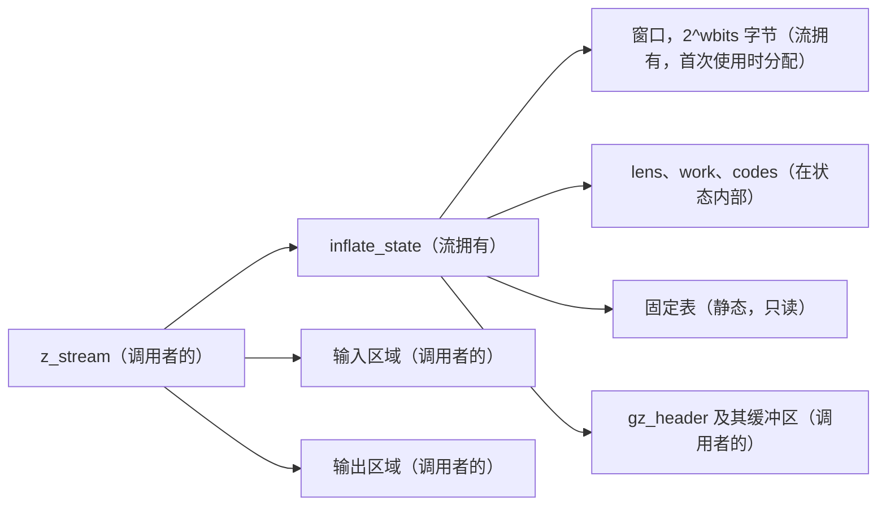

<!-- source-sha256: 5c1328e154a1642eff421f6c9b1034a33fe00dafe3a6359889c9f3b023d0498a -->
# 流式解码：`inflate` 为什么是安全的

源文件：`zlib/inflate.c`。翻译：`ZlibF/Zlib/inflate.c.lean`。

`inflate` 和其他 `inflate*` 函数，对任意输入、对输入输出缓冲区的任意切分、在任意一串被允许的调用上，都是安全的。证明维护解码器状态的一个不变量：`inflateInit2_` 确立它，每次调用保持它，而 C 代码的每一次内存访问都落在不变量描述的范围之内。本页解释这个不变量、每一步为什么保持它，以及解码循环为什么会结束。

本页以[解码表](inftrees.md)和[快速解码](inffast.md)为基础。`updatewindow` 的内部契约见[内部契约](../spec/internal-contracts.md#preserve-decoder-history-updatewindow)。

## 结论

表中的每个目标都已完成：旁边列出的定理，其命题恰好就是这个目标。

| 目标 | 内容 | 定理 |
| --- | --- | --- |
| `Goal.inflate_sequence_safety` | 序列结论，见下 | `inflate_sequence_safety_public` |
| 十个目标：`Goal.inflate_safety`、`Goal.inflateSetDictionary_safety`、`Goal.inflateGetDictionary_safety`、`Goal.inflateSync_safety`、`Goal.inflateReset_safety`、`Goal.inflateReset2_safety`、`Goal.inflatePrime_safety`、`Goal.inflateMark_safety`、`Goal.inflateGetHeader_safety`、`Goal.inflateEnd_safety` | 该函数拒绝被拒绝的流（[拒绝](#refusals)），并且在可达的流上调用一次该函数是安全的 | `inflate_safety` 以及形式相同的另外九条 |
| `Goal.inflateInit__safety`、`Goal.inflateInit2__safety` | 对每个 `strm`（包括 `NULL`）、每个 `windowBits`、每个 `version`（`NULL`，或者第一个字节可读）和每个 `stream_size`，只要 `zalloc` 和 `zfree` 字段各自是 `NULL` 或默认函数（`InitArguments`），初始化都是安全的。自定义分配器不在这个目标之内 | `inflateInit__safety`、`inflateInit2__safety` |
| `Goal.inflateCopy_safety` | `inflateCopy` 拒绝 `NULL` 参数和被拒绝的源，并且从可达的源复制是安全的 | `inflateCopy_safety` |
| `Goal.inflate_refusal` | 用一个命题陈述七个函数的拒绝；见[拒绝](#refusals) | `inflate_refusal` |
| `Goal.inflate_initialisation_domain` | 序列目标的前提可以被满足（非空性） | `inflate_initialisation_domain_public` |

**序列结论**有三部分（`StreamSequenceSafety`）。

1. 每个可达的流都满足公开不变量 `StreamInvariant`。
2. 在可达的流上，再做一次被允许的调用，调用会返回且不出故障。之后不变量仍然成立。调用只改动了流记录、流拥有的块、挂接的 `gz_header` 记录，以及交给它的调用者区域（这是*帧性质*）。存活块集合的变化，恰好是流新得到或释放掉的块（这是*分配账本*）：没有任何泄漏。
3. 在可达的流上调用 `inflateEnd`，返回 `Z_OK`，并释放流拥有的每一个块。

一个流是*可达*的，指它来自一次成功的 `inflateInit2_`，之后经过任意多次被允许的调用、成功的 `inflateCopy` 调用，以及调用者对四个缓冲区字段的修改。各函数的定理就是第 2 部分在一个函数上的情形，`inflateEnd` 的定理则是第 3 部分。它们是序列定理的推论。

`inflate_sequence_safety_public` 由引理 `inflate_sequence_safety` 推出。

这个文件也有功能结论，列在[功能结论](#functional-results)一节。

## 拒绝

*被拒绝*的流（`RefusedInflate`）是 `NULL`，或者是下面几种可读的记录之一：它的 `zalloc`、`zfree` 或 `state` 字段是 `NULL`；或者它的 `state` 是一个存活的 inflate 状态，但这个状态的回指指针不指向这个记录，或者它的模式在 `HEAD` .. `SYNC` 之外。在这些情形下，状态检查 `inflateStateCheck` 返回 1，并且不会通过坏指针去读。

拒绝在两处陈述。十个单函数目标各以它为第一个子句，`Goal.inflateCopy_safety` 有一个针对被拒绝的源的子句。`Goal.inflate_refusal` 用一个命题对七个函数再陈述一遍：`inflate`、`inflateEnd`、`inflateReset`、`inflateReset2`、`inflateGetDictionary`、`inflateSetDictionary` 和 `inflateCopy`。在被拒绝的流上，这十一个函数都返回，不出故障。

- `inflate` 和 `inflateSync` 返回 `Z_STREAM_ERROR`。两个翻译各自在检查之前创建一个四字节的局部数组（`hbuf`、`buf`），返回时释放它。所以调用之后的堆与之前不是同一个值：它的块计数器可能增大了。这个子句说的是：不写原先存活的任何块，存活块的集合也没有变。它多一条前提：从堆的下一个未用块编号起，没有任何块编号在使用（`Fresh`，堆良构性的一部分）。
- 源流被拒绝时的 `inflateCopy` 返回 `Z_STREAM_ERROR`：目的流是一个可读的记录。它的 `state` 字段变成 `NULL`，其余都不变。
- `inflateMark` 返回 `-65536`，即 `zlib.h` 为不一致的流规定的值，并让堆完全保持原样。
- 其余七个函数（`inflateEnd`、`inflateReset`、`inflateReset2`、`inflatePrime`、`inflateGetHeader`、`inflateSetDictionary`、`inflateGetDictionary`）返回 `Z_STREAM_ERROR`，并让堆完全保持原样。`inflateGetDictionary` 还原样返回传给它的长度值：翻译把这个结果单元当作值传递。

`zalloc` 和 `zfree` 已设置、而 `state` 字段里是垃圾指针、指向已释放状态的指针或指向 deflate 状态的指针的记录，不在这些子句之内；原因见[偏离记录](../deviations.md)中“被拒绝的流”一行。

拒绝子句是怎样证明的。没有哪个子句需要专门为它证明一条关于 C 的引理。七个子句就是 `inflate_refusal` 的各个子句。`inflatePrime` 和 `inflateMark` 的子句是该函数功能目标的拒绝子句（`CheckedInflate`）。`inflateSync` 和 `inflateGetHeader` 的子句来自引理 `inflateSync_check` 和 `inflateGetHeader_check`，这两条引理是针对检查能够读取、且未初始化的流陈述的（`StreamDom`、`¬ Initialised`）；`refused_dom` 和 `refused_not_initialised` 说明被拒绝的流就是这样的流。

## 假设

一个目标有哪些前提，要看是哪个目标。

| 目标 | 前提 |
| --- | --- |
| 序列目标的第 1 和第 3 部分；`Goal.inflateEnd_safety` 的 End 子句 | 可达的流，此外没有别的前提 |
| 序列目标的第 2 部分；从 `Goal.inflate_safety` 到 `Goal.inflateGetHeader_safety` 的九个单函数目标的调用子句（`StreamCallDomain`） | 可达的流；调用时的堆满足 `ByteObjectsFit`；该调用的参数前提（`StreamArguments`） |
| 两个初始化目标 | `InitArguments`：良构的堆，以及[结论](#results)一节给出的对参数的条件 |
| `Goal.inflateCopy_safety` | 源流可达；目的流是一个可读的流记录，并且不是源记录。命题还把源流的 `Good` 和 `DefAlloc` 列为前提；序列结论的第 1 部分对每个可达的流给出这两条 |
| `Goal.inflate_refusal`；每个单函数目标的拒绝子句和 `Goal.inflateCopy_safety` 的拒绝子句 | 被拒绝的流（[拒绝](#refusals)）；对 `inflate` 和 `inflateSync` 还有 `Fresh`；对 `inflateCopy`，目的是一个可读的流记录，并且在 `Goal.inflateCopy_safety` 的子句里，源指针不是 `NULL` |

*良构的堆*有三条性质：从下一个未用的块编号起，没有任何块编号在使用（`Fresh`）；一个块编号只对应一个对象（`Uniq`）；静态表保持初始内容（`LibraryGlobals`）。

下一张表把“可达的流”和各个参数前提展开。它列出 `StreamReachable .inflate` 的每一条前提，以及 `StreamArguments` 对各个 `inflate*` 调用的每一条前提。完整的命题是这些 Lean 定义：`StreamReachable`、`Rebuffer`、`StreamArguments`、`StreamBuffers`、`CallerRange`、`ActiveHeader`、`HeaderMemory`、`InflateHeaderProgress` 和 `StreamCallDomain`。[偏离记录](../deviations.md)逐行讨论这些前提，并说明每一条在哪里比 `zlib.h` 更窄。

| 前提 | 内容 | 属于 |
| --- | --- | --- |
| 第一次调用（`StreamReachable.inflateInit`） | 历史从一次返回 `Z_OK` 的 `inflateInit2_` 调用开始。这次调用运行在良构的堆上，针对一个可读的流记录，记录的 `zalloc` 和 `zfree` 各自是 `NULL` 或默认函数；版本字符串的第一个字节是 `'1'`，结构体大小是 112，`windowBits` 任意 | 历史 |
| 调用者的修改（`Rebuffer`） | 两次调用之间，调用者只改 `next_in`、`avail_in`、`next_out`、`avail_out`，以及不属于流的内存。它交回的堆是良构的，并且满足 `ByteObjectsFit`。这次修改不改变模型的分配失败预言和垃圾值，也不使模型的块计数器和分配计数器变小（`Frame`） | 历史 |
| 此前的调用（`StreamReachable.step`） | 此前的每次调用都是这个流上十四个 `inflate*` 流函数之一，满足它的参数前提和 `ByteObjectsFit`，并且返回了；返回码任意 | 历史 |
| 复制（`StreamReachable.inflateCopy`） | 流也可以作为一次返回 `Z_OK` 的 `inflateCopy` 调用的目的流而可达：这次调用从可达的源流复制到另一个可读的记录 | 历史 |
| `ByteObjectsFit` | 每个字节对象都少于 `2^63` 字节 | 每次调用 |
| `StreamBuffers` | 输入区域（`next_in`、`avail_in`）和输出区域（`next_out`、`avail_out`）互不重叠。每个区域要么是 `NULL`，要么在它的长度内可读（输出区域还要可写），并且在流拥有的块之外 | `inflate` |
| `ActiveHeader` 的第一部分（`HeaderMemory`） | 没有挂接 `gz_header` 记录；或者挂接的记录是存活的，不属于流，并且它的 `extra`、`name`、`comment` 缓冲区各自要么是 `NULL`，要么在 `extra_max`、`name_max`、`comm_max` 字节内可写，并且在流拥有的块之外 | `inflate` |
| `ActiveHeader` 的第二部分（`InflateHeaderProgress`） | 在 `HEAD` 到 `HCRC` 这些模式下，并且挂接了记录时：它的 `extra` 缓冲区（`extra_max` 字节）与尚未读的输入互不重叠。在 `EXTRA` 模式下还有：`extra_len` 不小于还要读的长度 | `inflate` |
| 字典区域（`CallerRange`） | 字典指针是 `NULL`；或者它在流拥有的块之外，并且在 `dictLength` 字节内可读（`inflateSetDictionary`），或在 `whave` 字节内可写（`inflateGetDictionary`） | 两个字典调用 |
| 同步输入 | 如果 `next_in` 是 `NULL`，那么 `avail_in = 0`。输入区域是 `NULL`，或者可读并且在流的块之外 | `inflateSync` |
| 头部记录（`HeaderMemory`） | 交给 `inflateGetHeader` 的记录不是 `NULL`。它是存活的，不属于流，它的缓冲区满足“`ActiveHeader` 的第一部分”一行的条件 | `inflateGetHeader` |

其余的流调用（`inflateReset`、`inflateReset2`、`inflateResetKeep`、`inflatePrime`、`inflateMark`、`inflateSyncPoint`、`inflateCodesUsed`、`inflateValidate`、`inflateUndermine`）没有参数前提。

默认分配器不是单独的前提：它由历史推出，并由不变量携带（子句 `alloc`）。

有 `InflateHeaderProgress` 这条前提，是因为缺了它 C 会出故障。在 `EXTRA` 模式里，C 往 `head->extra + extra_len - length` 处复制。`extra` 缓冲区若与输入重叠，就是一次重叠的 `memcpy`；`extra_len` 若在读头部的中途被调小，这个偏移就会回绕。这两种故障都已用真实的 C 在 sanitizer 下复现。这条前提是每次调用时对记录的条件，不论这个字段是谁写的。`inflate` 会写流所挂接记录中的 `extra_len`，所以两个流挂接在同一个记录上时（例如 `inflateCopy` 之后），一个流可能使另一个流的这条前提不成立。挂接在同一个头记录上的两个流在目标之外。

## 一次调用的轮廓

```c
int inflate(z_streamp strm, int flush) {
    /* 入口检查：state、next_out、next_in */
    LOAD();                       /* 取出 next_in、avail_in、next_out、avail_out、hold、bits 的本地副本 */
    for (;;) switch (state->mode) {
        case HEAD: ...            /* 每个 case 读若干位、写输出，或者改变模式 */
        case LEN:
            if (have >= 6 && left >= 258 && bits < 8) {
                RESTORE(); inflate_fast(strm, out); LOAD(); break;
            }
            ...                   /* 否则在这里解码一个符号 */
        case DONE: ret = Z_STREAM_END; goto inf_leave;
        ...
    }
  inf_leave:
    RESTORE();                    /* 把本地副本写回 */
    updatewindow(...);            /* 把输出的末尾保存为历史 */
    ...
}
```

一次调用可以经过许多模式，快速路径和慢速路径可以交替出现。一次调用还可能在任何地方停下：输入用完时，`NEEDBITS` 经 `inf_leave` 离开，下一次调用从同一个模式继续。所以不变量必须描述每一个模式下的状态，而不只是块与块之间的状态。


图里把模式分了组。证明对 C 中每个真实的模式各有一个情形。

## 内存与所有权



流拥有两个块：它的状态，以及分配之后的窗口。`lens[320]`、`work[288]` 和 `codes[1444]` 是状态内部的数组。`lencode` 和 `distcode` 指向 `codes` 内部，或者指向静态的固定表。`head` 指向调用者拥有的记录。

## 不变量

不变量是 `InflateInv`，有十二个子句。“允许 gzip 解码”指 `wrap` 的第 1 位置位：`wrap` 是 2、3、6 或 7（`GzipAllowed`）。

| 子句 | 白话说明 | 定义 |
| --- | --- | --- |
| `good` | 流记录可读，它的 `zalloc` 和 `zfree` 不是 `NULL`，它的 `state` 是一个存活的 inflate 状态，这个状态指回这个流，模式在 `HEAD` 到 `SYNC` 之间。状态里各数组的大小与 C 声明一致。窗口具有下面的形状 W。`reqbits ≤ 15`。`bits ≤ 39`。`next` 指向 `codes` 内部，下标不超过 1444。`lencode` 和 `distcode` 要么都指向 `codes` 内部，下标不超过 1443，要么就是那两张固定表。一个块编号不会同时表示两个对象（`Uniq`），从下一个未用的块编号起没有任何块编号在使用（`Fresh`） | `Good` |
| `alloc` | `zalloc` 和 `zfree` 是默认函数 | `DefAlloc` |
| `tables` | 在 `LEN_`、`LEN`、`LENEXT`、`DIST`、`DISTEXT`、`MATCH` 和 `LIT` 模式下：`lencode` 和 `distcode` 指向的表，对 `lenbits` 和 `distbits` 具有安全的表形状（[解码表](inftrees.md#the-table-shape)），并且每个字面量/长度叶子至少用掉一位 | `DataTableInvariant` |
| `pending` | `sane = 1`。在 `LENEXT` 中：附加位至多 5 位，`3 ≤ length`，`length + 2^extra ≤ 259`，并且 `0 ≤ back ≤ 15`。在 `DIST` 和 `DISTEXT` 中：`3 ≤ length ≤ 258` 且 `was = length`。在 `DIST` 中还有 `0 ≤ back ≤ 20`。在 `DISTEXT` 中还有：附加位至多 13 位，`offset ≥ 1`，`offset + 2^extra ≤ 73727`，`0 ≤ back ≤ 35`。在 `MATCH` 中：`0 < length ≤ was ≤ 258` 且 `offset > 0` | `DataPendingInvariant` |
| `lengths` | 在 `CODELENS` 中：`lencode` 就是 `codes[0]`，是一张形状安全的码长表；`nlen ≤ 286`，`ndist ≤ 30`，`have ≤ nlen + ndist`；已经读到的 `have` 个码长都不超过 15 | `CodeLengthInvariant` |
| `headerLengths` | 在 `LENLENS` 中：`ncode ≤ 19`，`have ≤ ncode`，`nlen ≤ 286`，`ndist ≤ 30`；已经写入的 `have` 项都是 3 位的值 | `LengthHeaderInvariant` |
| `held` | `hold < 2^bits`：位计数以上没有置位的位 | |
| `config` | `wrap` 和 `reqwrap` 取 0、1、2、3、5、6、7 之一。`wbits` 是 8 到 15；或者是 0，这时没有窗口，头部还没读（`flags = -1`），模式是 `HEAD`、`BAD`、`MEM` 或 `SYNC`。`reqbits` 等于 `wbits`；或者 `reqbits = 0` 而 `wbits` 是 8 到 15（调用者要求使用 zlib 头部给出的宽度，而宽度此后已经设定）。裸流一定有宽度：`wrap = 0` 时 `wbits ≠ 0`，`reqwrap = 0` 时 `reqbits ≠ 0`。`wrap = 0`，或者 `wrap` 和 `reqwrap` 在是否允许 gzip 解码上一致。只有允许 gzip 解码时才会挂接 `gz_header` | `InflateConfig` |
| `modes` | `HEAD ≤ mode ≤ SYNC` | |
| `phase` | 块的解码只发生在头部之后：模式是 `HEAD`、`BAD`、`MEM`、`SYNC` 或 `FLAGS`，或者流是裸流（`wrap = 0`），或者头部已经读过（`flags ≠ -1`）。只有允许 gzip 解码时，`flags` 才会既不是 -1 也不是 0。gzip 头部模式 `FLAGS` 到 `HCRC` 只在允许 gzip 解码时出现，并且在 `FLAGS` 之后的这些模式里 `flags ≠ 0` | `InflatePhase` |
| `origin` | `lencode` 是 `codes[0]`，或者 `lencode` 和 `distcode` 是那两张固定表。两次调用之间不会存下别的形状 | `CopyTableOrigin` |
| `globals` | 静态表（固定编码、CRC、`trees.c` 的表）保持初始内容 | `LibraryGlobals` |

这张表是用白话写的摘要。完整的命题是 Lean 定义 `InflateInv`，以及最后一列列出的各个定义。

有三个子句描述中途停下的调用：`pending`（停在一次匹配当中）、`lengths`（停在码长序列当中）和 `headerLengths`（停在码长编码的头部当中）。下一次调用靠它们才能继续。

还有一条事实在两次调用之间成立，它放在不变量旁边，叫 `DecoderHeldBits`：在 `BAD`、`MEM` 和 `SYNC` 之外，`bits ≤ 32`。在一次调用内部 `bits` 可以达到 39：`n ≤ 32` 的 `NEEDBITS(n)` 只在 `bits < n` 时才取一个字节，所以取字节时 `bits ≤ 31`，取完至多是 39。

序列目标陈述的是较小的公开谓词 `StreamInvariant`，也就是 `good` 和 `alloc` 两个子句。`InflateInv` 蕴含它。

### 窗口形状 W

W 是 `good` 中关于滑动窗口的部分（`WinInv`）。

1. `wbits ≤ 15`。
2. `window` 是 `NULL`，或者指向一个恰好 `2^wbits` 字节的可写块的开头。`window` 为 `NULL` 时 `wsize = 0`。
3. `wsize` 是 0 或 `2^wbits`。
4. `whave ≤ wsize`。`wnext < wsize`，或者两者都是 0。
5. 如果 `whave < wsize`，那么 `wnext = whave`：还没填满的窗口是从下标 0 开始填的。

W 说明对窗口的读写落在哪里，不涉及窗口里的字节是什么。

`updatewindow(strm, end, copy)` 保存最后 `copy` 个输出字节。它有三种情形。下面取 `wsize = 8`，`h` 表示旧字节，`n` 表示新字节：

```
copy >= wsize                 [ n n n n n n n n ]   wnext = 0   whave = 8

copy <= wsize - wnext         [ h h h . . . . . ]   wnext = 3   whave = 3
(copy = 2)                    [ h h h n n . . . ]   wnext = 5   whave = 5

copy >  wsize - wnext         [ h h h h h h . . ]   wnext = 6   whave = 6
(copy = 4)                    [ n n h h h h n n ]   wnext = 2   whave = 8
```

- 第一种情形：一次 `wsize` 字节的 `memcpy` 填满整个块。
- 第二种情形：一次 `memcpy` 写到 `[wnext, wnext + copy)`，它的终点不超过 `wsize`。然后 `wnext` 前进，到 `wsize` 时回到 0。如果窗口原先没满，W.5 给出 `whave = wnext`，所以给 `whave` 加上同样的数，W.5 仍然成立。
- 第三种情形：第一次 `memcpy` 把 `wsize - wnext` 字节写到块的末尾，第二次把剩下的写到下标 0 处。之后窗口是满的。

`updatewindow_safe` 证明这个调用不会出故障，并且之后 `Good` 仍然成立。如果需要分配窗口而分配失败，调用返回 1，状态不变，只有分配计数器前进了。

## 每一步为什么保持不变量

`reachable_invariant_kind` 对历史做归纳，证明每个可达的流都满足 `InflateInv` 和 `DecoderHeldBits`。归纳的每个情形是一条定理。

| 步骤 | 定理 | 为什么成立 |
| --- | --- | --- |
| `inflateInit2_` 成功 | `inflateInit2_invariant_of`、`inflateInit2_held` | 状态先被清零，然后 `inflateReset2` 设置 `wrap` 和 `wbits`，`inflateResetKeep` 设置 `mode = HEAD`、`hold = 0`、`bits = 0`、`lencode = distcode = next = codes`。窗口是 `NULL`，`wsize = 0` |
| 调用者修改缓冲区字段 | `rebuffer_invariant` | 没有哪个子句提到 `next_in`、`avail_in`、`next_out` 或 `avail_out`，调用者也不能碰流拥有的块 |
| `inflate` | `inflate_preserves`，来自 `inflate_call` 和 `inflate_call_refused` | 见下 |
| `inflateReset`、`inflateReset2`、`inflateResetKeep` | `inflateReset_preserves`、`inflateReset2_preserves`、`inflateResetKeep_preserves` | 三者都把模式置为 `HEAD` 并清空位缓冲。`inflateResetKeep` 什么都不释放，窗口和它的计数保持原样。`inflateReset` 把 `wsize`、`whave` 和 `wnext` 置为 0。当 `wbits != reqbits` 时它释放窗口，否则保留窗口块；按子句 `config`，两者只在 `reqbits = 0` 时才不相等。`inflateReset2` 先释放宽度与新 `windowBits` 所要求的宽度不同的窗口，然后调用 `inflateReset`。账本记下每一次释放 |
| `inflatePrime` | `inflatePrime_preserves` | 位数大于 16 或合计大于 32 时它拒绝，所以 `bits ≤ 32` 和 `held` 仍然成立 |
| `inflateSetDictionary`、`inflateGetDictionary` | `inflateSetDictionary_preserves`、`inflateGetDictionary_preserves` | 前者经过 `updatewindow`；后者只读窗口 |
| `inflateSync` | `inflateSync_preserves` | 它扫描输入，匹配成功时通过 `inflateReset` 重置。重置之后，如果还没有读过头部，它把 `wrap` 置为 0，否则清掉 `wrap` 的第 2 位。之后如果 `wbits == 0`，它释放仍然存在的窗口，并置 `wbits = 15` |
| `inflateGetHeader` | `inflateGetHeader_preserves` | 它把调用者的指针存进 `head`，并写 `head->done = 0`。子句 `config` 只在允许 gzip 解码时才允许挂接记录；当 `(wrap & 2) == 0` 时，C 在存指针之前就返回 `Z_STREAM_ERROR` |
| `inflateMark`、`inflateSyncPoint`、`inflateCodesUsed` | `inflateMark_preserves`、`inflateSyncPoint_preserves`、`inflateCodesUsed_preserves` | 它们什么都不写 |
| `inflateValidate` | `inflateValidate_preserves` | 它置位或清掉 `wrap` 和 `reqwrap` 的第 2 位。C 只在值非零时才置这一位，所以取值仍在子句 `config` 列出的那些值之中（1、2、3 变成 5、6、7，反之亦然；0 仍是 0）。第 1 位不变，所以两个字段在 gzip 上仍然一致 |
| `inflateUndermine` | `inflateUndermine_preserves` | 在本构建中它写 `sane = 1`，这正是子句 `pending` 要求的值，并返回 `Z_DATA_ERROR` |
| `inflateCopy` 成功 | `inflateCopy_invariant` | 副本得到自己的状态块和窗口块。子句 `origin` 说明了 `lencode` 可能是什么，所以副本可以照同样的方式指向自己的表 |

`operation_preserves` 汇总了流调用的各行。序列结论的第 2 部分还需要每次调用的帧性质和账本，它们是 `inflate_call_safe` 和 `operation_safe_other`。第 3 部分是 `inflateEnd_invariant`。

### 一次 `inflate` 调用的内部 {#the-mode-proof}

`inflate_call` 处理通过了入口检查、并且模式不是 `SYNC` 的调用。`inflate_call_refused` 处理这样的调用：流通过了状态检查，而调用返回 `Z_STREAM_ERROR`，即 `next_out` 是 `NULL`，或者 `next_in` 是 `NULL` 而 `avail_in != 0`，或者模式是 `SYNC`。前两种由入口检查拒绝。处于 `SYNC` 模式的流通过入口检查，在 switch 里（`case SYNC`）被拒绝，流记录和状态都不变。`inflate_call` 除了安全性之外，还证明了返回码和各计数器更新的完整列表；安全性只用到其中一部分。

下表对每组模式说明：哪次访问需要论证，哪条事实提供了论证。

| 模式 | 需要论证的访问 | 为什么安全 |
| --- | --- | --- |
| 每个 `NEEDBITS`、`PULLBYTE` | 读 `*next`；移位 `<< bits` | 读之前先检查 `have > 0`。移位发生在 `bits ≤ 31` 时 |
| `HEAD` 到 `HCRC` | 写 `head->extra`、`head->name`、`head->comment` | 每次写都受容量 `extra_max`、`name_max` 或 `comm_max` 约束，而 `ActiveHeader` 保证这些容量内可写。`extra` 的偏移用到 `InflateHeaderProgress` |
| `STORED`、`COPY` | 从输入到输出的 `memcpy` | `copy = min(length, have, left)` 限定了两段区域；`StreamBuffers` 保证它们不重叠 |
| `TABLE` | 之后的下标 `lens[have]` | C 拒绝 `nlen > 286` 或 `ndist > 30`，所以 `nlen + ndist ≤ 316 < 320` |
| `LENLENS` | `lens[order[have]]`，以及对 `inflate_table` 的调用 | `have < ncode ≤ 19`。19 个码长都是 3 位的值，这正是 [`inflate_table`](inftrees.md#assumptions) 对 `CODES` 的前提 |
| `CODELENS` | 查表、`lens[have++]`、`lens[have - 1]` | 子句 `lengths`。会超过 `nlen + ndist` 的重复被拒绝。`have = 0` 时的代码 16 在访问 `lens[have - 1]` 之前被拒绝 |
| `CODELENS` 的末尾 | 两次调用 `inflate_table`，写入 `codes[1444]` | `852 + 592 = 1444`。`inflate_table_safe` 给出无故障；`inflate_table_decoder_safe` 给出子句 `tables` 需要的表形状 |
| `LEN` 到 `DISTEXT` | 查表 | 子句 `tables`：掩码后的下标在表内，表项是叶子，或是通向叶子的链接 |
| `LEN`，快速路径 | 对 `inflate_fast` 的调用 | 这次调用是在 `RESTORE()` 留下的堆上，由不变量和 `StreamBuffers` 证明的，适用于 `StreamBuffers` 允许的每一种布局（`inflate_fast_default_view_buffers`）；见[快速路径](#the-fast-path) |
| `MATCH` | 从窗口或更早的输出复制 | `offset > 0`（子句 `pending`）。距离超出本次调用的输出时去读窗口；因为 `sane = 1`，距离超过 `whave` 时 C 会拒绝。W 限定了窗口下标 |
| `LIT` | 往 `*put` 写一个字节 | 先检查 `left > 0` |
| `CHECK` | 对 `put` 之前的 `out` 个字节计算校验和：这是从调用开始以来的输出。一次调用至多算一次：算过之后模式是 `LENGTH`、`DONE` 或 `BAD` | 这些字节是本次调用写的，在输出区域之内 |
| `LENGTH` | 除 `NEEDBITS(32)` 之外没有：这个模式把 `hold` 与 `total` 的低 32 位比较 | |
| `inf_leave` | 对本次调用的输出执行 `updatewindow`；第二次校验和，对 `next_out` 之前的 `out` 个字节计算：这是本次调用的输出中 `CHECK` 的校验和还没有算进去的部分 | 两者的源都是输出区域，`StreamBuffers` 保证它与窗口不重叠 |

<a id="table-and-trailer-statement-boundaries"></a>
每个模式都有一条运行引理，例如 `inflate_TABLE_run`、`inflate_LENLENS_run` 和 `inflate_CHECK_run`。

### 快速路径 {#the-fast-path}

证明通过三条途径到达对 `inflate_fast` 的调用。前两条是安全证明内部的引理，第三条属于功能结论。

- `inflate_fast_raw_entry` 建立[快速解码](inffast.md#assumptions)的入口条件，从而复用那一页的定理。它有一条前提：输入和输出位于两个不同的堆块。建立在它之上的引理带着同一条前提，名为 `RawFastIO`；`inflate_dispatch_data_rank` 就是其中之一。
- `inflate_fast_default_view_buffers` 对块没有前提。它直接由解码器不变量和调用者的区域证明 `inflate_fast` 的运行，输入和输出是同一个块里的两段时也适用。`inflate_dispatch_data_view_state_rank` 对每一次快速调用都用它，`inflate_call` 的证明在数据模式上依靠的就是这条引理。安全结论走的是这条途径。
- `inflate_fast_entry` 对每一种布局建立[快速解码](inffast.md#assumptions)的入口条件，对块没有前提。功能定理 `fast_call_meaning` 用到它（[功能结论](#functional-results)）。安全结论不用它。

## 循环为什么会结束

分派循环 `for (;;) switch (state->mode)` 在 C 里没有界。它会结束，是因为每一轮只要不离开循环，就有一个秩在下降。

```
mass = bits + 8 * have + left
rank = 64 * mass + credit(mode)
```

`mass` 数的是还可用的输入位数和还空着的输出字节数。`credit` 对每个模式是一个小于 64 的固定数：`HEAD` 60，`STORED` 48，`TABLE` 47，`LENLENS` 46，`CODELENS` 45，`LEN` 21，`LIT` 20，`TYPE` 8，`CHECK` 4，`DONE` 2，等等。

- 没有哪一轮会让 mass 增加：位从 `have` 移到 `bits`，然后被丢弃（`dispatchMass_advance`）。
- 写了输出或丢弃了输入位的一轮，使 `mass` 至少减一。一个单位的 mass 值 64，比 credit 的任何变化都大。
- 两样都没做的一轮，会转到 credit 更小的模式（`dispatchRank_advance`）。两个例子：裸流上的 `HEAD`（60）什么都不读就转到 `TYPEDO`（9）；存储块结束时的 `COPY`（17）转到 `TYPE`（8）。

每组模式都有一条引理，说“要么离开，要么秩下降”：数据模式是 `inflate_dispatch_data_view_state_rank`，此外有 `inflate_dispatch_type_rank`、`inflate_dispatch_stored_rank`、`inflate_dispatch_gzip_header_rank` 以及同类的其他引理。

快速路径算作一轮。一次快速调用有三种结束方式。它结束当前块并置模式 `TYPE`（credit 8），或者发现错误并置模式 `BAD`（credit 1）；两者都低于 `LEN` 的 credit（21），而快速调用不会让 mass 增加。或者它保持模式不变，这时它至少写了一个字节。`inflate_fast_default_view_buffers_progress` 对每一种布局陈述了这三种情形；`inflate_fast_safe_progress` 对[快速解码](inffast.md)的入口条件陈述了同样的内容。

翻译里的循环带有 `2^64` 轮的燃料，燃料耗尽是故障。由于 `bits ≤ 39`，而 `have` 和 `left` 是 32 位的，秩小于燃料（`dispatchRank_fuel`），所以这种故障不会发生。

内层循环直接有界：存储块的复制受 `copy` 约束，码长循环受 `nlen + ndist - have` 约束，匹配复制受 `length` 约束，`syncsearch` 受输入长度约束。

## 难点在哪里

难点不在某一个循环。难在一次调用可以在任何一个 `NEEDBITS` 处停下再继续，所以不变量必须在大约三十个模式中的每一个里都足够强，同时又能被每一个模式重新确立。有三处最难。

- **gzip 头部。** 这是 `inflate` 往输出之外的调用者缓冲区里写东西的唯一地方。往 `extra` 的复制需要前提 `InflateHeaderProgress`。
- **终止性。** 有几种转移既不用输入也不写输出。只看输入和输出的度量在这些地方不会下降；秩里的 credit 项处理的就是它们。
- **快速路径。** `inflate_fast` 的入口条件比它周围的模式更严。这次调用要在 `RESTORE()` 留下的堆上，从同一个不变量证明出来，包括输入和输出是同一个块里两段区域的情形（[快速路径](#the-fast-path)）。

## 没有定理陈述的 C 解读

- 匹配从窗口读到的字节是先前写过的。原因是 W.5：在没有填满的窗口里，有效历史是 `[0, whave)`，而 C 会拒绝超过 `whave` 的距离。定理只陈述了读落在块内。在模型里，读一个从未写过的字节会得到任意值，不算故障（[可信基础](../trusted-base.md)）。**尚未由证明确认**。
- 窗口里按顺序存着输出和字典最近的 `whave` 个字节。这是关于含义的事实，安全性不需要它，也没有安全定理陈述它。**尚未由证明确认**。
- 由 `inflateInit2_` 或 `inflateCopy` 建立的状态，其每个指针字段在被读之前都写过。这两个函数在使用新状态之前先用 `zmemzero` 把它清零，翻译在同一位置有同样的语句。由 `inflateBackInit_` 建立的状态不清零：它的 `strm` 字段没有写过，如果对这个流调用 inflate 函数，状态检查会读它（[模型的限制](../model-limits.md#representation-gaps-and-proof-obligations)）。没有定理陈述这一事实，在这个模型里也不可能有：在模型里，新分配的内存中的指针字段读出来是 `NULL`，不出故障，所以漏掉一次写入是看不出来的（[安全性](../spec/safety.md#uninitialised-memory)）。**尚未确认**，须由源码审查确认。

## 功能结论

这些结论说的是函数算出了什么。每一项都有定理，但都不是安全结论所必需的。

| 结论 | 定理 |
| --- | --- |
| `Goal.inflate`：一次调用的完整契约，包括进展、返回码、计数器、帧性质和所有权。`uncompress*` 和 gzip 读取端的安全证明用到它 | `inflate_public` |
| 其他函数的完整契约，例如 `Goal.inflateCopy`、`Goal.inflateReset`、`Goal.inflateSetDictionary` | `inflate_copy_public`、`reset_public`、`inflateSetDictionary_public` 等 |

有一种情形，有定理把翻译后的 `inflate` 的输出与 DEFLATE 格式联系起来。`completed_inflate_decodes` 说的是这样的流：由 `windowBits` 为 15 的 `inflateInit2_` 创建，之后只有调用者的修改和 `inflate` 调用，没有字典，也没有重置。如果历史中最后一次调用返回了 `Z_STREAM_END`，那么已消耗的输入是一个 zlib 流，它解码成已写出的输出（`Zlib.Decodes`）。对格式接受的流，`Goal.default_inflate_progress` 和 `Goal.default_inflate_completes` 说明 `inflateInit` 建立的解码器会到达 `Z_STREAM_END`，写出的恰好是解码结果；[往返](roundtrip.md)一页给出这两个目标，以及默认 zlib 流的往返。

不涵盖：其他配置（裸流和 gzip 流、其他窗口宽度、预设字典、重置）；对它们，没有定理说 `inflate` 的输出等于输入的含义。`inflate_decodes` 只是关于抽象模型的命题。

### 跨调用的因果关系与历史

关于解码器的三条事实，限定了关于含义的命题能说什么。

一个解码出的符号由输入位的一段前缀支撑。解码器可能已经读得更远：`inflate_fast` 会提前取入整字节，再把没用到的还回去。输出不必与解码器读过的全部内容一致：提前读入的字节可能格式有误，而已经解码的符号是有效的。`inflate` 的抽象模型里的关系只把每个符号与支撑它的那些位联系起来。有两条关于这个模型的定理说的是同一个裸流，在这个流上解码器先写出一个字节，然后才遇到一个无效的距离：`inflate_deferred_distance` 说模型接受这次调用，`inflate_deferred_distance_rejects_legacy_consistency` 说与读过的全部内容一致这一条件对它不成立。

数据错误并不总是在它的起因之后八个字节以内被发现：在一个动态块中，输入在第 230 字节处就已不可能成立，而一次调用可以消耗 281 字节并返回 `Z_OK`。模型目标 `Api.Goal.inflate_rejects_invalid` 陈述的是八字节的界；它未完成，也不在计划内（[进度](../progress.md#not-planned)）。

错误可能出现在真实的输出之后：窗口是在调用结束时分配的，所以 `inflate` 可能在写出一些字节之后返回 `Z_MEM_ERROR`。`Goal.inflate` 保留了这种效果。

## 在 `inflateCopy` 中发现的缺陷

未打补丁的 `inflateCopy` 用 `>=` 和 `<=` 来判断 `lencode` 是否落在 `codes` 之内。当 `lencode` 指向静态固定表时，这两个指针属于不同的对象，这种比较是未定义行为。补丁 0001 把它换成了指针相等的判断（`patches/README.md`；[发现](../findings.md)）。翻译和 `inflateCopy_safety` 针对的都是打过补丁的源码。
