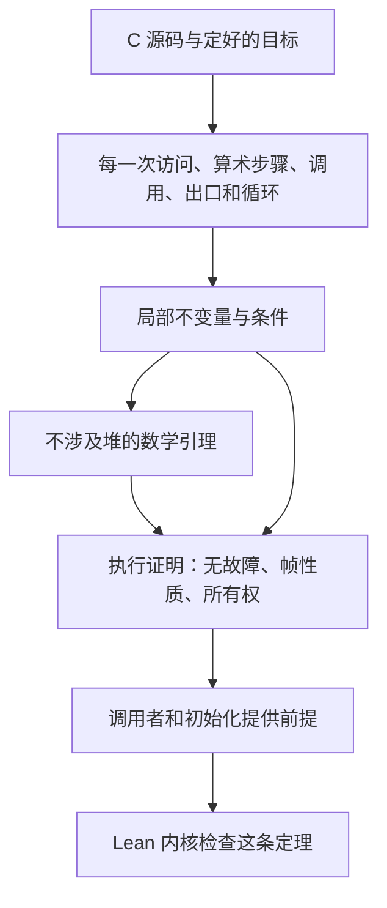

<!-- source-sha256: 59a7442a647625c29abaa848a4a9c43d55dbbfcfac22b914d472b3e8242d88e4 -->
# 证明一个函数

本页说明本项目里关于一个 C 函数的证明是怎样搭起来的。它讲的是方法，本身不陈述任何结论；定理列在[地图](/proofs.html)里，论证在各组件页面里。

必需的目标是安全目标：一次调用返回时没有未定义行为，也没有内存错误；它会终止；它只改动自己有权改动的内存；它不泄漏任何东西。[安全性](../spec/safety.md)定义了这些说法。功能目标还要说明调用算出了什么。功能目标不是安全结论所必需的。两类目标用的是同一套方法，本页会指出哪些步骤只和功能有关。

## 先把问题定下来

证明开始之前，有三样东西是定好的。

- **C 源码。** 固定的 `zlib/`，加上 `patches/README.md` 列出的补丁。
- **翻译。** 每个 C 文件逐条语句译成 Lean：C 里的每个分支、每次读、每次写、每次类型转换都有对应，顺序也相同。无符号运算回绕。有符号溢出、非法移位和非法指针操作会引发故障。不能为了让证明好做，把一条语句换成“看起来等价”的另一条。读的先后也有关系：在另一次写之前读一个字段，和使用早先缓存下来的值，不是一回事。
- **目标。** 一个 Lean 命题，写明调用者的义务、每种返回值对应的结果、调用可以写的内存，以及它的分配行为。

公开目标必须覆盖 `zlib.h` 允许的用法。任何比 `zlib.h` 更窄的前提，都写在目标的文档字符串里，并在[偏离记录](../deviations.md)中占一行。内部定理说的是只有库自己调用的函数，它可以多假设一些，比如表具有某种形状；这时每个调用者在每次调用处都要证明这条前提。

## 搭建论证

每类语句需要说明的内容：

| 语句 | 要说明什么 |
| --- | --- |
| 通过指针读或写 | 对象是存活的，指针种类正确，偏移落在对象之内 |
| 指针运算 | 结果在对象之内，或恰在对象末尾之后一个位置 |
| 移位、有符号运算 | 操作数落在 C 对结果有定义的范围内 |
| 循环 | 一个不变量，加一个每轮都下降、并且小于循环燃料的度量 |
| 调用 | 被调用函数的定理的前提在当前状态下成立 |

有两点容易漏掉。

**循环燃料。** 翻译里的每个循环最多跑 `2^64` 轮，跑完燃料就是故障 `outOfFuel`。所以终止性论证不能只说明循环在数学上有限，还要把轮数界定在燃料以下。

**不把被调用函数的契约当假设。** 处理一次调用时，用的是已经对翻译后的被调用函数证明过的定理。形如“被调用函数满足它的规格”的假设是不允许的。

不需要堆的算术引理和组合引理，是脱离内存模型单独证明的。内存证明把它们用到 C 实际读写的那些单元上。举例来说，一条关于规范编码的定理要对解码器有用，还得有第二条定理说明 `inflate_table` 确实把这些表项写进了堆。

## 证明走不通的时候

一次证明尝试失败，原因是四种之一：缺一条引理或不变量的一个子句；目标写错了，有一次被允许的执行与它矛盾；翻译与 C 不一致，比如求值顺序或某次类型转换；或者 C 本身在一个被允许的输入上出故障。不预设是哪一种，收窄调用者的定义域也解决不了其中任何一种。

除第一种之外，每种原因各有自己的证据。目标写错了，就有一个反例：一次被允许的执行，所陈述的结果对它不成立。这时更正目标。翻译与 C 不一致，就是翻译和真实的 C 在某个输入上有差别，也就是差分测试能发现的那种差别。这时更正翻译。zlib 的缺陷用真实的 C 来定论：在一个具体的输入上，在 sanitizer 下运行的 C 报告这个故障。[发现](../findings.md)列出了经过确认的那些。经过确认的 zlib 缺陷，可以成为给被验证的源码打一个最小补丁的理由；`patches/README.md` 列出了各补丁，并给出每个补丁对应的上游拉取请求。模型的限制不是 zlib 的缺陷。

## 一个表示不变量

每个有状态的组件有一个表示不变量：状态的一条性质，初始化确立它，每个操作保持它。因此在任何一串被允许的调用之后它都成立。只是*假设*不变量成立的定理不是序列结论；序列定理还要证明不变量确实能达到。

| 组件 | 不变量 | 解释见 |
| --- | --- | --- |
| `inflate` | `InflateInv` | [流式解码](inflate.md#the-invariant) |
| `deflate` | `DInv`，调用之间另有 `HeaderInv` 和 `CallFacts` | [流式压缩](deflate.md#the-invariant) |
| gzip 文件 | `GzInv` | [gzip 文件](gzip.md) |
| 回调解码器 | 调用之间是 `BackValid`，分派循环内部是 `PInv` | [回调解码器](callbacks.md) |

序列目标通过一个较小的公开谓词 `StreamInvariant` 来陈述不变量。证明用的不变量蕴含它。

不变量太弱时，表现出来的是反例，而不是证明难做。举一个例子：如果 `deflate` 的不变量允许状态 `EXTRA_STATE` 带着为 `NULL` 的 `gz_header` 指针，它就太弱了，因为从这样的状态运行 `deflate(Z_BLOCK)` 会出故障。所以不变量里有子句 `HeaderInv.record`，说明在读这个指针的四个头部状态里它不是 `NULL`，并且有一条定理证明每个可达状态都满足它（`reachable_inv_of`）。这条定理有一个假设 `SequenceFacts`：关于一次 `deflate` 调用的三个事实。三者的前提相同：调用之前的状态满足 `DInv`、`HeaderInv` 和 `CallFacts`，并且这次调用带有目标所要求的缓冲区和头部（`StreamBuffers`、`ActiveHeader`）。这次调用会返回，并保持 `DInv` 和所拥有的块；它保持 `HeaderInv`；它保持 `CallFacts`。这三个事实本身也已证明：`sequence_facts` 没有任何假设，`deflate_copy_public` 把 `reachable_inv_of` 应用于它。所以这个假设已被证明消去，不是留下来的假设。

仅与功能有关：界并不能说明解码出的是哪些字节。功能证明要针对同样的执行，加上一条状态与格式之间的关系，并说明每一步怎样改变它。

## 初始化、帧性质与所有权

**初始化**在成功时确立不变量，并交代每一种分配失败的情况。默认分配器不把内存清零：新分配的内存里的整数字段取任意值。所以不变量中关于这样一个字段的子句之所以成立，只是因为证明指出了设置这个字段的那次写。对指针字段，模型比 C 弱：新分配的内存里的指针字段读出来是 `NULL`，而且不出故障。所以证明并不表明指针字段在被读之前已经写过：这一点**尚未确认**，须由源码审查确认；见[安全性](../spec/safety.md#uninitialised-memory)和[可信基础](../trusted-base.md)。

**未初始化的整数**取任意值，定理对每一个这样的值都成立。例如 `slide_hash` 会读 `prev` 的每一个槽，不管写没写过；而链的遍历只会到达写过的槽（[流式压缩](deflate.md#hashing-chains-that-can-be-followed)）。模型让每个从未写过的单元在一次运行中取一个固定的值，所以对它读两次结果相同。C 并不保证这一点。这是模型的一条限制：见[模型的限制](../model-limits.md)里“每个单元一个任意初值”那一行。

一次调用的**帧**是它可以改动的内存：流记录、流拥有的块，以及交给这次调用的调用者区域。其余一切不变。出错返回各有各的效果：有的什么都不写，有的在返回前已经更新了状态或产生了输出。返回码为负，并不等于堆没有变。

**所有权**（`Owns`）跟踪属于一个流的存活块。一次分配增加一个块，一次释放恰好去掉它一次。复制会创建新块，并让内部指针指向它们。初始化或复制失败时，会释放它已经拿到的每一个块，原先的所有权保持原样。把这些步骤放到整个历史上看，包括失败路径在内，就得到没有泄漏。

## 非空性与组合

如果没有任何状态满足不变量，那么所有“只要不变量成立就如何”的定理都成立，却毫无价值。初始化定理排除了这种情况：它说明在整个被允许的参数范围内，不变量都能达到。顶层目标还各有一条非空性定理，给出一个满足它全部前提的具体的堆和调用。

调用的组合，靠的是对被允许的历史做归纳。初始化给出不变量。每次调用给出下一个不变量、它的帧，以及它的所有权变化。凡是 API 允许的地方，重置、字典、位预置、恢复、复制和没有填满的缓冲区，都是这个归纳的情形。

## 检查每一个证明接口

把两段已经证明的部分接起来之前，要在同一个堆、同一组寄存器上，比较前一段确立的关系和后一段要求的关系。两条定理名字对得上，并不等于它们接上了。

流引擎有六个这样的接口。

1. 初始化确立不变量。
2. 调用入口由它推出分派循环的局部关系。
3. 每个模式保持这个关系，或者确立它那个出口的确切关系。
4. 分派循环的每一轮使一个有界的秩下降。
5. 每个出口恢复公开的计数、帧性质和所有权关系。直接返回和公共出口路径各自都需要这一点。
6. 其他每个被允许的操作保持不变量。

建表有两项不同的义务。下标的界和合法的叶子形状让查表是安全的。与规范编码一致，才让查表得到正确的符号。只证明写操作落在表内，这两项都得不到。

## 多个证明共用的结构性事实

组件页面用编号引用这些事实。

| 编号 | 事实 | 用于 | 解释见 |
| --- | --- | --- | --- |
| F1 | 建表的写操作不超出表空间，建好的表在读者能构造出的每个下标处都有表项 | `inflate_table`、`inflate`、`inflate_fast` | [解码表](inftrees.md#every-index-is-covered) |
| F2 | 计数偏移把有编码的符号排进 `work` 中互不相同的槽，这些槽都写过 | `inflate_table` | [解码表](inftrees.md#sorting-f2) |
| F3 | 伸进窗口的匹配复制，已经用 `whave` 检查过它的距离 | `inflate`、`inflate_fast` | [快速解码](inffast.md#match-copies-f3-and-f4) |
| F4 | 在没有填满的窗口里，`wnext = whave` | `updatewindow` | [流式解码](inflate.md#window-shape-w)，W.5 |
| F5 | 哈希链的遍历只到达插入过的位置，经过的 `prev` 槽都写过 | `longest_match` | [流式压缩](deflate.md#inside-one-deflate-call) |
| F6 | 一次匹配的比较直到偏移 258 都在窗口之内 | `longest_match`、`deflate_rle` | [流式压缩](deflate.md#inside-one-deflate-call) |
| F7 | 活动堆、已存放的结点和树下标都在各自的数组之内 | `build_tree`、`pqdownheap` | [树](trees.md#building-a-tree-f7) |
| F8 | 码长修复总能找到一个非空的较短类，最长类的计数不会减到零以下 | `gen_bitlen` | [树](trees.md#limiting-the-code-lengths-f8) |
| F9 | 待输出的字节不会覆盖还没读的符号，整个块放得进共用缓冲区 | 写块的各函数 | [树](trees.md#the-overlay-lemma-f9) |

F3 和 F4 的作用不同。F3 让匹配对窗口的读落在块内。F4 让 `updatewindow` 保持 `whave ≤ wsize`。匹配复制的界并不需要 F4；F4 还说明它们读到的字节是写过的，而这是一条没有任何安全定理陈述的解读。

## 内核检查和测试各提供什么

Lean 内核检查每一条定理。只有当一条定理的命题恰好就是目标，并且它的证明除 Lean 的三条标准公理（`propext`、`Classical.choice`、`Quot.sound`）之外不使用任何公理时，这个目标才算已证明。所以一项结论并不依赖证明脚本写得对不对。它依赖的是内核、目标说的确实是想说的意思，以及翻译和运行时模型与 C 一致；[可信基础](../trusted-base.md)列出了这些。

测试针对的是其中最后一项。差分测试在相同的输入上把翻译与真实的 C 作比较；它们是保真度的证据，不是证明。
