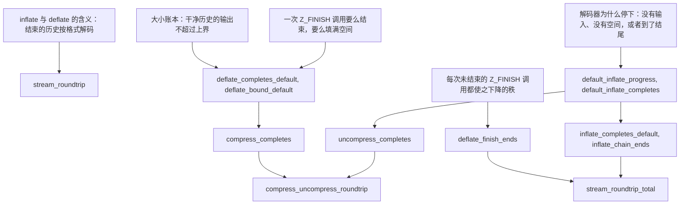

<!-- source-sha256: d39f02fcf2ce692fd7ffdd08c97840db2509c19d2625e0d28a068d9957f9d3f0 -->
# 默认 zlib 流的往返

用 zlib 按默认级别压缩，再解压，得到原输入。本页给出表达这件事的十四个目标及其前提，并说明证明的轮廓。这项结论已完成。它是一项功能结论：安全结论不依赖它。

目标写在 [RoundTrip.lean](../../../ZlibF/Spec/Functional/RoundTrip.lean) 和 [InflateCompletion.lean](../../../ZlibF/Spec/Functional/InflateCompletion.lean) 中。术语见[术语表](../glossary.md)。

## 设定

*默认流*是 `deflateInit(strm, Z_DEFAULT_COMPRESSION)` 建立的流：zlib 封装，32 KiB 窗口，`memLevel` 为 8，默认策略。*默认解码器*是 `inflateInit` 建立的解码器：zlib 封装，32 KiB 窗口。两边都不用预设字典。

一段*历史*是调用者对一个流实际做的事：初始化调用，然后是 `deflate`（或 `inflate`）调用，两次调用之间可以任意修改四个缓冲区字段 `next_in`、`avail_in`、`next_out`、`avail_out`。所以输入和输出可以按任何方式分块。历史里没有字典调用、没有重置，也没有其他操作。每段历史带一份日志：到目前为止接受的输入、写出的输出，以及最近一次的返回码。

*干净的*历史是每次调用都只用 `Z_NO_FLUSH` 或 `Z_FINISH` 的 `deflate` 历史。

`Zlib.Decodes [] S D` 是格式规格：字节 `S` 是一个 zlib 流，在没有字典的情况下解码得到 `D`。

## 证明了什么

每条定理证明的恰好是它的目标。下面的前提都是目标命题的一部分。

### 整块缓冲区

| 目标 | 定理 | 命题 |
| --- | --- | --- |
| `Goal.compress_completes`、`Goal.compress_z_completes` | `compress_completes`、`compress_z_completes_core` | 空间至少有 `compressBound(sourceLen)` 字节时，调用返回 `Z_OK`，并存入它写出的长度 `m`，`m` 不超过 `compressBound(sourceLen)`。`dest` 处的 `m` 个字节是一个 zlib 流，解码得到源数据，并且不要求预设字典。 |
| `Goal.uncompress_completes` | `uncompress_completes` | 源数据是一个 zlib 流，解码得到 `D`，并且不要求预设字典；目的缓冲区至少有 `|D|` 字节。这时 `uncompress` 返回 `Z_OK`，写出 `D`，并把 `|D|` 存入 `*destLen`。 |
| `Goal.compress_uncompress_roundtrip` | `compress_uncompress_roundtrip` | `uncompress(compress(x)) = x`。给 `compress` 留出 `compressBound` 的空间，它返回 `Z_OK` 并存入 `m`。把它写出的 `m` 个字节在任意第二个堆上交给 `uncompress`，目的缓冲区不短于源数据时，得到 `Z_OK`、源数据及其长度。 |
| `Goal.compress_uncompress_roundtrip_witness` | `compress_uncompress_roundtrip_witness` | 上一个目标的前提可以满足。一个具体的堆，带一字节的源数据 `"a"` 和 14 字节的目的缓冲区，满足 `compress` 那一半的前提。对 `compress` 在那里可能产生的每一种输出，都有一个具体的第二个堆满足 `uncompress` 那一半的前提。 |

`compress` 两个目标的前提：

- 调用者的堆是良构的，并且带有库的静态表（`Fresh`、`Uniq`、`LibraryGlobals`），每个字节对象少于 `2^63` 字节（`ByteObjectsFit`）；
- 每次分配都成功（`NoAllocationFailure`）；
- 源数据可读 `sourceLen` 字节，目的缓冲区在其容量内可写，两者不重叠；
- 参数没有被 C 自己的检查拒绝（`compressRejected`）。

`Goal.uncompress_completes` 的前提：同样的堆前提和分配成功；`dest`、`source` 和 `destLen` 都不是 `NULL`；`*destLen` 存着容量；目的缓冲区在其容量内可写；源数据、目的缓冲区和长度单元两两不重叠。

“流不要求预设字典”这条前提（`¬ AsksDictionary`）是必需的。取空字典时，格式规格也接受这样的流：头部设置了 `FDICT`，并且写的是空字典的 Adler-32。`uncompress` 把 `inflate` 的 `Z_NEED_DICT` 变成 `Z_DATA_ERROR`（`uncompr.c`）。**尚未由证明确认**：对头部设置了 `FDICT` 的每个流，`uncompress` 都返回 `Z_DATA_ERROR`；没有定理陈述这一点。

### 流，一次调用

| 目标 | 定理 | 命题 |
| --- | --- | --- |
| `Goal.deflate_bound_default` | `deflate_bound_default` | `zlib.h` 中 `deflateBound` 的承诺。在一段没有接受过输入、也没有写出过输出的干净历史上，`deflateBound(strm, n)` 返回 `b`。一次 `deflate(Z_FINISH)` 调用拿到全部 `n` 个输入字节和至少 `b` 字节的空间时，返回 `Z_STREAM_END`，接受全部输入，写出的流解码得到输入。 |
| `Goal.deflate_completes_default` | `deflate_completes_default` | 在一段尚未结束的干净历史之后，一次 `deflate(Z_FINISH)` 调用拿到全部剩余输入。它的空间多于整个输入的上界减去已写出的输出。这时它返回 `Z_STREAM_END`，接受全部输入，全部输出解码得到全部输入。 |
| `Goal.inflate_completes_default` | `inflate_completes_default` | 默认解码器已经读了一个完整默认流的一段前缀，尚未结束。拿到恰好是流的其余部分，以及容得下其余解码结果的空间时，`inflate` 返回 `Z_STREAM_END`，写出的恰好是编码器输入的其余部分。 |
| `Goal.default_inflate_completes` | `DefaultCompletes.completes` | 对任意满足 `Zlib.Decodes [] S D` 的流 `S` 同样成立，不限于 `deflate` 写出的流。调用结束这个流，写出的恰好是 `D`；`S` 要求预设字典时，调用返回 `Z_NEED_DICT`，没有输出。 |

`deflate` 两个目标的前提：流满足 `StreamBuffers`（它的缓冲区字段描述的是可读和可写的内存），`next_out` 不是 `NULL`，`next_in` 处存着所提供的输入。`Goal.deflate_completes_default` 还要求空间为正，并且要求流已经开始最后一个块（`FINISH_STATE`）时调用者不再提供新输入，这是 `zlib.h` 的要求。

关于 `Goal.deflate_completes_default` 有三点：

- **只限干净的历史。** 其他刷新值使 `deflate` 在没有输入时也写出输出。用过它们之后，输出可以超过任何以输入表示的上界，`zlib.h` 也说明这时压缩后的大小可以超过 `deflateBound`。`Goal.deflate_bound_default` 同样如此。
- **空间要严格多于上界的余量。** 流可以恰好和上界一样长。一次 `Z_FINISH` 调用先交付此前调用留下的待输出字节。如果这就用完了全部空间，调用返回 `Z_OK` 而不是 `Z_STREAM_END`，尽管流的每个字节都已写出。所以在更早的调用之后，空间等于余量是不够的。在新建的流上只做一次调用时，只需要上界本身：这就是 `Goal.deflate_bound_default`。
- **上界是不饱和的那一个。** `unsaturatedBound(m) = m + m/4096 + m/16384 + m/33554432 + 13`。只要 `compressBound` 没有饱和，它就等于 `compressBound(m)`（`compressBound_eq_unsaturated`）；对默认流，在写出任何输出之前，`deflateBound(strm, m)` 就是 `compressBound(m)`（`bound_value_default`）。`compressBound` 到 `2^64 - 1` 就不再增长，而一段历史接受的输入可以比这更多；不饱和的和继续增长，所以这个目标对那样的历史也有内容。

`inflate` 两个目标的前提：`StreamBuffers`，`next_out` 不是 `NULL`，`ByteObjectsFit`，每次分配都成功（历史中的和本次调用中的），刷新值不是 `Z_BLOCK` 和 `Z_TREES`，这两个值会在块边界停下。

### 流，每一段历史

| 目标 | 定理 | 命题 |
| --- | --- | --- |
| `Goal.stream_roundtrip` | `stream_roundtrip` | 条件形式。取默认流的一段 `deflate` 历史，刷新值任意；再取默认解码器的一段 `inflate` 历史。两者都以 `Z_STREAM_END` 结束，并且解码器消耗的输入是编码器写出的输出的前缀。这时解码器的输出就是编码器的输入。 |
| `Goal.deflate_finish_ends` | `deflate_finish_ends` | 编码器会结束。在默认流的任意一段尚未结束的 `deflate` 历史之后（刷新值任意），调用者手里是剩余的输入。存在一个数 `N`，使得接下去的每一串 `deflate(Z_FINISH)` 调用在未结束期间至多做 `N` 次调用。一旦结束，它已经接受全部输入，全部输出解码得到全部输入。对空间大小没有要求。 |
| `Goal.inflate_chain_ends` | `inflate_chain_ends` | 解码器会结束。默认解码器已经读了一个完整默认流的一段前缀。存在一个数 `N`，使得在流的其余部分上、按任意分块接下去的每一串 `inflate` 调用，在未结束期间至多做 `N` 次调用。一旦结束，它已经消耗整个流，写出的恰好是编码器的输入。 |
| `Goal.stream_roundtrip_total` | `stream_roundtrip_total` | 无条件形式：上面两个目标合在一起。 |
| `Goal.default_inflate_progress` | `DefaultCompletes.progress` | 默认解码器在任意满足 `Zlib.Decodes [] S D` 的流 `S` 上的推进。一次调用拿到 `S` 的后续部分时，要么返回 `Z_STREAM_END`，恰好消耗了 `S` 并写出了 `D`；要么返回 `Z_OK`（在 `Z_FINISH` 下是 `Z_BUF_ERROR`），消耗了输入或写出了输出，已消耗的输入仍是 `S` 的前缀，输出仍是 `D` 的前缀；要么在 `S` 要求预设字典时返回 `Z_NEED_DICT`，没有输出。 |

一串收尾调用（`DefaultFinishChain`）中的每次调用，`next_out` 都不是 `NULL`，空间为正，提供的是尚未被接受的那部分输入，并且在最后一个块开始之后不再提供新输入。一串解码调用（`DefaultInflateChain`）中的每次调用，都在 `ByteObjectsFit` 成立、每次分配都成功的堆上运行，`next_out` 不是 `NULL`，空间为正（除非全部输出已经写出），提供流的后续一段（除非整个流已被消耗，否则这一段非空），刷新值不是 `Z_BLOCK` 和 `Z_TREES`。两种情况下，调用者都可以在两次调用之间修改缓冲区字段。

在 `Goal.stream_roundtrip` 中，两段历史在各自的堆上运行，解码器历史中的每个堆都满足 `ByteObjectsFit`。

## 论证怎样进行

**条件形式的往返。** 关于已结束历史的两条事实在这里相遇。对 `deflate`：一段返回了 `Z_STREAM_END` 的默认历史，其输出是一个 zlib 流，解码得到被接受的输入（`GenericDefaultDataTrace.exact_decodes`）。对 `inflate`：默认解码器到 `Z_STREAM_END` 为止消耗的输入是一个 zlib 流，解码得到写出的输出（`completed_inflate_decodes`，[流解码](inflate.md#functional-results)）。一个完整的 zlib 流只有一种解码结果，并且以它开头的更长的字节序列都不是完整的流（`Zlib.ext`）。解码器消耗的是编码器输出的前缀，而两者都是完整的流。所以它们是同样的字节，两个解码结果相等。

**大小账本。** 沿着每一段干净的历史，有一个不变量 `SizeLedger`，它把已写出的输出、流内部暂存的字节和已接受的输入联系起来。对 `n` 个已接受的字节，它给出 `输出 ≤ n + 11 + 5·⌊n/16383⌋`，这不超过 `unsaturatedBound(n)`（`output_le_bound`）。每次 `Z_NO_FLUSH` 和 `Z_FINISH` 调用都保持这个账本，输出指针可以在任何内存中（`clean_size_ledger`）。

**一次 `Z_FINISH` 调用要么结束，要么填满空间。** 一次返回 `Z_OK` 的 `deflate(Z_FINISH)` 调用用完了它的全部输出空间（`finish_ok_fills`）。空间多于上界的余量时，账本说明调用不可能用完全部空间，所以它返回了 `Z_STREAM_END`；这个返回值意味着所提供的输入全部被接受（`stream_end_consumes`）。对一个还没有输出的流上的一次调用，返回 `Z_OK` 说明还欠着输出，所以输出严格低于上界（`first_ok_output_lt`），空间等于上界就够了。

**每一种收尾安排都会结束。** 不限制空间时，用一个自然数度量还剩多少事要做（`finishMeasure`）。在 `INIT_STATE` 中它是 `(2^32 + 未读) · 131078`。此后它是 `(预读 + 未读) · 131078`，在 `BUSY_STATE` 中再加 `65541 + 待输出字节数`，最后一个块开始之后则再加待输出字节数和还欠着的 4 个尾部字节。每次空间为正、返回 `Z_OK` 的 `Z_FINISH` 调用都使它下降（`finish_call_measure`，由 `finish_progress` 和 `foreign_finish_progress` 得到）；调用者的修改不改变它。它在开始时的值就是 `Goal.deflate_finish_ends` 中的 `N`（`chain_progress`）。结束的流解码得到它的输入，用的是条件形式的往返中的那条事实。

**解码器会推进并结束。** 在一个有效流的前缀上，分配成功时，一次 `inflate` 调用只会返回 `Z_OK`、`Z_STREAM_END`、`Z_NEED_DICT` 或 `Z_BUF_ERROR`（`call_codes`）：到目前为止的字节有一个有效的补全，所以不会有 `Z_DATA_ERROR`。`Z_NEED_DICT` 只来自设置了 `FDICT` 的头部（`need_dict_zlib`）。一次没有结束流就返回的调用，离开解码循环总有原因：没有输入，或者没有输出空间。如果还剩输入，那么输出已满，并且还有输出该写（`blocked_output_due`）。如果整个流都已读完，那么同样是输出已满，并且还有输出该写（`stop_short_zlib`）：读完了一个有效流、又有空间的解码器，不会在结尾之前停下。由此，拿到流的其余部分和容得下其余解码结果的空间的调用会结束，拿到一段的调用会消耗输入或写出输出。在分块的后续调用中，尚未消耗的流字节数加上尚未写出的解码字节数，在每次未结束的调用中至少下降一：一串未结束的后续调用做了 `k` 次之后，`k` 加上这个和不超过开始时的和。所以开始时的和就是未结束调用次数的上界。默认流从不设置 `FDICT`（`default_no_dictionary_request`），所以对它不会出现 `Z_NEED_DICT` 的情形。

**`compress`。** `compress_z` 按默认级别运行 `deflateInit`，然后是 `compress2_z` 的循环：重新填好缓冲区字段，再做一次 `deflate` 调用，源数据还有剩余时用 `Z_NO_FLUSH`，之后用 `Z_FINISH`。它的局部流走的是一段干净的历史，历史的输入是到目前为止读入的源数据，输出是到目前为止写入目的缓冲区的内容。目的缓冲区在结束之前不会被填满。一次 `Z_NO_FLUSH` 调用之后，还有源数据未读，所以输出在一个更短输入的上界之内。一次返回 `Z_OK` 的 `Z_FINISH` 调用之后，输出严格低于上界：目的缓冲区至多 `UINT_MAX` 字节、并且这是第一次调用时，由 `first_ok_output_lt` 得到；其余情况由账本得到，输出超过 `UINT_MAX` 字节之后，账本严格低于上界。所以循环以 `Z_STREAM_END` 结束，输出解码得到源数据。

**`uncompress`。** `uncompress2_z` 的循环驱动一个默认解码器；它重新填缓冲区字段的动作就是调用者的修改。由 `Goal.default_inflate_progress`，每次调用要么返回 `Z_OK`，输出仍是 `D` 的前缀；要么返回 `Z_STREAM_END`，写出的恰好是 `D`。`Z_NEED_DICT` 需要 `FDICT`，`Z_BUF_ERROR` 需要 `Z_FINISH`；这个循环用 `Z_NO_FLUSH` 调用 `inflate`。目标只要求目的缓冲区至少有 `|D|` 字节。目的缓冲区恰好 `|D|` 字节的情形在范围内，`D` 为空、目的缓冲区非 `NULL` 且为零字节的情形也在范围内：推进目标允许在 `D` 全部写出之后做一次没有输出空间的调用。

**`uncompress(compress(x)) = x`** 由两个完成性目标推出（`compress_uncompress_roundtrip_of`）：`compress` 的输出解码得到源数据，并且不要求字典，这正是 `Goal.uncompress_completes` 的前提。

## 不涵盖

- 其他压缩级别、策略、窗口大小和 `memLevel` 值；裸封装和 gzip 封装；历史中的 `deflateParams`、重置和 `deflatePrime`。
- 预设字典。
- 以 gzip 文件接口或 `inflateBack` 作为读或写的一方。
- `compress2` 和 `compress2_z`；`uncompress_z`、`uncompress2` 和 `uncompress2_z`。
- 分配失败。安全目标涵盖它；这里的目标假设每次分配都成功。
- 对其他配置的流，`inflate` 的输出等于格式规定的内容；以及 `inflate` 对格式拒绝的流做什么。
- 关于真实 C 的命题。这些定理说的是翻译，与安全结论的地位相同（[可信基础](../trusted-base.md)）。
