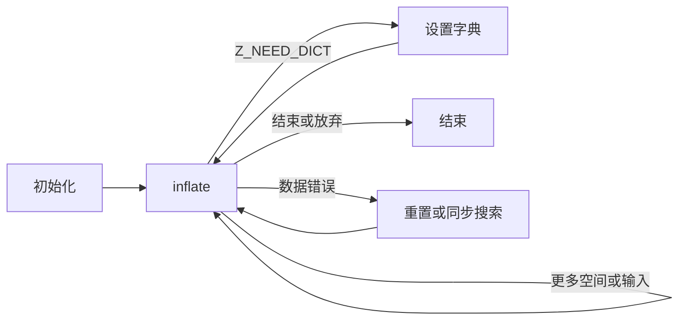

<!-- source-sha256: c61e45aaaba5f4791eed5c2c50403d817be3f40bbe2e2b661836e2e3cc4b0961 -->

# 流式解压

使用 `inflate` 流分批解码输入，同时控制输出空间。初始化时选择 zlib、gzip 或裸 DEFLATE，随后提供更多输入或空间继续，直到完成、请求字典或发生错误。无论出现哪种结果，`inflateEnd` 都可释放解码器。整块缓冲区的 zlib 解码见 [uncompress](utility.md#uncompress2_z)。

| 任务 | 条目 |
| --- | --- |
| 开始或复用 | [初始化](#inflateinit_)、[配置初始化](#inflateinit2_)、[重置](#inflatereset)、[新配置](#inflatereset2)、[保留历史](#inflateresetkeep) |
| 解码或提供元数据 | [解压](#inflate)、[设置字典](#inflatesetdictionary)、[读取历史](#inflategetdictionary)、[gzip 头](#inflategetheader) |
| 恢复或检查 | [同步搜索](#inflatesync)、[同步点](#inflatesyncpoint)、[位置标记](#inflatemark)、[表使用量](#inflatecodesused) |
| 调整或分支 | [预置位](#inflateprime)、[校验](#inflatevalidate)、[距离选项](#inflateundermine)、[复制](#inflatecopy) |
| 释放存储 | [结束](#inflateend) |

这些契约遵循固定版本的 `inflate.c`（上游 `1.4.0.1-motley`）以及 `zlib.h`，采用默认 LP64 Linux 构建，启用 gzip，不启用可选的无效距离或严格距离模式。其余[补丁](../../../../patches/README.md)均不修改 `inflate.c`（来自 PR #1369 的 `inflateCopy` 指针相等判断已并入上游）。这些是聚焦契约：前置条件描述通常的正确用法，有意比函数实际接受的范围窄。前置条件之外、C 仍会处理的情况，写在“错误”或“边界情况”下。超出前置条件的调用并不因此就是未定义行为，也不一定返回错误码。各标签的含义见[契约约定](contracts.md)。

**已证明的内容。** 只证明安全性：每次调用都返回，没有未定义行为和内存错误，只写其目标指明的内容，并且不泄漏（见[安全性](../safety.md)）。各条目在“证明目标”下给出自己的目标，所用的五项和固定用语由[阅读证明目标段落](contracts.md#reading-a-proof-goals-paragraph)定义：目标及其定理；目标适用的条件，按 Lean 命题中的顺序列出；对每一个取值都覆盖的内容；保证的内容（返回、状态、写入、分配）；以及留给其他目标的内容。证明所假设的是那里列出的条件，而不是文档中的前置条件。后置条件、返回值表和各项说明描述的是功能行为：它们读自 C 源码，凡是没有定理陈述的，都**尚未由证明确认**；安全结论不需要它们。哪些目标已完成，见[进度](../../progress.md)。

## 公共条件

调用者与解码器各自保留不同的内容。调用者提供每次调用的输入和输出缓冲区；解码器保留当前解析阶段、尚未用完的位，以及后续复制可能需要的历史。给它换一个输出数组，并不会开始一个新的解码任务。

`next_in` 是未读输入的起点，`avail_in` 是可读字节数；`next_out` 是下一个输出位置，`avail_out` 是从这里开始的剩余可写字节数。例如，一个 5 字节的输出数组在返回时还剩 2 字节空间，就说明它已收到 3 字节。先取走这些字节，再把指针和计数设置为下一块可写区域。

下列所有契约都有**受限定义域**。仅凭 C 指针类型，不能提供这里要求的存储、生命周期或调用历史。

- **存活流**已成功初始化或复制，尚未结束，保留库拥有的状态，且不发生并发调用。使用默认分配器和释放函数。初始化调用接收可写的、不是存活流的流对象，分配器字段为 NULL 或默认函数。
- 可读或可写范围在整个调用期间都具有所述容量。调用者范围与流及流拥有的存储分离。输入与输出范围不重叠。字典目的缓冲区、已挂接的头部记录及其目的缓冲区彼此分离，也与流分离。使用已挂接的头部存储的调用还要求它与输入/输出范围分离。这些限制属于前置条件；各条目的“证明目标”说明其目标假设了其中哪些。
- 调用者拥有流对象及缓冲区。库拥有状态和可选窗口。调用只改变自己的流、流拥有的存储、所述输出范围和任何已挂接的头部目的存储。它绝不释放调用者缓冲区。
- **流检查**拒绝时返回 `Z_STREAM_ERROR`，不发生变化，除非查询或复制契约另有说明。这覆盖 NULL 和可安全读取但未通过检查的记录，不覆盖悬空或任意指针。检查要求有分配器、状态、状态的回指指针和有效的模式。
- 计数器使用 C 无符号位宽并回绕。没有契约假设分配成功。解码、字典或分配错误之后，仍可调用 `inflateEnd`。
- 证明目标里说的是**可达流**，契约里说的是存活流（见[契约约定](contracts.md)）。目标所覆盖的调用会延长流的历史：调用返回后，无论返回哪个状态码，流仍然是可达流，下一次调用的目标随之适用。`inflateEnd` 结束这段历史。
- **结果单元作为值。** `inflateGetDictionary` 通过 `uInt *dictLength` 报告长度。翻译没有把这个单元建模为内存：函数接收该单元的旧值（或者指针为 NULL 这一事实），并返回新值。因此目标不涉及这个单元的地址，也无法表达它与其他对象重叠的情况。



## inflateResetKeep

```c
int ZEXPORT inflateResetKeep(z_streamp strm);
```

重新开始解码，同时保留历史。这是一个未文档化的入口点。

### 返回值与后续调用 {#api-inflateresetkeep-returns}

**返回值类型。** `int` — zlib 状态码

结果说明解码是否已重启，同时保留原有历史。

| 返回值 | 含义与出现条件 | 调用者接下来 |
| --- | --- | --- |
| `Z_OK`<br>**已重启并保留历史** | 存活流通过检查；清空计数、缓冲位和头部挂接，保留窗口历史。 | 仅在有意沿用历史时继续；独立流应使用 inflateReset。 |
| `Z_STREAM_ERROR`<br>**流检查未通过** | 流未通过公共流检查；内容不变。 | 先建立有效流并确定其所有权，再进行后续操作。 |

### 调用条件与效果 {#api-inflateresetkeep-contract}

**定义域。** 受限定义域：任意模式的存活流。

**效果。** 修改状态，不分配或释放。

**前置条件。** 满足公共存活流条件。调用者有意让旧窗口继续供下一个流使用。

**证明目标。**

- **目标。** 不要求它有自己的目标：`zlib.h` 把这个函数声明在“`undocumented functions (not part of the zlib API)`”（未文档化的函数，不属于 zlib API）之下。不过，对可达流的一次调用仍然被覆盖：它是必需的序列目标 `Goal.inflate_sequence_safety`（[Safety/Sequences.lean](../../../../ZlibF/Spec/Safety/Sequences.lean)；其命题是 [Common/Sequences.lean](../../../../ZlibF/Spec/Common/Sequences.lean) 中的 `StreamSequenceSafety`）第二个子句中的一步，因为 `StreamOperation` 列出了这个调用。定理：`Zlib.Inflate.Proofs.inflate_sequence_safety_public`（[public-inflate-sequence-safety.lean](../../../../ZlibF/Proof/public-inflate-sequence-safety.lean)）。
- **适用条件**（该子句的前提；这个调用没有参数条件）：
    1. `strm` 是可达流（`StreamReachable`）；
    2. 平台大小上界成立（`ByteObjectsFit`）。
- **无条件覆盖。** 每一个可达流，无论处于哪种模式：解码之前、块的中途、流结束处，以及数据错误或内存错误之后。
- **保证**（该子句的结论，`StreamCallSafe` 重述了它）。
    - *返回。* 调用返回。
    - *状态。* 流保持其不变量（`StreamInvariant`）。
    - *写入。* 只写流记录和流自己的块。
    - *分配。* 精确的分配账本（`LiveChange`）。
- **不在本目标内。** NULL 流或不一致的流：没有必需目标为这个函数覆盖它。调用之后各字段的值：功能目标 `Goal.inflateResetKeep`（不在计划内；已有定理证明它）。

<details markdown="1" class="ar-return-exact" data-return-exact="inflateResetKeep"><summary>完整返回条件与边界</summary>

**后置条件。** 返回 `Z_OK`。清空总计数、消息、`data_type`、缓冲位、字典已设置状态和头部挂接。使用当前封装重新开始头部/块解码，保留窗口及其历史。使用封装时，若接受 zlib，`adler` 为 1，否则为 0；裸流保持 `adler` 不变。

**边界情况。** 不还原恢复过程改动过的封装设置。流检查失败不改变任何内容。要丢弃历史，用 `inflateReset`。

</details>

## inflateReset

```c
int ZEXPORT inflateReset(z_streamp strm);
```

使用现有配置开始新的独立压缩数据流。

### 返回值与后续调用 {#api-inflatereset-returns}

**返回值类型。** `int` — zlib 状态码

结果说明是否已准备好用原配置解码一个独立的新流。

| 返回值 | 含义与出现条件 | 调用者接下来 |
| --- | --- | --- |
| `Z_OK`<br>**新流已就绪** | 存活流已重置；历史和头部挂接被清空，请求的封装及窗口大小被恢复。 | 设置新输入和输出范围后继续 inflate；最终仍须 inflateEnd。 |
| `Z_STREAM_ERROR`<br>**流检查未通过** | 流未通过公共流检查；内容不变。 | 先建立有效流并确定其所有权，再进行后续操作。 |

### 调用条件与效果 {#api-inflatereset-contract}

**定义域。** 受限定义域：存活流，包括已完成或失败的流。

**效果。** 修改状态，可能释放窗口，绝不分配。

**前置条件。** 满足公共存活流条件。

**证明目标。**

- **目标。** `Goal.inflateReset_safety`（[Safety/Streams.lean](../../../../ZlibF/Spec/Safety/Streams.lean)）；必需。定理：`ZlibF.Spec.Public.StreamCallSafetyProof.inflateReset_safety`（[public-stream-call-safety.lean](../../../../ZlibF/Proof/public-stream-call-safety.lean)）。这个目标有两个子句：对[被拒绝的流](contracts.md#reading-a-proof-goals-paragraph)的拒绝；对可达流的一次调用。`Goal.inflate_refusal`（[Safety/Refusals.lean](../../../../ZlibF/Spec/Safety/Refusals.lean)）也是必需目标，它陈述同一个拒绝。
- **适用条件。** 拒绝子句要求 `strm` 是被拒绝的流（`RefusedInflate`）。对可达流的调用要求（`StreamCallDomain`；这个调用没有参数条件）：
    1. `strm` 是可达流（`StreamReachable`）；
    2. 平台大小上界成立（`ByteObjectsFit`）。
- **无条件覆盖。** 每一个可达流，无论处于哪种模式：解码之前、块的中途、流结束处，以及数据错误或内存错误之后。拒绝子句中：每一个被拒绝的流。
- **保证**（对可达流的调用是 `StreamCallSafe`）。
    - *返回。* 对被拒绝的流，调用返回 `Z_STREAM_ERROR`。对可达流调用时，调用返回。
    - *状态。* 对可达流调用时，流保持其不变量（`StreamInvariant`）。
    - *写入。* 对被拒绝的流不写任何内容：堆不变。对可达流调用时，只写流记录和流自己的块。
    - *分配。* 对可达流调用时，精确的分配账本（`LiveChange`）。
- **不在本目标内。** `zalloc` 和 `zfree` 已设置、而 `state` 是垃圾指针、指向已释放的状态或指向 deflate 状态的流记录：没有目标覆盖对这种记录的这个调用（见[偏离记录](../../deviations.md#note-2-refused-streams)）。返回值和调用之后各字段的值：功能目标 `Goal.inflateReset`（不在计划内；已有定理证明它）。

<details markdown="1" class="ar-return-exact" data-return-exact="inflateReset"><summary>完整返回条件与边界</summary>

**后置条件。** 返回 `Z_OK`。恢复请求的封装和窗口大小，丢弃历史，然后执行 `inflateResetKeep` 所述重置。输入/输出指针和可用计数不变。相同大小的窗口可以保持已分配；不兼容窗口被释放。

**边界情况。** 清空头部挂接。保留 `inflateValidate` 选择的校验设置，同时撤销恢复过程临时改变的封装设置。流检查失败不改变任何内容。

</details>

## inflateReset2

```c
int ZEXPORT inflateReset2(z_streamp strm, int windowBits);
```

重置并选择新的封装和最大窗口大小。

### 返回值与后续调用 {#api-inflatereset2-returns}

**返回值类型。** `int` — zlib 状态码

结果说明新的封装和窗口配置是否已生效，可用于一次全新的解码。

| 返回值 | 含义与出现条件 | 调用者接下来 |
| --- | --- | --- |
| `Z_OK`<br>**新配置已生效** | 流检查通过且 windowBits 被接受；重置解码、丢弃历史和头部挂接，为新封装启用校验。 | 按新格式提供输入和输出范围，然后调用 inflate。 |
| `Z_STREAM_ERROR`<br>**配置或流被拒绝** | windowBits 无效或流检查失败；内容不变。 | 若原流有效，选择可接受配置；流检查失败时先修正流的使用。 |

**判读要点。**

- 接受 -15..-8、0、8..15、16、24..31、32、40..47；具体封装含义见完整契约。

### 调用条件与效果 {#api-inflatereset2-contract}

**定义域。** 受限定义域：存活流和每个有符号 `windowBits` 值。

**效果。** 修改状态，可能释放窗口，绝不分配。

**前置条件。** 满足公共存活流条件。放弃旧的解码过程。

**证明目标。**

- **目标。** `Goal.inflateReset2_safety`（[Safety/Streams.lean](../../../../ZlibF/Spec/Safety/Streams.lean)）；必需。定理：`ZlibF.Spec.Public.StreamCallSafetyProof.inflateReset2_safety`（[public-stream-call-safety.lean](../../../../ZlibF/Proof/public-stream-call-safety.lean)）。这个目标有两个子句：对[被拒绝的流](contracts.md#reading-a-proof-goals-paragraph)的拒绝；对可达流的一次调用。`Goal.inflate_refusal`（[Safety/Refusals.lean](../../../../ZlibF/Spec/Safety/Refusals.lean)）也是必需目标，它陈述同一个拒绝。
- **适用条件。** 拒绝子句要求 `strm` 是被拒绝的流（`RefusedInflate`）。对可达流的调用要求（`StreamCallDomain`；这个调用没有参数条件）：
    1. `strm` 是可达流（`StreamReachable`）；
    2. 平台大小上界成立（`ByteObjectsFit`）。
- **无条件覆盖。** 每一个 `windowBits`，无论是否被接受。每一个可达流，无论处于哪种模式：解码之前、块的中途、流结束处，以及数据错误或内存错误之后。拒绝子句中：每一个被拒绝的流，以及其他参数的每个取值。
- **保证**（对可达流的调用是 `StreamCallSafe`）。
    - *返回。* 对被拒绝的流，调用返回 `Z_STREAM_ERROR`。对可达流调用时，调用返回。
    - *状态。* 对可达流调用时，流保持其不变量（`StreamInvariant`）。
    - *写入。* 对被拒绝的流不写任何内容：堆不变。对可达流调用时，只写流记录和流自己的块。
    - *分配。* 对可达流调用时，精确的分配账本（`LiveChange`）。
- **不在本目标内。** `zalloc` 和 `zfree` 已设置、而 `state` 是垃圾指针、指向已释放的状态或指向 deflate 状态的流记录：没有目标覆盖对这种记录的这个调用（见[偏离记录](../../deviations.md#note-2-refused-streams)）。哪些 `windowBits` 被接受，以及调用之后各字段的值：功能目标 `Goal.inflateReset2`（不在计划内；已有定理证明它）。

<details markdown="1" class="ar-return-exact" data-return-exact="inflateReset2"><summary>完整返回条件与边界</summary>

**后置条件。** 对可接受值返回 `Z_OK`，效果等于使用新请求执行 `inflateReset`。可接受值及含义列于 `inflateInit2_`。为新封装请求启用校验。

**边界情况。** 无效值在任何变化之前返回 `Z_STREAM_ERROR`。改变请求大小会释放不兼容窗口。即使大小相同，待处理头部挂接和历史也会丢弃。

</details>

## inflateInit2_

```c
int ZEXPORT inflateInit2_(z_streamp strm, int windowBits, const char *version, int stream_size);
```

创建采用所选封装和窗口的解码器。

窗口保存近期已经解出的字节，长度／距离引用从中取回旧内容。下表中的“窗口位数”是一个指数 b，表示最多 `2^b` 字节：15 表示 32768 字节。`windowBits` 还通过符号或加上的常数来选择裸流、zlib、gzip 或自动检测，所以这个参数不是字节数。请求 0、16 和 32 把大小交给头部或默认值决定，各自的含义见表。

### 返回值与后续调用 {#api-inflateinit2_-returns}

**返回值类型。** `int` — zlib 状态码

结果说明是否已建立带指定格式的新解码器。仅成功初始化才需要后续结束操作。

| 返回值 | 含义与出现条件 | 调用者接下来 |
| --- | --- | --- |
| `Z_OK`<br>**解码器已建立** | 版本及流大小匹配，状态分配成功且 windowBits 被接受。 | 提供输入和输出范围后调用 inflate；完成或放弃时调用 inflateEnd。 |
| `Z_VERSION_ERROR`<br>**版本或结构大小不匹配** | version 为 NULL、首字节不匹配或 stream_size 错误；在检查 strm 前返回，内容不变。 | 修正版本和结构大小后重新初始化；本次失败无需 inflateEnd。 |
| `Z_STREAM_ERROR`<br>**流或窗口请求被拒绝** | 版本检查通过后 strm 为 NULL；或成功分配状态后发现 windowBits 无效，释放该状态并将 state 置为 NULL。 | 提供可写的、不是存活流的流和可接受的 windowBits 后重新初始化；本次失败无需结束。 |
| `Z_MEM_ERROR`<br>**状态分配失败** | 状态分配失败，保留旧 state 字段；msg 已清空，所需默认分配器字段可能已设置。 | 在资源可用时可重新初始化；本次失败未保留新分配，无需 inflateEnd。 |

### 调用条件与效果 {#api-inflateinit2_-contract}

**定义域。** 受限定义域：新的可写流存储、默认分配器，以及 NULL 或可读版本指针；覆盖所有有符号标量参数。

**效果。** 分配状态。

**前置条件。** 流不是存活流。分配器字段遵循公共约定。只要求版本首字节可读；不检查整个字符串。

**证明目标。**

- **目标。** `Goal.inflateInit2__safety`（[Safety/Initialisation.lean](../../../../ZlibF/Spec/Safety/Initialisation.lean)）；必需。定理：`ZlibF.Spec.Public.InitSafetyProof.inflateInit2__safety`（[public-init-safety.lean](../../../../ZlibF/Proof/public-init-safety.lean)）。
- **适用条件**（`InitArguments`）：
    1. 堆是库堆（`Fresh`、`Uniq`、`LibraryGlobals`）；
    2. `version` 为 NULL，或其首字节可读（`VersionValue`）；
    3. `strm` 为 NULL；或者指向一个可读的流记录，其 `zalloc` 和 `zfree` 各自为 NULL 或默认函数（`DefaultOrNull`）。
- **无条件覆盖。** 每一个 `windowBits`；每一个 `stream_size`；`version` 首字节的每一个取值；记录中其他字段的每一个取值，包括 `state`；每一种分配结果。本目标比前置条件宽：它还覆盖 `strm` 为 NULL、版本或 `stream_size` 不对，以及 `state` 不为 NULL 的记录。如果该记录原本是一个存活流，调用仍然返回，但旧状态仍处于已分配状态，而记录不再指向它：账本如实记下这次泄漏，并不排除它。
- **保证**（`InitResultSafe`）。
    - *返回。* 调用返回。`strm` 为 NULL 时，返回值是 `Z_VERSION_ERROR` 或 `Z_STREAM_ERROR`。
    - *状态。* 返回 `Z_OK` 时，`strm` 是可达流。
    - *写入。* `strm` 为 NULL 时不写任何内容：堆不变。否则只写流记录和调用自己分配的块。
    - *分配。* 返回 `Z_OK` 时，调用分配的每个块都是流自己的块，且不释放任何块（`LiveChange`）。返回其他状态码时，已分配的块与调用前相同。
- **不在本目标内。** `zalloc` 或 `zfree` 是自定义函数的流：在所有目标之外（见[偏离记录](../../deviations.md)）。各种拒绝和各种分配失败分别返回哪个状态码，以及调用之后各字段的值：功能目标 `Goal.inflateInit2_`（不在计划内；已有定理证明它）。确实存在返回 `Z_OK` 的调用：`Goal.inflate_initialisation_domain`（[Safety/Domains.lean](../../../../ZlibF/Spec/Safety/Domains.lean)），必需。

<details markdown="1" class="ar-return-exact" data-return-exact="inflateInit2_"><summary>完整返回条件与边界</summary>

**后置条件。** 返回 `Z_OK` 时，流是存活流，总计数为零，消息为 NULL，`data_type` 为零，没有窗口、历史、缓冲位或头部挂接。zlib/自动检测封装的 `adler` 初始为 1，仅 gzip 的为 0；裸流保持它不变。缓冲区指针和可用计数不变。

可接受的 `windowBits` 值为：

| 值 | 解码器请求 |
| --- | --- |
| -15 至 -8 | 裸 DEFLATE，窗口位数等于其绝对值 |
| 0；8 至 15 | zlib；0 由头部选择大小，否则以该值为最大值 |
| 16；24 至 31 | 仅 gzip；16 使用默认大小，否则为该值减 16 |
| 32；40 至 47 | zlib/gzip 检测；32 使用头部/默认大小，否则为该值减 32 |

**错误。** 版本为 NULL/首字节错误，或 `stream_size` 错误时，在检查 `strm` 前返回 `Z_VERSION_ERROR`，不发生变化。否则，NULL `strm` 返回 `Z_STREAM_ERROR`。窗口参数检查前先尝试分配状态。分配失败返回 `Z_MEM_ERROR`，保留旧 `state` 字段，清空消息，并按需安装默认回调。分配成功后发现无效窗口参数，则返回 `Z_STREAM_ERROR`，释放该状态，将 `state` 置为 NULL。任何失败初始化都不保留新分配。只有成功初始化才需要后续 `inflateEnd`；其窗口可能由后续调用分配。

</details>

## inflateInit_

```c
int ZEXPORT inflateInit_(z_streamp strm, const char *version, int stream_size);
```

创建最大窗口为 32 KiB 的 zlib 解码器。

### 返回值与后续调用 {#api-inflateinit_-returns}

**返回值类型。** `int` — zlib 状态码

结果说明是否已建立最大窗口为 32 KiB 的 zlib 解码器。

| 返回值 | 含义与出现条件 | 调用者接下来 |
| --- | --- | --- |
| `Z_OK`<br>**zlib 解码器已建立** | 等价于 windowBits 为 15 的 inflateInit2_，状态分配成功。 | 用 inflate 解码 zlib 输入；完成或放弃后调用 inflateEnd。 |
| `Z_VERSION_ERROR`<br>**版本或结构大小不匹配** | version 为 NULL、首字节不匹配或 stream_size 错误；不检查流且内容不变。 | 修正版本及结构大小后重新初始化；本次失败无需 inflateEnd。 |
| `Z_STREAM_ERROR`<br>**流指针被拒绝** | 版本检查通过后 strm 为 NULL。 | 提供可写的、不是存活流的流后重新初始化；本次失败无需结束。 |
| `Z_MEM_ERROR`<br>**状态分配失败** | 未能分配状态；保留旧 state，msg 和默认分配器字段可能已改变。 | 资源可用时可重新初始化；本次失败未保留新分配，无需 inflateEnd。 |

### 调用条件与效果 {#api-inflateinit_-contract}

**定义域。** 受限定义域：与 `inflateInit2_` 相同的存储、版本和分配器定义域。

**效果。** 分配状态。

**前置条件。** 满足 `inflateInit2_` 的前置条件。

**证明目标。**

- **目标。** `Goal.inflateInit__safety`（[Safety/Initialisation.lean](../../../../ZlibF/Spec/Safety/Initialisation.lean)）；必需。定理：`ZlibF.Spec.Public.InitSafetyProof.inflateInit__safety`（[public-init-safety.lean](../../../../ZlibF/Proof/public-init-safety.lean)）。
- **适用条件**（`InitArguments`）：
    1. 堆是库堆（`Fresh`、`Uniq`、`LibraryGlobals`）；
    2. `version` 为 NULL，或其首字节可读（`VersionValue`）；
    3. `strm` 为 NULL；或者指向一个可读的流记录，其 `zalloc` 和 `zfree` 各自为 NULL 或默认函数（`DefaultOrNull`）。
- **无条件覆盖。** 每一个 `stream_size`；`version` 首字节的每一个取值；记录中其他字段的每一个取值，包括 `state`；每一种分配结果。本目标比前置条件宽：它还覆盖 `strm` 为 NULL、版本或 `stream_size` 不对，以及 `state` 不为 NULL 的记录。如果该记录原本是一个存活流，调用仍然返回，但旧状态仍处于已分配状态，而记录不再指向它：账本如实记下这次泄漏，并不排除它。
- **保证**（`InitResultSafe`）。
    - *返回。* 调用返回。`strm` 为 NULL 时，返回值是 `Z_VERSION_ERROR` 或 `Z_STREAM_ERROR`。
    - *状态。* 返回 `Z_OK` 时，`strm` 是可达流。
    - *写入。* `strm` 为 NULL 时不写任何内容：堆不变。否则只写流记录和调用自己分配的块。
    - *分配。* 返回 `Z_OK` 时，调用分配的每个块都是流自己的块，且不释放任何块（`LiveChange`）。返回其他状态码时，已分配的块与调用前相同。
- **不在本目标内。** `zalloc` 或 `zfree` 是自定义函数的流：在所有目标之外（见[偏离记录](../../deviations.md)）。各种拒绝和各种分配失败分别返回哪个状态码，以及调用之后各字段的值：功能目标 `Goal.inflateInit_`（不在计划内；已有定理证明它）。确实存在返回 `Z_OK` 的调用：`Goal.inflate_initialisation_domain`（[Safety/Domains.lean](../../../../ZlibF/Spec/Safety/Domains.lean)），必需。

<details markdown="1" class="ar-return-exact" data-return-exact="inflateInit_"><summary>完整返回条件与边界</summary>

**后置条件。** 精确等于 `inflateInit2_(strm, 15, version, stream_size)`。成功后接受窗口不超过 32 KiB 的 zlib 流，拥有一项状态分配。

**错误。** 与 `inflateInit2_` 相同的版本、NULL 流、分配失败及清理行为。后续解码不会把 gzip 或裸流的字节作为 zlib 接受。

</details>

## inflatePrime

```c
int ZEXPORT inflatePrime(z_streamp strm, int bits, int value);
```

在下一个输入字节之前提供位，或清空缓冲位。

### 返回值与后续调用 {#api-inflateprime-returns}

**返回值类型。** `int` — zlib 状态码

结果说明位缓冲区是否接受了清空或补位请求。

| 返回值 | 含义与出现条件 | 调用者接下来 |
| --- | --- | --- |
| `Z_OK`<br>**位请求已生效** | bits 为负时清空缓冲；为零时不变；为 1..16 且能放入 32 位缓冲时追加 value 的低 bits 位。 | 在允许的裸流调用位置继续 inflate；补入的位先于 next_in。 |
| `Z_STREAM_ERROR`<br>**位请求或流被拒绝** | bits 大于 16、剩余位空间不足或流检查失败；内容不变。 | 有效流上修正补位请求；流检查失败则先修正流的使用。 |

### 调用条件与效果 {#api-inflateprime-contract}

**定义域。** 受限定义域：第一次解码前，或在已报告的块/头部边界处的存活裸流；覆盖每个有符号 `bits` 和 `value`。

**效果。** 只修改状态。

**前置条件。** 满足公共存活流条件和所述位预置调用顺序。

**证明目标。**

- **目标。** `Goal.inflatePrime_safety`（[Safety/Streams.lean](../../../../ZlibF/Spec/Safety/Streams.lean)）；必需。定理：`ZlibF.Spec.Public.StreamCallSafetyProof.inflatePrime_safety`（[public-stream-call-safety.lean](../../../../ZlibF/Proof/public-stream-call-safety.lean)）。这个目标有两个子句：对[被拒绝的流](contracts.md#reading-a-proof-goals-paragraph)的拒绝；对可达流的一次调用。
- **适用条件。** 拒绝子句要求 `strm` 是被拒绝的流（`RefusedInflate`）。对可达流的调用要求（`StreamCallDomain`；这个调用没有参数条件）：
    1. `strm` 是可达流（`StreamReachable`）；
    2. 平台大小上界成立（`ByteObjectsFit`）。
- **无条件覆盖。** 每一个 `bits` 和 `value`。每一个可达流，无论处于哪种模式：解码之前、块的中途、流结束处，以及数据错误或内存错误之后。本目标比前置条件宽：前置条件要求裸流和特定的调用位置。拒绝子句中：每一个被拒绝的流，以及其他参数的每个取值。
- **保证**（对可达流的调用是 `StreamCallSafe`）。
    - *返回。* 对被拒绝的流，调用返回 `Z_STREAM_ERROR`。对可达流调用时，调用返回。
    - *状态。* 对可达流调用时，流保持其不变量（`StreamInvariant`）。
    - *写入。* 对被拒绝的流不写任何内容：堆不变。对可达流调用时，只写流记录和流自己的块。
    - *分配。* 对可达流调用时，精确的分配账本（`LiveChange`）。
- **不在本目标内。** `zalloc` 和 `zfree` 已设置、而 `state` 是垃圾指针、指向已释放的状态或指向 deflate 状态的流记录：没有目标覆盖对这种记录的这个调用（见[偏离记录](../../deviations.md#note-2-refused-streams)）。返回值和调用之后的位缓冲区：功能目标 `Goal.inflatePrime`（不在计划内；已有定理证明它）。

<details markdown="1" class="ar-return-exact" data-return-exact="inflatePrime"><summary>完整返回条件与边界</summary>

**后置条件。** 零位返回 `Z_OK`，不发生变化。负位数清空位缓冲区。1 至 16 位且能放入 32 位缓冲区时，返回 `Z_OK`，将 `value` 的低 `bits` 位追加到已有位之上。`value` 为负时，追加的是其二进制补码表示的低 `bits` 位。这些位先于 `next_in` 使用。

**错误。** 超过 16 位、位缓冲区空间不足或流检查失败，返回 `Z_STREAM_ERROR`，不发生变化。不更新 `data_type`。C 不强制执行裸流限制或调用顺序限制。

</details>

## inflate

```c
int ZEXPORT inflate(z_streamp strm, int flush);
```

消费压缩字节，写入解码字节，跨调用保留状态。

一次调用只使用交给它的输入和输出空间。返回时先看它推进了多少，再看返回码，以决定是继续、提供字典、停止还是处理错误。`flush` 请求的是停止点或完成方式，不是压缩级别。输出缓冲区写满不表示流已经解完，输入用完也不表示数据已损坏。

### 返回值与后续调用 {#api-inflate-returns}

**返回值类型。** `int` — zlib 状态码

结果区分本次推进、一个流的完成、字典请求和错误；推进不代表解码结束。

| 返回值 | 含义与出现条件 | 调用者接下来 |
| --- | --- | --- |
| `Z_OK`<br>**已推进，尚未完成** | 已消费输入或产生输出，但尚未完成一个流；也可能因指定的块/头部边界而停下。 | 按需提供更多输入或输出空间后继续 inflate。 |
| `Z_STREAM_END`<br>**一个流或成员已完成** | 已完成一个所选格式的流，包括启用的尾部校验；已完成流的重复调用也返回此值。 | 保留未读尾部输入；调用 inflateEnd，或在处理下一个 gzip 成员前重置。 |
| `Z_NEED_DICT`<br>**需要 zlib 字典** | zlib 头部要求预置字典；strm->adler 给出所需字典的标识。 | 用 inflateSetDictionary 提供正确字典，成功后继续；放弃则调用 inflateEnd。 |
| `Z_BUF_ERROR`<br>**无法取得所需的推进或完成** | 本次没有输入/输出推进，或 Z_FINISH 请求无法完成；Z_FINISH 将本来为 Z_OK 的结果改为此值。 | 按需提供输入或输出空间后继续；不能仅凭此值判定数据损坏。 |
| `Z_DATA_ERROR`<br>**检测到数据错误** | 检测到格式错误或启用的校验和/长度错误；可能已经产生输出。数据错误状态会保持。 | 使用 inflateReset 放弃当前流，或用 inflateSync 尝试恢复，或调用 inflateEnd。 |
| `Z_MEM_ERROR`<br>**历史窗口分配失败** | 窗口分配失败；可能已经消费输入或写出数据，且错误状态会保持。 | 读取已更新的指针及可用计数；重置后再开始，或调用 inflateEnd。 |
| `Z_STREAM_ERROR`<br>**流或缓冲条件不满足** | 流/缓冲检查失败，或 inflateSync 恢复搜索尚未完成。 | 流有效时修正缓冲区参数；恢复搜索未完成时继续 inflateSync；其他情况先建立有效流。 |

### 调用条件与效果 {#api-inflate-contract}

**定义域。** 受限定义域：满足公共缓冲区/头部生命周期条件的存活流；覆盖任意压缩字节、任意输入/输出切分方式和任意有符号 `flush` 值。

**效果。** 修改流、输出和已挂接的头部存储；可能分配历史窗口。

**前置条件。** `next_in` 描述 `avail_in` 个可读字节，仅在计数为零时可为 NULL。即使 `avail_out` 为零，`next_out` 也非 NULL，并描述该数量的可写字节。已挂接的头部及其缓冲区保持可写。调用可以提供更多输入/空间继续，可以提供请求的字典，也可以在成功重置/恢复之后继续。终止/错误状态下重复调用的行为见下文。

**记账。** 正常返回，包括数据错误和缓冲区错误，按已消费/已产生字节数更新总计数，并更新已启用的输出校验和。`Z_NEED_DICT` 把已消费的头部字节计入总计数，并让 `adler` 保持为字典标识。迟发的窗口分配失败可能发生在消费输入和写入输出之后：指针/计数已经反映这些操作，但正常的最终总计数/校验和/`data_type` 记账被跳过。一次调用已消费的输入不必全部属于某个有效的流：后一次调用可以拒绝该流而不再消费输入。

**所有权。** 新窗口存储归流所有，仍可用于重置/结束，包括错误之后。一次调用的 `Z_FINISH` 完成可能无需窗口。拼接 gzip 成员要求成员之间重置。错误消息是借用的静态字符串。缓冲区和流检查的拒绝不改变任何内容。

**证明目标。**

- **目标。** `Goal.inflate_safety`（[Safety/Streams.lean](../../../../ZlibF/Spec/Safety/Streams.lean)）；必需。定理：`ZlibF.Spec.Public.StreamCallSafetyProof.inflate_safety`（[public-stream-call-safety.lean](../../../../ZlibF/Proof/public-stream-call-safety.lean)）。这个目标有两个子句：对[被拒绝的流](contracts.md#reading-a-proof-goals-paragraph)的拒绝；对可达流的一次调用。`Goal.inflate_refusal`（[Safety/Refusals.lean](../../../../ZlibF/Spec/Safety/Refusals.lean)）也是必需目标，它陈述同一个拒绝。
- **适用条件。** 拒绝子句要求 `strm` 是被拒绝的流（`RefusedInflate`），并要求模型的内存在下一个未用块号及其之后没有已分配的块（`Fresh`，这是对模型的条件，不是对调用者的要求）。对可达流的调用要求（`StreamCallDomain`）：
    1. `strm` 是可达流（`StreamReachable`）；
    2. 平台大小上界成立（`ByteObjectsFit`）；
    3. `next_in` 为 NULL，或指向 `avail_in` 个可读字节；`next_out` 为 NULL，或指向 `avail_out` 个可写字节；两个范围都不在流自己的块内，且互不重叠（`StreamBuffers`）；
    4. 如果挂接了头部记录（已交给 `inflateGetHeader`，此后没有被重置解除）：该记录存活，且不是流自己的块；它的 `extra`、`name`、`comment` 指针各自为 NULL，或分别指向 `extra_max`、`name_max`、`comm_max` 个可写字节，且这些字节在流自己的块之外（`HeaderMemory`）。本目标在每次调用时都要求这一点，头部读完之后也是如此；
    5. 在把 gzip 头读入该记录期间：`extra` 缓冲区与尚未读取的输入不重叠；在读取 extra 字段期间，记录的 `extra_len` 不小于尚待读取的长度（`InflateHeaderProgress`）。这是调用时对记录的条件，不论这个字段是谁写的：`inflate` 会写流所挂接记录中的 `extra_len`，所以挂接在同一个记录上的两个流（例如 `inflateCopy` 之后）在目标之外。条件 4 和 5 合起来就是 `ActiveHeader`。
- **无条件覆盖。** 每一个 `flush` 值；每一种输入字节序列，无论格式是否正确；每一种分配结果。本目标比前置条件宽：`next_out` 可以为 NULL，`next_in` 也可以在 `avail_in` 非零时为 NULL。C 对这两种情况都返回 `Z_STREAM_ERROR` 拒绝。拒绝子句中：每一个被拒绝的流，以及其他参数的每个取值。
- **保证**（对可达流的调用是 `StreamCallSafe`）。
    - *返回。* 对被拒绝的流，调用返回 `Z_STREAM_ERROR`。对可达流调用时，调用返回。
    - *状态。* 对可达流调用时，流保持其不变量（`StreamInvariant`）。
    - *写入。* 对被拒绝的流，不写调用前已分配的任何块（`Frame`）；这个子句没有写成“堆不变”，因为翻译会创建并释放一个四字节的局部数组。对可达流调用时，只写流记录、流自己的块、已挂接的头部记录、`next_out` 处的 `avail_out` 个字节，以及头部的 `extra`、`name`、`comment` 缓冲区（分别为 `extra_max`、`name_max`、`comm_max` 个字节）。
    - *分配。* 对被拒绝的流，已分配的块与调用前相同（`LiveChange`）。对可达流调用时，精确的分配账本（`LiveChange`）。
- **不在本目标内。** `zalloc` 和 `zfree` 已设置、而 `state` 是垃圾指针、指向已释放的状态或指向 deflate 状态的流记录：没有目标覆盖对这种记录的这个调用（见[偏离记录](../../deviations.md#note-2-refused-streams)）。返回哪个状态码、写出哪些字节：功能目标 `Goal.inflate`（不在计划内；已有定理证明它）。

<details markdown="1" class="ar-return-exact" data-return-exact="inflate"><summary>完整返回条件与边界</summary>

**后置条件。** 在所述范围内读写。按已消费/已产生字节数推进指针并减少可用计数。从初始化/重置开始的普通运行中，如果所选格式有效且字典正确，累计输出是解码数据的前缀，在 `Z_STREAM_END` 时等于完整数据。畸形字节也在定义域内：检测到格式错误，或启用的校验和/长度检查失败时，返回 `Z_DATA_ERROR`，此前可能已有输出。仅有输入不完整时需要更多输入；不必把它报告为数据错误。

各返回码的含义和下一步操作，见[返回值与后续调用](#api-inflate-returns)下的表。

**边界情况。** 允许输入或输出空间为零。`Z_BLOCK` 在头部或块边界停止；`Z_TREES` 还在块描述之后停止。`Z_FINISH` 将本来为 `Z_OK` 的结果改为 `Z_BUF_ERROR`。其他有符号刷新值被接受，行为与 `Z_NO_FLUSH` 相同。正常返回时，`data_type` 记录未用位数；最终块再加 64，头部/块边界再加 128，块头之后再加 256。数据和内存错误会保持；完成的流重复返回 `Z_STREAM_END`。

</details>

## inflateEnd

```c
int ZEXPORT inflateEnd(z_streamp strm);
```

释放解码器存储，包括解码被放弃或失败的情况。

### 返回值与后续调用 {#api-inflateend-returns}

**返回值类型。** `int` — zlib 状态码

结果说明解码器拥有的状态和窗口是否已释放；无需先解码完成。

| 返回值 | 含义与出现条件 | 调用者接下来 |
| --- | --- | --- |
| `Z_OK`<br>**解码器已释放** | 存活流通过检查；可选窗口和状态恰好释放一次，state 置为 NULL。 | 可释放调用者缓冲区；再次使用该流须重新初始化。 |
| `Z_STREAM_ERROR`<br>**未执行释放** | 流检查失败，包括已经结束的流；不释放任何内容。 | 确认流的生命周期和所有权；不要对已结束的流再次结束。 |

### 调用条件与效果 {#api-inflateend-contract}

**定义域。** 受限定义域：每种模式下的存活流，包括分配/数据错误之后。

**效果。** 修改流并释放拥有的存储。

**前置条件。** 满足公共存活流条件。

**证明目标。**

- **目标。** `Goal.inflateEnd_safety`（[Safety/Streams.lean](../../../../ZlibF/Spec/Safety/Streams.lean)）；必需。定理：`ZlibF.Spec.Public.StreamCallSafetyProof.inflateEnd_safety`（[public-stream-call-safety.lean](../../../../ZlibF/Proof/public-stream-call-safety.lean)）。这个目标有两个子句：对[被拒绝的流](contracts.md#reading-a-proof-goals-paragraph)的拒绝；可达流的结束。`Goal.inflate_refusal`（[Safety/Refusals.lean](../../../../ZlibF/Spec/Safety/Refusals.lean)）也是必需目标，它陈述同一个拒绝。
- **适用条件。** 拒绝子句要求 `strm` 是被拒绝的流（`RefusedInflate`）。可达流的结束要求 `strm` 是可达流（`StreamReachable`）；不要求平台大小上界。
- **无条件覆盖。** 每一个可达流，无论处于哪种模式：解码之前、块的中途、流结束处，以及数据错误或内存错误之后。拒绝子句中：每一个被拒绝的流。
- **保证。**
    - *返回。* 对被拒绝的流，调用返回 `Z_STREAM_ERROR`。对可达流调用时，调用返回，返回值为 `Z_OK`。
    - *状态。* 对可达流调用时，调用之后 `strm->state` 为 NULL。
    - *写入。* 对被拒绝的流不写任何内容：堆不变。对可达流调用时，只写流记录和流自己的块。
    - *分配。* 对可达流调用时，精确的分配账本（`LiveChange`）：流自己的块被释放；除此之外不释放任何块，也不分配任何块。
- **不在本目标内。** `zalloc` 和 `zfree` 已设置、而 `state` 是垃圾指针、指向已释放的状态或指向 deflate 状态的流记录：没有目标覆盖对这种记录的这个调用（见[偏离记录](../../deviations.md#note-2-refused-streams)）。流的其他字段的值：功能目标 `Goal.inflateEnd`（不在计划内；已有定理证明它）。

<details markdown="1" class="ar-return-exact" data-return-exact="inflateEnd"><summary>完整返回条件与边界</summary>

**后置条件。** 返回 `Z_OK`，对可选窗口和状态恰好释放一次，将 `state` 置为 NULL。其他流字段和调用者缓冲区不变。不分配，使用默认释放函数时不可能返回 `Z_MEM_ERROR`。

**边界情况。** 不要求流已完成，也不把数据不完整报告为错误。流检查失败，包括流已经结束，返回 `Z_STREAM_ERROR`，不释放任何内容。再次使用前须重新初始化。

</details>

## inflateGetDictionary

```c
int ZEXPORT inflateGetDictionary(z_streamp strm, Bytef *dictionary, uInt *dictLength);
```

读取保留的滑动历史，从最旧字节开始。

### 返回值与后续调用 {#api-inflategetdictionary-returns}

**返回值类型。** `int` — zlib 状态码

返回值报告查询是否成功；历史字节数写入 dictLength，而非作为返回值。

| 返回值 | 含义与出现条件 | 调用者接下来 |
| --- | --- | --- |
| `Z_OK`<br>**历史查询成功** | 流检查通过；非 NULL dictionary 接收从旧到新的历史，非 NULL dictLength 接收其字节数。 | 使用所请求的目的地址中的结果；流可继续使用，历史为空也有效。 |
| `Z_STREAM_ERROR`<br>**查询被拒绝** | 流检查失败；不写入任何目的地址。 | 不要把目的地址中的旧值当作本次结果；先建立有效流。 |

### 调用条件与效果 {#api-inflategetdictionary-contract}

**定义域。** 受限定义域：存活流，可带可写的字典和长度目的地址。

**效果。** 观察状态，只写入这些目的地址。

**前置条件。** 非 NULL 字典具有容纳保留历史的空间；32768 字节总是足够。非 NULL 的 `dictLength` 指向可写 `uInt` 存储。

**证明目标。**

- **目标。** `Goal.inflateGetDictionary_safety`（[Safety/Streams.lean](../../../../ZlibF/Spec/Safety/Streams.lean)）；必需。定理：`ZlibF.Spec.Public.StreamCallSafetyProof.inflateGetDictionary_safety`（[public-stream-call-safety.lean](../../../../ZlibF/Proof/public-stream-call-safety.lean)）。这个目标有两个子句：对[被拒绝的流](contracts.md#reading-a-proof-goals-paragraph)的拒绝；对可达流的一次调用。`Goal.inflate_refusal`（[Safety/Refusals.lean](../../../../ZlibF/Spec/Safety/Refusals.lean)）也是必需目标，它陈述同一个拒绝。
- **适用条件。** 拒绝子句要求 `strm` 是被拒绝的流（`RefusedInflate`）。对可达流的调用要求（`StreamCallDomain`）：
    1. `strm` 是可达流（`StreamReachable`）；
    2. 平台大小上界成立（`ByteObjectsFit`）；
    3. `dictionary` 为 NULL，或指向与窗口当前所存字节数相同的可写字节（`state->whave`，不超过 32768），且在流自己的块之外（`CallerRange`）。
- **无条件覆盖。** 每一个可达流，无论处于哪种模式：解码之前、块的中途、流结束处，以及数据错误或内存错误之后。在翻译中 `dictLength` 是一个值而不是内存（见[公共条件](#common-conditions)），所以本目标对这个指针没有要求，而前置条件要求它指向可写的 `uInt`。拒绝子句中：每一个被拒绝的流，以及其他参数的每个取值。
- **保证**（对可达流的调用是 `StreamCallSafe`）。
    - *返回。* 对被拒绝的流，调用返回 `Z_STREAM_ERROR`，长度值保持传入时的值。对可达流调用时，调用返回。
    - *状态。* 对可达流调用时，流保持其不变量（`StreamInvariant`）。
    - *写入。* 对被拒绝的流不写任何内容：堆不变。对可达流调用时，只写流记录、流自己的块，以及 `dictionary` 起 `state->whave` 个字节范围内的字节，也就是调用复制的那些字节；`dictionary` 为 `NULL` 时，不写调用者的内存。
    - *分配。* 对可达流调用时，精确的分配账本（`LiveChange`）。
- **不在本目标内。** `zalloc` 和 `zfree` 已设置、而 `state` 是垃圾指针、指向已释放的状态或指向 deflate 状态的流记录：没有目标覆盖对这种记录的这个调用（见[偏离记录](../../deviations.md#note-2-refused-streams)）。复制出的字节和报告的长度：功能目标 `Goal.inflateGetDictionary`（不在计划内；已有定理证明它）。

<details markdown="1" class="ar-return-exact" data-return-exact="inflateGetDictionary"><summary>完整返回条件与边界</summary>

**后置条件。** 返回 `Z_OK`。`dictionary` 非 NULL 时复制历史，`dictLength` 非 NULL 时存入历史大小。不分配/释放；流不变。

**边界情况。** 任一目的地址均可为 NULL。新历史为空。若一个流完成时从未分配窗口，即使已经产生输出，它的历史也可能为空。流检查失败不写入任何内容。

</details>

## inflateSetDictionary

```c
int ZEXPORT inflateSetDictionary(z_streamp strm, const Bytef *dictionary, uInt dictLength);
```

设置或补充可供向后匹配使用的字节。

### 返回值与后续调用 {#api-inflatesetdictionary-returns}

**返回值类型。** `int` — zlib 状态码

结果区分字典安装成功、标识不匹配和流/内存错误。

| 返回值 | 含义与出现条件 | 调用者接下来 |
| --- | --- | --- |
| `Z_OK`<br>**字典已安装** | 裸流接受字典，或等待字典的 zlib 流标识匹配；已保留可用窗口后缀。 | 继续 inflate；输入/输出指针和总计数未推进。 |
| `Z_DATA_ERROR`<br>**zlib 字典标识不匹配** | 给定字典的完整 Adler 标识与所需标识不同；流不变。 | 可尝试另一个字典；放弃则调用 inflateEnd。 |
| `Z_STREAM_ERROR`<br>**字典请求被拒绝** | dictionary 为 NULL、流检查失败，或带封装的流并未等待字典。 | 仅在有效的裸流或等待字典的 zlib 流上，按契约提供非 NULL 字典。 |
| `Z_MEM_ERROR`<br>**窗口分配失败** | 历史窗口分配失败，流进入内存错误模式。 | 先重置再开始新的解码，或调用 inflateEnd 释放状态。 |

### 调用条件与效果 {#api-inflatesetdictionary-contract}

**定义域。** 受限定义域：在 `Z_NEED_DICT` 后等待的存活 zlib 流，或处于任意调用边界的存活裸流。

**效果。** 修改历史，可能分配窗口。

**前置条件。** `dictionary` 非 NULL，描述 `dictLength` 个可读字节，即使长度为零也如此。要产生正确输出，它须与压缩器字典一致。

**证明目标。**

- **目标。** `Goal.inflateSetDictionary_safety`（[Safety/Streams.lean](../../../../ZlibF/Spec/Safety/Streams.lean)）；必需。定理：`ZlibF.Spec.Public.StreamCallSafetyProof.inflateSetDictionary_safety`（[public-stream-call-safety.lean](../../../../ZlibF/Proof/public-stream-call-safety.lean)）。这个目标有两个子句：对[被拒绝的流](contracts.md#reading-a-proof-goals-paragraph)的拒绝；对可达流的一次调用。`Goal.inflate_refusal`（[Safety/Refusals.lean](../../../../ZlibF/Spec/Safety/Refusals.lean)）也是必需目标，它陈述同一个拒绝。
- **适用条件。** 拒绝子句要求 `strm` 是被拒绝的流（`RefusedInflate`）。对可达流的调用要求（`StreamCallDomain`）：
    1. `strm` 是可达流（`StreamReachable`）；
    2. 平台大小上界成立（`ByteObjectsFit`）；
    3. `dictionary` 为 NULL，或指向 `dictLength` 个可读字节，且在流自己的块之外（`CallerRange`）。
- **无条件覆盖。** 每一个 `dictLength` 和每一种字典内容；每一种分配结果。每一个可达流，无论处于哪种模式：解码之前、块的中途、流结束处，以及数据错误或内存错误之后。拒绝子句中：每一个被拒绝的流，以及其他参数的每个取值。
- **保证**（对可达流的调用是 `StreamCallSafe`）。
    - *返回。* 对被拒绝的流，调用返回 `Z_STREAM_ERROR`。对可达流调用时，调用返回。
    - *状态。* 对可达流调用时，流保持其不变量（`StreamInvariant`）。
    - *写入。* 对被拒绝的流不写任何内容：堆不变。对可达流调用时，只写流记录和流自己的块。
    - *分配。* 对可达流调用时，精确的分配账本（`LiveChange`）。
- **不在本目标内。** `zalloc` 和 `zfree` 已设置、而 `state` 是垃圾指针、指向已释放的状态或指向 deflate 状态的流记录：没有目标覆盖对这种记录的这个调用（见[偏离记录](../../deviations.md#note-2-refused-streams)）。返回哪个状态码，以及调用之后的历史：功能目标 `Goal.inflateSetDictionary`（不在计划内；已有定理证明它）。

<details markdown="1" class="ar-return-exact" data-return-exact="inflateSetDictionary"><summary>完整返回条件与边界</summary>

**后置条件。** 保留“旧历史后接新字典”这一序列的最后一个窗口大小的后缀后，返回 `Z_OK`。整个给定字典都参与 zlib 标识检查。调用者字节被复制，不保留其存储，也不释放它。

**错误。** 错误的 zlib 标识返回 `Z_DATA_ERROR`，不发生变化；可以尝试另一个字典。NULL 字典、流检查失败，或带封装的流并未等待字典，返回 `Z_STREAM_ERROR`。分配失败返回 `Z_MEM_ERROR`，使流处于内存错误模式，仍可结束。

**边界情况。** gzip 没有预置字典路径。裸模式不检查标识；错误字典可能产生错误输出或较晚的错误。接受零长度的裸流字典。不推进输入/输出指针或总计数。

</details>

## inflateGetHeader

```c
int ZEXPORT inflateGetHeader(z_streamp strm, gz_headerp head);
```

挂接调用者存储，用于下一个 gzip 头。

gzip 头可以带有 extra 字节、文件名和注释。调用者分别提供这三类结果的目的地址与容量：`extra`／`extra_max`、`name`／`name_max`、`comment`／`comm_max`，容量均以字节计。挂接只保存这些地址；真正解析头部并填充结果的是后续 `inflate` 调用。

### 返回值与后续调用 {#api-inflategetheader-returns}

**返回值类型。** `int` — zlib 状态码

返回值只说明头部目的存储是否已挂接；解析进度稍后由 head->done 表示。

| 返回值 | 含义与出现条件 | 调用者接下来 |
| --- | --- | --- |
| `Z_OK`<br>**头部目的存储已挂接** | 有效流支持 gzip，挂接 head 并将 head->done 置为 0；尚未解析头部。 | 保持所有已挂接的存储有效并调用 inflate；通过 done 查看后续结果。 |
| `Z_STREAM_ERROR`<br>**挂接被拒绝** | 流检查失败或请求未启用 gzip 支持；内容不变。 | 先建立支持 gzip 的有效流，再在解码前挂接存储。 |

### 调用条件与效果 {#api-inflategetheader-contract}

**定义域。** 受限定义域：初始化/重置后、解码前，支持 gzip 的存活流。

**效果。** 挂接借用存储，写入 `head->done`。

**前置条件。** `head` 非 NULL 且可写。其 `extra`、`name`、`comment` 指针为 NULL，或分别具有可写容量 `extra_max`、`name_max`、`comm_max`。所有已挂接的存储保持有效，直到头部解析结束或请求被清空。头部记录及其目的缓冲区彼此分离，并与流、流拥有的存储，以及使用它们的调用的输入/输出范围分离。

**证明目标。**

- **目标。** `Goal.inflateGetHeader_safety`（[Safety/Streams.lean](../../../../ZlibF/Spec/Safety/Streams.lean)）；必需。定理：`ZlibF.Spec.Public.StreamCallSafetyProof.inflateGetHeader_safety`（[public-stream-call-safety.lean](../../../../ZlibF/Proof/public-stream-call-safety.lean)）。这个目标有两个子句：对[被拒绝的流](contracts.md#reading-a-proof-goals-paragraph)的拒绝；对可达流的一次调用。
- **适用条件。** 拒绝子句要求 `strm` 是被拒绝的流（`RefusedInflate`）。对可达流的调用要求（`StreamCallDomain`）：
    1. `strm` 是可达流（`StreamReachable`）；
    2. 平台大小上界成立（`ByteObjectsFit`）；
    3. `head` 不为 NULL，指向一个存活的头部记录，且该记录不是流自己的块；它的 `extra`、`name`、`comment` 指针各自为 NULL，或分别指向 `extra_max`、`name_max`、`comm_max` 个可写字节，且这些字节在流自己的块之外（`HeaderMemory`；`head` 不为 NULL 这一条由 `StreamArguments` 另加）。
- **无条件覆盖。** 每一个可达流，无论处于哪种模式：解码之前、块的中途、流结束处，以及数据错误或内存错误之后。本目标比前置条件宽：流不必支持 gzip。拒绝子句中：每一个被拒绝的流，以及其他参数的每个取值。
- **保证**（对可达流的调用是 `StreamCallSafe`）。
    - *返回。* 对被拒绝的流，调用返回 `Z_STREAM_ERROR`。对可达流调用时，调用返回。
    - *状态。* 对可达流调用时，流保持其不变量（`StreamInvariant`）。
    - *写入。* 对被拒绝的流不写任何内容：堆不变。对可达流调用时，只写流记录、流自己的块和头部记录 `head`。
    - *分配。* 对可达流调用时，精确的分配账本（`LiveChange`）。
- **不在本目标内。** 对可达流调用而 `head` 为 NULL：在所有安全目标之外（见[偏离记录](../../deviations.md)中“头部参数”一行）。流不支持 gzip 时，C 在用到 `head` 之前就返回 `Z_STREAM_ERROR`；功能目标 `Goal.inflateGetHeader` 陈述了这个返回值。`zalloc` 和 `zfree` 已设置、而 `state` 是垃圾指针、指向已释放的状态或指向 deflate 状态的流记录：没有目标覆盖对这种记录的这个调用（见[偏离记录](../../deviations.md#note-2-refused-streams)）。返回值，以及后续 `inflate` 调用在记录中存入的内容：功能目标 `Goal.inflateGetHeader`（不在计划内；已有定理证明它）。

<details markdown="1" class="ar-return-exact" data-return-exact="inflateGetHeader"><summary>完整返回条件与边界</summary>

**后置条件。** 返回 `Z_OK`，保留指针，将 `done` 置为 0。后续 `inflate` 调用填充标量字段和可用缓冲区前缀。存在 extra 字段时，`extra_len` 为实际长度；不存在时，`extra` 变为 NULL，`extra_len` 不变。只有终止符能放下时，名称/注释才以零终止。缺失的可选字段使对应指针变为 NULL。完成时将 `done` 置为 1；自动检测到 zlib 时置为 -1。

**边界情况。** 不分配，也不转移所有权。重置清空挂接。流检查失败或请求不支持 gzip 时，返回 `Z_STREAM_ERROR`，不发生变化。对已接受的请求传入 NULL `head` 不在本契约范围内：C 会解引用它。

</details>

## inflateSync

```c
int ZEXPORT inflateSync(z_streamp strm);
```

输入受损后，搜索可能的完全刷新边界。

### 返回值与后续调用 {#api-inflatesync-returns}

**返回值类型。** `int` — zlib 状态码

结果说明恢复搜索是否找到候选边界；找到模式不等于数据已恢复正确。

| 返回值 | 含义与出现条件 | 调用者接下来 |
| --- | --- | --- |
| `Z_OK`<br>**找到候选边界** | 在缓冲整字节或输入中找到 00 00 ff ff；历史和头部挂接重置，总计数保留。 | 可从后续块恢复 inflate；不要据此假定后缀有效或校验已恢复。 |
| `Z_DATA_ERROR`<br>**尚未找到，继续搜索** | 当前可搜索字节中未找到完整模式；部分匹配会跨调用保留。 | 提供更多输入并继续 inflateSync；搜索期间普通 inflate 返回 Z_STREAM_ERROR。 |
| `Z_BUF_ERROR`<br>**没有可搜索的字节** | 没有输入且缓冲位少于八位；内容不变。 | 提供更多输入后继续 inflateSync，或调用 inflateEnd 放弃。 |
| `Z_STREAM_ERROR`<br>**流检查未通过** | 流未通过公共流检查；内容不变。 | 先建立有效流并确定其所有权，再进行后续操作。 |

### 调用条件与效果 {#api-inflatesync-contract}

**定义域。** 受限定义域：数据错误后或恢复搜索期间的存活流，输入可读。

**效果。** 消费输入、修改状态，可能释放窗口。

**前置条件。** `next_in` 和 `avail_in` 描述可读范围。不使用输出。

**证明目标。**

- **目标。** `Goal.inflateSync_safety`（[Safety/Streams.lean](../../../../ZlibF/Spec/Safety/Streams.lean)）；必需。定理：`ZlibF.Spec.Public.StreamCallSafetyProof.inflateSync_safety`（[public-stream-call-safety.lean](../../../../ZlibF/Proof/public-stream-call-safety.lean)）。这个目标有两个子句：对[被拒绝的流](contracts.md#reading-a-proof-goals-paragraph)的拒绝；对可达流的一次调用。
- **适用条件。** 拒绝子句要求 `strm` 是被拒绝的流（`RefusedInflate`），并要求模型的内存在下一个未用块号及其之后没有已分配的块（`Fresh`，这是对模型的条件，不是对调用者的要求）。对可达流的调用要求（`StreamCallDomain`）：
    1. `strm` 是可达流（`StreamReachable`）；
    2. 平台大小上界成立（`ByteObjectsFit`）；
    3. `next_in` 指向 `avail_in` 个可读字节，且在流自己的块之外；或者为 NULL 且 `avail_in == 0`（`StreamArguments`）。
- **无条件覆盖。** 每一种输入字节序列。每一个可达流，无论处于哪种模式：解码之前、块的中途、流结束处，以及数据错误或内存错误之后。拒绝子句中：每一个被拒绝的流。
- **保证**（对可达流的调用是 `StreamCallSafe`）。
    - *返回。* 对被拒绝的流，调用返回 `Z_STREAM_ERROR`。对可达流调用时，调用返回。
    - *状态。* 对可达流调用时，流保持其不变量（`StreamInvariant`）。
    - *写入。* 对被拒绝的流，不写调用前已分配的任何块（`Frame`）；这个子句没有写成“堆不变”，因为翻译会创建并释放一个四字节的局部数组。对可达流调用时，只写流记录和流自己的块。
    - *分配。* 对被拒绝的流，已分配的块与调用前相同（`LiveChange`）。对可达流调用时，精确的分配账本（`LiveChange`）。
- **不在本目标内。** `zalloc` 和 `zfree` 已设置、而 `state` 是垃圾指针、指向已释放的状态或指向 deflate 状态的流记录：没有目标覆盖对这种记录的这个调用（见[偏离记录](../../deviations.md#note-2-refused-streams)）。返回哪个状态码、消费多少输入：功能目标 `Goal.inflateSync`（不在计划内；未完成）。

<details markdown="1" class="ar-return-exact" data-return-exact="inflateSync"><summary>完整返回条件与边界</summary>

**后置条件。** 先在缓冲的整字节、再在输入中搜索 `00 00 ff ff`，跨调用保留部分匹配。输入指针/计数和 `total_in` 按已搜索输入量推进。不产生输出，`total_out` 不变。

**结果。** `Z_OK` 表示找到模式：重置历史和头部挂接，保留总计数，可在后续块恢复解码。如果尚未读取头部，恢复使用裸模式；否则关闭尾部校验。仍未知的窗口大小变为 15。`Z_DATA_ERROR` 表示继续搜索；该搜索期间，普通 `inflate` 返回 `Z_STREAM_ERROR`。

**边界情况。** 无输入且缓冲位少于八位时，返回 `Z_BUF_ERROR`，不发生变化。流检查失败不改变任何内容。找到的模式不一定是真正的刷新点；即使是同步刷新边界，也可能需要更早的历史。恢复不承诺有效后缀，也不承诺恢复校验和检查。不分配。

</details>

## inflateSyncPoint

```c
int ZEXPORT inflateSyncPoint(z_streamp strm);
```

检查接下来是否正在等待存储块的长度字节。

### 返回值与后续调用 {#api-inflatesyncpoint-returns}

**返回值类型。** `int` — 状态查询值或错误码

这是带错误码的状态查询；须区分 1、0 和负错误码。

| 返回值 | 含义与出现条件 | 调用者接下来 |
| --- | --- | --- |
| `1`<br>**正在等待存储块长度** | 有效流正在等待存储块长度字节，且位缓冲区为空。 | 按此状态解释查询；继续使用有效流。 |
| `0`<br>**不处于该状态** | 有效流不同时满足等待存储块长度和空位缓冲区。 | 按未到达此点处理；这不表示解码错误。 |
| `Z_STREAM_ERROR`<br>**查询被拒绝** | 流检查失败；内容不变。 | 先建立有效流；不能把负错误码当作“是”。 |

### 调用条件与效果 {#api-inflatesyncpoint-contract}

**定义域。** 受限定义域：任意模式的存活流。

**效果。** 只读查询。

**前置条件。** 满足公共存活流条件。

**证明目标。**

- **目标。** 不要求它有自己的目标：`zlib.h` 把这个函数声明在“`undocumented functions (not part of the zlib API)`”（未文档化的函数，不属于 zlib API）之下。不过，对可达流的一次调用仍然被覆盖：它是必需的序列目标 `Goal.inflate_sequence_safety`（[Safety/Sequences.lean](../../../../ZlibF/Spec/Safety/Sequences.lean)；其命题是 [Common/Sequences.lean](../../../../ZlibF/Spec/Common/Sequences.lean) 中的 `StreamSequenceSafety`）第二个子句中的一步，因为 `StreamOperation` 列出了这个调用。定理：`Zlib.Inflate.Proofs.inflate_sequence_safety_public`（[public-inflate-sequence-safety.lean](../../../../ZlibF/Proof/public-inflate-sequence-safety.lean)）。
- **适用条件**（该子句的前提；这个调用没有参数条件）：
    1. `strm` 是可达流（`StreamReachable`）；
    2. 平台大小上界成立（`ByteObjectsFit`）。
- **无条件覆盖。** 每一个可达流，无论处于哪种模式：解码之前、块的中途、流结束处，以及数据错误或内存错误之后。
- **保证**（该子句的结论，`StreamCallSafe` 重述了它）。
    - *返回。* 调用返回。
    - *状态。* 流保持其不变量（`StreamInvariant`）。
    - *写入。* 只写流记录和流自己的块。
    - *分配。* 精确的分配账本（`LiveChange`）。
- **不在本目标内。** NULL 流或不一致的流：没有必需目标为这个函数陈述这种拒绝；功能目标 `Goal.inflateSyncPoint` 有一个子句陈述它。返回的值：功能目标 `Goal.inflateSyncPoint`（不在计划内；已有定理证明它）。

<details markdown="1" class="ar-return-exact" data-return-exact="inflateSyncPoint"><summary>完整返回条件与边界</summary>

**后置条件。** 当且仅当正在等待存储块长度，且位缓冲区为空时返回 1，否则返回 0。不分配/释放，不改变任何内容。

**边界情况。** 流检查失败返回 `Z_STREAM_ERROR`。应检查 `== 1`，因为负错误码在 C 中也视为真。这不是搜索标记。

</details>

## inflateCopy

```c
int ZEXPORT inflateCopy(z_streamp dest, z_streamp source);
```

创建可以从源位置继续的解码器。

### 返回值与后续调用 {#api-inflatecopy-returns}

**返回值类型。** `int` — zlib 状态码

结果说明目的流是否获得一个可独立结束的解码器副本。

| 返回值 | 含义与出现条件 | 调用者接下来 |
| --- | --- | --- |
| `Z_OK`<br>**解码状态已复制** | 有效源被复制到另一个不是存活流的目的流；目的流拥有独立状态和所需窗口，源不变。 | 两个流最终都须 inflateEnd；继续前提供分离的可写目的缓冲区并维持共享指针的生命周期。 |
| `Z_STREAM_ERROR`<br>**复制请求被拒绝** | dest 为 NULL 或源流检查失败；非 NULL dest 的 state 清空，其他字段不变，源不变。 | 修正源和目的流后再复制；本次失败未建立需结束的目的流。 |
| `Z_MEM_ERROR`<br>**副本分配失败** | 状态或窗口分配失败；本次已分配存储全部释放，目的流的 state 为 NULL，源不变。 | 资源可用时可重新复制；本次失败的目的流无需 inflateEnd，源仍须正常结束。 |

### 调用条件与效果 {#api-inflatecopy-contract}

**定义域。** 受限定义域：存活的源流，以及与之不同、可写、不是存活流的目的流。

**效果。** 分配独立状态，并在源有窗口时分配窗口。

**前置条件。** 源满足公共条件。目的流不与源或源拥有的存储重叠。共享的输入/输出和头部指针保留各自的调用者生命周期；使用前为各个流提供独立的可写目的缓冲区。

**证明目标。**

- **目标。** `Goal.inflateCopy_safety`（[Safety/Copy.lean](../../../../ZlibF/Spec/Safety/Copy.lean)）；必需。定理：`ZlibF.Spec.Public.InflateCopySafetyProof.inflateCopy_safety`（[public-inflate-copy-safety.lean](../../../../ZlibF/Proof/public-inflate-copy-safety.lean)）。这个目标有四个子句：对 NULL `dest` 的拒绝；对 NULL `source` 的拒绝；从可达的源复制（主子句）；对属于[被拒绝的流](contracts.md#reading-a-proof-goals-paragraph)的 `source` 的拒绝。`Goal.inflate_refusal`（[Safety/Refusals.lean](../../../../ZlibF/Spec/Safety/Refusals.lean)）也是必需目标，它同样陈述对被拒绝的源的拒绝。
- **适用条件。** 对 NULL `dest` 的拒绝没有条件。对 NULL `source` 的拒绝要求 `dest` 指向一个可读的流记录。对被拒绝的 `source` 的拒绝要求 `dest` 指向一个可读的流记录，并要求 `source` 不是 NULL 且是被拒绝的流（`RefusedInflate`）；它不要求 `dest` 与 `source` 不同。主子句要求：
    1. `source` 是可达流（`StreamReachable`）。命题还把它的不变量和默认分配器作为假设（`Good`、`DefAlloc`）；每个可达流都满足它们（`Goal.inflate_sequence_safety` 的第一个子句）；
    2. `dest` 指向一个可读的流记录，且不是 `source` 记录（`source ≠ dest`）。不要求平台大小上界。
- **无条件覆盖。** `dest` 记录的每一种内容；每一种分配结果。拒绝子句中：`dest` 记录的每一种内容，每一个被拒绝的 `source`，以及 `dest` 为 NULL 时的每一个 `source` 指针。本目标比前置条件宽：`dest` 可以是存活流；这时它的旧状态仍处于已分配状态，而记录不再指向它。
- **保证。**
    - *返回。* `dest` 为 NULL、`source` 为 NULL 或 `source` 被拒绝时，调用返回 `Z_STREAM_ERROR`。从可达的源复制时，调用返回，返回值为 `Z_OK` 或 `Z_MEM_ERROR`。只有在某次分配确实失败之后才返回 `Z_MEM_ERROR`（`AllocationFailed`）。
    - *状态。* 从可达的源复制时：`source` 记录及其状态不变。返回 `Z_OK` 时，`dest` 是可达流。返回 `Z_MEM_ERROR` 时，`dest->state` 为 NULL，`dest` 的其他字段不变。
    - *写入。* `dest` 为 NULL 时不写任何内容：堆不变。`source` 为 NULL 或被拒绝时，只写 `dest->state`，把它置为 NULL；`dest` 的其他字段和堆的其余部分不变。从可达的源复制时，只写 `dest` 记录和调用自己分配的块。
    - *分配。* 三种拒绝都不分配也不释放任何块。从可达的源复制时：返回 `Z_OK` 时，新块恰好是新状态记录的那些块：记录本身，以及它的窗口（如果有）。不释放任何块。安全目标没有说 `dest->state` 指向这个记录；功能目标 `Goal.inflateCopy` 说了这一点。返回 `Z_MEM_ERROR` 时，已分配的块与调用前相同。
- **不在本目标内。** `zalloc` 和 `zfree` 已设置、而 `state` 是垃圾指针、指向已释放的状态或指向 deflate 状态的 `source` 记录：没有目标覆盖从这种源的复制（见[偏离记录](../../deviations.md#note-2-refused-streams)）。`source` 可达而 `dest == source`：没有目标覆盖这个调用（见[偏离记录](../../deviations.md)中“复制的目的流”一行）。副本的内容：功能目标 `Goal.inflateCopy`（不在计划内；已有定理证明它）。

<details markdown="1" class="ar-return-exact" data-return-exact="inflateCopy"><summary>完整返回条件与边界</summary>

**后置条件。** `Z_OK` 复制解码位置、历史和流字段。两个流独立拥有各自状态/窗口，都必须结束。源不变。调用者缓冲区指针、消息和任何已挂接的头部指针共享，不做深复制。不消费或产生调用者数据。

**错误。** NULL `dest` 返回 `Z_STREAM_ERROR`。其他拒绝会清空非 NULL `dest` 的 `state`，除此以外不变。分配失败返回 `Z_MEM_ERROR`，并释放本次尝试的全部分配。源不变。

**边界情况。** 源为存活流而 `dest == source` 的调用不在本契约范围内。此时 C 先用 `zmemcpy(dest, source, sizeof(z_stream))` 把记录复制到它自身，这是未定义行为；随后把 `dest->state` 设为新状态。此后不再有指针指向原来的状态，这一点**尚未由证明确认**。源被拒绝时，C 在复制之前就返回 `Z_STREAM_ERROR`，与其他拒绝相同。（PR #1369 并入之前，zlib 1.4 的 `inflateCopy` 曾比较互不相关的指针；固定版本的 `1.4.0.1-motley` 源码已改用指针相等判断。）

</details>

## inflateUndermine

```c
int ZEXPORT inflateUndermine(z_streamp strm, int subvert);
```

请求可选的宽松距离模式。这是一个未文档化的入口点。

### 返回值与后续调用 {#api-inflateundermine-returns}

**返回值类型。** `int` — zlib 状态码

默认构建用返回值表示拒绝宽松距离模式；Z_DATA_ERROR 在这里不表示解码已失败。

| 返回值 | 含义与出现条件 | 调用者接下来 |
| --- | --- | --- |
| `Z_DATA_ERROR`<br>**正常距离检查已启用** | 有效流上，无论 subvert 为何，默认构建均启用正常距离检查并返回此值。 | 可继续正常解码；本次返回未使流进入数据错误模式。 |
| `Z_STREAM_ERROR`<br>**流检查未通过** | 流检查失败；内容不变。 | 先建立有效流，再进行后续操作。 |

### 调用条件与效果 {#api-inflateundermine-contract}

**定义域。** 受限定义域：存活流和每个有符号 `subvert`。

**效果。** 只修改状态。

**前置条件。** 满足公共存活流条件。

**证明目标。**

- **目标。** 不要求它有自己的目标：`zlib.h` 把这个函数声明在“`undocumented functions (not part of the zlib API)`”（未文档化的函数，不属于 zlib API）之下。不过，对可达流的一次调用仍然被覆盖：它是必需的序列目标 `Goal.inflate_sequence_safety`（[Safety/Sequences.lean](../../../../ZlibF/Spec/Safety/Sequences.lean)；其命题是 [Common/Sequences.lean](../../../../ZlibF/Spec/Common/Sequences.lean) 中的 `StreamSequenceSafety`）第二个子句中的一步，因为 `StreamOperation` 列出了这个调用。定理：`Zlib.Inflate.Proofs.inflate_sequence_safety_public`（[public-inflate-sequence-safety.lean](../../../../ZlibF/Proof/public-inflate-sequence-safety.lean)）。
- **适用条件**（该子句的前提；这个调用没有参数条件）：
    1. `strm` 是可达流（`StreamReachable`）；
    2. 平台大小上界成立（`ByteObjectsFit`）。
- **无条件覆盖。** 每一个 `subvert`。每一个可达流，无论处于哪种模式：解码之前、块的中途、流结束处，以及数据错误或内存错误之后。
- **保证**（该子句的结论，`StreamCallSafe` 重述了它）。
    - *返回。* 调用返回。
    - *状态。* 流保持其不变量（`StreamInvariant`）。
    - *写入。* 只写流记录和流自己的块。
    - *分配。* 精确的分配账本（`LiveChange`）。
- **不在本目标内。** NULL 流或不一致的流：没有必需目标为这个函数陈述这种拒绝；功能目标 `Goal.inflateUndermine` 有一个子句陈述它。返回值和被改变的字段：功能目标 `Goal.inflateUndermine`（不在计划内；已有定理证明它）。

<details markdown="1" class="ar-return-exact" data-return-exact="inflateUndermine"><summary>完整返回条件与边界</summary>

**后置条件。** 默认构建中，无论 `subvert` 为何，都返回 `Z_DATA_ERROR`，并启用正常距离检查。不分配/释放。

**边界情况。** 此返回不会使解码器进入数据错误模式。流检查失败返回 `Z_STREAM_ERROR`，不发生变化。可选宽松构建不在本页范围内。

</details>

## inflateValidate

```c
int ZEXPORT inflateValidate(z_streamp strm, int check);
```

启用或关闭封装校验和及 gzip 长度校验。

### 返回值与后续调用 {#api-inflatevalidate-returns}

**返回值类型。** `int` — zlib 状态码

结果说明封装校验设置是否已更新。

| 返回值 | 含义与出现条件 | 调用者接下来 |
| --- | --- | --- |
| `Z_OK`<br>**校验设置已更新** | 有效流在解码前接受设置：check 为零关闭校验，非零为带封装流启用校验；裸流仍是裸流。 | 按此设置继续 inflate；关闭校验时输出校验和不维护，坏尾部可能被接受。 |
| `Z_STREAM_ERROR`<br>**流检查未通过** | 流检查失败；内容不变。 | 先建立有效流并满足解码前的调用顺序，再进行设置。 |

### 调用条件与效果 {#api-inflatevalidate-contract}

**定义域。** 受限定义域：解码前的存活流，以及每个有符号 `check`。

**效果。** 只修改配置。

**前置条件。** 满足公共存活流条件和所述调用顺序。

**证明目标。**

- **目标。** 不要求它有自己的目标：`zlib.h` 把这个函数声明在“`undocumented functions (not part of the zlib API)`”（未文档化的函数，不属于 zlib API）之下。不过，对可达流的一次调用仍然被覆盖：它是必需的序列目标 `Goal.inflate_sequence_safety`（[Safety/Sequences.lean](../../../../ZlibF/Spec/Safety/Sequences.lean)；其命题是 [Common/Sequences.lean](../../../../ZlibF/Spec/Common/Sequences.lean) 中的 `StreamSequenceSafety`）第二个子句中的一步，因为 `StreamOperation` 列出了这个调用。定理：`Zlib.Inflate.Proofs.inflate_sequence_safety_public`（[public-inflate-sequence-safety.lean](../../../../ZlibF/Proof/public-inflate-sequence-safety.lean)）。
- **适用条件**（该子句的前提；这个调用没有参数条件）：
    1. `strm` 是可达流（`StreamReachable`）；
    2. 平台大小上界成立（`ByteObjectsFit`）。
- **无条件覆盖。** 每一个 `check`。每一个可达流，无论处于哪种模式：解码之前、块的中途、流结束处，以及数据错误或内存错误之后。
- **保证**（该子句的结论，`StreamCallSafe` 重述了它）。
    - *返回。* 调用返回。
    - *状态。* 流保持其不变量（`StreamInvariant`）。
    - *写入。* 只写流记录和流自己的块。
    - *分配。* 精确的分配账本（`LiveChange`）。
- **不在本目标内。** NULL 流或不一致的流：没有必需目标为这个函数陈述这种拒绝；功能目标 `Goal.inflateValidate` 有一个子句陈述它。返回值和被改变的字段：功能目标 `Goal.inflateValidate`（不在计划内；已有定理证明它）。

<details markdown="1" class="ar-return-exact" data-return-exact="inflateValidate"><summary>完整返回条件与边界</summary>

**后置条件。** 返回 `Z_OK`。零关闭检查；非零为带封装流启用检查。同时改变当前设置和请求设置。裸流仍是裸流。不分配/释放，也不访问缓冲区。

**边界情况。** 关闭检查会允许本来错误的尾部通过，并且不维护输出校验和。`inflateReset` 保留此选择；`inflateReset2` 替换它。流检查失败返回 `Z_STREAM_ERROR`，不发生变化。

</details>

## inflateMark

```c
long ZEXPORT inflateMark(z_streamp strm);
```

查询当前码位置，用于索引。

返回的一个整数打包了两种进度。`back` 按比特计，描述从当前位位置回到正在解码的码的起点的距离；`progress` 按字节计，描述存储块尚未复制的量或当前匹配已经输出的量。乘数 65536 即 `2^16`，只用于把两部分放进同一个结果，不是窗口大小。

### 返回值与后续调用 {#api-inflatemark-returns}

**返回值类型。** `long` — 打包的位置和进度，或重合的错误哨兵

返回一个打包的位置值，而非 zlib 状态码。错误哨兵与有效位置值重合。

| 返回值 | 含义与出现条件 | 调用者接下来 |
| --- | --- | --- |
| `back * 65536 + progress`<br>**打包的码位置** | 有效流：back 是回到当前码起点的位数；码之间、头部或存储块中为 -1。progress 是剩余存储块字节数、已输出匹配字节数，其他情况为零。 | 按位数和字节数分别解释两部分；查询不改变流。 |
| `-65536`<br>**流检查失败的哨兵** | 流检查失败时返回 -65536；有效流在 back 为 -1 且 progress 为零时也返回同一值。 | 仅凭此值无法区分错误；须根据流的有效性解释。 |

### 调用条件与效果 {#api-inflatemark-contract}

**定义域。** 受限定义域：任意模式的存活流。

**效果。** 只读查询。

**前置条件。** 满足公共存活流条件。

**证明目标。**

- **目标。** `Goal.inflateMark_safety`（[Safety/Streams.lean](../../../../ZlibF/Spec/Safety/Streams.lean)）；必需。定理：`ZlibF.Spec.Public.StreamCallSafetyProof.inflateMark_safety`（[public-stream-call-safety.lean](../../../../ZlibF/Proof/public-stream-call-safety.lean)）。这个目标有两个子句：对[被拒绝的流](contracts.md#reading-a-proof-goals-paragraph)的拒绝；对可达流的一次调用。
- **适用条件。** 拒绝子句要求 `strm` 是被拒绝的流（`RefusedInflate`）。对可达流的调用要求（`StreamCallDomain`；这个调用没有参数条件）：
    1. `strm` 是可达流（`StreamReachable`）；
    2. 平台大小上界成立（`ByteObjectsFit`）。
- **无条件覆盖。** 每一个可达流，无论处于哪种模式：解码之前、块的中途、流结束处，以及数据错误或内存错误之后。拒绝子句中：每一个被拒绝的流。
- **保证**（对可达流的调用是 `StreamCallSafe`）。
    - *返回。* 对被拒绝的流，调用返回 `-65536`。对可达流调用时，调用返回。
    - *状态。* 对可达流调用时，流保持其不变量（`StreamInvariant`）。
    - *写入。* 对被拒绝的流不写任何内容：堆不变。对可达流调用时，只写流记录和流自己的块。
    - *分配。* 对可达流调用时，精确的分配账本（`LiveChange`）。
- **不在本目标内。** `zalloc` 和 `zfree` 已设置、而 `state` 是垃圾指针、指向已释放的状态或指向 deflate 状态的流记录：没有目标覆盖对这种记录的这个调用（见[偏离记录](../../deviations.md#note-2-refused-streams)）。返回的值：功能目标 `Goal.inflateMark`（不在计划内；已有定理证明它）。

<details markdown="1" class="ar-return-exact" data-return-exact="inflateMark"><summary>完整返回条件与边界</summary>

**后置条件。** 返回 `back * 65536 + progress`：`back` 是向后回到当前码所需的位数；在码之间/头部内/存储块内为 -1。`progress` 为剩余存储块字节数、已输出匹配字节数，其他情况为零。不改变任何内容，不分配/释放。

**边界情况。** 流检查失败返回 -65536。该值也会出现在有效流上，因此不能单凭它识别错误。

</details>

## inflateCodesUsed

```c
unsigned long ZEXPORT inflateCodesUsed(z_streamp strm);
```

查询目前使用的解码表项数。这是一个未文档化的入口点。这里的单位是表项，不是比特或字节：一个表项记录一次查表所得的符号或后续操作。

### 返回值与后续调用 {#api-inflatecodesused-returns}

**返回值类型。** `unsigned long` — 解码表项计数或错误哨兵

返回的是嵌入式解码表的表项数，不是字节数或状态码。

| 返回值 | 含义与出现条件 | 调用者接下来 |
| --- | --- | --- |
| `0..1444`<br>**嵌入式表使用量** | 有效流返回从嵌入式表区域起点到下一个空闲表项的表项数；新建或重置流为零。 | 把结果按表项计数解释；零是有效结果，固定块可使用静态表而不改变此数。 |
| `(unsigned long)-1`<br>**流检查失败的哨兵** | 流检查失败，返回 unsigned long 最大值。 | 先识别该哨兵再使用计数；建立有效流后再查询。 |

### 调用条件与效果 {#api-inflatecodesused-contract}

**定义域。** 受限定义域：任意模式的存活流。

**效果。** 只读查询。

**前置条件。** 满足公共存活流条件。

**证明目标。**

- **目标。** 不要求它有自己的目标：`zlib.h` 把这个函数声明在“`undocumented functions (not part of the zlib API)`”（未文档化的函数，不属于 zlib API）之下。不过，对可达流的一次调用仍然被覆盖：它是必需的序列目标 `Goal.inflate_sequence_safety`（[Safety/Sequences.lean](../../../../ZlibF/Spec/Safety/Sequences.lean)；其命题是 [Common/Sequences.lean](../../../../ZlibF/Spec/Common/Sequences.lean) 中的 `StreamSequenceSafety`）第二个子句中的一步，因为 `StreamOperation` 列出了这个调用。定理：`Zlib.Inflate.Proofs.inflate_sequence_safety_public`（[public-inflate-sequence-safety.lean](../../../../ZlibF/Proof/public-inflate-sequence-safety.lean)）。
- **适用条件**（该子句的前提；这个调用没有参数条件）：
    1. `strm` 是可达流（`StreamReachable`）；
    2. 平台大小上界成立（`ByteObjectsFit`）。
- **无条件覆盖。** 每一个可达流，无论处于哪种模式：解码之前、块的中途、流结束处，以及数据错误或内存错误之后。
- **保证**（该子句的结论，`StreamCallSafe` 重述了它）。
    - *返回。* 调用返回。
    - *状态。* 流保持其不变量（`StreamInvariant`）。
    - *写入。* 只写流记录和流自己的块。
    - *分配。* 精确的分配账本（`LiveChange`）。
- **不在本目标内。** NULL 流或不一致的流：没有必需目标为这个函数陈述这种拒绝；功能目标 `Goal.inflateCodesUsed` 有一个子句陈述它。返回的值：功能目标 `Goal.inflateCodesUsed`（不在计划内；已有定理证明它）。

<details markdown="1" class="ar-return-exact" data-return-exact="inflateCodesUsed"><summary>完整返回条件与边界</summary>

**后置条件。** 返回从嵌入式表区域起点到下一个空闲表项的表项数，范围为 0 至 1444。新的/已重置流返回零。固定块使用静态表，不一定改变此计数。不发生变化，也不分配/释放。

**边界情况。** 流检查失败返回 `(unsigned long)-1`，即无符号最大值。

</details>
