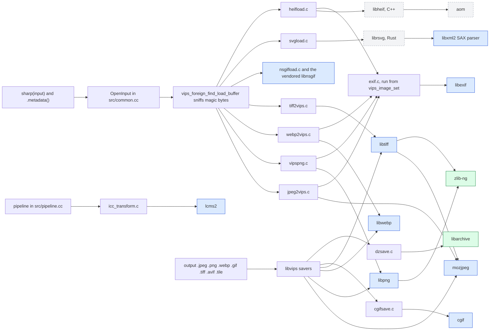
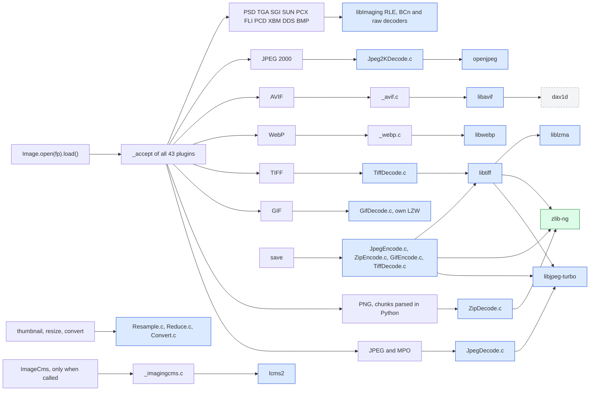

# Which C code Sharp and Pillow actually run on untrusted images

## How this list was made {#evidence}

Nothing here is taken from package descriptions or vulnerability feeds. Every path was checked two ways:

1. **What ships.** `sharp@0.35.5` was installed from npm and Pillow 13.0.0 from PyPI on Linux x86_64. For Sharp we read `sharp.versions` and `sharp.format` and inspected the prebuilt `libvips-cpp` binary (it links only the C runtime; every image library is bundled inside, and its only JPEG implementation is mozjpeg). For Pillow we read `PIL.features` and the bundled `pillow.libs/` directory.
2. **Who calls what.** In the latest upstream sources we listed every external function each caller invokes: Sharp's `src/common.cc` and `src/pipeline.cc`, libvips' `foreign/` and `colour/` modules, Pillow's `src/_imaging.c`, `src/_webp.c`, `src/_avif.c`, `src/_imagingcms.c` and `src/libImaging/`, and librsvg's XML loader.

Two facts decide reachability. Sharp picks a loader with `vips_foreign_find_load_buffer`, and Pillow's `Image.open` tries every registered plugin. Both look at the file's magic bytes, never its name, so **every decoder they enable is reachable from an upload**.

## Sharp {#sharp}

Green: already has a project with recorded progress. Blue: selected proof target. Grey dashed: on the path but not planned (Rust, C++, or a very large codec).

| Sharp call | libvips code | C library | Functions the caller uses |
| --- | --- | --- | --- |
| JPEG in, `.jpeg()` | `jpeg2vips.c`, `vips2jpeg.c` | mozjpeg | `jpeg_read_header`, `jpeg_start_decompress`, `jpeg_read_scanlines` with `scale_denom` 2/4/8; `jpeg_write_scanlines`, `jpeg_c_set_int_param` |
| PNG in, `.png()` | `vipspng.c` | libpng → zlib-ng | `png_read_info`, `png_read_row`, `png_read_image`, `png_get_iCCP`, `png_get_eXIf_1`; `png_write_info`, `png_write_rows` |
| WebP in, `.webp()` | `webp2vips.c`, `webpsave.c` | libwebp | `WebPDecode`, `WebPDemux`, `WebPDemuxGetFrame`; `WebPEncode`, `WebPAnimEncoderAdd` |
| TIFF in, `.tiff()` | `tiff2vips.c`, `vips2tiff.c` | libtiff | `TIFFClientOpenExt`, `TIFFReadDirectory`, `TIFFReadTile`, `TIFFReadEncodedStrip`, `TIFFRGBAImageGet`; `TIFFWriteScanline` |
| GIF in | `nsgifload.c` | vendored libnsgif | `nsgif_data_scan`, `nsgif_frame_decode` |
| `.gif()` | `cgifsave.c` | cgif | `cgif_newgif`, `cgif_addframe`, `cgif_close` |
| any input with EXIF | `exif.c` | libexif | `exif_data_new_from_data`, `exif_data_load_data`, `exif_entry_get_value`, `exif_data_save_data` |
| any input with an ICC profile, CMYK | `icc_transform.c` | lcms2 | `cmsOpenProfileFromMem`, `cmsCreateTransform`, `cmsDoTransform` |
| SVG in | `svgload.c` → librsvg | libxml2 | `xmlCreateIOParserCtxt`, `xmlParseDocument` |

SVG and HEIF/AVIF loaders are marked untrusted inside libvips, but Sharp accepts them unless the application sets `VIPS_BLOCK_UNTRUSTED` or calls `sharp.block()`. PNG goes through libpng because Sharp's libvips is built with `-Dspng=disabled`.

## Pillow {#pillow}

| Format | Pillow C code | C library | Functions the caller uses |
| --- | --- | --- | --- |
| JPEG, MPO | `libImaging/JpegDecode.c`, `JpegEncode.c` | libjpeg-turbo | `jpeg_read_header`, `jpeg_start_decompress`, `jpeg_read_scanlines`; `jpeg_write_scanlines` |
| PNG, APNG | `libImaging/ZipDecode.c`, `ZipEncode.c` | zlib-ng | `inflateInit`, `inflate`, `inflateEnd`; `deflateInit2`, `deflate` |
| GIF | `libImaging/GifDecode.c`, `GifEncode.c` | none | Pillow's own LZW |
| TIFF | `libImaging/TiffDecode.c` | libtiff (+ liblzma) | `TIFFClientOpen`, `TIFFReadEncodedStrip`, `TIFFReadTile`, `TIFFRGBAImageGet`; `TIFFWriteScanline`, `TIFFMergeFieldInfo` |
| WebP | `src/_webp.c` | libwebp | `WebPAnimDecoderNew`, `WebPAnimDecoderGetNext`; `WebPEncode`, `WebPAnimEncoderAdd` |
| AVIF | `src/_avif.c` | libavif → dav1d | `avifDecoderParse`, `avifDecoderNthImage`, `avifImageYUVToRGB` |
| JPEG 2000 | `libImaging/Jpeg2KDecode.c` | openjpeg | `opj_read_header`, `opj_read_tile_header`, `opj_decode_tile_data` |
| PSD, TGA, SGI, SUN, PCX, FLI, PCD, XBM, DDS, BMP and others | `PackDecode.c`, `TgaRleDecode.c`, `SgiRleDecode.c`, `SunRleDecode.c`, `PcxDecode.c`, `FliDecode.c`, `PcdDecode.c`, `XbmDecode.c`, `BcnDecode.c`, `RawDecode.c`, `Unpack.c` | none | Pillow's own decoders |

Pillow does not use libpng or libexif: PNG chunks and EXIF are parsed in Python. A few decoders (BMP RLE, QOI, XPM, FITS, MSP, PPM text) are written in Python and are not C targets.

## Selected proof targets {#targets}

| Library | Reached from | Status |
| --- | --- | --- |
| zlib-ng | Sharp (PNG, TIFF), Pillow (PNG, TIFF) | [recorded progress](../zlib-ng/en/progress.html) |
| libarchive | Sharp `.tile()` zip output | [recorded progress](../libarchive/en/progress.html) |
| libvips (loaders, vendored GIF decoder, EXIF and ICC glue) | every Sharp call | not done |
| mozjpeg | Sharp JPEG in and out | not done |
| libpng | Sharp PNG in and out | not done |
| libwebp | Sharp and Pillow WebP | not done |
| libtiff | Sharp and Pillow TIFF | not done |
| libexif | Sharp, every input with EXIF | not done |
| lcms2 | Sharp, every input with an ICC profile | not done |
| cgif | Sharp `.gif()` | not done |
| libxml2 | Sharp SVG input | not done |
| Pillow `libImaging` | every Pillow open, resize and save | not done |
| libjpeg-turbo | Pillow JPEG | not done |
| libavif | Pillow AVIF | not done |
| openjpeg | Pillow JPEG 2000 | not done |
| liblzma (xz) | Pillow LZMA-compressed TIFF, Python `lzma` | not done |
| bzip2, lz4 | Python `bz2`, python-lz4, libarchive | not done |

zlib, zstd, brotli and the 7-Zip SDK keep their existing scopes and are not listed again here.

## Checked and left out {#excluded}

| Library | Why it is not a target |
| --- | --- |
| libspng | Sharp's libvips is built with `-Dspng=disabled`; Pillow does not use it |
| expat | in Sharp it only reads `.vips` files from a path and fontconfig configuration; Pillow does not bundle it |
| FreeType | renders fonts chosen by the application, not uploaded fonts |
| librsvg | Rust; its C dependency libxml2 is a target |
| libheif, aom, dav1d | C++ or very large AV1 codecs; deferred |
| libimagequant | encode-side palette reduction in Sharp; deferred |
