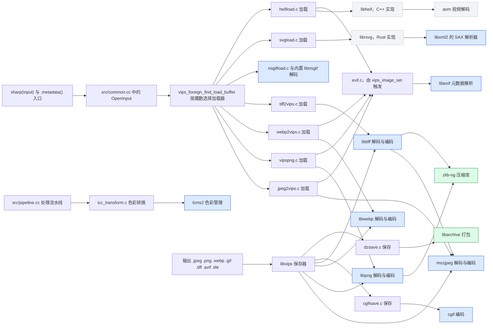
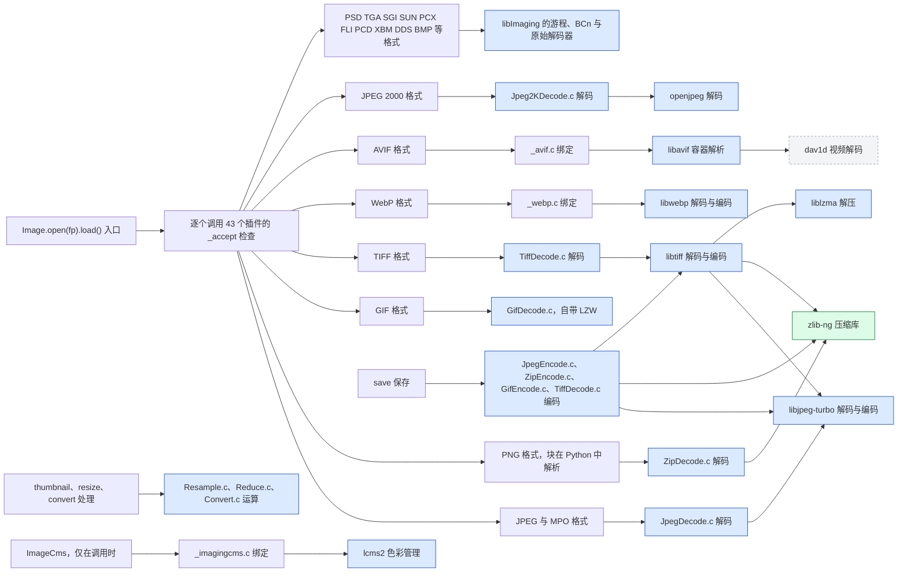

# Sharp 和 Pillow 处理不可信图像时真正运行的 C 代码

## 这份清单怎么得来 {#evidence}

这里没有任何一条来自包描述或漏洞库，每条路径都用两种方式核对过：

1. **实际发布了什么。** 在 Linux x86_64 上用 npm 安装 `sharp@0.35.5`，用 PyPI 安装 Pillow 13.0.0。Sharp 一侧读取 `sharp.versions` 与 `sharp.format`，并检查预编译的 `libvips-cpp` 二进制：它只动态链接 C 运行库，所有图像库都静态打包在内，其中唯一的 JPEG 实现是 mozjpeg。Pillow 一侧读取 `PIL.features` 和打包的 `pillow.libs/` 目录。
2. **谁调用了什么。** 在各上游仓库最新源码中，列出每个调用方实际调用的外部函数：Sharp 的 `src/common.cc` 与 `src/pipeline.cc`，libvips 的 `foreign/` 与 `colour/` 模块，Pillow 的 `src/_imaging.c`、`src/_webp.c`、`src/_avif.c`、`src/_imagingcms.c` 与 `src/libImaging/`，以及 librsvg 的 XML 加载器。

决定能否到达的是两个事实：Sharp 用 `vips_foreign_find_load_buffer` 选择加载器，Pillow 的 `Image.open` 会逐个尝试所有已注册插件。两者都只看文件开头的魔数，从不看文件名，所以**它们启用的每一个解码器都能被上传的文件触达**。

## Sharp 调用链 {#sharp}

绿色：已有项目且有进度记录。蓝色：选定的证明目标。灰色虚线：在路径上但不计划证明（Rust、C++ 或体量很大的编解码器）。

| Sharp 调用 | libvips 代码 | C 库 | 调用方实际使用的函数 |
| --- | --- | --- | --- |
| JPEG 输入、`.jpeg()` | `jpeg2vips.c`、`vips2jpeg.c` | mozjpeg | `jpeg_read_header`、`jpeg_start_decompress`、`jpeg_read_scanlines`（`scale_denom` 取 2/4/8）；`jpeg_write_scanlines`、`jpeg_c_set_int_param` |
| PNG 输入、`.png()` | `vipspng.c` | libpng → zlib-ng | `png_read_info`、`png_read_row`、`png_read_image`、`png_get_iCCP`、`png_get_eXIf_1`；`png_write_info`、`png_write_rows` |
| WebP 输入、`.webp()` | `webp2vips.c`、`webpsave.c` | libwebp | `WebPDecode`、`WebPDemux`、`WebPDemuxGetFrame`；`WebPEncode`、`WebPAnimEncoderAdd` |
| TIFF 输入、`.tiff()` | `tiff2vips.c`、`vips2tiff.c` | libtiff | `TIFFClientOpenExt`、`TIFFReadDirectory`、`TIFFReadTile`、`TIFFReadEncodedStrip`、`TIFFRGBAImageGet`；`TIFFWriteScanline` |
| GIF 输入 | `nsgifload.c` | 内置 libnsgif | `nsgif_data_scan`、`nsgif_frame_decode` |
| `.gif()` | `cgifsave.c` | cgif | `cgif_newgif`、`cgif_addframe`、`cgif_close` |
| 任何带 EXIF 的输入 | `exif.c` | libexif | `exif_data_new_from_data`、`exif_data_load_data`、`exif_entry_get_value`、`exif_data_save_data` |
| 任何带 ICC 配置或 CMYK 的输入 | `icc_transform.c` | lcms2 | `cmsOpenProfileFromMem`、`cmsCreateTransform`、`cmsDoTransform` |
| SVG 输入 | `svgload.c` → librsvg | libxml2 | `xmlCreateIOParserCtxt`、`xmlParseDocument` |

libvips 把 SVG 与 HEIF/AVIF 加载器标为不可信，但除非应用设置 `VIPS_BLOCK_UNTRUSTED` 或调用 `sharp.block()`，Sharp 默认都会接受。PNG 走 libpng，是因为 Sharp 所用的 libvips 以 `-Dspng=disabled` 构建。

## Pillow 调用链 {#pillow}

| 格式 | Pillow 的 C 代码 | C 库 | 调用方实际使用的函数 |
| --- | --- | --- | --- |
| JPEG、MPO | `libImaging/JpegDecode.c`、`JpegEncode.c` | libjpeg-turbo | `jpeg_read_header`、`jpeg_start_decompress`、`jpeg_read_scanlines`；`jpeg_write_scanlines` |
| PNG、APNG | `libImaging/ZipDecode.c`、`ZipEncode.c` | zlib-ng | `inflateInit`、`inflate`、`inflateEnd`；`deflateInit2`、`deflate` |
| GIF | `libImaging/GifDecode.c`、`GifEncode.c` | 无 | Pillow 自带的 LZW |
| TIFF | `libImaging/TiffDecode.c` | libtiff（另含 liblzma） | `TIFFClientOpen`、`TIFFReadEncodedStrip`、`TIFFReadTile`、`TIFFRGBAImageGet`；`TIFFWriteScanline`、`TIFFMergeFieldInfo` |
| WebP | `src/_webp.c` | libwebp | `WebPAnimDecoderNew`、`WebPAnimDecoderGetNext`；`WebPEncode`、`WebPAnimEncoderAdd` |
| AVIF | `src/_avif.c` | libavif → dav1d | `avifDecoderParse`、`avifDecoderNthImage`、`avifImageYUVToRGB` |
| JPEG 2000 | `libImaging/Jpeg2KDecode.c` | openjpeg | `opj_read_header`、`opj_read_tile_header`、`opj_decode_tile_data` |
| PSD、TGA、SGI、SUN、PCX、FLI、PCD、XBM、DDS、BMP 等 | `PackDecode.c`、`TgaRleDecode.c`、`SgiRleDecode.c`、`SunRleDecode.c`、`PcxDecode.c`、`FliDecode.c`、`PcdDecode.c`、`XbmDecode.c`、`BcnDecode.c`、`RawDecode.c`、`Unpack.c` | 无 | Pillow 自带的解码器 |

Pillow 不使用 libpng 和 libexif：PNG 块与 EXIF 都在 Python 中解析。少数解码器（BMP 游程、QOI、XPM、FITS、MSP、文本 PPM）用 Python 编写，不是 C 证明目标。

## 选定的证明目标 {#targets}

| 库 | 由谁触达 | 状态 |
| --- | --- | --- |
| zlib-ng | Sharp（PNG、TIFF）、Pillow（PNG、TIFF） | [已有进度记录](../zlib-ng/zh/progress.html) |
| libarchive | Sharp 的 `.tile()` 压缩包输出 | [已有进度记录](../libarchive/zh/progress.html) |
| libvips（加载器、内置 GIF 解码器、EXIF 与 ICC 衔接代码） | Sharp 的每一次调用 | 未完成 |
| mozjpeg | Sharp 的 JPEG 输入与输出 | 未完成 |
| libpng | Sharp 的 PNG 输入与输出 | 未完成 |
| libwebp | Sharp 与 Pillow 的 WebP | 未完成 |
| libtiff | Sharp 与 Pillow 的 TIFF | 未完成 |
| libexif | Sharp 中每个带 EXIF 的输入 | 未完成 |
| lcms2 | Sharp 中每个带 ICC 配置的输入 | 未完成 |
| cgif | Sharp 的 `.gif()` | 未完成 |
| libxml2 | Sharp 的 SVG 输入 | 未完成 |
| Pillow 的 `libImaging` | Pillow 的每次打开、缩放与保存 | 未完成 |
| libjpeg-turbo | Pillow 的 JPEG | 未完成 |
| libavif | Pillow 的 AVIF | 未完成 |
| openjpeg | Pillow 的 JPEG 2000 | 未完成 |
| liblzma（xz） | Pillow 的 LZMA 压缩 TIFF、Python 的 `lzma` 模块 | 未完成 |
| bzip2、lz4 | Python 的 `bz2` 模块、python-lz4、libarchive | 未完成 |

zlib、zstd、brotli 与 7-Zip SDK 保持各自原有范围，这里不再重复列出。

## 核对后排除的库 {#excluded}

| 库 | 不作为目标的原因 |
| --- | --- |
| libspng | Sharp 所用的 libvips 以 `-Dspng=disabled` 构建；Pillow 也不使用 |
| expat | 在 Sharp 中只读取从路径打开的 `.vips` 文件与 fontconfig 配置；Pillow 没有打包它 |
| FreeType | 渲染的是应用选定的字体，而不是上传的字体 |
| librsvg | Rust 实现；它依赖的 C 库 libxml2 已列为目标 |
| libheif、aom、dav1d | C++ 实现或体量很大的 AV1 编解码器，暂缓 |
| libimagequant | Sharp 编码时的调色板量化，暂缓 |
